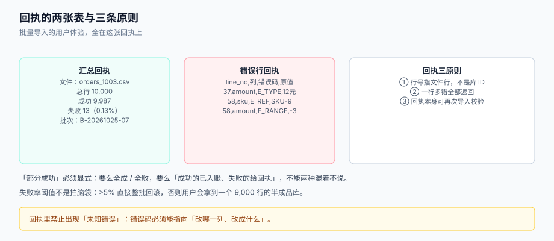

# 行级校验与错误回执

解析把文件变成了「一条条字段」，但**字段合法不等于数据可用**：`sku` 是字符串没错，可它在商品表里不存在；`price` 是数字没错，可它是负数；两行都合法，可它们写的是同一个 SKU。校验段要回答的是「这一行能不能入账」，回执段要回答的是「不能入账的那几行，用户怎么改」。

这两件事必须一起设计：**校验的颗粒度决定了回执好不好用**。一行只报一个错，用户要改 3 轮；一行报全部错，用户一次改完——差别不在技术，在回执结构。



本页判据族 `BDR-A` ~ `BDR-H`，共 8 条。定义表在第七节。

## 一、校验的四层，顺序不能乱

| 层 | 校验什么 | 依赖 | 失败代价 | 例子 |
| --- | --- | --- | --- | --- |
| **L1 语法** | 能否按契约解析成目标类型 | 只看本行 | 极低 | `price=12元` → `E_TYPE` |
| **L2 单行语义** | 范围、长度、枚举、格式 | 只看本行 | 低 | `price=-3` → `E_RANGE` |
| **L3 引用** | 外键是否存在、状态是否允许 | 需要查库/查缓存 | 中 | `sku=SKU-9999` 不存在 → `E_REF` |
| **L4 批内一致性** | 文件内重复、跨行合计、顺序依赖 | 需要看**整批** | 高 | 同一 `sku` 出现两次 → `E_DUP_IN_FILE` |

顺序的意义在于**代价**：L1/L2 是纯内存计算，几万行毫秒级；L3 要查库，必须批量化（一次 `IN` 查询，不要逐行查）；L4 需要维护批内状态，只能在 L1~L3 都过了之后做。

::: danger 注意
1. **不要逐行查库**。10,000 行逐行 `select` 在本机是秒级到十秒级，而一次 `where sku in (...)` 分批 1,000 个是毫秒级；更麻烦的是逐行查会把连接池占满，把在线业务拖慢。做法：先收集本批全部 `sku`，分批 `IN` 查询建内存集合，再逐行判定。
2. **不要「遇到第一个错就返回」**。用户拿到「第 37 行金额格式错」，改完再传，又被告知「第 58 行 SKU 不存在」——这是最典型的体验灾难。**一行内的所有错都要收集**，一份回执给全。
3. **不要把 L4 放到数据库唯一索引上兜底**。唯一索引报的是「整个事务失败」，你拿不到「文件里第几行和第几行冲突」，回执只能写「违反唯一约束」。
:::

## 二、错误码：必须能指向「改哪一列、改成什么」

错误码不是日志分类，是**给用户的修改指令**。所以它至少包含四段信息：

```text
E_<类别>_<细节>   +   列名   +   行号   +   原值   +   期望
```

| 错误码 | 含义 | 用户的下一步动作 | 是否可自动修复 |
| --- | --- | --- | --- |
| `E_TYPE` | 类型不匹配（`12元`） | 去掉单位，只填数字 | 否 |
| `E_REQUIRED` | 必填为空 | 补值 | 否 |
| `E_RANGE` | 超出范围（`price < 0`） | 改成合法值 | 否 |
| `E_ENUM` | 枚举外取值（`在售=maybe`） | 改成契约里的取值之一 | 半自动（可给候选） |
| `E_LENGTH` | 超长（备注 500 字） | 截断或拆分 | 半自动（可截断，但要告知） |
| `E_REF` | 引用不存在（`sku=SKU-9`） | 先建商品，或改编码 | 否 |
| `E_DUP_IN_FILE` | 文件内重复 | 删掉重复行 | 半自动（可标出所有行号） |
| `E_UNIQUE_DB` | 与库里已有数据冲突，且策略是「拒绝」 | 确认是否覆盖 | 否 |

`E_ENUM` 与 `E_DUP_IN_FILE` 值得特别对待：它们的信息量天然是「多个候选」或「多个行号」，回执里要把这些一起给出来，否则用户还要自己去找。

## 三、一行报多个错：实现与结构

```python [app/validate/row.py]
from dataclasses import dataclass

@dataclass
class RowError:
    line_no: int
    column: str
    code: str
    value: str
    hint: str

def validate_row(line_no: int, raw: dict[str, str], ctx) -> list[RowError]:
    """收集本行全部错误，不做「短路返回」。"""
    errs: list[RowError] = []
    out: dict[str, object] = {}

    for col in ctx.contract.columns:
        v = raw.get(col.name, "")
        if v == "":
            if col.required:
                errs.append(RowError(line_no, col.name, "E_REQUIRED", "", "该列必填"))
            continue
        try:
            out[col.name] = col.parse(v)          # L1
        except ValueError as e:
            errs.append(RowError(line_no, col.name, "E_TYPE", v, str(e)))
            continue
        if not col.in_range(out[col.name]):        # L2
            errs.append(RowError(line_no, col.name, "E_RANGE", v, col.range_hint()))
    # L3：引用校验放在批级做（先收集 sku，再统一查），这里只登记
    return errs
```

L3 的批量化写法：

```python [app/validate/reference.py]
def check_refs(rows: list[dict], repo) -> dict[int, list[RowError]]:
    skus = {r["sku"] for r in rows if "sku" in r}
    existing = repo.find_existing_skus(skus)        # 分批 IN，每批 <= 1000
    bad: dict[int, list[RowError]] = {}
    for r in rows:
        if r["sku"] not in existing:
            bad.setdefault(r["_line_no"], []).append(
                RowError(r["_line_no"], "sku", "E_REF", r["sku"], "商品不存在，请先建档"))
    return bad
```

L4 的批内重复判定要注意口径：**「重复」要不要算错，取决于业务键的语义**。价目表里 `(sku, effective_date)` 重复是错；库存流水里同一个 SKU 出现多次是正常。所以 `E_DUP_IN_FILE` 的判定依据是**契约里声明的唯一键组合**，不是「这一列看起来该唯一」。

## 四、部分成功：三种策略与「阈值」

| 策略 | 语义 | 用户看到 | 适合 |
| --- | --- | --- | --- |
| **全成或全败**（atomic） | 任一行失败 → 整批回滚 | 「0 行导入，13 行有错」 | 财务凭证、对账文件：半个结果没有意义 |
| **部分成功**（partial） | 合法行入账，非法行进回执 | 「9,987 行成功，13 行失败」 | 商品价目、客户名单：能进多少先进多少 |
| **全部待审**（staging） | 全部进待修正区，人工确认后入账 | 「10,000 行待确认」 | 高价值、低频、必须双人复核 |

选哪种是**业务决定**，但工程上必须显式声明，并写进批次记录（`import_batch.mode`）。三种策略的混用是最糟的：接口说「部分成功」，财务以为「要么全进要么不进」，于是对不上账时没人知道该信哪个。

**阈值的作用**是给「部分成功」加一道保险：

| 失败率 | 处置 | 理由 |
| --- | --- | --- |
| 0 | `SUCCEEDED` | 正常 |
| 0 < r ≤ 5% | `PARTIAL` + 回执 | 少量脏行，用户能改 |
| 5% < r ≤ 30% | `PARTIAL`，但**要求确认**才入账 | 大概率是模板用错，先别写库 |
| r > 30% | **整批拒绝**，`FAILED` | 这已经不是「几行脏数据」，是「文件不对」 |

本机实测给了一个很直观的量级：5,000 行里第 4,999 行非法时，**整批一个事务 → 入账 0 行**；批 500 → 9,500 行；批 100 → 9,900 行。阈值和事务粒度是两件事：阈值决定「要不要继续」，事务粒度决定「回滚多少」。

## 五、回执：两张表 + 一条守恒式

回执必须是**机器可读的文件**（CSV），而不是一段 JSON 日志。原因很实际：用户要拿它去筛自己的 Excel。

**表 1：汇总回执**（一行）

```text
batch_no,file_name,total_rows,success_rows,error_rows,error_rate,mode,started_at,finished_at
B-20261025-07,orders_1003.csv,10000,9987,13,0.13%,partial,2026-10-25T10:02:11+08:00,2026-10-25T10:02:19+08:00
```

**表 2：错误行回执**（每错一行一行；一行多错就多行）

```text
line_no,column,code,value,hint
37,price,E_TYPE,12元,只填数字，不要带单位
58,sku,E_REF,SKU-9999,商品不存在，请先建档
58,price,E_RANGE,-3,单价必须大于 0
```

两条设计要点：

1. **`line_no` 是文件行号**（含表头），与 Excel 左侧行号一致——见[文件契约](../FileContract/index.md)第六节。
2. **同一行的多个错分多行输出**，`line_no` 重复。这样用户在 Excel 里按 `line_no` 排序就能看到「这行有 2 个问题」，比塞进一个单元格用 `;` 分隔好处理得多。

而**守恒式**是回执与数据库之间唯一的桥：

```sql
-- 必须有且只有一个等式成立
SELECT b.total_rows,
       b.success_rows,
       b.error_rows,
       b.total_rows = b.success_rows + b.error_rows AS balanced
FROM import_batch b
WHERE b.batch_no = 'B-20261025-07';
```

`balanced = true` 才算这一批「说得清」。如果 `success_rows` 是程序里累加出来的、而库里实际只多了 9,900 行，那么这条等式仍然成立（因为两个数都来自同一个错误计数）——所以验收时要用**独立来源**再核一次：

```sql
-- 独立来源：库里实际属于这批的行数
SELECT count(*) FROM product_price WHERE import_batch_no = 'B-20261025-07';
```

两个数必须相等，否则说明「回执在说谎」。这正是 `BDR-F` 要抓的东西。

## 六、待修正区（staging）：什么时候值得做

「部分成功 + 回执」有一个天然缺口：**用户要重新准备一个只含修正行的文件**。对 10,000 行里的 13 行，这意味着他要在 Excel 里筛出来、改完、再拼回去——很容易在拼接时把行号搞乱。

待修正区的做法是：非法行**也入一张表**（`import_staging`），带原值、错误码、批次号；用户在页面上直接改这几行，改完点「重试」，系统只重跑这些行。

| 方案 | 实现成本 | 用户体验 | 适合 |
| --- | --- | --- | --- |
| 只给回执 | 低 | 用户自己拼文件 | 低频、错误少 |
| 回执 + 待修正区 | 中（多一张表 + 一个改行接口） | 站内改完即重试 | 高频、错误多 |
| 全量待审 | 高（审核流 + 权限） | 双人复核 | 财务、合规 |

顺带一个纪律：**待修正区里的行在重试成功之前，不能被任何下游读到**。这就要求它和正式表在物理上分开（不同表或不同 `status`），而不是靠在查询里到处加 `where status = 'ok'`。

## 七、本页判据

| 编号 | 看什么现象 | 判成什么 | 不满足时改哪里 |
| --- | --- | --- | --- |
| `BDR-A` | 校验是否分层（语法/单行/引用/批内），且引用校验是否批量化 | 逐行查库即失败 | 收集键 → 分批 `IN` → 内存判定 |
| `BDR-B` | 一行内的多个错误是否全部返回 | 遇错即返回即失败 | 用错误列表累积，不短路 |
| `BDR-C` | 错误码是否能指向「列 + 期望」 | 只给「数据不合法」即失败 | 按第二节改造错误码与 hint |
| `BDR-D` | 批次是否记录 `mode`（atomic/partial/staging） | 未声明即失败 | 批次表加 `mode` 列，回执带上 |
| `BDR-E` | 是否有失败率阈值与 >30% 整批拒绝 | 无阈值即失败 | 加三档阈值，超限置 `FAILED` |
| `BDR-F` | 回执的成功行数是否与库内实际行数（独立查询）一致 | 只信程序计数即失败 | 用 `import_batch_no` 独立 count 对账 |
| `BDR-G` | 回执是否为 CSV 文件，`line_no` 与 Excel 行号一致 | JSON 日志即失败 | 生成 CSV，行号用物理行 |
| `BDR-H` | 待修正区（若存在）是否与正式表物理隔离，且重试只跑差异行 | 靠查询条件隔离即失败 | 独立表 + 行级重试 |

## 与「履约交付与承运商集成工程」的分工（第 210 天补充）

本页管**文件里的每一行怎么校验、错误怎么回执**；[承运商账单核对](../../ShippingCarrier/InvoiceAudit/index.md)管**这些行算出来的钱对不对**。账单文件是本页最典型的输入之一：

| 问题 | 归本页 | 归履约交付专题 |
| --- | --- | --- |
| 编码、分隔符、引号 | 本页 | 不涉及 |
| 必填字段与类型 | 本页 | 要求 `waybill_no` 必须是必填（否则调整行无法回指） |
| 行级错误回执 | 本页 | 争议清单的行号来源 |
| 金额对不对 | 不涉及 | 三层核对与六类差异 |

::: danger 本页特有的一个坑
**把调整行的原始运单号当「可选字段」**。承运商的调整单常常只带调整单号与金额，运单号藏在备注或附件里；一旦校验时允许它为空，这条差异就永远无法与你的发货记录关联，只能整笔接受。**宁可整批退回，也不要放过一行没有运单号的调整**。
:::

## 与「采购到付款（P2P）与三单匹配工程」的分工（第 224 天补充）

| 这件事 | 本页负责 | [采购到付款专题](../../ProcureToPay/index.md) 负责 |
| --- | --- | --- |
| 文件结构 | 编码、分隔符、表头、行数 | 供应商价目表 / ASN / 对账单的业务字段定义 |
| 行级校验 | 类型、范围、枚举、批内重复、外键存在性 | 「这一行能不能入账」的业务判据（如允收上限） |
| 回执 | 行号 + 列名 + 原值 + 期望值 | 回执里的业务键（`po_no + po_line_no`）如何回到单据 |
| 幂等重跑 | 批次号 + 文件哈希 | 导入后的单据状态迁移（如收货过账） |

一句话：**本页保证「文件被正确读懂」，P2P 保证「读懂之后该不该收」**。

::: danger 本页特有的一个坑（与 P2P 相关）
**回执里的行号必须能映射回业务键**。供应商的 ASN 往往按「箱」而不是按「订单行」组织，只给文件行号，运营拿到回执后无法定位是哪张订单的哪一行；正确做法是在解析阶段就把 `po_no + po_line_no` 解析成结构化字段，回执同时给「文件第 N 行」与「订单 PO-1001 第 3 行」。只给文件行号的回执，最终都会变成「请把原始文件再发我一次」。
:::

## 与「供应商协同与价格主数据工程」的分工（第 225 天补充）

| 维度 | 本页（行级校验） | [料号与价格主数据](../../SupplierCollaboration/PriceMaster/index.md) |
| --- | --- | --- |
| 校验对象 | 文件里的每一行：类型、必填、编码、长度 | 一行价目**在业务上是否成立**：料号可映射、单位可换算 |
| 判据 | 行级错误码与回执 | 映射唯一性、`factor` 唯一来源、MOQ/增量 |
| 失败形态 | 整批拒绝或部分入库 | 入库成功但价格永远是错的（安静） |
| 回执给谁 | 上传者 | **对方**（供应商要在门户看到「哪一行不认」） |

**一页一坑**：行级校验最容易漏的一类错误是「格式全对、业务全错」——`supplier_sku` 是合法字符串、数量是合法数字、单价是两位小数，但那个 SKU 在我方映射表里不存在（或已过期）。这类行如果只做格式校验就会全部入库，然后在第一次对账时炸出几百条差异。正确做法是把映射存在性作为**行级错误**（而不是警告），并在回执里给出「我方建议的 `item_id` 候选」。

## 参考资料

- [文件契约：模板、列定义与版本](../FileContract/index.md)（唯一键组合决定 `E_DUP_IN_FILE` 的口径）
- [幂等重跑、批次状态机与断点](../IdempotentRerun/index.md)（重试与部分成功的关系）
- [实战：一个能跑起来的最小交换链路](../Practice/index.md)（三张表 + 五步流水）
- OWASP WSTG《Testing for CSV Injection》（回执文件同样是「导出」，同样要做前缀处理）：<https://owasp.org/www-project-web-security-testing-guide/latest/4-Web_Application_Security_Testing/07-Injection/21-CSV_Injection>
- PostgreSQL 18 文档《INSERT ... ON CONFLICT》（upsert 与唯一约束的语义）：<https://www.postgresql.org/docs/18/sql-insert.html>
