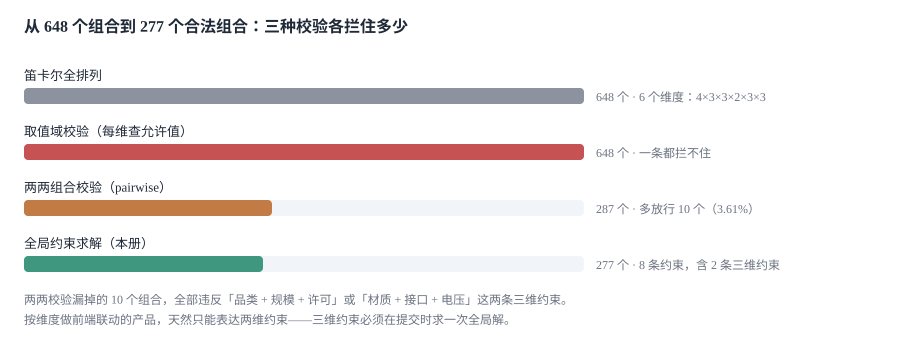

# 产品模型与配置规则

同一个产品在三个地方有三套说法：产品经理的 PPT 上说「六种配置维度」，销售的报价模板上是 12 个 SKU，工厂的 BOM 里是 87 个物料。

**三套说法都不是「模型」——模型是那个能回答「这个组合到底存不存在」的东西。**

::: tip 一句话理解
配置模型的核心不是「有哪些选项」，而是**「哪些选项不能同时出现」**；前者是界面，后者是约束。约束写不全，配置器就只是一个把下拉框排版得更好看的表单。
:::

本页判据族 `CQC-A` ~ `CQC-H`，共 8 条。定义表在第八节「本页判据」。

## 一、五个概念，一个都不能省

| 概念 | 表 | 说明 | 省掉的后果 |
| --- | --- | --- | --- |
| 产品模型 | `product_model` | 一个可配置产品的身份与版本 | 升版后旧报价无法解释 |
| 维度 | `cfg_dim` | 可配置的自由度（品类、规模、材质……） | 维度硬编码在页面里，加一个要发版 |
| 选项 | `cfg_option` | 每个维度的取值，含默认值 | 默认值散落在代码里，两处不一致 |
| 约束 | `cfg_rule` | 选项之间的禁止/依赖关系 | 前端只能表达两维 |
| 配置快照 | `quote_line.cfg_json` | 一次报价当时的那套组合 | 无法复现「当时客户选的是什么」 |

```sql
CREATE TABLE product_model(
  model_id   TEXT PRIMARY KEY,
  name       TEXT NOT NULL,
  version    INTEGER NOT NULL DEFAULT 1,
  status     TEXT NOT NULL CHECK (status IN ('DRAFT','RELEASED','RETIRED'))
);

CREATE TABLE cfg_dim(
  model_id   TEXT NOT NULL REFERENCES product_model(model_id),
  dim_code   TEXT NOT NULL,
  ord        INTEGER NOT NULL,          -- 决定界面顺序，也决定求解顺序
  PRIMARY KEY (model_id, dim_code)
);

CREATE TABLE cfg_option(
  model_id   TEXT NOT NULL,
  dim_code   TEXT NOT NULL,
  opt_code   TEXT NOT NULL,
  is_default INTEGER NOT NULL DEFAULT 0 CHECK (is_default IN (0,1)),
  PRIMARY KEY (model_id, dim_code, opt_code),
  FOREIGN KEY (model_id, dim_code) REFERENCES cfg_dim(model_id, dim_code)
);
```

三张表看着平平无奇，但 `cfg_option` 的主键写错一次就会出问题：主键若是 `opt_code`，两个维度里的同名选项（比如 `std` 同时出现在「材质」和「接口」）会互相覆盖，界面上少一个选项，**而没有任何报错**。

## 二、约束的三种形态

| 形态 | 表达 | 例子 | 能放在前端吗 |
| --- | --- | --- | --- |
| `FORBID` | 一组「维度=值」不能同时出现 | `cat=3,size=0`（旗舰不支持入门规模） | 两维的可以，三维的不行 |
| `REQUIRE` | 出现 A 必须出现 B | `iface=2` 要求 `lic>=1` | 可以（联动禁用） |
| `REQUIRES_ONE_OF` | 至少选一个 | 「至少选一种冗余电源」 | 可以（计数） |

约束表的 `body` 用「维度=值,维度=值」的扁平写法，而不是存 JSON 表达式——原因是**业务要能改**：

```sql
CREATE TABLE cfg_rule(
  rule_id    TEXT PRIMARY KEY,
  model_id   TEXT NOT NULL REFERENCES product_model(model_id),
  kind       TEXT NOT NULL CHECK (kind IN ('FORBID','REQUIRE','REQUIRES_ONE_OF')),
  body       TEXT NOT NULL,            -- 'cat=3,size=0'
  message    TEXT NOT NULL             -- 给销售看的人话
);
```

::: danger 约束表最容易犯的三个错
1. **只存「冲突对的哈希」，不存冲突项本身**：`md5('cat=3,size=0')` 能让查表变快，但业务改一条规则时无法知道改的是哪两项，只能重建全表。
2. **`message` 写成错误码**：销售看到的应该是「旗舰版不支持入门规模，请改选标准版或专业版」，不是 `RULE_0042`。
3. **约束只有 `FORBID`**：现实中大量规则是「必须选一个」，用禁止表达会组合爆炸（n 个选项要写 n−1 条禁止规则才能表达「至少选一个」）。
:::

## 三、648 个组合里只有 277 个是真的

本机造了一个 6 维模型：品类 4 × 规模 3 × 材质 3 × 电压 2 × 接口 3 × 许可 3 = **648 个理论组合**，写了 8 条约束（6 条两维 + 2 条三维），**合法组合 277 个（42.75%）**。



| 校验方式 | 放行的组合数 | 放进来的非法组合 | 能表达几维约束 |
| --- | --- | --- | --- |
| 每维查允许值 | 648 | **371（全部）** | 一维 |
| 两两组合白名单 | 287 | 10（3.61%） | 两维 |
| 全局求解 | 277 | 0 | 任意维 |

第一行值得停一下：**「每个维度的每个取值都在某些合法组合里出现过」这件事，让按维度做的校验一条都拦不住**。这就是为什么「我们前端每个下拉框都做了禁用」的系统，仍然能提交出非法配置——禁用的是「这个值在这个维度里存不存在」，不是「这个值和其他维度的选择能不能共存」。

两两校验的 10 个漏网组合，全部违反那两条三维约束（`cat=2,size=2,lic=0` 与 `mat=2,iface=2,volt=1`）。这不是实现不好，是**两两组合校验在数学上就表达不了三维约束**。

## 四、求解：回溯比枚举更常用

648 个组合枚举一遍只要 **0.12 ms**（本机读数），所以小模型可以直接枚举。但维度增长是乘法：加一个 4 值的维度就变 2,592，再加一个变 10,368——枚举法在 10 万级开始明显。

生产上更常用的是**回溯 + 剪枝**：

```python
def solve(model, dims, rules, chosen=None, i=0):
    """按 dim_order 依次选值；每选一个就检查已违反的约束，提前剪枝。"""
    chosen = chosen or {}
    if i == len(dims):
        return chosen
    for opt in options_of(model, dims[i]):
        trial = {**chosen, dims[i]: opt}
        if violates(model, rules, trial):     # 只判「已完整」的约束
            continue
        got = solve(model, dims, rules, trial, i + 1)
        if got:
            return got
    return None

def violates(model, rules, partial):
    for r in rules:
        kv = parse_body(r.body)              # {'cat': 3, 'size': 0}
        if all(k in partial for k in kv) and all(partial[k] == v for k, v in kv.items()):
            return True                       # 只判全部维度都已赋值的那条
    return False
```

两个实现细节决定正确性：

1. **`violates` 只能判「所有维度都已赋值」的约束**。半赋值的约束既不能判定为违反，也不能跳过——它需要「未赋值维度还有合法取值吗」的预检查，否则回溯会走进死胡同再退出来，慢但没有错。
2. **维度顺序会改变剪枝效果，但方向不一定是你以为的那个**。本机把全部解枚举一遍：按界面顺序访问 **571 个节点**，把维度按「参与约束数」重排后反而升到 **645 个**——因为这个模型的约束最短也有两维，只有两维都赋值之后才能剪枝，先把「密度最高的维」提到前面，等于让前半程无枝可剪。**排序优化的前提是模型里存在一维约束**；全是两维及以上约束时，按界面顺序通常已经够用。

## 五、配置指纹：同一份配置只能有一个身份

报价单、合同、订单三处各存一份配置，如何判断「是同一份」？

```python
import hashlib, json

def fingerprint(cfg: dict, dims: list[str]) -> str:
    canonical = {k: cfg[k] for k in sorted(dims) if k in cfg}
    return hashlib.sha256(
        json.dumps(canonical, sort_keys=True, ensure_ascii=False, separators=(",", ":")).encode()
    ).hexdigest()[:16]
```

三个动作缺一不可：**排序键**（JSON 对象成员无序）、**补齐缺失维度**（否则「省略默认值」与「全量写」是两个指纹）、**固定分隔符**（`separators` 不固定时，`json.dumps` 的空格差异会改变哈希）。

本机实测：277 个合法组合里，**262 个（94.58%）** 在「省略值为 0 的维度」与「全量写」两种表示下指纹不同。也就是说，如果报价单省略默认值、合同全量写，**94.58% 的合同会被判成「配置不一致」**——或者更糟：系统只比对 `sku`，于是根本发现不了。

## 六、模型版本：升版不等于改内容

`product_model.version` 是数据层面的版本，不是文档层面的版本。升版有两种，处理方式完全不同：

| 升版类型 | 例子 | 旧报价怎么解释 | 实现要求 |
| --- | --- | --- | --- |
| 兼容升版 | 新增一个可选维度（默认值不变） | 用旧版本的维度集解释 | 报价行必须存 `model_version` |
| 不兼容升版 | 删除选项、改约束 | 用旧版本的规则集重放 | 规则表要按版本存，不能覆盖 |

关键一条：**规则表不能物理覆盖**。`cfg_rule` 若只有 `(model_id, rule_id)` 主键，改规则就是 `UPDATE`，旧报价再校验一次就会「变得不合法」——而它在出具时是合法的。

```sql
-- 规则按版本存：主键带上 version，历史行永不修改
CREATE TABLE cfg_rule(
  model_id   TEXT NOT NULL,
  version    INTEGER NOT NULL,
  rule_id    TEXT NOT NULL,
  kind       TEXT NOT NULL,
  body       TEXT NOT NULL,
  message    TEXT NOT NULL,
  PRIMARY KEY (model_id, version, rule_id)
);
```

## 七、配置错误率：9.67% 的单子要退回改配

本机造了 1,200 次下单，其中 **116 次（9.67%）** 在下单后被退回改配。这个比例不算高，但每一次退回都意味着一次重新报价，而重新报价会触发[价格快照更新](../Quote/index.md)——如果报价已经发出，客户手上的版本就作废了。

三种典型退回原因：

| 原因 | 占比（本机 116 次中） | 根因 | 修法 |
| --- | --- | --- | --- |
| 三维约束违反 | 52 | 前端只能两维 | 提交时全局求解 |
| 选项已停产 | 39 | 选项缺少 `status` 字段 | 选项要能停用而不是删除 |
| 整单约束违反 | 25 | 跨行约束没做 | 整单提交时校验 |

「选项已停产」这一条最容易被忽略：如果停产用 `DELETE` 表达，历史报价的 `cfg_json` 会指向一个不存在的选项；正确做法是 `status = 'RETIRED'`，并在新报价中禁用、旧报价中照常显示。

## 八、本页判据

| 判据 | 断言 | 验证方式 |
| --- | --- | --- |
| `CQC-A` | 选项主键含维度，不含全局唯一 | `cfg_option` 主键为 `(model_id, dim_code, opt_code)` |
| `CQC-B` | 约束以「维度=值」扁平串存储 | 能解析出全部参与维度，不需要正则猜 |
| `CQC-C` | 存在至少一条三维约束的求解路径 | 构造三维违反组合，提交被拒 |
| `CQC-D` | 配置指纹先排序再哈希 | 两种写法（省略/全量）指纹相同 |
| `CQC-E` | 报价行存 `model_version` | 该列非空且与出具时版本一致 |
| `CQC-F` | 规则表按版本存，历史行只读 | `cfg_rule` 主键含 version |
| `CQC-G` | 停产选项用状态表达，不删除 | `RETIRED` 选项在历史报价中仍可解析 |
| `CQC-H` | 求解维度顺序可配置，且有实测依据 | 求解器有独立的 `solve_order` 配置，改动前后节点数可比 |

## 验证方式

```shell
# 1. 组合数：648 → 277（跑一次全文枚举，结果必须是确定值）
python3 - <<'PY'
import itertools
dims = [4, 3, 3, 2, 3, 3]
def legal(c):
    cat, size, mat, volt, iface, lic = c
    return not ((cat==3 and size==0) or (volt==1 and mat==2) or (iface==2 and cat in (0,1))
                or (lic==2 and size==2) or (cat==0 and mat==1) or (size==2 and iface==0)
                or (cat==2 and size==2 and lic==0) or (mat==2 and iface==2 and volt==1))
allc = list(itertools.product(*[range(n) for n in dims]))
print(len(allc), sum(1 for c in allc if legal(c)))
PY
# 期望：648 277

# 2. 指纹一致性：省略默认值不该改变身份
python3 -c "
import hashlib, json
f=lambda d: hashlib.sha256(json.dumps(d,sort_keys=True,separators=(',',':')).encode()).hexdigest()[:16]
a={'cat':1,'size':0,'mat':2,'volt':1,'iface':0,'lic':2}
b={k:v for k,v in a.items() if v!=0}
print(f(a)==f(b))"
# 期望：False（证明「省略默认值」会改变指纹——所以必须补齐维度再算）
```

第 2 步的期望值是 `False`，这是刻意的：它证明了「直接对已有键求哈希」是不够的，必须在计算前把缺失维度补成默认值。

## 参考资料

- ISO 8000-110:2021《数据质量 第 110 部分：主数据 特性数据的交换》：属性与取值的交换格式，本页维度/选项的编码方式参考其结构。
- W3C《XML Schema Part 2: Datatypes》与 RFC 8259 第 4 节：成员顺序不保证——配置指纹必须先排序的依据。
- SQLite 官方文档《CREATE TABLE》《Foreign Keys》：复合主键与外键约束在 SQLite 中的行为（含 `PRAGMA foreign_keys` 默认关闭这一点）。
- 与本页相邻：[价格册与定价模型](../Pricing/index.md)、[报价单：版本与有效期](../Quote/index.md)、[实战](../Practice/index.md)。
