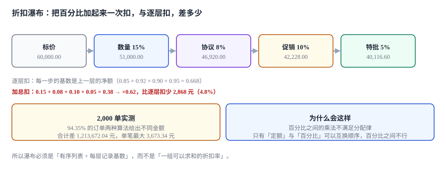

# 折扣瀑布与审批阈值

销售在电话里对客户说：「15 个点，再加协议价，再叠一个限时促销。」三样都写在报价单上，系统给的净额是 37,200，销售的心里预期是 40,116。差的 2,916 元没人在意——直到季度末发现毛利率比预算低了 4.8 个点。

**折扣算错的形态非常统一：每一个折扣单独看都对，合起来是错的。**

::: tip 一句话理解
折扣瀑布是**一个有序的、每层基数为上一层净额的过程**——它和「一组可以求和的折扣率」长得几乎一样，但两者的结果在 94% 的订单上不同。
:::

本页判据族 `CQD-A` ~ `CQD-H`，共 8 条。定义表在第八节「本页判据」。

## 一、三层让价，必须分开列

| 层 | 作用对象 | 谁决定 | 有没有审批 | 记在哪 |
| --- | --- | --- | --- | --- |
| 价格差异 | 价目本身 | 定价部门 | 没有（价目发布即生效） | `price_entry` |
| 规则折扣 | 订单结构 | 商务政策 | 通常没有 | `disc_layer`（自动层） |
| 特批折扣 | 单张报价 | 审批人 | **有** | `disc_layer`（特批层）+ `disc_approval` |

混成一列的后果很具体：报价单上写「折扣 22%」，客户问「为什么不是 25%」，销售答不出；财务要算「特批让了多少」，也算不出——因为 22% 里既有客户专属价的成分，也有一次性让价。

## 二、瀑布：每层记三个数

```sql
CREATE TABLE disc_layer(
  quote_id   TEXT NOT NULL REFERENCES quote(quote_id),
  seq        INTEGER NOT NULL,          -- 顺序是语义的一部分
  layer_code TEXT NOT NULL,             -- QTY / AGREEMENT / PROMO / SPECIAL
  base_amt   REAL NOT NULL,             -- 这一层的基数（上一层净额）
  kind       TEXT NOT NULL CHECK (kind IN ('PCT','AMT')),
  rate       REAL,                      -- PCT 时有值
  amount     REAL NOT NULL,             -- 这一层实际减掉多少
  PRIMARY KEY (quote_id, seq)
);
```

`base_amt` 是最容易被省掉的字段，也是唯一能让人**事后复算**的字段。只存 `rate` 的瀑布，一旦促销改了定义（比如从「10% 折上折」改成「满 5 万减 5 千」），历史报价就再也算不出当时的金额。

三层写成一条有序链：

```text
base_0 = 标价（行金额之和）
base_n = base_{n-1} − amount_{n-1}
amount_n = kind = PCT ? ROUND(base_n × rate, 2) : 定额
净额 = base_N
```

### 一次能手算的对比

标价 60,000，四层：数量 15%、协议 8%、促销 10%、特批 5%。

| 步骤 | 逐层扣（正确） | 加总扣（常见错法） |
| --- | --- | --- |
| 数量 15% | 60,000 → 51,000.00 | — |
| 协议 8% | 51,000 → 46,920.00 | — |
| 促销 10% | 46,920 → 42,228.00 | — |
| 特批 5% | 42,228 → 40,116.60 | 60,000 × (1 − 0.38) = 37,200.00 |
| 差 | **2,916.60（4.8%）** | |



本机 2,000 单实测：**94.35% 的订单两种算法给出不同金额，合计差 1,213,672.04 元，单笔最大 3,673.34 元**。

::: danger 折扣实现的三条硬规则
1. **百分比之间只能乘，不能加**：`0.85 × 0.92 × 0.90 × 0.95 = 0.668`，而 `1 − 0.15 − 0.08 − 0.10 − 0.05 = 0.62`。两个数差 4.8 个点，且**折扣层数越多差越大**。
2. **定额与百分比不可交换**：先减 500 再打 9 折 = `(G−500) × 0.9`；先打 9 折再减 500 = `G × 0.9 − 500`。G = 60,000 时两者差 50 元，G = 6,000 时前者为 4,950、后者为 4,900——**大额单上「先定额」更省，小额单上反过来**。
3. **上限要说明作用在哪个基数上**：「折扣不超过 30%」是按标价算，还是按上一层净额算？按标价算时，叠完 15% + 8% + 10% 已经到 33.5%，却可能被判成「未超 30%」。
:::

## 三、折扣上限与毛利保底

两个约束方向相反，必须同时存在：

| 约束 | 表达 | 判定基数 | 超了怎么办 |
| --- | --- | --- | --- |
| 折扣上限 | `Σ让价 / 标价 ≤ max_disc` | 标价 | 拒绝提交，走更高一级审批 |
| 毛利保底 | `净额 ≥ 成本 × (1 + min_margin)` | 净额 | 拒绝提交，或强制转特批 |

只做上限、不做保底，会出现「合规但亏钱」的单：标价 10 万、成本 9.8 万，折扣 15% 完全在阈值内，但净额 8.5 万已经低于成本。

```sql
-- 提交前校验：上限与保底同时成立
-- 上限的分母是「第一层的基数」（标价），分子是「全层让价之和」
SELECT CASE WHEN
  (SELECT SUM(amount) FROM disc_layer WHERE quote_id = :qid)
    / (SELECT base_amt FROM disc_layer WHERE quote_id = :qid AND seq = 1) > :max_disc
  OR (SELECT ROUND(SUM(line_amt), 2) FROM quote_line WHERE quote_id = :qid)
     < :cost_amt * (1 + :min_margin)
THEN RAISE(ABORT, 'DISCOUNT_POLICY_VIOLATED') END;
```

## 四、分摊：余数必须有主人

一张报价多行、折扣按比例摊到行上时，逐行取整会出现「摊出来的和 ≠ 要摊的总额」。本机 2,000 组里 **850 组（42.50%）不闭合，累计差 8.99 元**。

| 分摊法 | 闭合 | 代价 |
| --- | --- | --- |
| 逐行四舍五入 | 57.50% 闭合 | 差额无人认领 |
| 最大余数法 | 100% 闭合 | 需要一次排序，且「谁拿到最后一分」可解释 |
| 差额记到末行 | 100% 闭合 | 末行金额可能被拉偏（大单上明显） |
| 单独 `residual` 列 | 100% 闭合 | 多一列，报表要能解释 |

推荐「最大余数法 + 差额落 `residual` 兜底」：先按比例取整，再把 `目标额 − Σ取整` 按小数部分从大到小逐行补 1 分，补不完的落 `residual`。

```python
def allocate(total, weights, cents=2):
    raw = [total * w / sum(weights) for w in weights]
    base = [round(x, cents) for x in raw]
    diff = round(total - sum(base), cents)
    step = 10 ** -cents
    order = sorted(range(len(raw)), key=lambda i: -(raw[i] - base[i]))
    i = 0
    while abs(diff) >= step / 2 and i < len(order) * 2:
        j = order[i % len(order)]
        base[j] = round(base[j] + (step if diff > 0 else -step), cents)
        diff = round(diff - (step if diff > 0 else -step), cents)
        i += 1
    return base, diff      # diff 为 0 才算闭合，否则落 residual
```

## 五、审批阈值：`5.94%` 的单子越权了

折扣审批的判定有两个维度：**折扣率**和**金额**。只看率不看额，会是「10 万的 20%」和「1 万的 20%」同一个审批人；只看额不看率，会是「100 万的 3%」不需要任何审批。

本机 5,000 笔实测：**297 笔（5.94%）的实际折扣超出了审批人权限**。其中约 7% 是「审批人权限被配小」造成的系统性越权——这类不是人为绕过，而是**权限配置与制度不一致**，且因为每次只超一点点，永远不会被抽检抓到。

详见[审批与例外](../Approval/index.md)。本页只强调一条：**上限必须落在数据里，不能落在流程描述里**。

## 六、折扣侵蚀：27.90% 的单子实际让价大于批准让价

「侵蚀」指实际成交价低于审批通过的价。本机 2,000 笔里 **558 笔（27.90%）** 出现侵蚀，累计 **270,069.76 元**。

三个来源：

| 来源 | 机制 | 检测方法 |
| --- | --- | --- |
| 价格册与折扣叠加 | 批的是「折扣率」，实际少收来自价格册本身 | 比对 `price_entry` 与审批时的参考价 |
| 分摊差额 | 逐行取整的余数被吞 | `Σ行金额` vs `目标净额` |
| 后续改配 | 改配置后只重算行价，不重跑审批 | 改配后审批记录应与新金额重新匹配 |

第一条最隐蔽：审批人看到的是「让价 12%」，但销售用的是客户专属价 + 5% 折扣，实际让价 22%。**审批必须针对「相对标价的最终净额」，而不是某一个折扣层**。

## 七、报价单上怎么写折扣

给客户看的版本与给财务看的版本不是一份：

| 展示位置 | 写什么 | 为什么 |
| --- | --- | --- |
| 客户报价单 | 标价、行折扣、净额、税额、总额 | 客户只需要能核对的四项 |
| 内部审批单 | 每层基数、每层金额、审批人、上限 | 审批人需要判断「超没超权」 |
| 财务凭证 | 净额、税额、成本、毛利额 | 财务需要判断「赚不赚」 |

三份视图同源（都从 `disc_layer` 生成），但**列不同**。用一份视图服务三种角色的后果是：客户看到了内部成本口径，或者审批人看不到基数。

## 八、本页判据

| 判据 | 断言 | 验证方式 |
| --- | --- | --- |
| `CQD-A` | 折扣按层存储且有序 | `disc_layer.seq` 连续，无并列 |
| `CQD-B` | 每层记录基数 | `base_amt` 非空，且等于上一层净额 |
| `CQD-C` | 百分比逐层相乘，不加总 | 两种算法结果不同（60,000 例：40,116.60 vs 37,200.00） |
| `CQD-D` | 定额与百分比顺序显式 | `seq` 决定顺序，不依赖插入顺序 |
| `CQD-E` | 上限与保底同时校验 | 各构造一例，均被拒 |
| `CQD-F` | 分摊闭合或落 `residual` | `Σ行金额 + residual = 目标净额` |
| `CQD-G` | 实际让价按「相对标价的净额」算 | 侵蚀报表的口径字段可取到 |
| `CQD-H` | 三份视图同源不同列 | 客户版无成本字段，内部版有基数 |

## 验证方式

```shell
# 1. 逐层扣 vs 加总扣（必须不同，否则说明实现把百分比当可加了）
python3 -c "
g=60000; layers=[0.15,0.08,0.10,0.05]
import functools
print(round(functools.reduce(lambda v,r: v*(1-r), layers, g),2), round(g*(1-sum(layers)),2))"
# 期望：40116.6 37200.0

# 2. 分摊闭合：Σ行金额 + residual 必须等于目标净额
sqlite3 cpq.db "select quote_id, round(sum(line_amt),2) as s, residual, total_amt
                from quote_line l join quote q using(quote_id)
                group by quote_id having abs(s + residual - total_amt) > 0.005;"
# 期望：0 行（任何一行都说明分摊不闭合且没有兜底）

# 3. 侵蚀：实际净额低于批准净额的报价必须能列出来
sqlite3 cpq.db "select q.quote_id, q.total_amt,
                  (select round(sum(base_amt-amount),2) from disc_layer d
                   where d.quote_id=q.quote_id and d.seq=1) as approved_net
                from quote q where q.total_amt < approved_net - 0.005;"
# 期望：列出侵蚀单；若为 0 行，先确认审批记录里存了「批准净额」而不只是「批准率」
```

## 参考资料

- 《中华人民共和国价格法》第十四条：经营者不得以低于成本的价格倾销——报价侧的「毛利保底」校验与此对应。
- ISO/IEC 25010:2011《系统与软件质量模型》：功能正确性中的「计算准确性」条目。
- SQLite 官方文档《CREATE TRIGGER》：`RAISE(ABORT, ...)` 在提交前校验中的用法。
- 与本页相邻：[审批与例外](../Approval/index.md)、[价格册与定价模型](../Pricing/index.md)、[报价单：版本与有效期](../Quote/index.md)。
