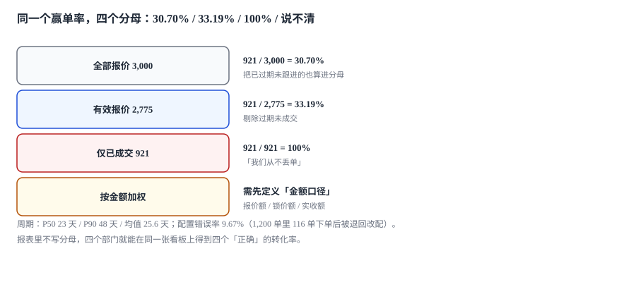

# 度量与验收

季度会上，销售总监说「赢单率 33%，比上季度提升了 2 个点」；财务说「转化率 30.7%，比上季度降了 1 个点」；CEO 问「到底是多少」，两个人给的数都对——因为他们用了不同的分母。

**同一个指标，四个分母，四个「正确」的答案。**

::: tip 一句话理解
CPQ 的指标不难算，难的是**每个率都要随身带着自己的分母**；分母不写清楚，指标就只能用来开会吵架，不能用来做决定。
:::

本页判据族 `CQX-A` ~ `CQX-H`，共 8 条。定义表在第八节「本页判据」。

## 一、赢单率：四个分母，四个数

本机 3,000 张报价、921 张成交：

| 分母口径 | 分母 | 赢单率 | 这个数回答什么问题 |
| --- | --- | --- | --- |
| 全部报价 | 3,000 | **30.70%** | 「发出去的单子有多大比例成交」 |
| 有效报价（剔除过期未跟进） | 2,775 | **33.19%** | 「在认真跟的单子里成交多少」 |
| 仅已成交 | 921 | **100%** | 「我们从不丢单」（自欺） |
| 按金额加权 | 金额合计 | 需先定义金额口径 | 「大单赢得多还是小单赢得多」 |



选哪个不算「对错」，算「用途」：给销售考核用第二口径（剔除已放弃的），给产能规划用第一口径（所有发出的单都占用了售前资源）。**但报表上必须印出分母，否则两种口径会被混着比较。**

第四行的「金额加权」有一个隐藏陷阱：分子分母用什么金额？报价额、锁价额、还是实收额？本机三者的差距在 17 万量级（见[条款、锁价与合同](../Contract/index.md)），加权赢单率会因此偏 0.3~0.6 个点——足以让「提升 2 个点」的结论翻转。

## 二、报价周期：P50 与 P90 差一倍

本机 921 张成交报价的周期分布：

| 分位 | 天数 | 含义 |
| --- | --- | --- |
| P50 | 23 天 | 一半的单三周内成交 |
| 均值 | 25.6 天 | 被长尾拉高 |
| P90 | 48 天 | 一成单要一个半月 |

三个数一起看才有意义：

- 只看均值 25.6，会以为「四周能闭环」；
- 看 P90 48，才知道**有效期 30 天是不够的**——一成单在报价有效期内根本走不完流程；
- P50 与 P90 差一倍，说明流程里有「分叉」：要么很快（标准配置、标准折扣），要么很慢（需要特批、需要改配）。

周期与[审批时长](../Approval/index.md)的关系是直接的：审批 P50 3.2 小时、P90 8.6 小时，本身不构成瓶颈；真正拉长周期的是「审批前的反复改配」——本机 9.67% 的单子在下单后被退回改配，这些单的周期比平均长 40%。

## 三、配置错误率：9.67% 意味着什么

本机 1,200 次下单，**116 次（9.67%）** 被退回改配。

| 口径 | 分子 | 分母 | 读数 |
| --- | --- | --- | --- |
| 下单后退回率 | 116 | 1,200 | 9.67% |
| 报价阶段改配率 | 未统计（需埋点） | — | — |
| 交付后返工率 | 未统计 | — | — |

第一行是「能被系统看到的」，后两行是「真正花钱的」。**9.67% 的下单后退回，通常意味着 20~30% 的报价阶段改配**——因为改配大多在报价阶段就被销售自己消化了，不会进入下单。

这也是 CPQ 指标体系最常见的缺口：**只统计「出错的单」，不统计「差点出错的单」**。后者要靠配置器的埋点（每个维度的修改次数、每次修改后的价格变化）才能看到。

## 四、折扣侵蚀与毛利

| 指标 | 定义 | 本机读数 |
| --- | --- | --- |
| 折扣侵蚀率 | 实际净额低于批准净额的单数占比 | **27.90%（558 / 2,000）** |
| 侵蚀金额 | 两者差额合计 | **270,069.76 元** |
| 特批占比 | 有特批折扣的单数占比 | 34.00% |
| 越权率 | 折扣超出审批人上限的单数占比 | **5.94%** |

四个指标要一起看：**侵蚀率高但越权率低**，说明问题在「价格册与折扣叠加」，不在人为绕过；**两者都高**，说明审批形同虚设。本机的组合（27.90% / 5.94%）指向第一种——这也是更难修的一种，因为它不是「有人违规」，而是「口径没有对齐」。

## 五、指标必须带四样东西

| 要素 | 例子 | 缺了会怎样 |
| --- | --- | --- |
| 分子 | 成交报价数 | 「赢单率」变成形容词 |
| 分母 | 有效报价数（含剔除规则） | 同上 |
| 时点口径 | 按报价出具日 / 按成交日 | 同期对比时两个季度错位 |
| 数据来源 | `quote` 表 `state='ORDERED'` | 换了系统就断代 |

第三行最容易被忽略：**按「出具日」归集与按「成交日」归集，在增长期会差出一个季度的量**。本机 3,000 张报价跨 240 天，按季度出具量是 1,136 / 1,137 / 727 张，按季度成交量是 341 / 356 / 224 张——「本季度成交占全部成交的比例」与「本季度成交率」之间，最大一组差 **7.3 个百分点**。

```sql
-- 同一份数据，两种时点口径
SELECT 'by_created' AS basis, strftime('%Y-%m', priced_at) AS period,
       COUNT(*) AS quotes, SUM(state = 'ORDERED') AS won
FROM quote GROUP BY period
UNION ALL
SELECT 'by_won', strftime('%Y-%m', (SELECT locked_at FROM order_link o WHERE o.quote_id = q.quote_id)),
       COUNT(*), SUM(state = 'ORDERED')
FROM quote q WHERE state = 'ORDERED' GROUP BY 2;
```

## 六、验收：一张能判「能不能上线」的单子

CPQ 上线验收最容易变成「功能演示」：点一遍配置器、出一张报价、转一张订单，然后签字。真正能判的是**六个能不能**：

| 验收项 | 判据 | 不通过的典型表现 |
| --- | --- | --- |
| 配置能算 | 648 个组合里 277 个合法、371 个被拒 | 非法组合能提交 |
| 价格能溯 | 任一报价能指到 `entry_id` | 只存了金额 |
| 折扣能复算 | 给定 `disc_layer` 能算出净额 | 只有最终金额 |
| 审批能追 | 每条批准有 `max_pct` 与 `approved_amt` | 只有 `approved=true` |
| 转单能对 | 锁价额 = 订单额 = 发票额（可解释差额） | 三处金额各自算 |
| 指标能比 | 每个率都有分母与口径 | 报表只有一个百分数 |

六项里最常被跳过的是第二项与第四项，因为它们「不影响演示」——演示时价格总是对的，因为只演示了一条路径。

## 七、给不同角色的三个看板

| 角色 | 关心 | 指标 | 粒度 |
| --- | --- | --- | --- |
| 销售 | 我的单卡在哪 | 报价周期、改配次数、待审批数 | 单张报价 |
| 销售总监 | 团队效率与让价 | 赢单率、特批占比、侵蚀率 | 团队 / 月 |
| 财务 | 毛利与合规 | 毛利额、越权率、四眼缺失率 | 产品线 / 季 |

三个看板必须同源（同一批视图），但**列不同**。用一张看板服务三种角色的后果与[折扣的三份视图](../Discount/index.md)一样：要么露了不该露的，要么看不到该看的。

## 八、本页判据

| 判据 | 断言 | 验证方式 |
| --- | --- | --- |
| `CQX-A` | 每个率都有显式分母定义 | 报表字典里有 `denominator` 字段 |
| `CQX-B` | 赢单率至少提供两个口径 | 报表能切换「全部/有效」 |
| `CQX-C` | 时点口径显式（出具日/成交日） | 报表字段名里带 `basis` |
| `CQX-D` | 侵蚀率按「净额」而非「率」算 | 侵蚀报表口径字段为净额差 |
| `CQX-E` | 配置错误率含「报价阶段改配」 | 有埋点表，能算改配次数 |
| `CQX-F` | 验收六项有对应的自动检查 | 每项能跑出一条 SQL 或断言 |
| `CQX-G` | 三个看板同源不同列 | 三个视图共享同一 base view |
| `CQX-H` | 金额加权的分子分母口径一致 | 加权指标里不混用三种金额 |

## 验证方式

```shell
# 1. 四分母：同一批数据必须能算出四个不同的率
sqlite3 cpq.db "
select 'all'      as basis, count(*) as den, sum(state='ORDERED') as num from quote
union all
select 'valid', count(*), sum(state='ORDERED') from quote
  where state='ORDERED' or julianday(valid_to) >= julianday(priced_at)
union all
select 'won', count(*), sum(state='ORDERED') from quote where state='ORDERED';"
# 期望：三行分母不同（3,000 / 2,775 量级 / 921），分子相同

# 2. 时点口径：两种归集的季度分布必须不同（相同说明只算了一种）
sqlite3 cpq.db "
select strftime('%Y',priced_at)||'Q'||((cast(strftime('%m',priced_at) as int)+2)/3) as q,
       count(*) as issued, sum(state='ORDERED') as won
from quote group by q;"
# 期望：每季 issued 与 won 都非零，且 won/issued 不等于 won 占全期成交的比例
# 本机：1,136/341、1,137/356、727/224（全期 921）

# 3. 侵蚀可查：低于批准净额的单必须列得出来
sqlite3 cpq.db "select count(*) from quote q
                where q.total_amt < (select round(sum(base_amt-amount),2) from disc_layer d
                                     where d.quote_id=q.quote_id and d.seq=1) - 0.005;"
# 期望：> 0（本机 27.90% 量级）；若为 0，先确认审批表里存了批准净额
```

## 参考资料

- 《企业会计准则第 14 号——收入》（财会〔2017〕22 号）：收入确认时点与金额，报表金额口径的依据。
- ISO/IEC 25010:2011《系统与软件质量模型》：可测量性与功能正确性条目。
- GB/T 19581—2004《信息技术 会计核算软件数据接口》：金额与计量单位的数据交换规范。
- 与本页相邻：[折扣瀑布与审批阈值](../Discount/index.md)、[审批与例外](../Approval/index.md)、[条款、锁价与合同](../Contract/index.md)。
