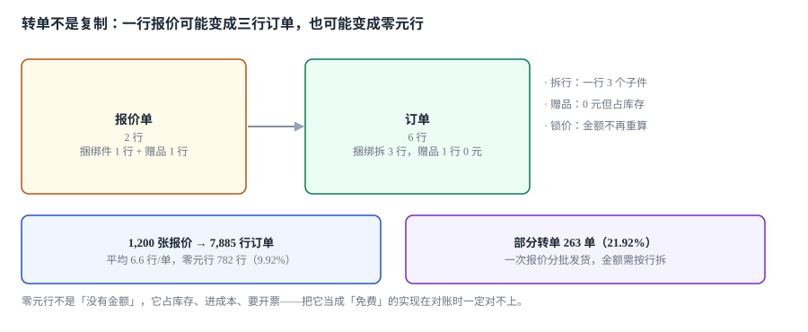

# 转单与履约衔接

一张报价单转成订单，销售以为「就是复制过去」。实际发生的事：2 行报价变成了 6 行订单——捆绑包被拆成 3 个子件，赠品单独一行且金额为 0，服务费被拆成 12 期。

**在报价侧它们是一件事，在履约侧是三件不同的事：库存、发货、开票各按不同的粒度记账。**

::: tip 一句话理解
转单不是复制，是**一次结构转换**：报价按「客户买什么」组织，订单按「仓库发什么、财务开什么」组织。两个结构之间必须有一条显式的映射规则，否则金额会在转换里被悄悄改掉。
:::

本页判据族 `CQM-A` ~ `CQM-H`，共 8 条。定义表在第八节「本页判据」。

## 一、三种行映射

| 报价行 | 订单行 | 映射类型 | 要点 |
| --- | --- | --- | --- |
| 单件 | 1 : 1 | 直映 | 金额、数量直接带过去 |
| 捆绑包 | 1 : N | 拆行 | 子件单价之和必须等于捆绑价 |
| 赠品 | 1 : 1（0 元） | 零元行 | 金额 0，但**占库存、进成本** |
| 服务/订阅 | 1 : 1 + 计划 | 生成履约计划 | 分期确认，不是一次性 |
| 按重量/长度计价 | 1 : N（按批次） | 运行时拆 | 转单时只能给「预计」 |

本机造了 1,200 张报价转单：**7,885 行订单，平均 6.6 行/单，其中零元行 782 行（9.92%）**。



零元行是最容易被「优化」掉的东西：看起来它不影响金额，删了更干净。但它承担三件事——**占用库存**（赠品也要发货）、**进入成本**（成本不为 0）、**出现在发票上**（折扣行或赠品行，税务口径不同）。删掉它，库存会对不上，成本会少算，发票会缺行。

## 二、拆分守恒：子件之和必须等于母件

捆绑包 1 行 12,000 元，拆成 3 个子件。拆分规则必须满足：

```text
Σ(子件数量 × 子件单价) = 母件金额
```

而现实里子件单价是独立维护的，加起来经常不等于 12,000。差额怎么办？三种做法：

| 做法 | 说明 | 风险 |
| --- | --- | --- |
| 按比例缩放子件单价 | 12,000 / Σ子件原价 | 子件单价出现多位小数，需取整 |
| 差额挂在「捆绑折扣」行 | 多一行负金额 | 发票上出现负行，需税务确认 |
| 差额挂 `residual` | 不体现在行上 | 对账时「行合计 ≠ 订单额」 |

推荐第二种：**差额显式成行**。因为发票必须能解释每一分钱，而 `residual` 是一笔「无来源的钱」。

```sql
-- 拆分后校验：母件金额必须等于子件之和（含捆绑折扣行）
SELECT CASE WHEN ABS(
  (SELECT SUM(line_amt) FROM order_line WHERE order_no = :no AND bundle_of = :parent_line)
  - (SELECT line_amt FROM order_line WHERE order_no = :no AND line_no = :parent_line)
) > 0.005 THEN RAISE(ABORT, 'BUNDLE_SPLIT_NOT_BALANCED') END;
```

## 三、部分转单：21.92% 的单子分批发

本机 1,200 张转单里 **263 张（21.92%）是部分转单**——一张报价分批发货、分批开票。

部分转单带来三个必须回答的问题：

| 问题 | 错的答案 | 对的答案 |
| --- | --- | --- |
| 金额怎么分？ | 按下单比例平均分 | 按行金额分，余数给末批 |
| 折扣怎么分？ | 每批都按原折扣 | 折扣按行摊，批次继承行的摊后金额 |
| 报价何时算「已转单」？ | 第一批就置 `ORDERED` | 全部行转完才置 `ORDERED`，否则置 `PARTIAL` |

第三个问题最容易被忽略：第一批转单就把报价置为 `ORDERED`，后面几批再转时会因为「报价已转单」被拒——或者更糟，被允许，于是同一张报价转出两张订单，`order_link.quote_id` 主键冲突，报错发生在第二批。

正确做法是 `order_link` 的主键改为 `(quote_id, batch_no)`，并在报价上维护 `converted_qty / total_qty`。

## 四、幂等：5.30% 的重放会造出第二张订单

转单接口被重试是常态（网络超时、前端重复点击、消息重投）。本机模拟 1,000 次转单，**53 次（5.30%）是重放**。

| 方案 | 重放结果 | 代价 |
| --- | --- | --- |
| 无幂等键 | 两张订单，库存扣两次 | 无 |
| `quote_id` 做唯一键 | 第二次插入报错 | 部分转单做不了 |
| `Idempotency-Key` + 请求指纹 | 第二次返回第一次的结果 | 需要存键与响应 |

推荐第三种，键取「报价号 + 批次号 + 客户端请求 ID」：

```sql
CREATE TABLE order_idem(
  idem_key   TEXT PRIMARY KEY,        -- quote_id:batch_no:client_req
  req_hash   TEXT NOT NULL,           -- 请求体哈希，防「同键不同体」
  order_no   TEXT NOT NULL,
  created_at TEXT NOT NULL
);
```

`req_hash` 是关键：如果同一个键配了不同的请求体（说明客户端复用了键），必须拒绝而不是返回旧结果——否则客户改了数量却拿到旧订单。

## 五、配置指纹：转单时唯一能证明「是同一件东西」的手段

报价行有 `cfg_json`，订单行也有 `cfg_json`。两者必须**指纹相同**，否则就是「报价卖的是光口，订单发的是电口」。

本机读数：277 个合法组合里 **262 个（94.58%）** 在「省略默认值」与「全量写」两种表示下指纹不同。这意味着，如果报价侧省略默认值、订单侧全量写，**94.58% 的转单会被误判成配置不一致**——或者，如果系统干脆不比对，那 5.42% 的**真不一致**也一起放过去了。

两种实现口径：

| 口径 | 比对什么 | 能发现什么 | 漏什么 |
| --- | --- | --- | --- |
| 比 `sku` | 字符串相等 | 换了型号 | 同型号不同配置 |
| 比指纹（规范化后） | 哈希相等 | 任何维度差异 | 无（前提是规范化一致） |
| 比字段逐项 | 逐维相等 | 任何差异 + 能指出哪个维度 | 需要维度列表 |

生产上推荐「逐项比，并输出差异维度」——因为报错信息要能告诉销售「接口维度不一致：报价是光口，订单是电口」，而不是 `CONFIG_MISMATCH`。

## 六、履约衔接：转单只是开始

| 衔接点 | 谁负责 | 系统里体现为 | 常见断层 |
| --- | --- | --- | --- |
| 库存预占 | 仓储/库存 | 订单行 → 预占记录 | 零元行不预占，发货时缺货 |
| 交期承诺 | 计划 | 订单行 → 交期 | 报价承诺 4 周，订单按 6 周排 |
| 发货 | 仓储 | 批次 → 出库单 | 部分转单的批次与发货批次不一致 |
| 开票 | 财务 | 行 → 发票行 | 折扣行没有对应发票行 |
| 收入确认 | 财务 | 履约义务 → 确认计划 | 服务费一次性确认 |

第一行与第二行是最常见的断层来源，且都与「报价侧的承诺」有关：报价单上写了「4 周交付」，这个承诺没有进订单，于是计划按标准交期排——**客户拿报价单来追责时，系统里没有任何地方记录过这个承诺**。

修法很朴素：报价行的 `lead_time_days` 必须复制到订单行，并在排产时作为约束而非参考。

## 七、转单的六条校验

| 校验 | 拒绝条件 | 报错信息应包含 |
| --- | --- | --- |
| 状态 | 报价非 `ACCEPTED` | 当前状态与所需状态 |
| 有效期 | 已过 `valid_to` | 到期日与当前时间 |
| 审批 | 折扣无覆盖 | 缺哪一级 |
| 配置 | 指纹不一致 | 差异维度 |
| 金额 | 锁价额 ≠ 报价额 | 两个金额 |
| 幂等 | 键已用且请求体不同 | 原订单号 |

六条全部通过才允许写入。**顺序也有讲究**，但不是为了性能：本机把「配置指纹」整条链路走一遍（`json.loads` + `dumps(sort_keys)` + `sha256`）只要 **6.97 µs**，纯 `json.loads` 是 **1.95 µs**——在毫秒级的转单接口里可以忽略。真正的理由是**报错质量**：先查状态与有效期，销售得到的是一句人能读懂的话（「报价已过期 3 天」）；先查配置，得到的是「指纹不一致」，他还得再猜是哪一步错了。**便宜且能说人话的校验放前面**。

## 八、本页判据

| 判据 | 断言 | 验证方式 |
| --- | --- | --- |
| `CQM-A` | 捆绑拆行后子件之和等于母件 | 差额行存在或差额为 0 |
| `CQM-B` | 零元行保留且占库存 | 零元行数 > 0，且预占记录覆盖它 |
| `CQM-C` | 部分转单有批次维度 | `order_link` 主键含 `batch_no` |
| `CQM-D` | 幂等键含请求体哈希 | 同键不同体被拒 |
| `CQM-E` | 配置逐项比对并输出差异 | 报错含维度名与两侧取值 |
| `CQM-F` | 转单金额取自锁价 | `locked_amt` 与发票行合计可对 |
| `CQM-G` | 交期承诺随单流转 | 订单行有 `lead_time_days` |
| `CQM-H` | 转单校验有固定顺序 | 幂等在金额校验之后、写库之前 |

## 验证方式

```shell
# 1. 拆分守恒：每个捆绑母件的子件之和必须等于母件金额
sqlite3 cpq.db "select order_no, bundle_of, round(sum(line_amt),2) as s
                from order_line where bundle_of is not null
                group by order_no, bundle_of
                having abs(s - (select line_amt from order_line o2
                                where o2.order_no=order_line.order_no
                                  and o2.line_no=order_line.bundle_of)) > 0.005;"
# 期望：0 行

# 2. 零元行没有被优化掉（若为 0，说明赠品被合并进了主行，库存会少）
sqlite3 cpq.db "select count(*) from order_line where line_amt = 0;"
# 期望：> 0（本机 7,885 行里 782 行）

# 3. 幂等：同一个键重放两次，订单数不变
python3 -c "
seen={}
def transfer(key, body, make_order):
    if key in seen:
        return 'dup' if seen[key]!=body else 'replay'
    seen[key]=body; make_order(); return 'new'
n=[0]
print(transfer('Q1:1:req-a', 'qty=10', lambda: n.__setitem__(0,n[0]+1)))
print(transfer('Q1:1:req-a', 'qty=10', lambda: n.__setitem__(0,n[0]+1)))
print(transfer('Q1:1:req-a', 'qty=12', lambda: n.__setitem__(0,n[0]+1)))
print('orders', n[0])"
# 期望：new replay dup orders 1
```

## 参考资料

- ISO 8000-110:2021《数据质量 第 110 部分：主数据 特性数据的交换》：行项目与属性交换的结构要求。
- RFC 8259《The JavaScript Object Notation (JSON) Data Interchange Format》第 4 节：对象成员无序——配置比对前必须规范化的依据。
- 《企业会计准则第 14 号——收入》（财会〔2017〕22 号）：履约义务与收入确认时点，本页「服务费分期确认」的口径来源。
- 与本页相邻：[条款、锁价与合同](../Contract/index.md)、[产品模型与配置规则](../Configuration/index.md)、[订单状态机](../../Ecommerce/OrderStateMachine/index.md)。
