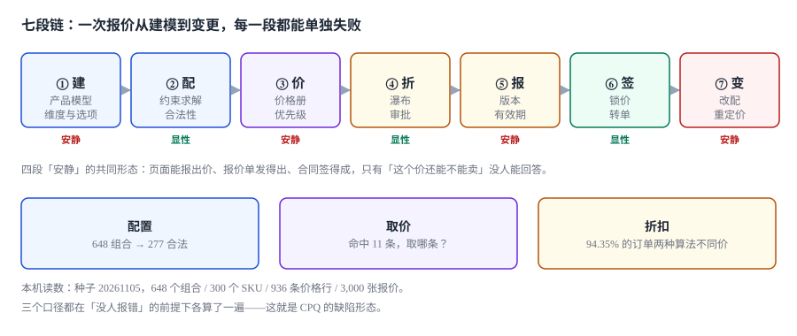

# 总览：七段链与三个「同一个数」

一张报价单被三个人看过：销售看到的是「客户能接受的价格」，财务看到的是「毛利率还剩多少」，客户看到的是「这个配置能不能装进我的机房」。

**三份理解都基于同一张纸，但那张纸上只写了一行总额。** 于是「配置是否成立」「价格从哪来」「折扣谁批的」这三件事被压成了同一个数字，而数字是无法自证的。

::: tip 一句话理解
CPQ 的难点不在「算价」，而在**给「一个数」配上三样能让别人复核的东西**：它是哪套配置、取自哪条价格、谁批准了让价。三样缺一样，这个数就只对出具它的人有效。
:::

本页判据族 `CQO-A` ~ `CQO-H`，共 8 条。定义表在第九节「本页判据」。

## 一、七段链：每一段都有自己的「成功定义」

| 段 | 业务方以为的成功 | 系统实际判断的成功 | 差在哪 |
| --- | --- | --- | --- |
| ① 建 | 模型建好了 | 维度、选项、约束都落库且版本已发布 | 发布后改约束，旧报价解释不了 |
| ② 配 | 客户选完了 | 组合满足全部约束（含三维约束） | 前端只能表达两维 |
| ③ 价 | 出价了 | 命中唯一一条有效价格 | 多条命中时靠排序而不是规则 |
| ④ 折 | 让价了 | 每层基数正确且审批覆盖 | 审批只管「率」，不管「额」 |
| ⑤ 报 | 报价发了 | 金额、版本、有效期三者一致 | 有效期只是一个字段 |
| ⑥ 签 | 客户签了 | 锁价、条款、金额三者冻结 | 转单时又按实时价算了一遍 |
| ⑦ 变 | 改完了 | 变更后的金额可解释且差额可归因 | 改完不回写总额 |



四段「安静」的失败有一个共同的形状：**它不产生异常，只产生一个偏差**。偏差会随着报价数量的增加累加，最后以「毛利不对」的形式出现在月结里，而那时已经无法追溯到具体是哪一单。

## 二、三个「同一个数」

| 口径 | 什么时候写 | 谁读 | 写错了会怎样 |
| --- | --- | --- | --- |
| 报价额 `quoted` | 出具、改配、改量时 | 客户、销售、渠道 | 客户拿旧数字来签，销售拿新数字来批 |
| 锁价额 `locked` | 转单那一刻 | 订单、履约、开票 | 转单重算则客户被涨价，不重算则毛利被吃掉 |
| 实收额 `invoiced` | 开票、收款时 | 财务、审计 | 三者之间没有差异表，只能靠人对 |

三者之间必须有**差额记录**。本机实测：921 张成交报价按转单时刻的价目重算（年涨 6%），**全部漂移，合计 173,269.87 元，单笔最大 1,271.18 元**——如果系统在转单时「顺手取最新价」，这 17 万会静默地从毛利里消失，因为每一单都只差一两百块。

### 为什么「差额」比「金额」更重要

一张 8,640 元的报价，客户签的时候是 8,640，订单上也是 8,640，发票上还是 8,640——三处一致，看起来很干净。但如果这 8,640 是「客户专属价 8,640」，而订单取的是「区域价 9,120 打了 5% 折后 8,664」，那么：

- 三处金额差 24 元，靠人眼看不出；
- 报价单上写的折扣是 10%，订单上实际是 5%；
- 客户下次拿着报价单来要 10%，系统给不出 10%——因为那 10% 是「客户专属价 + 5% 折扣」的组合，不是「基础价 × 0.9」。

**差额记录要写清「三个数各是多少、差额由哪一段产生」**，而不是只写「最终金额」。

::: danger 三件事必须写进数据模型，不能留给「报价单上写清楚」
1. **价格必须落 `price_entry` 主键，不能只落金额**：只落金额的报价，一年后无法回答「这单为什么是 8,640」，也无法在价目调整时做影响面分析。
2. **配置必须落 `cfg_json` + 模型版本**：只落 `sku` 的报价，在产品升版后无法解释「当时这个配置合不合法」——而这一条在售后争议里经常是唯一的依据。
3. **审批必须落「谁、什么级别、上限多少、何时」**：只落 `approved = true` 的报价，无法回答「这个人有没有权限批 30%」，也无法在审计时证明「四眼」真的存在。
:::

## 三、三个「减价」的层次

折扣不是一件事，是三层，混在一起就会算错：

| 层 | 作用对象 | 典型形态 | 谁决定 | 能不能事后补 |
| --- | --- | --- | --- | --- |
| 价格差异 | 价目本身 | 客户专属价、区域价、协议价 | 定价部门 | 能（新开价格册条目） |
| 规则折扣 | 订单结构 | 数量阶梯、捆绑、长约 | 产品/商务政策 | 能（改配置重算） |
| 特批折扣 | 单张报价 | 一次性让价 | 审批人 | 不能（须在发出前完成） |

三层必须在报价单上**分开列**。混成一列「折扣 22%」的后果是：客户问「为什么不是 25%」，销售答不出；财务要算「特批占了多少」，也算不出。

本机实测：把「客户专属价」和「特批折扣」压成同一个 `disc_pct` 之后，**27.90% 的成交单出现了「实际让价大于批准让价」**（558 / 2,000），累计 **270,069.76 元**——因为审批人批的是折扣率，而实际少收的钱来自价格册本身。

## 四、一次报价的四个时刻

| 时刻 | 该冻结什么 | 冻结在哪 | 常见遗漏 |
| --- | --- | --- | --- |
| 出具 | 配置快照、价格快照、审批快照 | 报价单三列 | 只冻结金额 |
| 发出 | 有效期起点 | `valid_from` | 用「出具时间」而不是「发送成功时间」 |
| 转单 | 锁价额、条款版本 | `order_link` | 转单时重新取价 |
| 开票 | 税额、币种、汇率 | 发票行 | 用开票日汇率重算报价金额 |

四个时刻对应四个不同的「谁负责」。把四个时刻压成一个 `updated_at`，等于把四份责任压成一份。

## 五、配置为什么会算错

配置出错不是「用户点错了」，而是**约束没法用下拉框表达**：

| 约束形态 | 例子 | 前端能表达吗 | 必须在哪校验 |
| --- | --- | --- | --- |
| 单维约束 | 电压只有 2 种 | 能（选项列表） | 不需要 |
| 两维约束 | 高压不配某材质 | 能（联动） | 前端足够 |
| 三维约束 | 品类 + 规模 + 许可 | **不能** | 提交时求全局解 |
| 数量约束 | 至少选 2 个接口 | 能（计数） | 前端 + 后端 |
| 跨行约束 | 整单总功率不超过机柜上限 | **不能** | 整单提交时 |

本机实测：8 条约束里 6 条是两维、2 条是三维；如果只做「两两组合白名单」，**287 个组合会被放行，其中 10 个（3.61%）违反三维约束**。而如果只做「每维查允许值」——648 个组合**一个都拦不住**，因为每个维度的每个取值都在某些合法组合里出现过。

::: warning 「前端拦住就够了」是最贵的假设
前端能拦住的只有「当场能看到的那几个维度」。三维约束、跨行约束、以及「同一配置在不同模型版本下合法性不同」这三类，都需要在提交时用一份**规则表**求一次解。规则表要能被业务改，不能硬编码在页面里。
:::

## 六、价格为什么会算错

价格出错的原因只有两类：**取错了条目**，或者**算错了顺序**。

| 错法 | 表现 | 量级（本机） |
| --- | --- | --- |
| 取最低价 | 看起来对客户友好，实际绕过了定价策略 | 46.33% 的 SKU 结果不同，差 89,315.50 元 |
| 取最新录入 | 谁的录入时间晚谁生效，等于把定价权给了操作顺序 | 命中 11 条时 179/179 全部与优先级结果不同 |
| 多条都有效 | 排序字段不稳定，翻页时价格会变 | 157 对有效期重叠 |
| 每步取整 | 与「末尾一次取整」差 1 分 | 35.30% 的订单差 0.01 元 |

**取价这件事的正确形态是一条 SQL 视图，不是一段服务代码**：

```sql
-- 取在时点 T 生效、且优先级最高的一条价格；同优先级取生效期最晚的一条
SELECT e.book_id, e.amount, e.valid_from
FROM price_entry e
JOIN price_book b ON b.book_id = e.book_id
WHERE e.model_id = :model_id
  AND e.valid_from <= :at
  AND (e.valid_to IS NULL OR e.valid_to > :at)
ORDER BY b.priority DESC, e.valid_from DESC
LIMIT 1;
```

这段 SQL 有两个必须写对的地方：`valid_to > :at`（半开区间，不是 `>=`），以及 `ORDER BY` 里必须有**唯一的第二排序键**——否则同优先级同日期的两条价格，返回哪条取决于执行计划。

## 七、折扣为什么会算错

因为**百分比之间不能相加**：

```text
逐层扣：60,000 × 0.85 × 0.92 × 0.90 × 0.95 = 40,116.60
加总扣：60,000 × (1 − 0.15 − 0.08 − 0.10 − 0.05) = 37,200.00
差：2,916.60（4.8%）
```

2,000 单实测里，**94.35% 的订单两种算法给出不同金额，合计差 1,213,672.04 元，单笔最大 3,673.34 元**。这不是「精度问题」，是「定义问题」：折扣瀑布的定义是**一个有序的、每层基数为上一层净额的过程**，不是一组可以求和的率。

::: danger 折扣必须是一条有序列表，不是一个率
1. **每层记录基数**：`layer.base_amt` + `layer.rate` + `layer.amount` 三个字段都要落，只落 `rate` 时无法复算。
2. **百分比与定额不能混加**：`10% + 200 元` 不是一个数；定额在前还是在后，结果不同。
3. **上限要作用在「净额」还是「总额」要写死**：最低毛利率保护若按总额算，叠加折扣后必然击穿。
:::

## 八、一张报价单的最小字段集

| 字段 | 为什么必须有 | 缺了的后果 |
| --- | --- | --- |
| `model_id` + `model_version` | 解释「当时这套配置合不合法」 | 升版后无法回溯 |
| `cfg_json` + 指纹 | 判断「同一份配置」 | 合同与订单对不上 |
| `book_id` + `entry_id` | 解释「这个价从哪来」 | 无法做价格调整影响面 |
| `disc_layers`（有序） | 解释「每一层让了多少」 | 客户问「为什么不是 25%」时答不出 |
| `approval[]` | 解释「谁批的、批到多少」 | 审计无法证明四眼 |
| `valid_from` / `valid_to` | 判断「还能不能签」 | 过期单静默转单 |
| `state` | 区分「发出/接受/转单/作废」 | 无法统计赢单率 |

这七个字段构成「可复核的最小集」。少于七个，报价单就退化成一张**看起来像合同的通知单**。

## 九、本页判据

| 判据 | 断言 | 验证方式 |
| --- | --- | --- |
| `CQO-A` | 报价同时落「配置快照 + 价格条目 + 审批链」三样 | 三列任一为空的报价数为 0 |
| `CQO-B` | 三个金额（报价/锁价/实收）各有独立字段 | 表结构里能查到三个字段而非一个 |
| `CQO-C` | 有效期判定用的是半开区间 | 代码/视图里 `valid_to > at` 而非 `>=` |
| `CQO-D` | 折扣按层存储且每层有基数 | `disc_layer` 表存在且 `base_amt` 非空 |
| `CQO-E` | 三维约束在提交时求解 | 构造一个违反三维约束的组合，提交被拒 |
| `CQO-F` | 取价 SQL 有唯一第二排序键 | `ORDER BY` 至少两个键，末键唯一 |
| `CQO-G` | 转单金额等于报价锁价额 | 差异行数为 0 |
| `CQO-H` | 每个指标都写明分母 | 报表定义里每个率都有 denominator 字段 |

## 验证方式

```shell
# 1. 取价视图必须只用一条 SQL 就能复现（在实战库上跑）
sqlite3 cpq.db "select model_id, book_id, amount from v_price_at
                where model_id='M1' and at='2026-11-05' order by priority desc limit 1;"
# 期望：只返回一行；把 at 改成 2026-12-31 后金额若变化，说明价格条目有生效期

# 2. 配置指纹：两种写法必须得到同一个指纹
python3 - <<'PY'
import hashlib, json
def fp(d): return hashlib.sha256(json.dumps(d, sort_keys=True, ensure_ascii=False).encode()).hexdigest()[:12]
a = {"cat": 0, "size": 0, "mat": 0, "volt": 0, "iface": 0, "lic": 0}
b = {k: v for k, v in a.items() if v != 0}
print(fp(a) == fp(b))   # 期望 True：省略默认值不改变指纹
PY

# 3. 折扣顺序：两种算法的结果必须不同（证明它们不是同一个函数）
python3 -c "print(round(60000*0.85*0.92*0.90*0.95,2), round(60000*(1-0.15-0.08-0.10-0.05),2))"
# 期望：40116.6 37200.0
```

第 3 步看着像废话，但它是最省事的「定义检查」：如果两段代码算出同一个数，说明其中一段把百分比当成可加的了。

## 参考资料

- ISO/IEC 25010:2011《系统与软件质量模型》：功能正确性与可用性的定义，本页「每段都有自己的成功定义」借用其中的「适合性」视角。
- ISO 8000-110:2021《数据质量 第 110 部分：主数据 特性数据的交换》：产品维度与选项的交换格式。
- RFC 8259《The JavaScript Object Notation (JSON) Data Interchange Format》第 4 节：对象成员无序——这是配置指纹必须先排序再哈希的依据。
- 与本页相邻：[产品模型与配置规则](../Configuration/index.md)、[价格册与定价模型](../Pricing/index.md)、[折扣瀑布与审批阈值](../Discount/index.md)。
