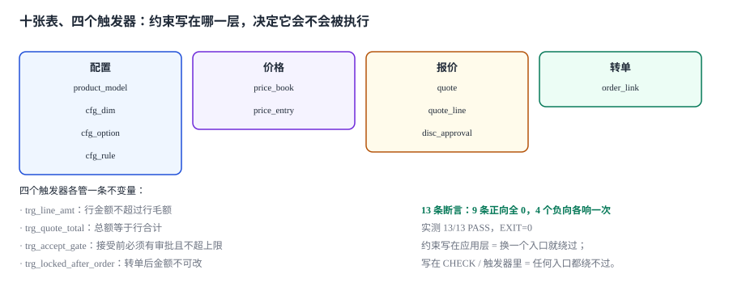

# 实战：十张表、四个触发器、十三条断言

前面九页讲了九个道理。这一页把它们压成一份能跑的东西：**十张表、四个触发器、十三条断言，全部在 SQLite 3.50 上实测通过，退出码 0。**

::: tip 一句话理解
一份 CPQ 设计能不能落地，只看一件事：**把约束写进数据库之后，还能不能构造出一张「合法但错」的报价**。构造不出来，说明约束真的在起作用；构造得出来，说明它只写在文档里。
:::

本页判据族 `CQP-A` ~ `CQP-H`，共 8 条。定义表在第七节「本页判据」。

## 一、十张表的分工

| 组 | 表 | 承担的不变量 |
| --- | --- | --- |
| 配置 | `product_model` `cfg_dim` `cfg_option` `cfg_rule` | 配置合法性与版本可解释 |
| 价格 | `price_book` `price_entry` | 取价唯一、有效期不重叠 |
| 报价 | `quote` `quote_line` `disc_approval` | 总额等于行合计、折扣有审批 |
| 转单 | `order_link` | 锁价不可回改 |

```sql
CREATE TABLE product_model(
  model_id TEXT PRIMARY KEY, name TEXT NOT NULL,
  version INTEGER NOT NULL DEFAULT 1,
  status TEXT NOT NULL CHECK (status IN ('DRAFT','RELEASED','RETIRED'))
);
CREATE TABLE cfg_dim(
  model_id TEXT NOT NULL REFERENCES product_model(model_id),
  dim_code TEXT NOT NULL, ord INTEGER NOT NULL,
  PRIMARY KEY (model_id, dim_code)
);
CREATE TABLE cfg_option(
  model_id TEXT NOT NULL, dim_code TEXT NOT NULL, opt_code TEXT NOT NULL,
  is_default INTEGER NOT NULL DEFAULT 0 CHECK (is_default IN (0,1)),
  PRIMARY KEY (model_id, dim_code, opt_code),
  FOREIGN KEY (model_id, dim_code) REFERENCES cfg_dim(model_id, dim_code)
);
CREATE TABLE cfg_rule(
  rule_id TEXT PRIMARY KEY,
  model_id TEXT NOT NULL REFERENCES product_model(model_id),
  kind TEXT NOT NULL CHECK (kind IN ('FORBID','REQUIRE','REQUIRES_ONE_OF')),
  body TEXT NOT NULL, message TEXT NOT NULL
);
CREATE TABLE price_book(
  book_id TEXT PRIMARY KEY, priority INTEGER NOT NULL, currency TEXT NOT NULL,
  valid_from TEXT NOT NULL, valid_to TEXT
);
CREATE TABLE price_entry(
  entry_id INTEGER PRIMARY KEY AUTOINCREMENT,
  book_id TEXT NOT NULL REFERENCES price_book(book_id),
  model_id TEXT NOT NULL REFERENCES product_model(model_id),
  amount REAL NOT NULL CHECK (amount >= 0),
  valid_from TEXT NOT NULL, valid_to TEXT,
  UNIQUE (book_id, model_id, valid_from)
);
CREATE TABLE quote(
  quote_id TEXT PRIMARY KEY,
  model_id TEXT NOT NULL REFERENCES product_model(model_id),
  book_id TEXT NOT NULL REFERENCES price_book(book_id),
  currency TEXT NOT NULL,
  total_amt REAL NOT NULL DEFAULT 0 CHECK (total_amt >= 0),
  valid_to TEXT NOT NULL,
  state TEXT NOT NULL CHECK (state IN ('DRAFT','SENT','ACCEPTED','EXPIRED','ORDERED','VOID')),
  priced_at TEXT NOT NULL
);
CREATE TABLE quote_line(
  quote_id TEXT NOT NULL REFERENCES quote(quote_id),
  line_no INTEGER NOT NULL,
  model_id TEXT NOT NULL REFERENCES product_model(model_id),
  cfg_json TEXT NOT NULL,
  qty INTEGER NOT NULL CHECK (qty > 0),
  unit_price REAL NOT NULL CHECK (unit_price >= 0),
  disc_pct REAL NOT NULL DEFAULT 0 CHECK (disc_pct >= 0 AND disc_pct <= 1),
  line_amt REAL NOT NULL,
  PRIMARY KEY (quote_id, line_no)
);
CREATE TABLE disc_approval(
  quote_id TEXT NOT NULL REFERENCES quote(quote_id),
  level INTEGER NOT NULL, approver TEXT NOT NULL, max_pct REAL NOT NULL,
  decided_at TEXT NOT NULL, PRIMARY KEY (quote_id, level)
);
CREATE TABLE order_link(
  quote_id TEXT PRIMARY KEY REFERENCES quote(quote_id),
  order_no TEXT NOT NULL UNIQUE, ordered_at TEXT NOT NULL, locked_amt REAL NOT NULL
);
```

建这十张表加四个触发器，本机 **0.98 ms**（50 次平均，`:memory:`）。

## 二、四个触发器：把不变量变成拒绝

| 触发器 | 时机 | 拦住什么 | 错误码 |
| --- | --- | --- | --- |
| `trg_line_amt` | `BEFORE INSERT ON quote_line` | 行金额大于行毛额 | `LINE_AMT_EXCEEDS_GROSS` |
| `trg_quote_total` | `AFTER INSERT ON quote_line` | 总额不等于行合计（纠正） | — |
| `trg_accept_gate` | `BEFORE UPDATE OF state ON quote` | 无审批 / 超审批上限就接受 | `APPROVAL_REQUIRED` / `APPROVAL_CAP_EXCEEDED` |
| `trg_locked_after_order` | `BEFORE UPDATE OF total_amt ON quote` | 转单后改总额 | `QUOTE_LOCKED_BY_ORDER` |

```sql
CREATE TRIGGER trg_line_amt BEFORE INSERT ON quote_line
BEGIN
  SELECT CASE WHEN NEW.line_amt > ROUND(NEW.qty * NEW.unit_price + 0.0000001, 2)
              THEN RAISE(ABORT, 'LINE_AMT_EXCEEDS_GROSS') END;
END;

CREATE TRIGGER trg_quote_total AFTER INSERT ON quote_line
BEGIN
  UPDATE quote SET total_amt = (
    SELECT ROUND(SUM(line_amt), 2) FROM quote_line WHERE quote_id = NEW.quote_id
  ) WHERE quote_id = NEW.quote_id;
END;

CREATE TRIGGER trg_accept_gate BEFORE UPDATE OF state ON quote
WHEN NEW.state = 'ACCEPTED'
BEGIN
  SELECT CASE WHEN EXISTS (SELECT 1 FROM quote_line l
      WHERE l.quote_id = NEW.quote_id AND l.disc_pct > 0)
    AND NOT EXISTS (SELECT 1 FROM disc_approval a WHERE a.quote_id = NEW.quote_id)
    THEN RAISE(ABORT, 'APPROVAL_REQUIRED') END;
  SELECT CASE WHEN EXISTS (SELECT 1 FROM quote_line l
      WHERE l.quote_id = NEW.quote_id
        AND l.disc_pct > (SELECT COALESCE(MAX(max_pct),0) FROM disc_approval a
                          WHERE a.quote_id = NEW.quote_id) + 0.0000001)
    THEN RAISE(ABORT, 'APPROVAL_CAP_EXCEEDED') END;
END;

CREATE TRIGGER trg_locked_after_order BEFORE UPDATE OF total_amt ON quote
WHEN EXISTS (SELECT 1 FROM order_link o WHERE o.quote_id = NEW.quote_id)
BEGIN
  SELECT CASE WHEN NEW.total_amt <> OLD.total_amt
              THEN RAISE(ABORT, 'QUOTE_LOCKED_BY_ORDER') END;
END;
```



四个触发器对应四条「不能靠评审保证」的规则。第二条是 `AFTER` 而不是 `BEFORE`，因为它不是拒绝而是**纠正**：总额由数据库从行算出来，应用层不再有「自己算总额」的机会。

::: danger 触发器写错的三条路
1. **`RAISE(ABORT)` 用成 `RAISE(FAIL)`**：`FAIL` 只回滚当前语句，事务里前面的语句仍然生效，转单半途失败会留下一张「有行没总额」的报价单。
2. **`BEFORE UPDATE OF state` 漏掉 `WHEN`**：任何 `UPDATE quote` 都会进触发器，包括只改 `valid_to` 的语句，误报成「无审批」。
3. **多语句触发器里用 `AND` 串两个 CASE**：SQLite 的触发器体是多条语句，不是表达式；写成 `CASE WHEN a AND b` 只能报一个错误码，两种违规共用一条错误码，值班员分不清是「没人批」还是「批得不够」。
:::

## 三、十三条断言：9 条正向，4 条负向

正向断言要求「违规行数为 0」；负向断言要求「必须被拦住」。

| 编号 | 断言 | 期望 |
| --- | --- | --- |
| `C1` | 行金额不超过行毛额 | 0 |
| `C2` | 报价总额等于行合计 | 0 |
| `C3` | 已接受/已转单报价必有审批 | 0 |
| `C4` | 折扣不超过审批上限 | 0 |
| `C5` | 转单金额等于锁价金额 | 0 |
| `C6` | 无零行报价 | 0 |
| `C7` | 同册同价目有效期不重叠 | 0 |
| `C8` | 过期报价未转单 | 0 |
| `C9` | 三张报价合计守恒 | 506,400.00 |
| `N1` | 行金额超过毛额 → 被拒 | `LINE_AMT_EXCEEDS_GROSS` |
| `N2` | 无审批直接接受 → 被拒 | `APPROVAL_REQUIRED` |
| `N3` | 超出审批上限接受 → 被拒 | `APPROVAL_CAP_EXCEEDED` |
| `N4` | 转单后改总额 → 被拒 | `QUOTE_LOCKED_BY_ORDER` |

`C9` 的 506,400.00 是三张报价的合计：Q-0001 = 10 × 9,600 × 0.9 + 2 × 1,200 = 88,800；Q-0002 = 50 × 9,600 × 0.85 = 408,000；Q-0003 = 1 × 9,600 = 9,600。

## 四、实跑输出

```text
N1 行金额超过毛额  PASS  -> LINE_AMT_EXCEEDS_GROSS
N2 无审批直接接受  PASS  -> APPROVAL_REQUIRED
N3 超出审批上限接受  PASS  -> APPROVAL_CAP_EXCEEDED
N4 转单后改总额  PASS  -> QUOTE_LOCKED_BY_ORDER
C1 行金额不超过行毛额: 0 (期望 0) OK
C2 报价总额等于行合计: 0 (期望 0) OK
C3 已接受/已转单报价必有审批: 0 (期望 0) OK
C4 折扣不超过审批上限: 0 (期望 0) OK
C5 转单金额等于锁价金额: 0 (期望 0) OK
C6 无零行报价: 0 (期望 0) OK
C7 同册同价目有效期不重叠: 0 (期望 0) OK
C8 过期报价未转单: 0 (期望 0) OK
C9 三张报价合计守恒: 506400.0 (期望 506400.0) OK
表 10 张 / 触发器 4 个
ASSERT 13/13  PASS
EXIT 0
```

关键在最后三行：**13/13 且退出码 0**。一个「看起来通过」的断言集常常是 10/13 —— 因为负向用例最难写，而它们恰恰是唯一能证明「约束真的在拦」的部分。

## 五、为什么是这十三条，不是三十条

十三条的取舍标准：**每条对应一个「可以被静默绕过」的入口**。

| 入口 | 对应断言 | 绕过的样子 |
| --- | --- | --- |
| 直接改行金额 | `C1` `N1` | 行金额写成毛额 1.2 倍，页面照样显示 |
| 应用层自算总额 | `C2` | 加行后忘了回写总额 |
| 直接置状态 | `C3` `N2` | 无审批也能「已接受」 |
| 审批上限写小 | `C4` `N3` | 批 30% 但记录说上限 10% |
| 转单重算金额 | `C5` | 锁价与订单额差两百块 |
| 改价后不重算 | `C6` | 一张没有任何行的「报价单」 |
| 价格册直接插行 | `C7` | 同一天两条价格都有效 |
| 过期照转 | `C8` | 24.43% 的单子就这么转的 |
| 总额被改 | `C9` `N4` | 转单后被人「修正」了金额 |

去掉任何一条，就有一条入口变成「靠人盯」。

## 六、从断言到日常

十三条断言不是上线前跑一次的东西，它们的正确用法是**变成每日巡检**：

```shell
# 每日 02:00 跑这九条正向断言，任何一条非 0 就出工单
sqlite3 cpq.db <<'SQL'
.mode list
select 'C1', count(*) from quote_line where line_amt > round(qty*unit_price+1e-7,2);
select 'C2', count(*) from quote q
  where abs(total_amt - (select coalesce(round(sum(line_amt),2),0)
                          from quote_line l where l.quote_id=q.quote_id)) > 0.005;
select 'C7', count(*) from price_entry a join price_entry b
  on a.book_id=b.book_id and a.model_id=b.model_id and a.entry_id<b.entry_id
  and (a.valid_to is null or b.valid_from<=a.valid_to);
SQL
# 期望：三行都是 0
```

**负向断言不巡检**——它们靠 CI 里的自测用例守（每次改触发器就重跑一遍），因为生产库上不能刻意造违规数据。

## 七、本页判据

| 判据 | 断言 | 验证方式 |
| --- | --- | --- |
| `CQP-A` | 十张表覆盖配置/价格/报价/转单四组 | `sqlite_master` 里 10 张业务表 |
| `CQP-B` | 四个触发器对应四条不变量 | 错误码可枚举，一条一个 |
| `CQP-C` | 正向断言 9 条全 0 | 巡检输出全 0 |
| `CQP-D` | 负向断言 4 条全响 | 每条错误码都被触发一次 |
| `CQP-E` | 总额由数据库计算 | 应用层无 `total_amt` 赋值语句 |
| `CQP-F` | 接受动作有前置校验 | `trg_accept_gate` 存在且有两个错误码 |
| `CQP-G` | 锁价后不可改 | `trg_locked_after_order` 存在 |
| `CQP-H` | 断言能脱离测试框架独立运行 | 只用 `sqlite3` + `python3` 标准库 |

## 验证方式

```shell
# 1. 建库：10 张表 + 4 个触发器，必须能一遍建成
sqlite3 :memory: < schema.sql
sqlite3 cpq.db "select type, count(*) from sqlite_master
                where name not like 'sqlite_%' group by type;"
# 期望：table|10  trigger|4

# 2. 十三条断言：一次跑完，退出码必须是 0
python3 cpq_practice.py; echo "EXIT=$?"
# 期望：ASSERT 13/13  PASS / EXIT=0

# 3. 反证：把 TRG 常量里的 trg_accept_gate 整段删掉再跑
#    脚本每次在 :memory: 里重建库，所以必须改脚本，不能改落盘的 cpq.db
sed '/CREATE TRIGGER trg_accept_gate/,/^END;/d' cpq_practice.py > cpq_practice_nogate.py
python3 cpq_practice_nogate.py; echo "EXIT=$?"
# 期望：N2/N3 FAIL（未拦住），ASSERT 11/13，EXIT=1
```

第 3 步是这一页的核心：**一条断言只有在「删掉约束后会变红」时才算数**。永远绿的断言不是保障，是装饰。

## 参考资料

- SQLite 官方文档《CREATE TRIGGER》：`BEFORE`/`AFTER`、`UPDATE OF`、`RAISE(ABORT|FAIL|ROLLBACK)` 的语义差别。
- SQLite 官方文档《Foreign Keys》：`PRAGMA foreign_keys` 默认关闭，连接建立后必须显式打开。
- ISO/IEC 25010:2011《系统与软件质量模型》：功能正确性与可测试性条目。
- 与本页相邻：[产品模型与配置规则](../Configuration/index.md)、[报价单：版本与有效期](../Quote/index.md)、[转单与履约衔接](../Ordering/index.md)。
