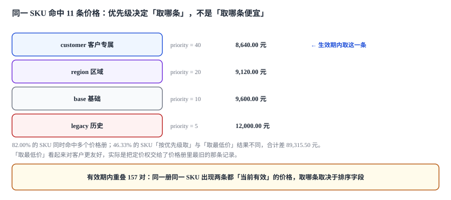
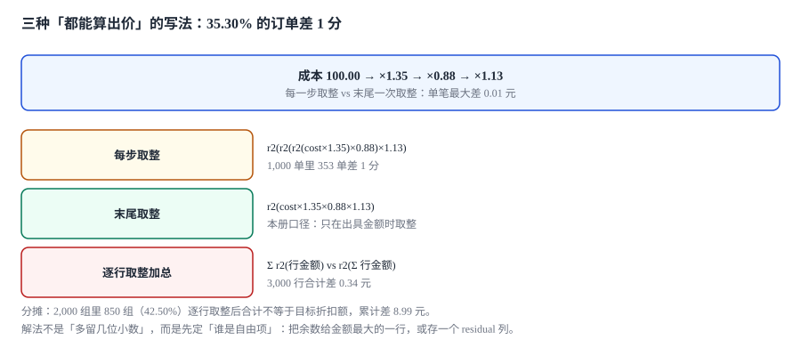

# 价格册与定价模型

同一个 SKU，在系统里躺着 11 条「当前有效」的价格：基础价 9,600、区域价 9,120、客户专属 8,640、促销价 7,800、协议价 8,900、历史价 12,000……

**每一次取价都是一次仲裁，而多数系统把这个仲裁交给了一个 `ORDER BY`。**

::: tip 一句话理解
价格册不是「一张价格表」，是**一组带优先级和生效期的价格层**；取价的正确性问题不在算术，而在「同一时刻命中多条时，谁赢」这条规则有没有被写死、写对、写进 SQL。
:::

本页判据族 `CQR-A` ~ `CQR-H`，共 8 条。定义表在第八节「本页判据」。

## 一、价格册的五个属性

| 属性 | 作用 | 写错的后果 |
| --- | --- | --- |
| `priority` | 决定同刻命中多条时谁赢 | 取到历史价，客户莫名涨价 |
| `currency` | 这一层用什么币种标价 | 混币种求和，差 76.3%（[多币种](../../MultiCurrency/Conversion/index.md)有独立讨论） |
| `valid_from` / `valid_to` | 这一层什么时候有效 | 半开写错，边界那天两条都有效或都不生效 |
| `scope` | 适用对象（客户/区域/行业/协议） | 客户专属价被别的客户命中 |
| `mode` | 阶梯模式（`graduated` 累进 / `volume` 全额） | 跨档重算，同数量两个价 |

```sql
CREATE TABLE price_book(
  book_id    TEXT PRIMARY KEY,
  priority   INTEGER NOT NULL,          -- 越大越优先，必须是显式值
  currency   TEXT NOT NULL,
  valid_from TEXT NOT NULL,
  valid_to   TEXT
);

CREATE TABLE price_entry(
  entry_id   INTEGER PRIMARY KEY AUTOINCREMENT,
  book_id    TEXT NOT NULL REFERENCES price_book(book_id),
  model_id   TEXT NOT NULL REFERENCES product_model(model_id),
  amount     REAL NOT NULL CHECK (amount >= 0),
  valid_from TEXT NOT NULL,
  valid_to   TEXT,
  UNIQUE (book_id, model_id, valid_from)   -- 同一册同一条不能有两个起点
);
```

`UNIQUE (book_id, model_id, valid_from)` 这一条约束，能挡掉最常见的一类脏数据：**改价时不改旧行、直接插一条新行**。加了唯一键之后，改价必须显式关闭旧行（写 `valid_to`），于是「当前有效」永远只有一条。

## 二、命中 11 条是常态，不是异常

本机造了 300 个 SKU、8 层价格册、936 条价格行：

| 读数 | 值 |
| --- | --- |
| 同时命中多个价格册的 SKU | **246 / 300（82.00%）** |
| 单 SKU 最多命中条数 | **11** |
| 「按优先级取」与「取最低价」结果不同 | **139 / 300（46.33%）** |
| 两种取法金额合计差 | **89,315.50 元** |



第二行的 11 条不是设计失误——它恰恰说明价格册分层是有效的：基础价 + 区域价 + 行业价 + 客户价 + 促销 + 币种 + 协议 + 历史，本来就应该同时存在。**问题不在「有几条」，在「谁赢」这条规则是否显式**。

「取最低价」看起来对客户最友好，实际后果是把定价权交给了**录入最激进的那个人**：任何一次误录入（少写一个 0、把 9,600 写成 960）都会立刻变成全公司的成交价。而「取优先级最高」的错误是局部的——某一个客户拿到了不该拿的价，影响面可枚举。

::: danger 取价的三条硬规则
1. **`ORDER BY` 必须有唯一的末位键**：`priority DESC, valid_from DESC` 之后还要加 `entry_id DESC`。少了它，同优先级同生效日的两条价格返回哪条取决于执行计划，翻页时价格会「跳变」。
2. **`valid_to` 用半开判断**：`valid_to > :at`，不是 `>=`。用 `>=` 时，`valid_to = 2026-11-05` 的旧价与 `valid_from = 2026-11-05` 的新价在 11 月 5 日**同时有效**——本机 157 对重叠里有一半是这么来的。
3. **有效期为空必须解释为「长期有效」，不能解释为「无限远」**：`NULL` 参与比较在 SQL 里是 `UNKNOWN`，`WHERE valid_to > :at` 会把 `NULL` 行整批排除——最稳定的那批基础价反而取不到。
:::

## 三、一条能复算的取价 SQL

```sql
-- 视图：给定 model 与时点，返回唯一一条价格 + 它的来源
CREATE VIEW v_price_at AS
SELECT e.model_id, e.book_id, b.priority, e.amount, e.currency, e.valid_from
FROM price_entry e
JOIN price_book b ON b.book_id = e.book_id
WHERE e.valid_from <= :at
  AND (e.valid_to IS NULL OR e.valid_to > :at)
  AND b.valid_from <= :at
  AND (b.valid_to IS NULL OR b.valid_to > :at);
```

调用侧只写一次排序：

```sql
SELECT * FROM v_price_at
WHERE model_id = :model_id
ORDER BY priority DESC, valid_from DESC, book_id DESC
LIMIT 1;
```

把「筛选」和「排序」拆成视图 + 外层，好处是**所有入口用的是同一段逻辑**：报价、合同改价、订单重算、财务复核，四处都调这个视图，就不会出现「销售页面 8,640、财务页面 8,664」这种经典分歧。

## 四、逐个 SKU 复算一遍：为什么「差不多」很危险

取 3 个 SKU 做手算（数据取自本机读数，金额取整到分）：

| SKU | 命中价格 | 优先级取 | 最低价取 | 差 |
| --- | --- | --- | --- | --- |
| `SKU-0007` | base 9,600 / region 9,120 / legacy 12,000 | 9,120（region 20） | 9,120 | 0 |
| `SKU-0042` | base 3,600 / customer 2,592 / promo 3,240 | 2,592（customer 40） | 2,592 | 0 |
| `SKU-0118` | base 9,600 / region 10,752 / legacy 7,680 | 10,752（region 20） | 7,680 | **3,072** |

第三行是关键：`legacy` 册优先级只有 5（最低），但它是**唯一一条高于基础价的**——这时候「取最低价」与「取优先级」刚好一致，都是 7,680；而如果 `legacy` 是 12,000、`region` 是 7,680，两者就分开了。**「有时候一致」正是这类缺陷最难被抓到的原因**：抽查 10 单可能全部正确。

## 五、阶梯价：累进与全额是两个函数

| 模式 | 含义 | 买 120 件（档位 1-99 / 100-499 / 500+，价 100 / 90 / 80） |
| --- | --- | --- |
| `volume`（全额） | 达到哪档，全部按那档价 | 120 × 90 = 10,800 |
| `graduated`（累进） | 分段累加 | 99 × 100 + 21 × 90 = 11,790 |

差 **990 元（9.2%）**，而两种模式在界面上都叫「阶梯价」。本库在[订阅计费](../../SubscriptionBilling/Pricing/index.md)里已经讨论过周期计费的档位模式，本页只强调一条：**报价侧的阶梯必须与订单、发票用同一个模式**，否则「报价 10,800、开票 11,790」会在对账时以「税率差异」的假象出现。

## 六、取整：三个位置，只能选一个

报价里出现取整的位置有三个：单价取整、行金额取整、总额取整。只能选一个作为「唯一的取整点」。

| 方案 | 做法 | 本机读数 | 问题 |
| --- | --- | --- | --- |
| 每步取整 | 成本→加成→折扣→税，每步都 `round(2)` | 706 / 2,000 单与「末尾取整」差 1 分（35.30%） | 误差累积，且方向不可预测 |
| 行级取整 | 行金额取整，合计=Σ行 | 3,000 行合计比精确值多 **0.34 元** | 可接受，但要对账时能解释 |
| 末尾取整 | 全部用精确值，出具时一次取整 | 差额落在 `residual` 列 | 需要多一列，且分摊时要有规则 |



推荐组合是**行级取整 + 总额由行加总 + `residual` 记录差额**：

```sql
-- 报价总额永远由行加总得出，不允许应用层另行计算
UPDATE quote SET total_amt = (
  SELECT ROUND(COALESCE(SUM(line_amt), 0), 2) FROM quote_line WHERE quote_id = quote.quote_id
) WHERE quote_id = :quote_id;
```

这条 `UPDATE` 写成触发器（见[实战](../Practice/index.md)的 `trg_quote_total`），就把「总额必须等于行合计」变成了数据库不变量，而不是一条评审意见。

## 七、价格发布与缓存：旧价还会被服务多久

价格发布后，缓存里的旧价还会被读到一段时间。本机按 200 rps 估算「发布瞬间到缓存过期之间被服务的请求数」：

| 缓存 TTL | 期间被服务的请求数（200 rps） |
| --- | --- |
| 1 s | 200 |
| 5 s | 1,000 |
| 30 s | 6,000 |
| 300 s | 60,000 |

所以价格发布必须带**版本号**：缓存键用 `price:{model_id}:{book_version}`，发布时提升 `book_version`，旧键自然失效。只用 TTL 的方案，等于承诺「最多 5 分钟后生效」——而销售在发布后第一分钟就会来问「为什么还是旧价」。

## 八、本页判据

| 判据 | 断言 | 验证方式 |
| --- | --- | --- |
| `CQR-A` | 价格册优先级是显式整数字段 | `price_book.priority` 非空，无默认值 0 |
| `CQR-B` | 同册同模型同起点唯一 | `UNIQUE(book_id, model_id, valid_from)` 存在 |
| `CQR-C` | 取价排序有唯一末位键 | `ORDER BY` 末位是 `entry_id` 或 `book_id` |
| `CQR-D` | 生效判断为半开区间 | 视图里 `valid_to > :at` 且 `NULL` 单独处理 |
| `CQR-E` | 阶梯模式在价格行显式声明 | `mode` 列存在，取值受 CHECK 约束 |
| `CQR-F` | 取整点唯一且可说明 | 全链路只有一处 `round`，其余用精确值 |
| `CQR-G` | 总额由行加总（触发器保证） | 手工改总额被拒或立即被覆盖 |
| `CQR-H` | 价格发布带版本号而非仅 TTL | 缓存键含版本，发布后旧键不可达 |

## 验证方式

```shell
# 1. 命中条数：同一个 SKU 在时点上应当能列出全部候选（证明「多条命中」是常态）
sqlite3 cpq.db "select book_id, priority, amount, valid_from, valid_to
                from v_price_at where model_id='M1' and at='2026-11-05'
                order by priority desc;"
# 期望：≥ 2 行；第一行是最终取到的价格

# 2. 半开区间：边界日只能有一条生效
sqlite3 cpq.db "select count(*) from v_price_at
                where model_id='M1' and at='2026-11-05'
                  and book_id='base';"
# 期望：1（若为 2，说明 valid_to 用了 >= 或存在重叠）

# 3. 阶梯两模式必须给出不同结果（证明 mode 真的被读）
python3 -c "
q=120
vol=q*90                      # volume：全部按 100-499 档的 90
grad=99*100+(q-99)*90         # graduated：分段累加
print(vol, grad, grad-vol)"
# 期望：10800 11790 990
```

## 参考资料

- ISO 4217:2015《货币代码》：价格册币种字段的取值依据（CNY/USD/EUR 等三位字母码）。
- RFC 3339《Date and Time on the Internet: Timestamps》：价格生效期的字符串格式与比较语义。
- SQLite 官方文档《CREATE VIEW》《Partial Indexes》：取价视图与「当前有效」部分索引的用法。
- 与本页相邻：[产品模型与配置规则](../Configuration/index.md)、[折扣瀑布与审批阈值](../Discount/index.md)、[多币种折算](../../MultiCurrency/Conversion/index.md)。
