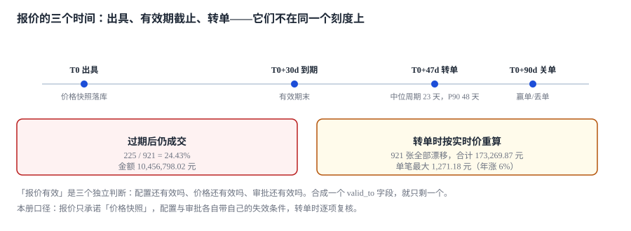

# 报价单：版本与有效期

一张报价单发出去，第 12 天客户要求改配置，第 23 天客户签了，第 26 天价格册涨了 6%，第 31 天财务对账发现这一单的毛利比预算低 188 元。

**每一方都说自己按规则办事：客户按 30 天有效期，销售按新配置，财务按新价目。**

::: tip 一句话理解
「报价有效」不是一条 `valid_to` 字段，而是**三个独立判断**：这套配置还合法吗、这条价格还有效吗、这份审批还算数吗。三者各有各的失效条件，合成一个日期字段就只剩下最宽松的那个。
:::

本页判据族 `CQT-A` ~ `CQT-H`，共 8 条。定义表在第八节「本页判据」。

## 一、报价单的六个状态与五条边

| 状态 | 含义 | 能做什么 | 不能做什么 |
| --- | --- | --- | --- |
| `DRAFT` | 草稿，可随意改 | 改配置、改行、重算 | 不能发出、不能转单 |
| `SENT` | 已发出，客户手上有 | 接受、拒绝、改配（生成新版本） | 不能静默改金额 |
| `ACCEPTED` | 客户接受，待转单 | 转单 | 不能再改金额（只能作废重开） |
| `ORDERED` | 已转单 | 关联订单、开票 | 金额冻结 |
| `EXPIRED` | 超过有效期 | 重新报价（新版本） | 不能转单 |
| `VOID` | 作废 | 留档 | 一切 |

```text
DRAFT ──send──> SENT ──accept──> ACCEPTED ──order──> ORDERED
                  │                  │
                  ├──expire──> EXPIRED
                  └──void────> VOID
```

五条边里，只有 `accept` 需要额外校验（审批是否覆盖、配置是否仍合法），其余四条都是「写状态」。**这条边是全流程唯一需要跨表判断的地方**，所以它必须落在数据库里，不能只写在服务层（见[实战](../Practice/index.md)的 `trg_accept_gate`）。

## 二、有效期其实是三个时钟

| 时钟 | 起点 | 长度 | 谁定 | 过期后 |
| --- | --- | --- | --- | --- |
| 配置有效 | 模型版本发布 | 到下一次不兼容升版 | 产品 | 旧报价仍可解释，但不能再配 |
| 价格有效 | 价格条目生效日 | `valid_to` 或新价发布 | 定价 | 必须重新取价 |
| 审批有效 | 审批通过时间 | 通常 30~90 天 | 财务 | 必须重新审批 |

三者的长度通常不同：配置可能一年不变，价格可能一个月一调，审批可能只认 30 天。**报价单上印的「有效期 30 天」只是三者中最小值的一个投影。**

本机 3,000 张报价（有效期 30 天占 80%）实测：

| 读数 | 值 |
| --- | --- |
| 成交报价 | 921（30.70%） |
| **在有效期之后才成交** | **225（24.43%）** |
| 这些单的金额 | **10,456,798.02 元** |
| 若转单时按实时价重算（年涨 6%） | 921 张全部漂移，合计 **173,269.87 元**，单笔最大 **1,271.18 元** |



24.43% 这个数字的含义不是「四分之一客户拖延」，而是**四分之一成交的商务承诺在系统眼里已经失效了**。如果系统按 `state = 'SENT'` 就能转单，这 225 单会静默地以「有效报价」的身份进入订单。

## 三、快照：报价必须能自证

一张报价单要能在一年后被完整复现，至少需要三份快照：

```sql
CREATE TABLE quote(
  quote_id    TEXT PRIMARY KEY,
  rev         INTEGER NOT NULL DEFAULT 1,     -- 版本号
  parent_id   TEXT,                            -- 上一版（改配产生）
  model_id    TEXT NOT NULL,
  model_ver   INTEGER NOT NULL,                -- 配置模型版本
  book_id     TEXT NOT NULL,
  entry_id    INTEGER NOT NULL,                -- 具体取到的价格条目
  currency    TEXT NOT NULL,
  total_amt   REAL NOT NULL CHECK (total_amt >= 0),
  residual    REAL NOT NULL DEFAULT 0,
  cost_amt    REAL,                            -- 出具时的成本快照
  valid_from  TEXT NOT NULL,
  valid_to    TEXT NOT NULL,
  state       TEXT NOT NULL CHECK (state IN ('DRAFT','SENT','ACCEPTED','EXPIRED','ORDERED','VOID')),
  priced_at   TEXT NOT NULL,
  UNIQUE (quote_id, rev)
);
```

四个字段承担了「自证」的责任：`model_ver`（配置怎么解释）、`entry_id`（价格从哪来）、`cost_amt`（毛利怎么算）、`priced_at`（价目时点）。少任何一个，复现都要靠猜。

## 四、版本：改配不是改行

客户在第 12 天要求把「接口」从电口换成光口。有三种改法：

| 改法 | 做法 | 客户手上那份 | 风险 |
| --- | --- | --- | --- |
| 原地改 | `UPDATE quote_line` | 静默失效 | **最危险**：客户按旧单签，系统按新单履约 |
| 作废重开 | `VOID` + 新建 | 明确作废 | 丢失历史，赢单率口径断裂 |
| 新版本 | `rev + 1`，`parent_id` 指向上版 | 仍指向旧版 | 需要界面提示「有新版本」 |

正确做法是第三种，且**旧版本必须保持可读**：

```sql
-- 新版本：复制上一版的行与折扣层，改配置后重算
INSERT INTO quote(quote_id, rev, parent_id, model_id, model_ver, book_id, entry_id,
                  currency, total_amt, valid_from, valid_to, state, priced_at)
SELECT quote_id, rev + 1, quote_id, model_id, model_ver, :new_book, :new_entry,
       currency, 0, :now, :now + 30, 'DRAFT', :now
FROM quote WHERE quote_id = :qid AND rev = (SELECT MAX(rev) FROM quote WHERE quote_id = :qid);
```

注意 `quote_id` 与 `rev` 组成复合唯一键：**同一个报价身份，多个版本**。这比「每次改配生成新 quote_id」好，因为后者会让「一张报价改了 5 次」变成「5 张独立的报价」，赢单率的分母立刻虚高。

## 五、改量为什么不只是乘法

客户把 60 台改成 45 台，价格不是简单乘 0.75——数量跨档了。本机 1,500 次改量实测：**552 次（36.80%）在「锁旧档」与「按新档重算」之间产生差异，合计 257,086.65 元**（改量后按新档重算普遍更贵，因为档位下移）。

| 做法 | 含义 | 适合 | 风险 |
| --- | --- | --- | --- |
| 锁旧档 | 仍按报价时的档位价 | 合同已签、只调交付量 | 客户会问「为什么 45 台还是 60 台的价」 |
| 按新档重算 | 重新查阶梯 | 仍在报价阶段 | 改小数量反而涨价，需要解释 |
| 分段：已交付锁旧、未交付按新 | 最公平 | 部分交付 | 实现最复杂 |

**这条规则必须写在报价单上**，不能留给销售临场决定。写成文字的一句话成本极低，事后的争议成本极高。

## 六、报价号：97 次重号从哪来

本机模拟 3 台应用实例、按「日期 + 各实例自增序列」发号，3,000 张报价里出现 **97 次重号（3.23%）**。

原因很简单：三个实例的序列都从 1 开始。`20261105-0001` 在三个实例上各生成一次，就撞了两次。

| 方案 | 重号风险 | 代价 |
| --- | --- | --- |
| 日期 + 自增（无实例前缀） | **必然重号** | 无 |
| 日期 + 实例号 + 自增 | 无（实例号固定时） | 实例扩容要规划号段 |
| 数据库序列 | 无 | 单点，需高可用 |
| UUID / ULID | 无 | 不可读，人工沟通成本高 |

推荐「日期 + 实例号 + 自增 + 校验位」：可读、可排序、可校验。校验位不是防伪，是防手抄错——报价号在电话里被念出来过。

## 七、报价单上必须印的六件事

| 印什么 | 为什么 | 漏了会怎样 |
| --- | --- | --- |
| 报价号 + 版本 | 客户与你指的是同一份 | 客户拿 v1 来签，系统按 v3 履约 |
| 出具时间与有效期 | 双方对「什么时候失效」有共识 | 第 31 天争论「还算不算数」 |
| 配置摘要（维度与选项） | 客户能核对「买的是什么」 | 交付时「我以为包含光口」 |
| 单价、数量、行折扣、行金额 | 客户能自行复算 | 客户不信任总额 |
| 税额与税率 | 合规要求 | 开票金额与报价不一致 |
| 价格与审批的「条件」 | 例如「以签约日价目为准」 | 涨价由谁承担没有约定 |

最后一条最容易被省略，也最容易引发争议：**报价单要么承诺价格，要么承诺「按签约日价目」，不能模糊**。本机那 173,269.87 元的漂移，本质就是这句话没写清楚。

## 八、本页判据

| 判据 | 断言 | 验证方式 |
| --- | --- | --- |
| `CQT-A` | 报价有版本号且旧版可读 | `(quote_id, rev)` 复合唯一，旧版 `state` 不被覆盖 |
| `CQT-B` | 三个有效期分别存储 | 表里能查到配置版本、价格条目、审批时限 |
| `CQT-C` | 过期报价不能转单 | 对 `EXPIRED` 转单被拒（触发器或状态机） |
| `CQT-D` | 转单金额来自锁价而非实时价 | 转单 SQL 不查 `price_entry` |
| `CQT-E` | 成本快照落库 | `cost_amt` 非空，可复算毛利 |
| `CQT-F` | 改量规则显式（锁旧档/新档/分段） | 报价单上有对应文字，系统有对应开关 |
| `CQT-G` | 报价号含实例号且全局唯一 | `UNIQUE(quote_id)` 且发号规则含实例位 |
| `CQT-H` | 报价单印出六项要素 | 打印模板字段与上表一一对应 |

## 验证方式

```shell
# 1. 过期不能转单：EXPIRED 状态必须被拒绝
sqlite3 cpq.db "update quote set state='EXPIRED' where quote_id='Q-0003';
                insert into order_link select quote_id,'SO-X','2026-11-05',total_amt
                  from quote where quote_id='Q-0003' and state in ('ACCEPTED','ORDERED');"
sqlite3 cpq.db "select count(*) from order_link where quote_id='Q-0003';"
# 期望：0（插入语句的 where 把 EXPIRED 挡在外面）

# 2. 版本：同一 quote_id 的多个 rev 都能查到
sqlite3 cpq.db "select quote_id, rev, total_amt, state from quote
                where quote_id='Q-0001' order by rev;"
# 期望：≥ 1 行；若改配过，应有多行且旧行 state 不再是 DRAFT

# 3. 漂移可量化：按实时价重算与锁价额的差
python3 -c "
amt=8640.0; days=47; rate=0.06
print(round(amt*(1+rate)**(days/365),2), round(amt*(1+rate)**(days/365)-amt,2))"
# 期望：8707.0 67.0（47 天、年涨 6%，一张 8,640 的报价漂 67 元）
```

## 参考资料

- ISO 8601-1:2019《日期和时间 信息交换表示法 第 1 部分：基本规则》：有效期的时刻表示。
- RFC 3339《Date and Time on the Internet: Timestamps》：时间戳的字符串格式与比较。
- 《中华人民共和国民法典》第四百七十二条、第四百七十六条：要约的定义与撤销条件——报价单在法理上是要约，「有效期」即承诺期限。
- 与本页相邻：[折扣瀑布与审批阈值](../Discount/index.md)、[条款、锁价与合同](../Contract/index.md)、[转单与履约衔接](../Ordering/index.md)。
