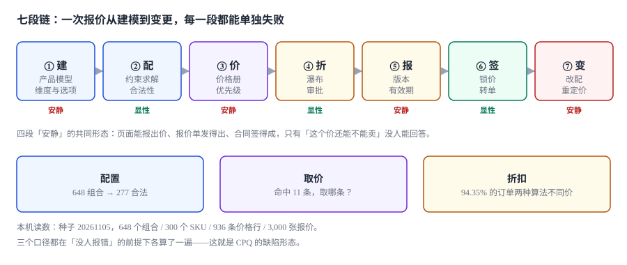
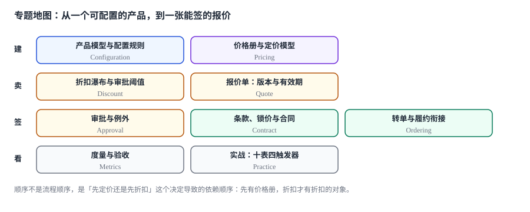

# 配置、定价与报价工程

<p style="text-align:center;"></p>

一个客户要在二十天内买到 300 台「够用的」边缘网关。销售在配置器里点了四轮：先是旗舰版，系统提示「旗舰不支持入门规模」；换成标准版，又提示「光口只在高端型号上提供」；加上三年企业许可，价格跳了 18%；最后客户问「如果只买 200 台呢」——价格又跳了一次，这次是往上。

四轮里，系统每一轮都给出了一个数，而且每一轮的数都能被解释。**但没有一轮告诉销售：这个配置到底存不存在、这个价格是从八本价格册里的哪一条取出来的、这个折扣是谁批的。** 报价单发出去了，客户签了，订单转过来了，三个月后财务发现同一批货有三个成交价，差 11.7 万——而三份合同上都盖了章。

::: tip 一句话理解
报价不是「一个数」，是**一组约束下的一次承诺**：它同时承诺了「这个配置在物理上成立」「这个价格在某个价格册的某一条上」「这个折扣有一个人负责」，以及「这些承诺在某个时刻之前有效」——四条里有任何一条没有落库，报价就只是屏幕上的一行字。
:::

## 一、这个专题讲什么

从「这个产品能被配成什么样」到「改配之后要不要重新报价」，一次报价要走七段：

| 段 | 这一段在做什么 | 产物 | 失败是否安静 |
| --- | --- | --- | --- |
| ① 建 | 定义产品模型：维度、选项、约束 | `product_model` + `cfg_rule` | **安静**（模型版本错了照常能配，只是配出不存在的东西） |
| ② 配 | 在这个模型上求一个合法组合 | `cfg_json` | 显性（冲突会当场拦住，但拦得对不对是另一回事） |
| ③ 价 | 从价格册里取出「这一个」价格 | `price_entry` | **安静**（命中 11 条照样返一个数） |
| ④ 折 | 按顺序叠折扣，超阈值送审批 | `disc_approval` | 显性（审批不走就发不出去） |
| ⑤ 报 | 生成报价单：版本、金额、有效期 | `quote` | **安静**（过期了照样能转单） |
| ⑥ 签 | 锁价、转单、生成合同条款 | `order_link` | 显性（金额对不上会拦住） |
| ⑦ 变 | 改配、改量、重定价 | 报价新版本 | **安静**（改完不重算，谁也看不出来） |



七段里**四段的失败是安静的**。它们的共同形态是：每个环节都返回了一个「看起来对」的结果，只有「这四条承诺还同不同时成立」没人能回答。

本机实测最能说明问题的一组读数：6 个维度、648 个理论组合、277 个合法组合；300 个 SKU 对应 936 条价格行，**82.00% 的 SKU 同时命中多个价格册，最多的命中 11 条**；3,000 张报价里 921 张成交，其中 **24.43% 是在有效期之后才转的单**。

| 视角 | 读数 | 它掩盖了什么 |
| --- | --- | --- |
| 合法组合占比 | 42.75%（277 / 648） | 另外 371 个非法组合里，前端下拉框一个都拦不住 |
| 多价格册命中率 | 82.00% | 每次「取一个价」都在做一次没有规则的仲裁 |
| 过期后成交 | 24.43%（225 / 921） | 报价单上写着「30 天有效」，业务上根本没人在看 |

这就是 CPQ 最典型的缺陷形态：**每一段都对，合起来不对**。一张报价单可以同时是「配置合法」「价格正确」「审批通过」的，但它仍然是错的——因为它在第 31 天才被签，而价格册在第 25 天涨了 6%。

## 二、三个「同一个数」

报价里最容易出分歧的不是金额本身，而是「哪个金额算数」：

| 口径 | 定义 | 谁在关心 | 常见错法 |
| --- | --- | --- | --- |
| 报价额 `quoted` | 出具时报价单上的总额 | 客户、销售 | 改配后只改行、不回写总额 |
| 锁价额 `locked` | 转单那一刻写进订单的金额 | 财务、履约 | 转单时「顺手」按当前价目重算 |
| 实收额 `invoiced` | 开票/收款时的金额 | 财务、审计 | 与锁价额之间没有差异记录 |

三者必须由同一条链路写出来，而且**每一步的差额都要能归因**。本机实测里，921 张成交报价如果按转单时刻的价目重算（假设年涨 6%），**全部 921 张都会漂移，合计 173,269.87 元，单笔最大 1,271.18 元**。

### 一个必须自己算一遍的例子

一张 60,000 元的报价，五层折扣：数量 15%、协议 8%、促销 10%、特批 5%。

| 算法 | 表达式 | 净额 | 后果 |
| --- | --- | --- | --- |
| 逐层扣 | 60,000 × 0.85 × 0.92 × 0.90 × 0.95 | 40,116.60 | 正确：每层的基数是上一层净额 |
| 折扣率加总 | 60,000 × (1 − 0.38) | 37,200.00 | 少收 2,916.60，销售还以为自己算对了 |
| 只乘百分比（漏定额） | 同第一种，但促销是 500 元定额时被当成 5% | 视订单而定 | 定额折扣在大额单上被放大 6 倍 |

**三种写法都能跑出数字，只有第一种同时满足「每层可解释」和「总额可复核」。**

::: danger 三件事必须写进数据模型，不能留给「提交时算一下」
1. **配置必须存成规范化 JSON 并计算指纹**：同一份配置，一处写全 6 个维度、一处只写非默认值，指纹就不一样。实测 277 个合法组合里 **262 个（94.58%）** 在「省略默认值」与「全量写」两种表示下指纹不同——合同与订单因此对不上，而两边都没有报错。
2. **价格必须落到 `price_entry` 的一行，不能只存一个数**：只存金额等于把「这条价格从哪来、什么时候失效」丢掉了。价格调整时无法回溯，也无法回答「这一单为什么是 8,640」。
3. **有效期是一个时段，不是截止日**：`valid_to = 2026-12-31` 只是「报价单上印的字」，真正要判的是「配置模型版本还有效吗、价格条目还有效吗、审批还有效吗」——三者各有各的失效条件（详见[报价单：版本与有效期](Quote/index.md)）。
:::

## 三、专题地图



按「一次报价的生命周期」读：

| 阶段 | 页面 | 一句话 |
| --- | --- | --- |
| 建 | [产品模型与配置规则](Configuration/index.md) | 648 个组合里只有 277 个是真的，靠取值域拦不住 |
| 价 | [价格册与定价模型](Pricing/index.md) | 命中 11 条不是异常，是常态；关键是谁排在前面 |
| 折 | [折扣瀑布与审批阈值](Discount/index.md) | 百分比之间不能相加，只能逐层乘 |
| 报 | [报价单：版本与有效期](Quote/index.md) | 有效期是三个独立判断，不是一个日期字段 |
| 审 | [审批与例外](Approval/index.md) | 阈值写进制度不算数，写进约束才算 |
| 签 | [条款、锁价与合同](Contract/index.md) | 报价到合同，锁的是「承诺」不是「文本」 |
| 转 | [转单与履约衔接](Ordering/index.md) | 一行报价能变三行订单，也能变零元行 |
| 看 | [度量与验收](Metrics/index.md) | 同一个赢单率，四个分母四个答案 |
| 落地 | [实战：十张表、四个触发器、十三条断言](Practice/index.md) | 能被脚本判定的，才叫设计 |

## 四、和相邻专题的分工

本册只讲「一个可配置的产品怎么被报出一个能签的价」。相邻主题各自已经讲透的部分，这里不重复：

| 相邻专题 | 它讲什么 | 本专题不重复讲 |
| --- | --- | --- |
| [定价与优惠](../PricingPromotion/Overview/index.md) | 促销规则引擎、优惠券、优惠分摊 | 价格册的**优先级仲裁**与阶梯跨档 |
| [订阅计费](../SubscriptionBilling/Pricing/index.md) | 周期计费、档位模式、用量计价 | 一次性报价的**配置绑定**与锁价 |
| [合同版本演进](../ContractEvolution/index.md) | 条款版本、兼容性、废弃策略 | 报价转合同时**哪些字段被冻结** |
| [电商订单状态机](../Ecommerce/OrderStateMachine/index.md) | 线上订单生命周期与状态迁移 | 报价转单时的**行映射与部分转单** |
| [供应商价格协议](../SupplierCollaboration/PriceAgreement/index.md) | 采购侧阶梯价与协议价 | 销售侧的价格册层级与客户专属价 |
| [开票与红冲](../TaxInvoice/Overview/index.md) | 发票要素、红冲、税额 | 报价里的税额只讲**取整与顺序** |
| [审批流引擎](../WorkflowEngine/ApprovalFlow/index.md) | 流程定义、会签、加签 | 折扣审批只讲**阈值矩阵与四眼** |
| [主数据与标准](../../DB/DataGovernance/StandardsMasterData/index.md) | 编码标准、主数据治理 | 产品维度的**选项编码**只讲约束表达 |
| [授信与额度](../RiskDecision/Overview/index.md) | 信用评估、额度与定价 | 客户信用只作为「能不能报价」的前置 |
| [多币种折算](../MultiCurrency/Conversion/index.md) | 汇率快照、折算时点 | 报价币种只讲**价格册的币种维度** |

## 五、版本组织：为什么不建版本目录

CPQ 侧最常见的疑问是「从 Excel 报价到配置器，文档是不是要分一代」。本册**不建 `CPQ/V1` 这类目录**，三条理由：

1. **换代的是交互方式，判据一字没变。** Excel 模板、网页配置器、销售 App，变的只是 `quote.source` 的枚举值；「配置必须合法、价格必须可溯源、折扣必须有人负责、有效期必须可判」这四条从纸质报价单时代就成立。
2. **并存差异是销售形态，不是代际。** 直销、渠道、代理的差别在**谁能给多少折扣**（审批矩阵）与**谁能看哪本价格册**（数据权限），不在链路本身。用版本目录去装「渠道报价」，会把权限问题伪装成代码分支问题。
3. **真正需要版本目录的是「同一份代码两套写法」。** 本库已有先例：[Spring5](../Java/Frame/Spring/Spring5/index.md) / [Spring6](../Java/Frame/Spring/Spring6/index.md)、[Vue2](../../Frontend/Frame/Vue/Vue2/index.md) / [Vue3](../../Frontend/Frame/Vue/Vue3/index.md)——同一框架两代 API 并存，旧版必须原样保留并标注维护状态。CPQ 侧不是这种情形：一套写法接不同渠道，渠道差异落在审批矩阵与价格册可见性上。

::: info 旧报价模板与旧价格表的处置口径
遇到仍在用 Excel 模板的团队，**不新建章节**，在[价格册与定价模型](Pricing/index.md)的兼容性表里加一行，标注「仅存量客户使用，新签合同不再新建模板」。这条口径和本库对 Spring5 / Vue2 的处理一致：旧内容保留、标注状态、不覆盖。

真正需要「版本目录」的是**产品模型本身**——`product_model.version` 是数据层面的版本，不是文档层面的版本：模型升版后旧报价仍要能按旧版本解释，这件事在[产品模型与配置规则](Configuration/index.md)里用 `model_version` 落到每一行报价上。
:::

## 六、建议阅读顺序

1. 先读[总览：七段链与三个「同一个数」](Overview/index.md)——把「一次承诺」这个概念立起来。
2. 再读[产品模型与配置规则](Configuration/index.md)与[价格册与定价模型](Pricing/index.md)——这两页决定后面所有数字的来源。
3. 然后是两段「减价」的：[折扣瀑布与审批阈值](Discount/index.md)、[审批与例外](Approval/index.md)。
4. 接着是两段「出单」的：[报价单：版本与有效期](Quote/index.md)、[条款、锁价与合同](Contract/index.md)。
5. 最后读[转单与履约衔接](Ordering/index.md)与[度量与验收](Metrics/index.md)，按[实战](Practice/index.md)把十张表建出来，跑一遍十三条断言。

## 七、本册的读数从哪来

所有数字来自一台 16 GB 笔记本上的 SQLite 3.50.4 / Python 3.13，种子 `20261105`，规模是 6 个维度（648 个组合）、300 个 SKU、936 条价格行、3,000 张报价、1,200 次转单，**不是生产数据，也不是压测结论**。写进正文的每一个数都可以用附录里的脚本重跑：

| 读数 | 值 | 出现在 |
| --- | --- | --- |
| 合法组合 / 全排列 | 277 / 648（42.75%） | 本页、[配置](Configuration/index.md) |
| 两两校验漏放行 | 10 个（3.61%） | [配置](Configuration/index.md) |
| 多价格册命中 | 82.00%，最多 11 条 | [价格册](Pricing/index.md) |
| 优先级 vs 最低价差异 | 46.33%，89,315.50 元 | [价格册](Pricing/index.md) |
| 取整顺序不一致 | 35.30%（单笔最大 0.01 元） | [价格册](Pricing/index.md) |
| 瀑布两种算法差异 | 94.35%，1,213,672.04 元 | [折扣](Discount/index.md) |
| 越权审批 | 5.94%（297 / 5,000） | [审批](Approval/index.md) |
| 四眼缺失 | 9.00%（108 / 1,200） | [审批](Approval/index.md) |
| 过期后成交 | 24.43%（225 / 921） | [报价单](Quote/index.md) |
| 转单价格漂移 | 173,269.87 元（921 张全漂） | [合同](Contract/index.md) |
| 零元行占比 | 9.92%（782 / 7,885） | [转单](Ordering/index.md) |
| 赢单率四口径 | 30.70% / 33.19% / 100% / 加权 | [度量](Metrics/index.md) |
| 断言通过 | 13 / 13，退出码 0 | [实战](Practice/index.md) |

::: warning 这些数字不能直接当业务基线
单机 SQLite 与真实 CPQ 系统的并发、目录规模都不是一回事。本文用它们判断**方向和量级**（例如「两份价格都能生效时，取哪条取决于排序字段」「百分比折扣不可加」），不用它们承诺性能或转化率。凡涉及性能的结论，文中都注明了「按本机读数」。
:::

## 验证方式

读完本册后，任选一页的「验证方式」小节照做即可。若要一次性确认本册自洽：

```shell
# 1. 目录与配图齐全（11 页 + 12 张图）
find docs/Backend/CPQ -name "index.md" | wc -l    # 期望 11
ls docs/Backend/CPQ/assets | wc -l                 # 期望 12

# 2. 判据族不撞号（应只输出本册 10 个前缀）
grep -rho "CQ[A-Z]-[A-H]" docs/Backend/CPQ | sort -u | cut -c1-3 | sort -u

# 3. 链接与配图全部可解析（在仓库根目录、构建后检查）
pnpm docs:build
```

## 参考资料

- ISO/IEC 25010:2011《系统与软件质量模型》：产品配置的功能完备性与可用性要求，本册「配置合法性」的判定视角来自其中的功能正确性定义。
- ISO 8000-110:2021《数据质量 第 110 部分：主数据 特性数据的交换》：产品维度与选项编码的交换格式要求。
- GB/T 7408—2005《数据元和交换格式 信息交换 日期和时间表示法》：报价有效期与价格条目生效期的表示。
- RFC 8259《The JavaScript Object Notation (JSON) Data Interchange Format》：配置快照的序列化格式；本册要求键排序后再计算指纹，就是对其中「对象成员无序」这一点的应对。
- 与本册相邻：[定价与优惠](../PricingPromotion/Overview/index.md)、[订阅计费](../SubscriptionBilling/Overview/index.md)、[合同版本演进](../ContractEvolution/index.md)。
