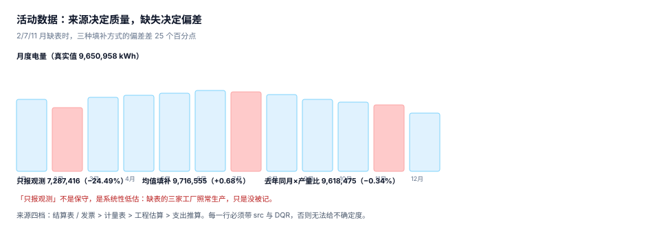

# 活动数据：来源、期间与缺失

排放量 = 活动数据 × 因子。因子可以从公开库取，**活动数据只能从自己这里取**——所以整条链里最不可替代、也最容易出错的一段就是这里。

活动数据有四个坑，全都不会报错：来源不分级（估算和实测混在一列）、期间不统一（账单期跨月）、缺失不处理（缺表当月按 0 计）、计量不核对（表计倍率漏乘）。

::: tip 一句话理解
「没有数据就不估」看起来最保守，实际是**系统性低估**：缺表的那三个月工厂照常生产，只是没被记。保守的做法不是不估，是**估了并标注**。
:::

## 一、四类来源与优先级



| 来源 | 典型形态 | 精度 | DQR | 什么时候用 |
| --- | --- | --- | --- | --- |
| 结算/发票 | 电费单、燃气结算单、加油发票 | 高（有第三方） | 1~2 | 默认优先 |
| 计量表 | 自有电表、流量计、DCS 记录 | 高（但需校表） | 1~2 | 内部核算与分表 |
| 工程估算 | 按设备额定功率 × 运行小时 | 中 | 3~4 | 无表无单 |
| 支出推算 | 金额 × 行业强度 | 低 | 4~5 | 范围三、小额杂项 |

优先级不是「越靠前越好」，而是**同一排放源内部要一致**：今年用发票、明年用估算，两年的数就不可比。规则应写成「按此优先级取第一个可用来源，并记录实际用了哪个」。

`src` 字段必须落库，不能只写在报告脚注里。原因很简单：核查时要按来源分层抽样，分层信息在脚注里就没法机读。

## 二、期间：账单期不是自然月

电费单的周期通常是「上月 28 日到本月 27 日」，而报告期是自然月。三种处理各有代价：

| 处理 | 做法 | 偏差 | 适用 |
| --- | --- | --- | --- |
| 整笔记发票月 | 简单，最常见 | 跨月那几天全跑到下月 | 全年口径影响小 |
| 按天数分摊 | 按覆盖天数比例拆 | 假设日耗均匀 | 月度披露必须用 |
| 按日负荷曲线分摊 | 用 15 分钟/小时数据 | 最准 | 有分时计量时 |

读数：一个账单期 3/28–4/27，电量 30,000 kWh，共 31 天，其中 3 月 4 天、4 月 27 天。

```text
按天数分摊：3 月 30,000 × 4/31 = 3,870.97 kWh，4 月 26,129.03 kWh
整笔记发票月：3 月 0 kWh，4 月 30,000 kWh —— 3 月凭空少 3,870.97
```

全年看，跨月部分会互相抵消一部分；但**只要有一头落在报告期边界上（12 月/1 月），就有一段永远落在报告期外**。这是「年度数差了 1%~2%、怎么也找不到」的常见来源。

::: danger 期间错配的三个连锁反应
1. **月度考核失真**：12 月看起来能耗下降，1 月暴涨，实际是账单边界在移动。
2. **配额清缴口径不符**：履约期按自然年，账单期错位会让清缴量与核查量差一截。
3. **强度指标漂移**：分母（产量）用自然月、分子（能耗）用账单月，单位产品能耗每月都在「波动」，其实是口径在动。
:::

## 三、缺失：三种填补，三个结果

12 个月的电量，2/7/11 月缺表（真实年度 9,650,958 kWh）：

| 处理 | 年度值 | 相对真值 | 本质 |
| --- | --- | --- | --- |
| 只报观测到的 9 个月 | 7,287,416 | **−24.49%** | 把「没有数据」当成「没有排放」 |
| 缺月按其余月均值 | 9,716,555 | +0.68% | 无偏，但抹平季节性 |
| 缺月按去年同月 × 产量比 | 9,618,475 | −0.34% | 保留季节性，依赖去年数据 |

三个数的差别不是「精度」，是**报告态度**：第一种在披露里会写「数据覆盖率 75%」，读者会自动打折；后两种写「估算占比 25%」，读者知道哪几个月是估的。

工程上有三条要求：

1. **填补必须留痕**：`src='estimate'` 与 `method`（mean / yoy / regression）都要落库，不能事后改 `src`。
2. **估算占比要单独统计**：`sum(case when src='estimate' then co2e else 0 end) / sum(co2e)`，这个比例是核查时的第一个问题。
3. **不允许用 0 填补**：0 是一个具体的主张（这个月没排放），与「不知道」是两件事。用 `NULL` 表示未知，用 `0` 表示确实是零。

## 四、计量：表计倍率与量程

工业电表常配电流互感器（CT），读数要乘倍率：

```text
CT 200/5 = 40 倍；表计读数 1,250 → 实际 50,000 kWh
漏乘倍率：只记 1,250 kWh，少 97.50%
```

漏乘倍率不会报错，因为 1,250 是一个完全合法的数。它的症状是「这家工厂的单位产品能耗只有同行的 1/40」——通常要等到做同行对标时才被发现。

三类计量问题：

| 问题 | 症状 | 检查方法 |
| --- | --- | --- |
| 倍率漏乘 | 数值小一个数量级 | 与电费单金额反推的电量对比 |
| 量程溢出 | 表计回零或跳变 | 月度环比突降 > 30% 即排查 |
| 单位混用 | m³ 与 kWh 混在一个 `fuel` 下 | `unit` 与因子单位必须匹配 |

第一条检查最好用：**发票金额 ÷ 单价 = 电量**，与表计读数对一下，差一个数量级立刻能看出来。这也是为什么「有发票就优先用发票」。

## 五、支出推算法：能用，但要标清楚

范围三和小额杂项常用「金额 × 行业碳强度」。它的适用边界：

| 场景 | 是否适用 | 原因 |
| --- | --- | --- |
| 差旅、办公用品 | 适用 | 金额与实物量强相关，单项占比小 |
| 大宗原材料 | 慎用 | 价格波动会让排放随价格变，与实际生产脱钩 |
| 同一供应商多年对比 | 不适用 | 涨价 20% 会被读成「排放增加 20%」 |
| 有实测数据的品类 | 不适用 | 有更好的数据就不用估算 |

::: warning 支出法的「价格幻觉」
用支出法时，排放 = 金额 × 强度。金额里含价格变动，所以**通胀年份的排放会自动上升**，与实际产量无关。这不是精度问题，是口径问题：它测的是「花了多少钱」，不是「用了多少物」。

披露时必须写清「本类采用支出法（spend-based）」，否则读者会把它和供应商实测数据放在一起比较。
:::

## 六、台账表结构

```sql
CREATE TABLE activity(
  id          INTEGER PRIMARY KEY,
  facility_id TEXT NOT NULL REFERENCES facility(id),
  period      TEXT NOT NULL CHECK(period GLOB '[0-9][0-9][0-9][0-9]-[0-9][0-9]'),
  fuel        TEXT NOT NULL,                  -- elec / gas / diesel / steam ...
  qty         REAL NOT NULL CHECK(qty >= 0),
  unit        TEXT NOT NULL,                  -- kWh / m3 / kg / L / GJ
  src         TEXT NOT NULL CHECK(src IN ('meter','invoice','estimate')),
  fill_method TEXT,                           -- NULL 表示实测；mean / yoy / regression
  meter_ratio REAL DEFAULT 1.0 CHECK(meter_ratio > 0),
  dqr         INTEGER NOT NULL CHECK(dqr BETWEEN 1 AND 5),
  doc_ref     TEXT,                           -- 发票号 / 表计编号
  UNIQUE(facility_id, period, fuel)
);
```

四个字段是关键：

- `unit`：与因子的 `unit` 必须一致，不一致就在入库时换算（不要留到计算时）。
- `meter_ratio`：倍率单独一列，避免「读数已乘过」和「没乘过」两种数据混在一张表里。
- `fill_method`：估算方法落库，`src='estimate'` 时不允许为空。
- `UNIQUE(facility_id, period, fuel)`：这一条挡住「同一个月同一设施同一个能源被导两次」，是最省事的一道闸门。

## 七、本页判据：`CBA-A` ~ `CBA-H`

| 编号 | 判据 | 怎么判 |
| --- | --- | --- |
| `CBA-A` | 每条活动数据有 `src`，取值在白名单内 | `src` 非空率 100% |
| `CBA-B` | `src='estimate'` 时 `fill_method` 非空 | 该组合计数为 0 违例 |
| `CBA-C` | 不存在用 0 填补的缺月 | 缺月行为 `NULL` 或 `src='estimate'` |
| `CBA-D` | 活动数据单位与因子单位一致 | 入库时已换算，`unit` 与因子 `unit` 相等 |
| `CBA-E` | 表计倍率单独记录，不预乘 | 有 `meter_ratio` 列且非默认值的行有 `doc_ref` |
| `CBA-F` | `(facility_id, period, fuel)` 唯一 | 重复导入后行数不变 |
| `CBA-G` | 账单期跨月时按天数分摊或标注不分摊 | 有 `period_start`/`period_end` 或明确的「整笔记账」声明 |
| `CBA-H` | 估算占比可统计且 < 20%（超阈值需说明） | 一个 SQL 就能算出占比 |

## 八、验证方式

先验证三种填补的偏差，再验证「重复导入不会翻倍」：

```shell
# 1) 本页判据 8 条
grep -o 'CBA-[A-H]' docs/Backend/CarbonAccounting/ActivityData/index.md | sort -u | wc -l

# 2) 三种填补的偏差
python3 - <<'PY'
true_v, obs, avg_fill, yoy_fill = 9_650_958, 7_287_416, 9_716_555, 9_618_475
for name, v in (("只报观测", obs), ("均值填补", avg_fill), ("去年同月", yoy_fill)):
    print("%s %.0f（%+.2f%%）" % (name, v, (v-true_v)/true_v*100))
PY

# 3) 账单期按天数分摊
python3 - <<'PY'
tot, mar, apr = 30_000, 4, 27
print("3 月 %.2f / 4 月 %.2f" % (tot*mar/(mar+apr), tot*apr/(mar+apr)))
PY
```

预期输出：第一条 `8`；第二条打印三行，分别是 `只报观测 7287416（-24.49%）`、`均值填补 9716555（+0.68%）`、`去年同月 9618475（-0.34%）`；第三条打印 `3 月 3870.97 / 4 月 26129.03`。

如果第二条第一行的偏差不是 −24.49% 而是接近 0，说明你在填补时把「缺表」当成了「表读数为 0」——这两件事在数上一样，在披露上是两回事。

## 参考资料

- [组织边界与合并方法](../BoundaryOrg/index.md)
- [排放因子与 GWP](../EmissionFactor/index.md)
- GHG Protocol《Corporate Standard》第 6 章（识别与计算温室气体排放）：<https://ghgprotocol.org/corporate-standard>
- ISO 14064-1:2018 第 6.2 节（温室气体量化）：<https://www.iso.org/standard/66453.html>
- 国家发展改革委《关于加快建立统一规范的碳排放统计核算体系实施方案》（2022）：<https://www.ndrc.gov.cn/>
