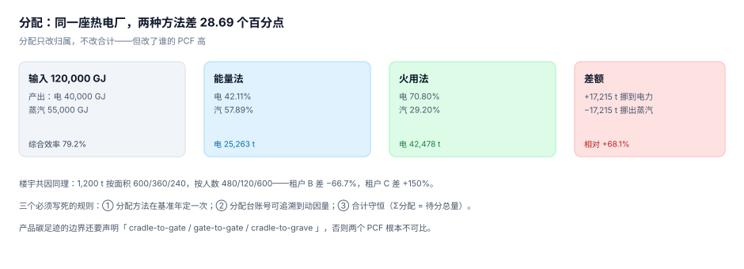

# 分配与产品碳足迹：只改归属不改合计

分配是「一份排放，多个受益方」时的分摊规则。它有三层：实体之间（集团内跨公司）、设施内部（一座厂产出多种产品）、产品之间（一个产品用了几道工序）。

分配的三条铁律：**合计守恒**（分出去的和等于待分的总量）、**方法写死**（基准年定一次）、**动因可查**（每一份分到多少，能算回它用了多少动因量）。

::: tip 一句话理解
分配不改变总量，只改变「谁认领」。所以分配方法是一个**立场问题**，不是一个算术问题——同一座热电厂，按能量分还是按火用分，电力的排放能差 68%。
:::

## 一、三层分配

| 层 | 待分对象 | 常见动因 | 谁受影响 |
| --- | --- | --- | --- |
| 实体之间 | 集团共有的服务（总部、共享工厂） | 排放量占比 / 产值 / 人数 | 各子公司的清单 |
| 设施内部 | 一座厂的共因排放（热电联产、公用工程） | 能量 / 火用 / 产量 | 各条产品线 |
| 产品之间 | 一条产线的排放 | 工时 / 机时 / 产量 | 单个产品的 PCF |

三层里最容易出错的是第二层：它没有「金额」作为天然动因，只能靠物理量，而物理量的选择直接决定结论。

## 二、热电联产：能量法 vs 火用法



一座热电厂输入 120,000 GJ 燃料，产出电力 40,000 GJ、蒸汽 55,000 GJ，综合效率 79.2%，排放 60,000 tCO₂e。

| 方法 | 电力的权重 | 电力分到 | 蒸汽分到 | 差额 |
| --- | --- | --- | --- | --- |
| 能量法 | 40,000 / 95,000 = **42.11%** | 25,263 t | 34,737 t | — |
| 火用法 | 40,000 / (40,000 + 55,000×0.30) = **70.80%** | 42,478 t | 17,522 t | +17,215 t |

火用法给电力更高的权重，理由是**电是纯火用（可 100% 转为功），蒸汽的温度品位低**。物理上这是对的；但从「谁该为排放负责」的角度看，它把 17,215 t 从蒸汽挪到了电力。

后果很具体：

- 用电力的一方，PCF 立刻上升 68%——如果它是出口产品，CBAM 申报的嵌入排放跟着上升。
- 用蒸汽的一方，PCF 下降——如果蒸汽是内部自用，这部分排放就「消失」在了内部转移里。

::: danger 分配方法不能为了结果好看而选
两种方法都合规（GHG Protocol 与 ISO 14067 都允许，但要求声明并一致使用）。真正的纪律是：**方法在基准年定一次，之后所有年份、所有产品都用同一个方法**。

本机见过的最坏做法：对外报 PCF 时用能量法（电力权重低、产品碳足迹好看），做内部考核时用火用法（电力部门背锅）——两套数，各自都能自圆其说。
:::

## 三、共租楼宇：动因选错，一家差 150%

一栋楼 1,200 t，三个租户：

| 租户 | 面积（m²） | 人数 | 按面积 | 按人数 | 偏差 |
| --- | --- | --- | --- | --- | --- |
| A | 500 | 40 | 600.0 t | 480.0 t | −20.0% |
| B | 300 | 10 | 360.0 t | 120.0 t | **−66.7%** |
| C | 200 | 50 | 240.0 t | 600.0 t | **+150.0%** |

两种动因都「合理」，但结论完全相反：B 是仓库（面积大、人少），C 是客服中心（面积小、人多）。按面积分，C 只承担 20%；按人数分，C 承担一半。

选择依据不是「哪个更公平」，是**哪个更接近排放的物理来源**：如果这栋楼的排放主要是空调与照明，面积是更好的动因；如果是工位设备与人员活动，人数更好。混合动因（面积 60% + 人数 40%）也常见，但必须写清权重来源。

## 四、产品碳足迹：功能单位与边界

PCF 的两个前置声明决定了它能不能和别人比：

| 声明 | 选项 | 说明 |
| --- | --- | --- |
| 功能单位 | 1 kg / 1 件 / 1 次使用 / 1 年 | 不同功能单位的 PCF 不可比 |
| 系统边界 | cradle-to-gate / gate-to-gate / cradle-to-grave | 最常见的是 cradle-to-gate（摇篮到大门） |
| 分配方法 | 能量 / 火用 / 质量 / 经济 | 必须与同行业可比 |
| 切分规则 | 质量/能量占比阈值（常用 1%） | 低于阈值可忽略，但要在报告里说明 |

本机读数里有一个容易被忽略的点：**PCF 的边界通常只到「大门」**，而客户拿它做 CBAM 申报时，需要的是「到岸」的嵌入排放（含运输）。两者差多少取决于运输方式——一批 8,000 t 的钢材，若只报生产段（1.55 tCO₂e/t）而实际含上游前体物是 1.85 tCO₂e/t，就漏了 16.2%。

## 五、优先避免分配

分配永远是次优解。**能细分就不要分**：

| 场景 | 分配做法 | 更好的做法 |
| --- | --- | --- |
| 一座厂产三种产品 | 按产量分摊公用工程 | 给每条产线装分表 |
| 一栋楼多个租户 | 按面积分摊 | 分户计量（电、冷、热各自计量） |
| 一道工序产主产品与副产品 | 按质量或经济价值分摊 | 按工序拆分成两个过程 |
| 车队多用途 | 按里程分摊 | 按车辆/任务记油耗 |

本机数据里，分表计量的成本通常在 1~2 年内由「不再需要争论分配方法」省回来——争论一次管理层会议的成本，往往就超过一块电表。

## 六、落库

```sql
CREATE TABLE allocation_run(
  id         INTEGER PRIMARY KEY,
  year       INTEGER NOT NULL,
  source_id  TEXT NOT NULL,          -- 待分对象（设施/共因池）
  method     TEXT NOT NULL CHECK(method IN ('energy','exergy','area','headcount','mass','economic')),
  total      REAL NOT NULL,          -- 待分总量
  UNIQUE(year, source_id)
);

CREATE TABLE allocation_line(
  id           INTEGER PRIMARY KEY,
  run_id       INTEGER NOT NULL REFERENCES allocation_run(id),
  target_id    TEXT NOT NULL,        -- 受益方（设施/租户/产品）
  driver_qty   REAL NOT NULL,        -- 动因量
  driver_share REAL NOT NULL CHECK(driver_share BETWEEN 0 AND 1),
  co2e         REAL NOT NULL,
  UNIQUE(run_id, target_id)
);

-- 守恒检查：每个 run 的分出之和必须等于 total
CREATE VIEW allocation_balance AS
SELECT r.id, r.total, sum(l.co2e) AS allocated,
       r.total - sum(l.co2e) AS diff
FROM allocation_run r JOIN allocation_line l ON l.run_id = r.id
GROUP BY r.id;
```

`allocation_balance.diff` 必须全为 0。允许 ±0.01 的舍入差，但要在最后一行做尾差归集（最大余数法），否则每次汇总都会缺几毛钱。

## 七、本页判据：`CBL-A` ~ `CBL-H`

| 编号 | 判据 | 怎么判 |
| --- | --- | --- |
| `CBL-A` | 每个分配运行的分出之和 = 待分总量 | `allocation_balance.diff` 全为 0（±0.01） |
| `CBL-B` | 分配方法在基准年定死，全库一致 | 同一 `source_id` 多年只有一个 `method` |
| `CBL-C` | 每行有动因量与份额 | `driver_qty`、`driver_share` 非空 |
| `CBL-D` | 份额之和 = 1 | 按 `run_id` 分组和为 1 |
| `CBL-E` | PCF 声明的功能单位与边界可查 | 产品碳表有 `functional_unit`、`system_boundary` |
| `CBL-F` | 切分阈值与忽略项有说明 | 报告含阈值与忽略清单 |
| `CBL-G` | 能细分的地方不用分配 | 有分表计量的设施不出现 `allocation_run` |
| `CBL-H` | 分配方法变更按重述处理 | 方法变更年份有 `restatement` 记录 |

## 八、验证方式

先验证守恒，再验证「同一座厂两种方法差多少」：

```shell
# 1) 本页判据 8 条
grep -o 'CBL-[A-H]' docs/Backend/CarbonAccounting/Allocation/index.md | sort -u | wc -l

# 2) 热电联产两法
python3 - <<'PY'
el, st, tot = 40_000, 55_000, 60_000
energy = el/(el+st)
exergy = el/(el+st*0.30)
print("能量法 %.2f%% -> 电 %.0f / 汽 %.0f" % (energy*100, tot*energy, tot*(1-energy)))
print("火用法 %.2f%% -> 电 %.0f / 汽 %.0f（差 %.2f 个百分点）" %
      (exergy*100, tot*exergy, tot*(1-exergy), (exergy-energy)*100))
PY

# 3) 楼宇两种动因
python3 - <<'PY'
area, head, tot = [500,300,200], [40,10,50], 1200
for i, n in enumerate("ABC"):
    a, h = tot*area[i]/sum(area), tot*head[i]/sum(head)
    print("%s 面积 %.1f / 人数 %.1f（%+.1f%%）" % (n, a, h, (h-a)/a*100))
PY
```

预期输出：第一条 `8`；第二条打印 `能量法 42.11% -> 电 25263 / 汽 34737` 与 `火用法 70.80% -> 电 42478 / 汽 17522（差 28.69 个百分点）`；第三条打印 `A 面积 600.0 / 人数 480.0（-20.0%）`、`B 面积 360.0 / 人数 120.0（-66.7%）`、`C 面积 240.0 / 人数 600.0（+150.0%）`。

两条输出合计都等于 60,000 与 1,200——**守恒是分配的底线，不是分配的功劳**。方法选错的分配，照样能守恒。

## 参考资料

- [范围三：十五类与两种算法](../Scope3/index.md)
- [数据质量、不确定性与重大性](../Uncertainty/index.md)
- GHG Protocol《Product Lifecycle Accounting and Reporting Standard》（产品层面分配规则）：<https://ghgprotocol.org/product-standard>
- GB/T 24067—2024（分配与切分规则、功能单位要求）：<https://www.mee.gov.cn/ywdt/zbft/202409/t20240910_1085481.shtml>
- ISO 14067:2018（产品碳足迹的分配与边界）：<https://www.iso.org/standard/71206.html>
