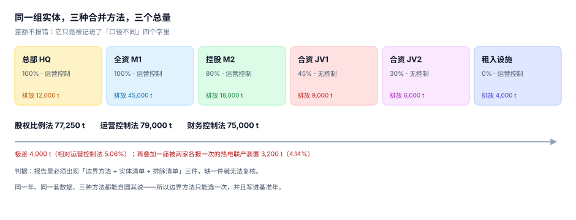

# 组织边界与合并方法：并谁、并多少

财务合并有一套准则（控制、重大影响、共同控制），碳核算的组织边界有两套常用方法（股权比例法、控制法），而两者**不总是给出同一个实体清单**。最典型的差异是租入资产：财务上经营租赁不入表，运营控制法下它必须并进来。

差异不报错。它只是让同一家公司在两套口径下差 5%，而两套口径都合规。

::: tip 一句话理解
组织边界不是一个「范围」，是一次**只能做一次的选择**。选了就要写进基准年，之后所有年份跟着走；中途改，代价是重述全部历史。
:::

## 一、三种合并方法，三个总量



同一组六个实体，排放与股权如下：

| 实体 | 持股 | 运营控制 | 财务控制 | 排放（tCO₂e） | 股权法 | 运营控制法 | 财务控制法 |
| --- | --- | --- | --- | --- | --- | --- | --- |
| 总部 HQ | 100% | 是 | 是 | 12,000 | 12,000 | 12,000 | 12,000 |
| 全资 M1 | 100% | 是 | 是 | 45,000 | 45,000 | 45,000 | 45,000 |
| 控股 M2 | 80% | 是 | 是 | 18,000 | 14,400 | 18,000 | 18,000 |
| 合资 JV1 | 45% | 否 | 否 | 9,000 | 4,050 | 0 | 0 |
| 合资 JV2 | 30% | 否 | 否 | 6,000 | 1,800 | 0 | 0 |
| 租入设施 | 0% | 是 | 否 | 4,000 | 0 | 4,000 | 0 |
| **合计** | | | | **94,000** | **77,250** | **79,000** | **75,000** |

三个总量的极差是 4,000 t，相对运营控制法 **5.06%**。三个数都能自圆其说：

- **股权比例法**：按经济利益归属，合资公司按持股比例计入——投资者关心的是「我这份有多少」。
- **运营控制法**：谁有运营控制权谁全量计入——管理者关心的是「我能决定的部分有多少」。
- **财务控制法**：谁控制财务政策谁全量计入——财务关心的是「并表范围」。

::: danger 三个方法不能混着用
最常见的混用是「母公司用运营控制法，但对合资公司按持股比例计入」——听起来很合理（毕竟是合资），实际是把两种方法的边界拼在一起，得到一个既不满足「全量计入」也不满足「按比例」的第三个数。它的问题不是错，是**无法复核**：任何第三方都推不出你的规则。
:::

## 二、为什么方法只能选一次

三条硬理由：

1. **可比性**：碳目标和减排进度都相对基准年，方法一变，基准年就得重算（见[披露与重述](../Disclosure/index.md)）。
2. **配额与履约**：纳入碳市场的重点排放单位，边界由主管部门的核算指南规定，企业自己不能改；组织边界与履约边界不一致时，必须出桥接表。
3. **核查**：核查机构按你声明的方法逐条验，方法含糊等于没法验。

判断方法是否「选定」的一个可执行检查：**能不能用一句话写出规则，并让第三个人按这句话把六个实体逐个判一遍，得到同一个总数**。写不出这句话，就还没定。

## 三、六个具体决定

| 决定 | 常见选项 | 本册建议 | 错了的后果 |
| --- | --- | --- | --- |
| 并谁 | 全资 + 控股 + 合资 + 租入 | 按运营控制，全量计入 | 少并一家 = 少一大块 |
| 并多少 | 100% 或按持股 | 控制法一律 100% | 混用导致无法复核 |
| 何时并 | 取得控制日 / 年初 | 按取得控制日起算，跨年按天数 | 年中并购重复或漏计 |
| 租赁 | 经营租赁 / 融资租赁 / 转租 | 有运营控制就并（含经营租赁） | 整栋楼的排放消失 |
| 特许经营 | 特许方 / 被特许方 | 运营控制方报 | 双方都不报或都报 |
| 合同制造 | 品牌方 / 代工厂 | 代工厂报范围一，品牌方报范围三 | 双重计入 |

### 租赁的三种形态

| 形态 | 财务处理 | 碳处理（运营控制法） | 说明 |
| --- | --- | --- | --- |
| 经营租赁（我方承租） | 不入表，计费用 | **计入**（我方控制运营） | 最容易被漏掉的一类 |
| 融资租赁（我方承租） | 入表，计资产 | 计入 | 两套口径一致 |
| 转租给他人 | 视合同 | 若承租人控制运营，则**不计入** | 需看谁在实际操作 |

经营租赁这一行是「财务与碳不一致」的典型：财务上它只是一笔费用，碳上它是一整栋楼的能耗。一家以租赁办公室为主的公司，漏掉经营租赁可能漏掉 60% 以上的范围二。

## 四、运营边界：三个范围怎么分

组织边界回答「并谁」，运营边界回答「并什么」。GHG Protocol 的三个范围不是按「排放源类型」分的，是按**谁拥有或控制排放源**分的：

| 排放源 | 归属 | 为什么 |
| --- | --- | --- |
| 锅炉烧天然气 | 范围一 | 我拥有/控制的燃烧设备 |
| 公司车辆烧柴油 | 范围一 | 我控制的移动源 |
| 制冷剂逸散 | 范围一 | 我控制的设备泄漏 |
| 外购电 | 范围二 | 电不是我发的，但我消费了 |
| 外购蒸汽/热/冷 | 范围二 | 同电力，属「购买的能源」 |
| 员工差旅 | 范围三 | 承运商控制排放源 |
| 采购的原材料 | 范围三 | 供应商控制排放源 |
| 售出产品的使用 | 范围三 | 客户控制排放源 |

::: warning 外购蒸汽为什么归范围二而不是范围一
直觉上「我烧的蒸汽」像范围一，但蒸汽是**购买的能源**：燃料在供应商的锅炉里烧，那部分排放已计入供应商的范围一。如果采购方再算一次范围一，同一股烟气被数了两遍。

本机读数：某园区外购蒸汽对应 50,000 tCO₂e，若采购方把它记进自己的范围一，集团层面双重计入 50,000 t——而两家的报表各自都「平」。
:::

## 五、双重计入：两个来源

| 来源 | 场景 | 处理 |
| --- | --- | --- |
| 边界重叠 | 一座热电联产装置同时给 M2 与 JV1 供能，两家各报一次 | 按设施归属唯一化（`facility.entity_id` 唯一） |
| 范围错配 | 采购方把外购蒸汽记进范围一 | 归属规则写死 + 计算前校验 |

本机读数：一座 3,200 t 的共用装置被两家各报一次，占股权法总量的 **4.14%**。这种错在合计层面看不出来，只有在做「同设施去重」时才暴露。

去重的工程做法很简单：**排放挂在设施上，不挂在实体上**。实体只决定「这个设施要不要并进来、并多少」，排放本身只有一个归属。

## 六、边界表怎么落库

```sql
CREATE TABLE entity(
  id          TEXT PRIMARY KEY,
  name        TEXT NOT NULL,
  parent_id   TEXT REFERENCES entity(id),
  share_pct   REAL NOT NULL CHECK(share_pct BETWEEN 0 AND 100),
  control     TEXT NOT NULL CHECK(control IN ('operational','financial','none')),
  since       TEXT NOT NULL,          -- 取得控制日，YYYY-MM-DD
  until       TEXT                    -- 处置日，NULL 表示仍在边界内
);

CREATE TABLE facility(
  id          TEXT PRIMARY KEY,
  entity_id   TEXT NOT NULL REFERENCES entity(id),
  name        TEXT NOT NULL,
  region      TEXT NOT NULL,          -- 影响位置法因子取值
  lease_type  TEXT CHECK(lease_type IN ('owned','finance','operating','sublet'))
);

-- 排除清单：没并进来的实体也必须留痕，否则无法解释「为什么没有它」
CREATE TABLE boundary_exclusion(
  id          TEXT PRIMARY KEY,
  entity_id   TEXT NOT NULL REFERENCES entity(id),
  year        INTEGER NOT NULL,
  reason      TEXT NOT NULL CHECK(reason IN ('no_control','below_threshold','divested','data_unavailable')),
  note        TEXT NOT NULL,
  UNIQUE(entity_id, year)
);
```

`boundary_exclusion` 这张表是核查时最常被要的东西：核查员不只要看「并了什么」，更要看「没并什么、为什么」。没有这张表，「排除」就等于「忘了」。

## 七、本页判据：`CBB-A` ~ `CBB-H`

| 编号 | 判据 | 怎么判 |
| --- | --- | --- |
| `CBB-A` | 合并方法在基准年选定且全库唯一 | `boundary_run` 同一年的方法只有一个值 |
| `CBB-B` | 实体清单含 `share_pct`、`control`、`since` 三列 | 三列非空率 100% |
| `CBB-C` | 未并进来的实体有排除清单与理由 | `boundary_exclusion` 覆盖所有 `control='none'` 且有排放的实体 |
| `CBB-D` | 排放挂在设施上，实体只决定并多少 | `calc_line` 无 `entity_id` 直连，经设施关联 |
| `CBB-E` | 经营租赁的设施在边界内 | `lease_type='operating'` 的设施有活动数据 |
| `CBB-F` | 外购蒸汽/热/冷归范围二 | 该来源的 `scope=2`，且不计入范围一 |
| `CBB-G` | 同设施不重复计入 | 按 `facility_id` 去重后合计 = 明细合计 |
| `CBB-H` | 年中并购/处置按天数折算 | 有 `since`/`until` 的实体其年度值按覆盖天数计 |

## 八、验证方式

先验证三法三个数，再验证「经营租赁漏掉会少多少」：

```shell
# 1) 本页判据 8 条
grep -o 'CBB-[A-H]' docs/Backend/CarbonAccounting/BoundaryOrg/index.md | sort -u | wc -l

# 2) 三法总量与极差
python3 - <<'PY'
ent = [("HQ",1.00,True,True,12000),("M1",1.00,True,True,45000),("M2",0.80,True,True,18000),
       ("JV1",0.45,False,False,9000),("JV2",0.30,False,False,6000),("LEASE",0.00,True,False,4000)]
eq = sum(e*s for _,s,_,_,e in ent)
op = sum(e for _,_,o,_,e in ent if o)
fc = sum(e for _,_,_,f,e in ent if f)
print("股权 %.0f / 运营控制 %.0f / 财务控制 %.0f / 极差 %.2f%% / 租赁占比 %.2f%%" %
      (eq, op, fc, (op-fc)/op*100, 4000/op*100))
PY

# 3) 双重计入
python3 - <<'PY'
eq, shared = 77250, 3200
print("共用设施重复计入 %.0f，占 %.2f%%" % (shared, shared/eq*100))
PY
```

预期输出：第一条 `8`；第二条打印 `股权 77250 / 运营控制 79000 / 财务控制 75000 / 极差 5.06% / 租赁占比 5.06%`；第三条打印 `共用设施重复计入 3200，占 4.14%`。

第二个输出里「租赁占比」与「极差」都是 5.06%，不是巧合：极差 = 79,000 − 75,000 = 4,000，正好是租入设施那一块，分母又同为运营控制法的 79,000。也就是说，**这一家的三法之争全部来自那栋租来的楼**——股权比例法与财务控制法都不算它，只有运营控制法算它。

查出这一点，方法之争就变成了一个具体得多的问题：这栋楼的运营到底谁说了算。答案若是「我方」，就该用运营控制法并把租赁写进边界说明；答案若是「业主」，就该把它移出并登记进排除清单。

## 参考资料

- [总览：七段链与三个「碳」](../Overview/index.md)
- [披露、重述与履约](../Disclosure/index.md)
- GHG Protocol《Corporate Standard》第 3 章「Setting Organizational Boundaries」：<https://ghgprotocol.org/corporate-standard>
- ISO 14064-1:2018 第 5.1 节（组织边界与合并）：<https://www.iso.org/standard/66453.html>
- 《企业温室气体排放核算方法与报告指南》系列（国内重点行业核算边界与归属）：<https://www.mee.gov.cn/>
