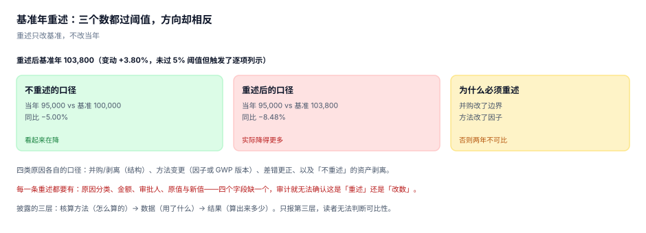

# 披露、重述与履约：给谁看、怎么改、欠多少

前面八段都在企业内部。这一段对外：披露给监管、评级、客户、银行看；重述回答「去年的数改了怎么办」；履约回答「配额不够要花多少钱」。

三件事共用一份底层数据，但对外口径不同。最常出错的地方是**基准年**：一旦边界或方法变了，去年的数就不再是去年的数，而绝大多数企业的第一反应是「不改，反正只差一点」。

::: tip 一句话理解
重述不是「改历史」，是**让历史可比**。不重述的年份对比，等于拿两把不同刻度的尺子量身高，然后据此说「孩子长高了」。
:::

## 一、披露的三层



| 层 | 内容 | 读者的用途 | 缺了会怎样 |
| --- | --- | --- | --- |
| 方法 | 边界、因子来源、GWP 集、分配方法 | 判断可比性 | 无法与同行比 |
| 数据 | 活动数据来源、估算占比、DQR | 判断可信度 | 无法评估风险 |
| 结果 | 各范围排放、强度、同比 | 判断趋势 | — |

只报第三层是最常见的做法，也是最没有信息量的做法：一个「12 万吨」，读者既不知道含不含范围三，也不知道是不是估的。

## 二、报告边界与期间

| 项 | 选项 | 影响 |
| --- | --- | --- |
| 期间 | 自然年 / 财年 | 与财务报表期不一致时需桥接 |
| 组织边界 | 同[组织边界](../BoundaryOrg/index.md) | 与财务并表范围可能不同 |
| 气体种类 | CO₂ / 七种京都气体 / 全部 | 影响 GWP 使用范围 |
| 基准年 | 固定某年 / 滚动 | 滚动会让目标永远「刚起步」 |

报告边界与财务边界不一致是常态（比如财务并表含 45% 合资的权益法核算，碳按运营控制不并）。不一致必须出桥接表：

```text
财务并表范围排放（按权益法）     77,250 t
+ 租入设施（财务不入表、碳要并）  4,000 t
− 合资公司按权益计入部分          −5,850 t
= 碳报告边界排放                 75,400 t
```

桥的两端必须能对平，对不平说明有一项被算了两次或漏了。

## 三、基准年重述：四类原因

| 原因 | 是否重述 | 例子 | 本机金额 |
| --- | --- | --- | --- |
| 结构变化 | 是 | 并购、剥离、合并方法变更 | +8,000 |
| 方法变化 | 是 | 因子版本升级、GWP 换版、分配方法变更 | −3,000 |
| 差错更正 | 视重大性 | 漏记、重复计入、单位错误 | −1,200 |
| 不重述 | 否 | 资产剥离（部分体系要求） | — |

本机：基准年 100,000 t，三项合计 +3,800（+3.80%）。

```text
不重述：当年 95,000 vs 基准 100,000 = −5.00%
重述后：当年 95,000 vs 基准 103,800 = −8.48%
```

方向没错（都在降），幅度差了 70%。如果这家企业的目标是「到 2030 年降 30%」，用错的分母会让它以为自己进度更快，从而少投钱。

::: danger 重述的四条纪律
1. **每一笔重述都要有原因分类、金额、审批人、原值与新值**——四个字段缺一个，审计无法区分「重述」与「改数」。
2. **重述只改基准年与历史年份，不改当年实测值**。当年数变了，那是差错更正，不是重述。
3. **同一原因只重述一次**。发现同一原因被拆成多笔登记（比如并购分成三笔），要合并。
4. **重述阈值要写明**：常见 5%，但「低于阈值不重述」必须与「低于阈值仍要披露该项」配套，否则就成了藏数。
:::

## 四、鉴证：limited 与 reasonable

| 类型 | 核查深度 | 结论措辞 | 成本 |
| --- | --- | --- | --- |
| 有限保证（limited assurance） | 询问、分析性复核、抽样 | 「未发现重大错报」 | 低 |
| 合理保证（reasonable assurance） | 充分适当的证据、控制测试 | 「公允反映」 | 高 |

多数强制披露体系目前要求有限保证。这意味着：**核查员不会替你算一遍**，他们检查的是「你有没有一套能算出这个数的流程」。所以台账、快照、审批记录比「数算得多准」更重要。

## 五、履约：配额缺口与碳关税

核算完之后，两个「要付钱」的口径：

### 全国碳市场

纳入的重点排放单位按年度获得免费配额，缺口要买、盈余可卖。

```text
排放 500,000 t / 免费配额 480,000 t / 缺口 20,000 t（4.0%）
按 75 元/t：成本 1,500,000 元
价格 60 / 75 / 100 元 → 1,200,000 / 1,500,000 / 2,000,000 元
```

制度背景（2026-11-02 核对）：《碳排放权交易管理暂行条例》2024-05-01 施行；2025-03-20 发布钢铁、水泥、铝冶炼行业扩围工作方案，新增重点排放单位约 1,300 家、新增覆盖约 30 亿吨 CO₂e，扩围后管控全国 60% 以上碳排放；按公开部署，2027 年基本覆盖工业领域主要排放行业。

**核算边界与履约边界不一致是常态**：履约按行业核算指南的边界（通常只含直接排放 + 部分间接），披露按企业边界（含范围三）。两套数之间的桥接表是清缴前最容易被漏掉的物料。

### 欧盟碳边境调节机制（CBAM）

| 阶段 | 时间 | 义务 |
| --- | --- | --- |
| 过渡期 | 2023-10-01 至 2025-12-31 | 只报告嵌入排放，不购买凭证 |
| 征收期 | 2026-01-01 起 | 按嵌入排放购买 CBAM 凭证 |
| 覆盖行业 | 钢铁、水泥、铝、化肥、电力、氢 | 含直接排放与部分间接排放 |

本机读数：出口 8,000 t 钢材，嵌入排放 1.85 tCO₂e/t，凭证价 70 欧元、汇率 7.8：

```text
14,800 tCO2e × 70 × 7.8 = 8,080,800 元
若只报直接排放（1.55 tCO2e/t）：12,400 tCO2e，漏 16.2%
```

16.2% 的漏报不是「估算误差」，是**边界错**：CBAM 要的是含上游前体物的嵌入排放，只报自己烟囱那一截就不够。这正是[产品碳足迹](../Allocation/index.md)里「系统边界必须声明」的现实后果。

## 六、洗绿的三种形态

| 形态 | 手法 | 识别方法 |
| --- | --- | --- |
| 换边界 | 把高排放业务剥离后说「排放下降」 | 看同期营收与产量是否同降 |
| 换算法 | 支出法换供应商法，总量降 13% | 看方法变更说明 |
| 换口径 | 只报范围一+二，不报范围三 | 看是否声明「不含范围三」 |

三种都不是造假——每一份报表都「真实」。它们只是**选择了一个对自己有利的口径，并且没有告诉读者口径变了**。识别方法也简单：**任何同比下降超过 5% 的年份，先问「边界、方法、口径有没有变」**。

## 七、落库

```sql
CREATE TABLE disclosure(
  id         INTEGER PRIMARY KEY,
  year       INTEGER NOT NULL,
  metric     TEXT NOT NULL,          -- scope1 / scope2 / scope3 / intensity
  basis      TEXT NOT NULL CHECK(basis IN ('location','market','n/a')),
  value      REAL NOT NULL,
  uncertainty REAL,                  -- 相对不确定度
  ci_type    TEXT CHECK(ci_type IN ('1sigma','90ci','95ci')),
  standard   TEXT NOT NULL,          -- GHG Protocol / ISO 14064-1 / 行业指南
  UNIQUE(year, metric, basis)
);

CREATE TABLE restatement(
  id          INTEGER PRIMARY KEY,
  year        INTEGER NOT NULL,
  reason      TEXT NOT NULL CHECK(reason IN ('acquisition','divestment','method','error')),
  delta       REAL NOT NULL,
  old_value   REAL NOT NULL,
  new_value   REAL NOT NULL,
  approved_by TEXT NOT NULL CHECK(length(approved_by) > 0),
  approved_at TEXT NOT NULL
);
```

`CHECK(old_value + delta = new_value)` 可以加，但浮点会让它偶尔失败——实践上改用触发器 + 容差 0.01。

## 八、本页判据：`CBD-A` ~ `CBD-H`

| 编号 | 判据 | 怎么判 |
| --- | --- | --- |
| `CBD-A` | 披露三层齐全（方法/数据/结果） | 报告含三节且方法节有边界与因子来源 |
| `CBD-B` | 报告边界与财务边界不一致时有桥接表 | 桥接表首末行可对平（±0.01） |
| `CBD-C` | 每笔重述有四字段（原因/金额/审批人/原新值） | `restatement` 四列非空 |
| `CBD-D` | 重述阈值写明且执行一致 | 报告含阈值，历年判定规则相同 |
| `CBD-E` | 每个数带口径（location/market/n/a） | `disclosure.basis` 非空 |
| `CBD-F` | 披露数可追到明细合计 | join 差额为 0 |
| `CBD-G` | 履约口径与披露口径有桥接 | 清缴量与披露量差额有说明 |
| `CBD-H` | 同比变化超 5% 时说明边界/方法/口径是否变 | 有 `change_note` 或变更记录 |

## 九、验证方式

先验证重述的方向翻转，再验证碳关税的边界差：

```shell
# 1) 本页判据 8 条
grep -o 'CBD-[A-H]' docs/Backend/CarbonAccounting/Disclosure/index.md | sort -u | wc -l

# 2) 重述前后
python3 - <<'PY'
b0, cur, acq, method, err = 100_000, 95_000, 8_000, -3_000, -1_200
adj = b0 + acq + method + err
print("重述后基准 %.0f（变动 %+.2f%%）" % (adj, (adj-b0)/b0*100))
print("不重述 %+.2f%% / 重述后 %+.2f%%" % ((cur-b0)/b0*100, (cur-adj)/adj*100))
PY

# 3) 碳关税边界差
python3 - <<'PY'
exp_t, embed, direct = 8_000, 1.85, 1.55
print("含上游 %.0f tCO2e / 只报直接 %.0f tCO2e / 漏 %.1f%%" %
      (exp_t*embed, exp_t*direct, (embed-direct)/embed*100))
print("按 70 欧元、7.8 汇率：%.0f 元" % (exp_t*embed*70*7.8))
PY
```

预期输出：第一条 `8`；第二条打印 `重述后基准 103800（变动 +3.80%）` 与 `不重述 -5.00% / 重述后 -8.48%`；第三条打印 `含上游 14800 tCO2e / 只报直接 12400 tCO2e / 漏 16.2%` 与 `按 70 欧元、7.8 汇率：8080800 元`。

第二条的两个百分比是同一个「下降」的两种说法。它们在报告里都合法，但**必须选一个并保持一致**——今年用不重述口径、明年用重述口径，趋势线就会出现一个凭空多出来的拐点。

## 参考资料

- [数据质量、不确定性与重大性](../Uncertainty/index.md)
- [实战：八张表跑通一次核算与披露](../Practice/index.md)
- 《碳排放权交易管理暂行条例》（2024-05-01 施行）：<https://www.mee.gov.cn/>
- 生态环境部《全国碳排放权交易市场覆盖钢铁、水泥、铝冶炼行业工作方案》（2025-03-20）：<https://www.mee.gov.cn/>
- 欧盟 CBAM 官方页面（过渡期与征收期安排）：<https://taxation-customs.ec.europa.eu/carbon-border-adjustment-mechanism_en>
- 欧盟 CSRD 与 ESRS E1（含 2025 年「停表」指令对时间表的影响）：<https://finance.ec.europa.eu/>
