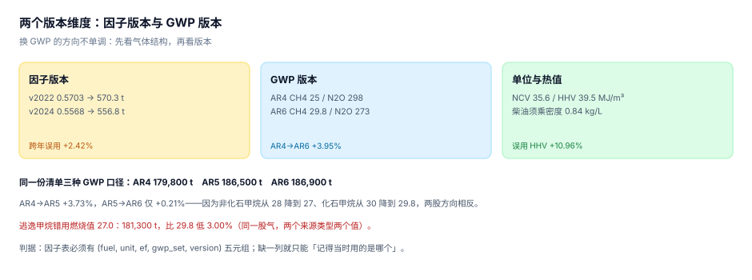

# 排放因子与 GWP：两个版本维度

排放因子是「单位活动数据对应多少排放」的那个换算率。它看起来是一个数，实际是一组五个字段：**燃料、单位、因子值、GWP 集、版本**。少一个，这个数就不可复核。

除了因子本身，还有第二个版本维度：把 CH₄ 与 N₂O 折成 CO₂e 用的 GWP。IPCC 改过三次（AR4 / AR5 / AR6），甲烷的 100 年 GWP 从 25 提到 30 又降到 29.8。

::: tip 一句话理解
因子与 GWP 都是**带版本的数据，不是常数**。跨年误用旧因子、跨页混用不同 GWP，算出来的数都「看起来正常」，只有和同行或者和去年对比时才会露馅——而那时已经报出去了。
:::

## 一、两个版本维度叠在一起



| 维度 | 变的是什么 | 变化频率 | 影响幅度（本机） |
| --- | --- | --- | --- |
| 因子版本 | 同一燃料/电力的排放强度 | 每年（电网因子）、数年（燃料因子） | 跨年误用 +2.42% |
| GWP 版本 | 非 CO₂ 气体折 CO₂e 的倍数 | 每次 IPCC 评估报告 | AR4→AR6 +3.95% |
| 单位与热值 | 体积/质量/能量之间的换算 | 不常变，但常被忽略 | 误用高位热值 +10.96% |

三者相乘，就是「同一份活动数据」能算出的最大与最小结果之比。本机这套数据里，最大偏差来自热值（10.96%），其次 GWP（3.95%），再次因子版本（2.42%）。

## 二、因子的五元组

```sql
CREATE TABLE factor(
  id         TEXT PRIMARY KEY,            -- EF-ELEC-CN-2024
  fuel       TEXT NOT NULL,               -- elec / gas / diesel / steam
  unit       TEXT NOT NULL,               -- kWh / m3 / kg / GJ
  ef         REAL NOT NULL CHECK(ef > 0), -- tCO2e / unit
  gwp_set    TEXT NOT NULL CHECK(gwp_set IN ('AR4','AR5','AR6')),
  version    TEXT NOT NULL,               -- v2024
  source     TEXT NOT NULL,               -- 发布机构 + 文件名
  valid_from TEXT NOT NULL,
  valid_to   TEXT
);
```

三个约束值得单说：

1. **`unit` 必须在因子表里，不能在计算时猜**。同一个 `gas`，按 m³ 与按 kWh 的因子差一个热值。
2. **`gwp_set` 必须随因子走**。有些因子是「纯 CO₂」的（燃料燃烧），有些已经含 CH₄/N₂O（电力的电网因子），混在一起就无法判断要不要再乘 GWP。
3. **`valid_from`/`valid_to` 让「用哪一年的因子」变成一次查询，而不是一次记忆**。

## 三、单位与热值：最容易差 10% 的地方

天然气同时有体积（m³）、能量（kWh 或 GJ）、质量（kg）三种计量方式，而因子可能只对其中一种发布。

```text
100,000 m³ 天然气：
按低位热值 NCV 35.6 MJ/m³ → 3,560,000 MJ = 988,889 kWh
按高位热值 HHV 39.5 MJ/m³ → 3,950,000 MJ = 1,097,222 kWh
误用 HHV：+10.96%
```

NCV（低位热值）与 HHV（高位热值）的差是烟气中水蒸气的潜热。国际核算惯例用 NCV，而部分设备铭牌与合同用 HHV——两者相差约 10%，正好是一个「看起来像节能成效」的量级。

液体燃料还多一层密度：

| 写法 | 计算 | 结果（MJ） | 相对正确值 |
| --- | --- | --- | --- |
| 正确 | 1,000 L × 0.84 kg/L × 43.0 MJ/kg | 36,120 | — |
| 漏乘密度 | 1,000 × 43.0 | 43,000 | **+19.05%** |
| 密度取 0.83 | 1,000 × 0.83 × 43.0 | 35,690 | −1.19% |

漏乘密度是最常见的写法错误：`L × MJ/kg` 量纲都不对，但计算器不会报错。

::: danger 三条单位纪律
1. **入库即换算**：`activity.unit` 与 `factor.unit` 必须相等，换算在写入时完成并记录换算系数。
2. **热值口径写进因子表**：`ncv_or_hhv` 一列，别指望文档里那句「按低位热值」。
3. **禁止「先算后凑」**：发现结果与去年差 10% 才回头找单位问题，几乎一定会找错方向。
:::

## 四、GWP：三个版本，方向不单调

同一份清单（CO₂ 100,000 t、CH₄ 2,000 t、N₂O 100 t）在三套 GWP 下：

| GWP 集 | CH₄ | N₂O | 合计（tCO₂e） | 相对 AR6 |
| --- | --- | --- | --- | --- |
| AR4 | 25 | 298 | 179,800 | −3.80% |
| AR5 | 30（化石）/ 28（非化石） | 265 | 186,500 | −0.21% |
| AR6 | 29.8（化石）/ 27.0（非化石） | 273 | 186,900 | — |

三个转移方向值得记住：

- **AR4 → AR5：+3.73%**（甲烷从 25 提到 30，涨 20%；N₂O 从 298 降到 265，跌 11%，两者部分抵消）
- **AR5 → AR6：+0.21%**（甲烷微降、N₂O 微升，几乎抵消）
- **AR4 → AR6：+3.95%**

所以「升级到 AR6 会让排放上升」这句话只在从 AR4 升级时成立；从 AR5 升级几乎不变。**结论取决于起点，不取决于终点**——这正是「先看气体结构，再看版本」的意思：一家以 CO₂ 为主的企业，三套 GWP 差别很小；一家甲烷排放占三成的企业，AR4 与 AR6 差 4 个点。

### 化石甲烷与非化石甲烷

AR5 起 IPCC 把甲烷拆成两股：**化石源**（开采、逃逸、燃烧）与**非化石源**（生物质、畜牧、废弃物）。AR6 的 100 年值是 29.8 与 27.0，差 10.4%。

用错来源类型的后果（本机）：一股逃逸甲烷若按燃烧值 27.0 计，得到 181,300 t，比按 29.8 计低 **3.00%**。3% 不大，但它是**系统性偏低**——所有油气类企业都会中招，且方向一致，合并到行业数据里就成了「行业整体比自报低 3%」。

::: warning 用哪套 GWP，要写进方法说明
GHG Protocol 的 GWP 表同时列了 AR4/AR5/AR6 三列，并没有强制用哪一套；ISO 14064-1 要求「声明所用 GWP 的来源与时间范围」。所以选哪套是自由的，**不声明是不行的**。

实践建议：跟披露准则走（ESRS E1 与 IFRS S2 都指向最新 IPCC 值），跟履约走（国内行业核算指南有自己的规定，通常按指南版本），两套并行时在桥接表里单独列一行「GWP 差异」。
:::

## 五、因子来源层级

| 层级 | 例子 | 何时用 | 精度 |
| --- | --- | --- | --- |
| 实测（供应商/自测） | 供应商提供的产品碳足迹 | 有且可信 | 最高 |
| 区域/电网 | 省级电网排放因子、区域电网 | 电力默认 | 高 |
| 国家默认 | 国家温室气体清单的燃料因子 | 无实测、无区域值 | 中 |
| 国际默认 | IPCC 缺省因子 | 以上都没有 | 低 |

选层级的规则是「**取第一个可用层级，并记录层级**」。不记录层级的后果是：同一年里一半设施用省级因子、一半用 IPCC 默认，合计出来后没人能说清它到底是哪一层。

## 六、快照：为什么因子不能在计算时现查

计算时 `join` 因子表的「当前版本」，会带来一个隐蔽问题：**因子更新后，历史报告会变**。同一份 2024 年清单，2025 年重跑得到不同的数，而没有人改过任何活动数据。

正确做法是计算时把因子值**复制进明细**：

```sql
CREATE TABLE calc_line(
  id          INTEGER PRIMARY KEY,
  activity_id INTEGER NOT NULL REFERENCES activity(id),
  factor_id   TEXT NOT NULL REFERENCES factor(id),
  scope       INTEGER NOT NULL CHECK(scope IN (1,2,3)),
  ef_applied  REAL NOT NULL,     -- 快照：计算当时用的因子值
  gwp_set     TEXT NOT NULL,     -- 快照：计算当时用的 GWP 集
  co2e        REAL NOT NULL,
  UNIQUE(activity_id, factor_id)
);
```

`ef_applied` 与 `gwp_set` 是冗余字段，但这份冗余是审计要求的：有了它，「去年那个数是按什么算的」这个问题可以靠一条 SQL 回答。

## 七、本页判据：`CBF-A` ~ `CBF-H`

| 编号 | 判据 | 怎么判 |
| --- | --- | --- |
| `CBF-A` | 因子表五元组齐全（fuel/unit/ef/gwp_set/version） | 五列非空率 100% |
| `CBF-B` | 因子有来源与生效期 | `source`、`valid_from` 非空 |
| `CBF-C` | 计算明细快照因子值，非实时 join | `calc_line.ef_applied` 非空且等于当时因子 |
| `CBF-D` | 同一 `fuel` 的 `unit` 唯一 | 分组计数 = 1 |
| `CBF-E` | 热值口径（NCV/HHV）显式记录 | 有 `ncv_or_hhv` 列且气体类因子全部填写 |
| `CBF-F` | GWP 集在明细里显式记录 | `calc_line.gwp_set` 非空且在允许集合 |
| `CBF-G` | 化石/非化石甲烷按来源类型取值 | 有 `ch4_origin` 或按排放源分类区分 |
| `CBF-H` | 因子版本升级有对照记录（旧值/新值/影响） | 因子变更表有 before/after 与影响金额 |

## 八、验证方式

先验证单位与热值的三种写法，再验证 GWP 三版本：

```shell
# 1) 本页判据 8 条
grep -o 'CBF-[A-H]' docs/Backend/CarbonAccounting/EmissionFactor/index.md | sort -u | wc -l

# 2) 热值与密度
python3 - <<'PY'
v = 100_000
ncv, hhv = v*35.6/3.6, v*39.5/3.6
print("NCV %.0f / HHV %.0f（%+.2f%%）" % (ncv, hhv, (hhv-ncv)/ncv*100))
c, no_rho, rho83 = 1000*0.84*43.0, 1000*43.0, 1000*0.83*43.0
print("柴油 %.0f / 漏乘密度 %.0f（%+.2f%%）/ 密度0.83 %.0f（%+.2f%%）" %
      (c, no_rho, (no_rho-c)/c*100, rho83, (rho83-c)/c*100))
PY

# 3) GWP 三版本
python3 - <<'PY'
co2, ch4, n2o = 100_000, 2_000, 100
for name, g1, g2 in (("AR4",25,298), ("AR5",30,265), ("AR6",29.8,273)):
    print("%s %.0f" % (name, co2 + ch4*g1 + n2o*g2))
PY
```

预期输出：第一条 `8`；第二条打印 `NCV 988889 / HHV 1097222（+10.96%）` 与 `柴油 36120 / 漏乘密度 43000（+19.05%）/ 密度0.83 35690（-1.19%）`；第三条打印 `AR4 179800`、`AR5 186500`、`AR6 186900`。

若第三条三行相同，说明你的清单里只有 CO₂——那 GWP 版本对你不构成风险；但只要清单里有制冷剂（HFC 类 GWP 数千到上万），版本的影响会被放大到几十个百分点。

## 参考资料

- [活动数据：来源、期间与缺失](../ActivityData/index.md)
- [范围二双报](../Scope2Dual/index.md)
- GHG Protocol《Global Warming Potential Values》（AR4/AR5/AR6 三列对照）：<https://ghgprotocol.org/sites/default/files/2024-08/Global-Warming-Potential-Values%20(August%202024).pdf>
- IPCC AR6 WGIII 附件 II（化石/非化石甲烷的 GWP100 取值）：<https://www.ipcc.ch/report/ar6/wg3/>
- ISO 14064-1:2018 第 6.2.3 节（GWP 的使用与声明）：<https://www.iso.org/standard/66453.html>
