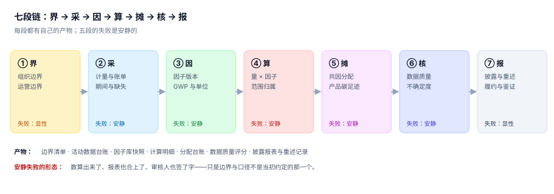
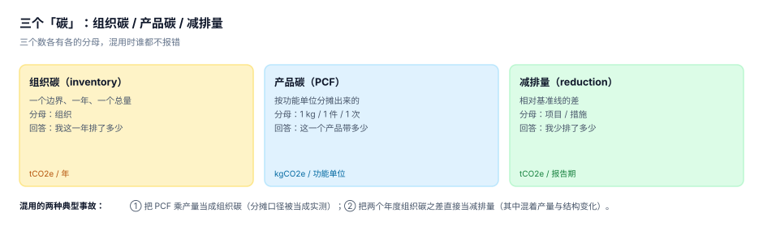

# 总览：七段链与三个「碳」

碳核算看起来只是「把能耗乘个系数加起来」。真正决定结果对不对的，是加法之前的三件事：**这条能耗属于哪个边界内的哪个设施**、**用哪一版系数**、**这个系数乘出来的气体用什么倍数折成 CO₂e**。

这三件事各自都有 2~3 个合法选项，组合起来就是几十种「都算对」的答案。本页把整条链摊开，标出每一段的产物与失败方式，后面九页逐段展开。

::: tip 一句话理解
七段链里**五段的失败是安静的**。安静的意思是：数出来了、报表合上了、没人报警——只有第三方核查或配额清缴才会把它翻出来，而那时基准年已经过去两年。
:::

## 一、七段链的完整形态



| 段 | 输入 | 处理 | 输出 | 一句话判据 |
| --- | --- | --- | --- | --- |
| ① 界 | 股权结构、租赁合同、特许经营协议 | 选合并方法、划范围归属 | 实体清单 + 排放源清单 | 换个方法能算出另一个总数 |
| ② 采 | 电费单、燃气单、加油卡、ERP 领用 | 定期间、处理缺失、标来源 | 活动数据台账 | 每一行都有 `src` 与 `dqr` |
| ③ 因 | 因子库、GWP 表 | 选版本、配单位、取热值 | 因子快照 | 每一行都有五元组 |
| ④ 算 | 活动数据 × 因子 | 按范围归属、算 CO₂e | 计算明细 | 明细逐行 = 量 × 因子 |
| ⑤ 摊 | 共因（热电联产、共租楼宇） | 按动因分配到设施/租户/产品 | 分配台账 | 分配之和 = 待分总量 |
| ⑥ 核 | 明细 + 评分 | 算不确定度、判重大性 | 数据质量报告 | 每个数都有区间 |
| ⑦ 报 | 汇总 + 基准年 | 披露、重述、履约 | 报表 + 重述记录 | 每个数都能追到明细 |

## 二、三个「碳」必须分开存



| 维度 | 组织碳 | 产品碳 | 减排量 |
| --- | --- | --- | --- |
| 期间 | 一个自然年（或财年） | 一批/一段时间 | 报告期 vs 基准线 |
| 边界 | 组织边界内的全部排放源 | 一个产品生命周期的一段 | 一个项目/措施的影响范围 |
| 分母 | 无（就是总量） | 功能单位 | 基准线排放 |
| 常见错法 | 拿 PCF 乘产量 | 拿组织碳除产量 | 拿两年之差当减排 |
| 谁在用 | 监管、评级、碳市场 | 客户、CBAM、标签 | 内部考核、碳信用 |

三个数在健康的体系里是**三张表**，可以互相引用，但不能互相替代。它们之间有桥，桥必须能对平：

```text
组织碳（某产品线）= Σ(该产品线各产品的 PCF × 产量) + 该产品线的非生产性排放
减排量（某措施）= 基准线排放 − 措施后排放（同边界、同期间、同因子版本）
```

桥对不平是常态，因为组织碳里有大量「不摊到产品」的排放（办公、照明、通勤）。**桥差本身要作为一个字段披露**，而不是硬摊进产品里把账做平。

## 三、四个必失接缝

七段之间有四道接缝，任何一道没对齐都会产生「两套数」：

| 接缝 | 症状 | 后果 |
| --- | --- | --- |
| 界 → 采 | 活动数据按「谁付钱」归集，边界按「谁控制」划 | 租入设施的排放有账单、没实体 |
| 采 → 因 | 活动数据是体积（m³），因子是按能量（kWh） | 差一个热值，10% 起 |
| 因 → 算 | 因子有 `gwp_set`，计算时没带上 | 同一批明细混了两种 GWP |
| 算 → 报 | 明细按范围分，披露按主体分 | 主体合计对不上范围合计 |

第一道接缝是最隐蔽的：财务上「谁付钱谁入账」天经地义，碳核算上「谁控制谁报告」才是规则。一家公司替租户代缴电费，账单在它名下，但排放归租户（如果租户有运营控制）。

## 四、三个边界定一次管三年

| 边界 | 关键决定 | 本机读数 | 改的代价 |
| --- | --- | --- | --- |
| 组织 | 股权比例 / 运营控制 / 财务控制 | 77,250 / 79,000 / 75,000 t | 重述基准年全部历史 |
| 运营 | 范围一/二/三的归属规则 | 外购电归范围二、外购蒸汽归范围二 | 重算全部历史 |
| 报告 | 披露准则与期间 | GHG Protocol + 自然年 | 出双份对照表 |

组织边界的三法差 5.06%，看起来不大——但这个 5% 会原样传到目标设定、配额清缴和碳关税申报上。**5% 的边界差乘以一家中型制造企业的排放量，就是几十万吨。**

## 五、本页判据：`CBO-A` ~ `CBO-H`

| 编号 | 判据 | 怎么判 |
| --- | --- | --- |
| `CBO-A` | 三个「碳」（组织/产品/减排）分表存放，无字段复用 | 三张表各有独立主键与期间字段 |
| `CBO-B` | 七段各有产物表，缺哪一段一眼可见 | 七张核心表全部存在且有行 |
| `CBO-C` | 组织边界方法在基准年写死并落库 | `boundary_run.method` 有值且年份唯一 |
| `CBO-D` | 排放源清单含归属范围（1/2/3）与依据 | `facility` 或 `source` 表有 `scope` 与 `basis` |
| `CBO-E` | 每条计算明细可追到活动数据与因子两行 | `calc_line` 双外键非空且可 join |
| `CBO-F` | 分配台账满足「分配之和 = 待分总量」 | 差额断言为 0 |
| `CBO-G` | 每个汇总数带不确定度或数据质量标记 | 汇总行有 `uncertainty` 或 `dqr_avg` |
| `CBO-H` | 披露数与明细合计一致，重述有独立记录 | 披露表 join 明细差额为 0，重述表有原因与审批人 |

## 六、验证方式

先验证七段链的产物齐备，再复现「三个碳不能互相替代」中最容易出错的那一步——用组织碳除产量冒充 PCF：

```shell
# 1) 本页判据 8 条
grep -o 'CBO-[A-H]' docs/Backend/CarbonAccounting/Overview/index.md | sort -u | wc -l

# 2) 目录页 + 10 章
ls -d docs/Backend/CarbonAccounting/*/ | grep -v assets | wc -l

# 3) 复现「PCF × 产量 ≠ 组织碳」
python3 - <<'PY'
org = 9_973.98          # 组织碳（本机八表实战合计）
output = 12_000         # 产量（件）
pcf = 0.62              # 某产品 PCF（tCO2e/件，只含生产段）
bridge = org - pcf * output
print("组织碳 %.2f / PCF×产量 %.2f / 桥差 %.2f（占 %.1f%%）" %
      (org, pcf*output, bridge, bridge/org*100))
PY
```

预期输出：第一条 `8`；第二条 `10`；第三条打印 `组织碳 9973.98 / PCF×产量 7440.00 / 桥差 2533.98（占 25.4%）`。

**桥差 25.4% 不是错误**，它是「不摊到产品的排放」（办公、通勤、上游物流）。真正的错误是把这 2,533.98 t 硬摊进产品，让 PCF 变成 0.83——那样产品碳看起来覆盖了全部排放，实际把不属于该产品的排放卖给了客户。

## 参考资料

- [组织边界与合并方法](../BoundaryOrg/index.md)
- [活动数据：来源、期间与缺失](../ActivityData/index.md)
- [范围二双报](../Scope2Dual/index.md)
- GHG Protocol《Corporate Accounting and Reporting Standard》第 3 章（组织边界与合并方法）：<https://ghgprotocol.org/corporate-standard>
- ISO 14064-1:2018 第 5 章（边界设定）：<https://www.iso.org/standard/66453.html>
