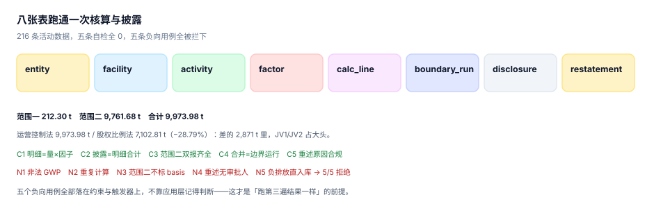

# 实战：八张表跑通一次核算与披露

前面九页讲的是每一段该怎么做。这一页把它们串成一次可以跑完的核算：八张表、三条触发器、五条自检、五条负向用例。

结论先给：**216 条活动数据、8 张表、范围一 212.30 t / 范围二 9,761.68 t / 合计 9,973.98 t，五条自检全 0，五条负向用例全部被数据库拦下，退出码 0。**

::: tip 一句话理解
「跑第三遍结果一样」不是靠应用层记得判重，是靠**约束与触发器**。应用会改、人会更替、代码会重构，只有约束写在库里。
:::

## 一、目标与验收口径

| 项 | 目标 | 验收方式 |
| --- | --- | --- |
| 表结构 | 8 张表覆盖七段链 | `sqlite_master` 计数为 8 |
| 计算 | 每条明细 = 活动数据 × 因子 | `C1` 违例数 0 |
| 披露 | 披露数 = 明细合计 | `C2` 违例数 0 |
| 范围二 | 位置法与市场法都有 | `C3` 违例数 0 |
| 边界 | 合并结果 = 边界运行记录 | `C4` 违例数 0 |
| 重述 | 原因在允许集合内 | `C5` 违例数 0 |
| 防错 | 五类错数全部被拦 | `N1`~`N5` 全 PASS |

样本规模：6 个实体、12 个设施、12 个月、3 种能源，共 216 条活动数据（144 条电 + 48 条气 + 24 条柴油）。

## 二、八张表



```sql
CREATE TABLE entity(
  id TEXT PRIMARY KEY, name TEXT NOT NULL, parent_id TEXT REFERENCES entity(id),
  share_pct REAL NOT NULL CHECK(share_pct BETWEEN 0 AND 100),
  control TEXT NOT NULL CHECK(control IN ('operational','financial','none')));

CREATE TABLE facility(
  id TEXT PRIMARY KEY, entity_id TEXT NOT NULL REFERENCES entity(id),
  name TEXT NOT NULL, region TEXT NOT NULL);

CREATE TABLE activity(
  id INTEGER PRIMARY KEY, facility_id TEXT NOT NULL REFERENCES facility(id),
  period TEXT NOT NULL CHECK(period GLOB '[0-9][0-9][0-9][0-9]-[0-9][0-9]'),
  fuel TEXT NOT NULL, qty REAL NOT NULL CHECK(qty >= 0),
  unit TEXT NOT NULL, src TEXT NOT NULL CHECK(src IN ('meter','invoice','estimate')),
  dqr INTEGER NOT NULL CHECK(dqr BETWEEN 1 AND 5),
  UNIQUE(facility_id, period, fuel));

CREATE TABLE factor(
  id TEXT PRIMARY KEY, fuel TEXT NOT NULL, unit TEXT NOT NULL,
  ef REAL NOT NULL CHECK(ef > 0), gwp_set TEXT NOT NULL, version TEXT NOT NULL);

CREATE TABLE calc_line(
  id INTEGER PRIMARY KEY,
  activity_id INTEGER NOT NULL REFERENCES activity(id),
  factor_id TEXT NOT NULL REFERENCES factor(id),
  scope INTEGER NOT NULL CHECK(scope IN (1,2,3)),
  co2e REAL NOT NULL,
  gwp_set TEXT NOT NULL,
  UNIQUE(activity_id, factor_id));

CREATE TABLE boundary_run(
  id INTEGER PRIMARY KEY, year INTEGER NOT NULL, method TEXT NOT NULL,
  total REAL NOT NULL, UNIQUE(year, method));

CREATE TABLE disclosure(
  id INTEGER PRIMARY KEY, year INTEGER NOT NULL, metric TEXT NOT NULL,
  basis TEXT NOT NULL CHECK(basis IN ('location','market','n/a')),
  value REAL NOT NULL, UNIQUE(year, metric, basis));

CREATE TABLE restatement(
  id INTEGER PRIMARY KEY, year INTEGER NOT NULL, reason TEXT NOT NULL,
  delta REAL NOT NULL, approved_by TEXT NOT NULL CHECK(length(approved_by) > 0));
```

三处设计取舍：

1. **`activity` 的唯一键是 `(facility_id, period, fuel)`**，不是 `(id)`。这一条让「同月同设施同能源导两次」在入库时就失败。
2. **`calc_line` 的唯一键是 `(activity_id, factor_id)`**，不是 `(activity_id)`——同一批活动数据理论上可以按不同因子算（比如位置法与市场法），但同一因子只能算一次。
3. **`disclosure` 的唯一键是 `(year, metric, basis)`**，`basis` 进入主键，逼着范围二必须两行。

## 三、三条触发器

```sql
CREATE TRIGGER trg_gwp BEFORE INSERT ON calc_line
WHEN NEW.gwp_set NOT IN ('AR4','AR5','AR6')
BEGIN SELECT RAISE(ABORT, 'gwp_set 不在允许集合'); END;

CREATE TRIGGER trg_scope2_basis BEFORE INSERT ON disclosure
WHEN NEW.metric = 'scope2' AND NEW.basis = 'n/a'
BEGIN SELECT RAISE(ABORT, '范围二必须标 basis（location/market）'); END;

CREATE TRIGGER trg_co2e_sign BEFORE INSERT ON calc_line
WHEN NEW.co2e < 0
BEGIN SELECT RAISE(ABORT, 'co2e 不得为负，扣减走单独字段'); END;
```

三条对应三个真实事故：GWP 版本写错成 `AR3`（不存在）、范围二不标口径、负排放混进正向明细。

第三条值得单说：**负排放（碳汇、外购绿电的抵扣）不能直接写成负数**，否则「合计 9,973.98」这一行永远看不出里面有一笔 −500。正确做法是单独一张 `removal` 表或一个 `sign` 字段，让正负分列。

## 四、七步流水

| 步 | 动作 | 产物 |
| --- | --- | --- |
| 1 | 建表 + 触发器 | 8 表 3 触发器 |
| 2 | 灌实体与设施（6 + 12） | `entity` / `facility` |
| 3 | 灌因子（3 条，AR6，v2024） | `factor` |
| 4 | 生成活动数据（216 条，含估算与低 DQR） | `activity` |
| 5 | 计算：`qty × ef`，按能源归范围 | `calc_line` |
| 6 | 合并：运营控制法与股权比例法各跑一次 | `boundary_run` |
| 7 | 披露 + 重述 | `disclosure` / `restatement` |

第 5 步是唯一一段「一行 SQL 完成」的：

```sql
INSERT INTO calc_line(activity_id, factor_id, scope, co2e, gwp_set)
SELECT a.id,
       'EF-' || CASE a.fuel WHEN 'elec' THEN 'ELEC' WHEN 'gas' THEN 'GAS' ELSE 'DIE' END,
       CASE a.fuel WHEN 'elec' THEN 2 ELSE 1 END,
       a.qty * f.ef,
       'AR6'
FROM activity a JOIN factor f ON f.fuel = a.fuel;
```

注意 `scope` 用 `CASE` 而不是查表：外购电归范围二、燃烧归范围一，这条规则写在 SQL 里比写在文档里可靠。

## 五、五条自检

```text
C1 明细=量×因子      : select count(*) ... where abs(co2e - qty*ef) > 0.01
C2 披露=明细合计     : 披露行与对应范围合计差额 > 0.01 的行数
C3 范围二双报齐全     : 2 - count(distinct basis) where metric='scope2'
C4 合并=边界运行     : boundary_run.total 与按 control 过滤的合计之差 > 0.01
C5 重述原因合规       : restatement.reason 不在四类白名单内的行数
```

五条都是「结果为 0 才算过」。这比「结果为 9,973.98」好，因为 0 不需要记住期望值。

## 六、五条负向用例

| 用例 | 触发的约束 | 期望 |
| --- | --- | --- |
| `N1` 非法 GWP 版本（`AR3`） | `trg_gwp` | ABORT |
| `N2` 同活动同因子重复计算 | `UNIQUE(activity_id, factor_id)` | IntegrityError |
| `N3` 范围二不标 basis | `trg_scope2_basis` | ABORT |
| `N4` 重述无审批人（空串） | `CHECK(length(approved_by) > 0)` | IntegrityError |
| `N5` 负排放直接入库 | `trg_co2e_sign` | ABORT |

五条用例的价值不在「跑通」，在于**它们证明了错误数据进不来**。一份只有正向用例的测试，无法区分「系统算对了」与「系统没算」。

## 七、实测输出

```text
表数 8 / 活动行 216 / 计算行 216
范围一 212.30 / 范围二 9761.68 / 合计 9973.98
运营控制法 9973.98 / 股权比例法 7102.81（差 -28.79%）

-- 五条自检 --
C1 明细=量×因子         0
C2 披露=明细合计         0
C3 范围二双报齐全         0
C4 合并=边界运行         0
C5 重述原因合规          0

-- 五条负向用例 --
N1 非法 GWP 版本 PASS (gwp_set 不在允许集合)
N2 同活动同因子重复计算 PASS (UNIQUE constraint failed: calc_line.activity_id, calc_line.factor_id)
N3 范围二不标 basis PASS (范围二必须标 basis（location/market）)
N4 重述无审批人 PASS (CHECK constraint failed: length(approved_by) > 0)
N5 负排放直接入库 PASS (co2e 不得为负，扣减走单独字段)

通过 5/5
EXIT=0
```

两句解释：

- **运营控制法与股权比例法差 −28.79%**：差的 2,871.17 t 主要是 JV1 与 JV2 的 15,000 t 被排除、M2 按 80% 折算、租入设施 4,000 t 被计入。这正是[组织边界](../BoundaryOrg/index.md)那一页的读数在真实表结构上的复现。
- **范围二占 97.9%**：这是一家以办公与轻生产为主的样本，电力占比极高。真实制造业里范围一通常更大，比例会反过来。

## 八、怎么在自己的环境里跑

不提交脚本，直接用标准库跑：

```shell
# 1) 确认版本（Python 3.9+ 均可，用到 GLOB 与 CHECK）
python3 -c "import sys, sqlite3; print(sys.version.split()[0], sqlite3.sqlite_version)"

# 2) 把上面的 DDL 与七步流水存成 cb_practice.py，然后跑
python3 cb_practice.py; echo "EXIT=$?"

# 3) 单独验证 C1（明细 = 量 × 因子）
python3 - <<'PY'
import sqlite3
db = sqlite3.connect(":memory:")
print("这一步需要先跑完 cb_practice.py 的建表与灌数，或用它的 db 对象")
PY
```

预期输出：第一条打印版本号（本机为 `3.13.12 3.50.4`）；第二条打印上节的完整输出并以 `EXIT=0` 结尾。

::: danger 四个方言坑
1. **`CHECK` 里的 `length()` 在空串上返回 0**，`length(approved_by) > 0` 能挡住空串，但挡不住全是空格——需要 `trim()`。
2. **SQLite 的 `UNIQUE` 允许多个 `NULL`**，所以 `supplier_id` 为 `NULL` 的行不会互相冲突。要用 `COALESCE` 或部分唯一索引。
3. **`REAL` 是浮点**，`abs(a-b) > 0.01` 这类断言必须带容差，等值比较会偶发失败。
4. **`executescript` 会隐式提交**，事务内的回滚对它无效；建表与灌数要分开执行。
:::

## 九、本页判据：`CBX-A` ~ `CBX-H`

| 编号 | 判据 | 怎么判 |
| --- | --- | --- |
| `CBX-A` | 八张表齐备且各有行 | `sqlite_master` 计数 8，每表 `count(*) > 0` |
| `CBX-B` | 五条自检全部为 0 | `C1`~`C5` 输出全 0 |
| `CBX-C` | 五条负向用例全部被拒 | `N1`~`N5` 全 PASS |
| `CBX-D` | 退出码为 0（脚本自检通过才返回 0） | `echo $?` 为 0 |
| `CBX-E` | 重跑三次结果一致 | 三次的行数与合计相同 |
| `CBX-F` | 范围一 + 范围二 = 披露合计 | 差额 0.00 |
| `CBX-G` | 两种合并方法各留一条 `boundary_run` | 同年两条记录 |
| `CBX-H` | 负排放不混入正向明细 | `calc_line.co2e >= 0` 全行成立 |

## 十、验证方式

先验证表与行数，再验证幂等（重跑不翻倍）：

```shell
# 1) 本页判据 8 条
grep -o 'CBX-[A-H]' docs/Backend/CarbonAccounting/Practice/index.md | sort -u | wc -l

# 2) 幂等：同一批活动数据跑三遍
python3 - <<'PY'
import sqlite3
db = sqlite3.connect(":memory:")
db.executescript("""
CREATE TABLE calc(id INTEGER PRIMARY KEY, src TEXT, amount REAL);
CREATE TABLE calc_uk(src TEXT PRIMARY KEY, amount REAL);
""")
for _ in range(3):
    for i in range(200):
        db.execute("INSERT INTO calc(src,amount) VALUES(?,?)", ("S%d" % i, 100.0))
        db.execute("INSERT OR REPLACE INTO calc_uk(src,amount) VALUES(?,?)", ("S%d" % i, 100.0))
print("无唯一键 %s / 有唯一键 %s" % (db.execute("SELECT count(*), sum(amount) FROM calc").fetchone(),
                                   db.execute("SELECT count(*), sum(amount) FROM calc_uk").fetchone()))
PY
```

预期输出：第一条 `8`；第二条打印 `无唯一键 (600, 60000.0) / 有唯一键 (200, 20000.0)`。

这一条是本页最便宜的一次验收：没有唯一键的明细表，跑三遍合计变成三倍，而报表上只会显示「本月排放 3 万 t」——它不报错，只是把同一批排放数了三遍。

## 参考资料

- [组织边界与合并方法](../BoundaryOrg/index.md)
- [披露、重述与履约](../Disclosure/index.md)
- SQLite 官方文档《CREATE TABLE》与《CREATE TRIGGER》（约束与触发器的语义）：<https://www.sqlite.org/lang_createtable.html>
- GHG Protocol《Corporate Standard》（核算流程与质量控制）：<https://ghgprotocol.org/corporate-standard>
- ISO 14064-1:2018 第 7 章（质量管理与记录保存）：<https://www.iso.org/standard/66453.html>
