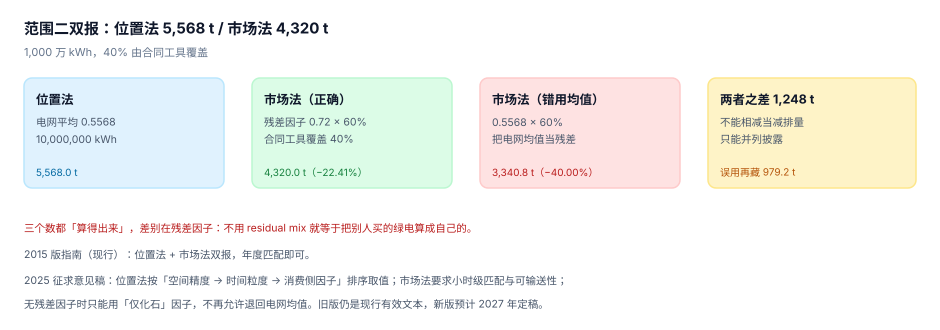

# 范围二双报：位置法、市场法与残差

范围二是「买的电、蒸汽、热、冷」产生的间接排放。它在 2015 年被单独拿出来要求**双报**：同一批用电，必须同时给出位置法（电网平均）与市场法（你买了什么）两个数。

双报的初衷很实在：位置法回答「我所在电网有多脏」，市场法回答「我为此做了什么」。两个数回答两个问题，所以**既不能只报一个，也不能相减**。

::: tip 一句话理解
范围二的两个数是**两种口径的两个答案**，不是「实际值」与「减排量」。把它们相减，等于把「我买了绿电」记成「我少发了电」。
:::

## 一、两种方法与残差



本机：年用电 1,000 万 kWh，电网平均因子 0.5568 tCO₂e/MWh，其中 40% 由合同工具（绿证/PPA）覆盖，未覆盖部分的残差因子 0.72。

| 口径 | 算法 | 结果 | 相对位置法 |
| --- | --- | --- | --- |
| 位置法 | 1,000 万 × 0.5568 | **5,568.0 t** | — |
| 市场法（用残差因子） | 600 万 × 0.72 | **4,320.0 t** | −22.41% |
| 市场法（误用电网均值） | 600 万 × 0.5568 | 3,340.8 t | **−40.00%** |

三个数都「算得出来」。差别在第三行：市场法里，未覆盖部分应该用**残差因子**（把已被合同工具认领的清洁电量剔除后剩下的那部分电网），而不是电网平均。用平均等于把别人买的绿电算成自己的。

「残差因子」这个概念的工程含义是：**它是一个减法**。电网平均里含有已经被别人认领的绿色电量，若你也用平均值，同一度绿电被认领两次。本机读数：误用均值把 979.2 t 藏了起来。

## 二、双报的三条纪律

| 纪律 | 反例 | 后果 |
| --- | --- | --- |
| 两个数并列披露，不相减 | 报「减排 1,248 t」 | 把采购行为记成减排成效 |
| 同一年用同一批活动数据 | 位置法用全年电量、市场法用有合同的月份 | 两数不可比 |
| 每个数都标口径与工具 | 只写「范围二 4,320 t」 | 读者无法判断是否含绿电 |

第一条最常被违反，因为它「很有说服力」：1,248 t 的差额看起来就是一个漂亮的减排成果。但它不满足减排量的定义——基准线没有变，产量没有变，变的只是采购合同。

::: danger 市场法的三个隐性前提
1. **合同工具必须可追溯**：每张绿证有唯一编号、有注销记录，且注销主体是你。没有注销记录的绿证不算数。
2. **覆盖量不能超过用电量**：买了 120% 的绿证，只能用 100%，多出的部分不能结转成负排放（除非所在体系明确规定）。
3. **地域与时间要匹配**：现行 2015 版允许年度匹配、同一市场边界内；修订草案要求小时级匹配与可输送性。按草案准备时，年度绿证会在 2027 年后失效。
:::

## 三、标准的两个版本（状态标注）

这是本册唯一涉及「大版本」的地方，两版并行、旧版仍是现行有效文本：

| 项目 | 2015 版（**现行有效**） | 2025 征求意见稿（**草案，不得作为报告依据**） |
| --- | --- | --- |
| 结构 | 位置法 + 市场法双报 | 双报结构保留 |
| 位置法取值 | 区域/国家电网平均 | 按「空间精度 → 时间粒度 → 消费侧优于生产侧」排序，取可得的最精确因子 |
| 市场法匹配 | 年度（或月度）匹配 | 小时级匹配（大用电户的自愿声明必须） |
| 可输送性 | 市场边界内即可 | 合同工具须可在受报告主体所在电网区域内实际输送 |
| 残差因子 | 无残差时可用电网平均 | **只用「仅化石」因子**，不再允许退回电网平均 |
| 实施 | — | 分阶段实施、存量合同过渡条款、可选提前采用 |

时间线（据 GHG Protocol 公开信息）：2015 版发布；2022-11 启动企业标准套件整体修订；2025-07-14 独立标准委员会通过范围二修订案进入公众咨询；2025-10-20 起 60 天公开征求意见；关键条款定稿预计 2026 年中；完整修订版与其余企业标准预计 2027 年底发布。

工程含义很直接：**位置法的因子取值逻辑要能「按精度降级」，市场法的匹配粒度要能「从年切到小时」**。这两件事都不难做，难的是数据：小时级匹配要求用电曲线与合同工具的时间戳都到小时。

## 四、怎么落库

两张表 + 一个视图，就能支撑双报：

```sql
-- 用电（按设施、按月；有小时数据时按小时）
CREATE TABLE elec_consumption(
  id          INTEGER PRIMARY KEY,
  facility_id TEXT NOT NULL REFERENCES facility(id),
  period      TEXT NOT NULL,
  kwh         REAL NOT NULL CHECK(kwh >= 0),
  factor_loc  REAL NOT NULL,     -- 位置法因子快照
  UNIQUE(facility_id, period)
);

-- 合同工具（绿证 / PPA / 自发电）
CREATE TABLE instrument(
  id          TEXT PRIMARY KEY,          -- 证书编号
  facility_id TEXT NOT NULL REFERENCES facility(id),
  kind        TEXT NOT NULL CHECK(kind IN ('rec','ppa','self_gen')),
  mwh         REAL NOT NULL CHECK(mwh > 0),
  period_from TEXT NOT NULL,
  period_to   TEXT NOT NULL,
  retired_at  TEXT,                      -- 注销时间，NULL 表示未注销
  retired_by  TEXT
);

-- 双报视图：一行两个数
CREATE VIEW scope2_dual AS
SELECT c.facility_id, c.period,
       c.kwh / 1000.0 * c.factor_loc AS loc_tco2e,
       (c.kwh / 1000.0 - coalesce(
          (SELECT sum(i.mwh) FROM instrument i
            WHERE i.facility_id = c.facility_id AND i.period_from <= c.period
              AND i.period_to >= c.period AND i.retired_at IS NOT NULL), 0))
       * 0.72 AS mkt_tco2e
FROM elec_consumption c;
```

三点说明：

1. **`factor_loc` 存在用电表里**，不 join 因子表——理由同[因子快照](../EmissionFactor/index.md)一节。
2. **`retired_at` 是市场法的门槛**：未注销的证书不算数，这一条能挡住「买了但没注销」的常见错误。
3. **残差因子 0.72 应来自因子库**，不是硬编码；这里写成常量只为让视图可读。

## 五、本页判据：`CBS-A` ~ `CBS-H`

| 编号 | 判据 | 怎么判 |
| --- | --- | --- |
| `CBS-A` | 位置法与市场法同时产出 | 视图两列均非空 |
| `CBS-B` | 两数并列披露，无「差额 = 减排」字段 | 披露表中无 `scope2_reduction` |
| `CBS-C` | 市场法的未覆盖部分用残差因子 | 计算式中残差因子来自因子表且有版本 |
| `CBS-D` | 每个市场法数值可追到合同工具编号 | `instrument.retired_at` 非空且可 join |
| `CBS-E` | 合同工具覆盖量不超过用电量 | 覆盖比例 ≤ 100% |
| `CBS-F` | 位置法因子取值标注精度层级 | `factor_loc` 有来源与层级字段 |
| `CBS-G` | 小时级数据可用性有评估（为草案做准备） | 有 `has_hourly` 标记或评估记录 |
| `CBS-H` | 标准版本在方法说明中声明 | 报告含「依据 2015 版 / 参考 2025 草案」字样 |

## 六、验证方式

先验证三口径的三个数，再验证「误用均值藏了多少」：

```shell
# 1) 本页判据 8 条
grep -o 'CBS-[A-H]' docs/Backend/CarbonAccounting/Scope2Dual/index.md | sort -u | wc -l

# 2) 三口径
python3 - <<'PY'
cons, grid, resid, cover = 10_000_000, 0.5568, 0.72, 0.40
loc = cons*grid/1000
mkt = cons*(1-cover)*resid/1000
bad = cons*(1-cover)*grid/1000
print("位置 %.1f / 市场(残差) %.1f（%+.2f%%）/ 市场(均值) %.1f（%+.2f%%）" %
      (loc, mkt, (mkt-loc)/loc*100, bad, (bad-loc)/loc*100))
print("两法差 %.1f，误用均值再藏 %.1f" % (loc-mkt, mkt-bad))
PY
```

预期输出：第一条 `8`；第二条打印 `位置 5568.0 / 市场(残差) 4320.0（-22.41%）/ 市场(均值) 3340.8（-40.00%）` 与 `两法差 1248.0，误用均值再藏 979.2`。

如果你只有位置法一个数，说明还没做双报；如果市场法用的是电网均值，说明残差因子的概念还没落地——这两种情况下，「范围二下降 22%」这类结论都不成立。

## 参考资料

- [排放因子与 GWP](../EmissionFactor/index.md)
- [范围三：十五类与两种算法](../Scope3/index.md)
- GHG Protocol《Scope 2 Guidance》（2015，现行有效）：<https://ghgprotocol.org/scope-2-guidance>
- GHG Protocol 范围二修订说明（2025-07 委员会通过、2025-10 公开征求意见）：<https://ghgprotocol.org/blog/scope-2-standard-advances-isb-approves-consultation-market-and-location-based-revisions>
- 财政部会计准则委员会《温室气体核算体系就范围二指南修订发布征求意见稿》（2025-10-24）：<https://www.casc.org.cn/2025/1024/276777.shtml>
