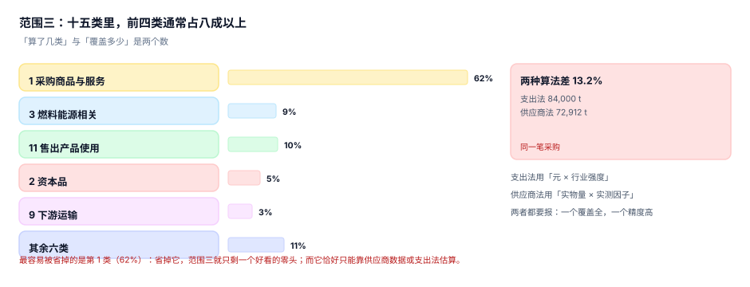

# 范围三：十五类与两种算法

范围三是「价值链上别人排的、但跟我有关的」排放。它有十五个类别，覆盖上游采购到下游产品报废的全过程。

范围三的难点不是算，是**算到哪儿为止**：同一家企业可以报「范围三 5 万吨」（只算差旅和通勤）也可以报「范围三 80 万吨」（算了采购商品），两个数都是真的，差别只在覆盖了哪几类。

::: tip 一句话理解
范围三要报**两个数**：算了几类、覆盖多少。只报「合计 80 万吨」而不说覆盖率，等于报了一个无法比较的数。
:::

## 一、十五类与上下游



| 上游（1~8） | 下游（9~15） |
| --- | --- |
| 1 购买的商品与服务 | 9 下游运输与配送 |
| 2 资本商品 | 10 加工售出产品 |
| 3 燃料与能源相关活动（范围一/二之外） | 11 使用售出产品 |
| 4 上游运输与配送 | 12 售出产品报废处理 |
| 5 运营中产生的废弃物 | 13 下游租赁资产 |
| 6 商务旅行 | 14 特许经营 |
| 7 员工通勤 | 15 投资 |
| 8 上游租赁资产 | |

本机这套数据里各类的占比（示意）：

| 类别 | 占比 | 典型数据来源 |
| --- | --- | --- |
| 1 购买的商品与服务 | **62%** | 供应商实测 / 支出法 |
| 11 使用售出产品 | 10% | 产品能效 × 使用强度 |
| 3 燃料与能源相关 | 9% | 上游燃料开采与输送 |
| 2 资本商品 | 5% | 采购台账 |
| 9 下游运输 | 3% | 承运商账单 |
| 其余五类合计 | 11% | 逐类估算 |

四个主类占 86%，其余六类合计 14%。这个分布决定了工作重点：**第 1 类占 62%，它算不准，范围三就没意义**；而它恰好是最难拿数据的一类。

## 二、覆盖率的两个数

| 指标 | 算法 | 本机 |
| --- | --- | --- |
| 类别覆盖率 | 已算类别数 / 15 | 10 / 15 = 66.7% |
| 排放覆盖率 | 已算类别排放 / 全部类别排放 | 100%（其余五类为零排放） |
| 支出覆盖率 | 已覆盖支出 / 总采购支出 | 76% |

三个数会打架，所以要一起报。一个常见的坑：只算 10 类但「其余 5 类本企业没有」（比如没有特许经营、没有下游租赁），此时类别覆盖率 66.7% 而排放覆盖率 100%——**必须说明另外 5 类为什么是零，而不是漏了**。

## 三、两种算法：支出法与供应商法

| 算法 | 输入 | 优点 | 缺点 | 本机结果 |
| --- | --- | --- | --- | --- |
| 支出法（spend-based） | 采购金额 × 行业强度 | 覆盖全、拿数快 | 随价格波动、精度低 | 84,000 t |
| 供应商法（supplier-specific） | 实物量 × 供应商实测因子 | 精度高、可追溯 | 覆盖有限、依赖供应商 | 72,912 t |

同一笔 2 亿元的采购，两法差 **13.20%**。差额不来自计算错误，来自**口径**：支出法测的是「花了多少钱」，供应商法测的是「用了多少物」。

### 混合法怎么混

现实做法是混合：有大供应商实测数据的部分用供应商法，其余用支出法。

```text
采购 1.24 亿元，其中 35% 有供应商实测数据（其因子为行业强度的 62%）：
支出法：      124,000,000 × 0.00042 = 52,080 t
混合法：0.35 × 52,080 × 0.62 + 0.65 × 52,080 = 45,153 t（−13.30%）
```

这个读数的意义不是「混合法更准」，而是：**只要供应商实测因子系统性低于行业强度，混合法就会把总量拉低**。所以覆盖率的提升会带来「排放下降」的错觉——这是范围三最常见的伪减排。

::: danger 范围三的三个伪减排
1. **换算法**：从支出法换成供应商法，总量降 13%，被写成「供应链减排成效」。
2. **换边界**：把某个自制件改成外购，范围一降、范围三升，总量不变，但「范围一下降」被单独宣传。
3. **换供应商**：把高排放供应商换成「说不清」的供应商，数据从有变无，总量下降。
:::

## 四、类别边界：三个容易串号的地方

| 情形 | 正确归属 | 常见错法 |
| --- | --- | --- |
| 外购蒸汽里的燃料 | 供应商范围一 + 我方范围二 | 我方再记一次范围一 |
| 员工开公司车出差 | 范围一（我控制车辆） | 记进类别 6（差旅） |
| 员工开私家车出差 | 类别 6 | 记进范围一 |
| 上游运输（供应商送货） | 类别 4 | 记进范围一（不是我的车） |
| 下游运输（我付钱的配送） | 类别 9 | 记进范围一 |
| 售出产品的用电 | 类别 11 | 记进范围二（不是我的用电） |

判定规则一句话：**排放源由谁控制，就归谁的范围一/二；不由我控制但与我的价值链有关，就是我的范围三。**

## 五、数据怎么拿：三条现实路径

| 路径 | 覆盖率 | 精度 | 落地成本 |
| --- | --- | --- | --- |
| 供应商问卷（实测因子） | 20%~40% | 高 | 高（要一家家谈） |
| 行业平均因子（EEIO） | 100% | 低 | 低 |
| 混合（分层） | 60%~80% | 中 | 中 |

分层的原则是**按支出额排序，头部用问卷、长尾用强度**：本机数据里前 35% 的供应商贡献了 62% 的排放，把这 35% 拿下，剩下的用支出法估，误差被压到可接受范围。

问卷回收率是这条路的真实瓶颈。工程上要做的不是「催」，而是**让供应商填一次能用三年**：问卷字段与你的因子表字段对齐（燃料、单位、因子、边界），回填后直接入库成 `factor` 行。

## 六、落库

```sql
CREATE TABLE scope3_line(
  id           INTEGER PRIMARY KEY,
  year         INTEGER NOT NULL,
  category     INTEGER NOT NULL CHECK(category BETWEEN 1 AND 15),
  method       TEXT NOT NULL CHECK(method IN ('spend','supplier','hybrid','activity')),
  spend        REAL,                 -- 元，spend 法必填
  qty          REAL,                 -- 实物量，supplier/activity 法必填
  unit         TEXT,
  ef           REAL,
  co2e         REAL NOT NULL CHECK(co2e >= 0),
  supplier_id  TEXT,                 -- 有实测因子时必须填
  dqr          INTEGER NOT NULL CHECK(dqr BETWEEN 1 AND 5),
  UNIQUE(year, category, supplier_id, method)
);

-- 覆盖率单独一张表，跟着披露一起出
CREATE TABLE scope3_coverage(
  year        INTEGER PRIMARY KEY,
  cats_done   INTEGER NOT NULL,
  cats_zero   INTEGER NOT NULL,      -- 明确判定为零的类别
  emis_cover  REAL NOT NULL,
  spend_cover REAL NOT NULL,
  note        TEXT NOT NULL          -- 零排放类别的理由
);
```

`cats_done + cats_zero` 必须等于 15，这一条约束挡住「漏了两类但没人发现」——漏掉的类别既不在 done 里也不在 zero 里，约束立刻失败。

## 七、本页判据：`CBT-A` ~ `CBT-H`

| 编号 | 判据 | 怎么判 |
| --- | --- | --- |
| `CBT-A` | 十五类逐类有归属（算了 / 为零 / 不适用） | `cats_done + cats_zero = 15` |
| `CBT-B` | 每行标注算法（spend/supplier/hybrid/activity） | `method` 非空 |
| `CBT-C` | 供应商法必须带 `supplier_id` 与实测因子 | 该组合 `supplier_id` 非空 |
| `CBT-D` | 支出法行只带金额，不带实物量（避免混算） | `method='spend'` 时 `qty` 为空 |
| `CBT-E` | 类别归属不与范围一/二重叠 | 外购蒸汽、售出产品用电不在范围三行里 |
| `CBT-F` | 覆盖率与合计同时披露 | `scope3_coverage` 与 `scope3_line` 同年存在 |
| `CBT-G` | 换算法导致的变化单独说明 | 有 `method_change` 记录与影响值 |
| `CBT-H` | 供应商问卷回填直接入库，不做手工转录 | 因子表有 `source='supplier_survey'` 的行 |

## 八、验证方式

先验证覆盖率约束，再验证「换算法造成的伪减排」：

```shell
# 1) 本页判据 8 条
grep -o 'CBT-[A-H]' docs/Backend/CarbonAccounting/Scope3/index.md | sort -u | wc -l

# 2) 混合法相对支出法
python3 - <<'PY'
spend, eeio, sup, gap = 124_000_000, 0.00042, 0.35, 0.62
base = spend*eeio
mix = spend*sup*eeio*gap + spend*(1-sup)*eeio
print("支出法 %.0f / 混合法 %.0f（%+.2f%%）" % (base, mix, (mix-base)/base*100))
PY

# 3) 十五类归属检查
python3 - <<'PY'
done, zero = 10, 5
print("合计 %d，%s" % (done + zero, "通过" if done + zero == 15 else "缺类"))
PY
```

预期输出：第一条 `8`；第二条打印 `支出法 52080 / 混合法 45153（-13.30%）`；第三条打印 `合计 15，通过`。

第二条的 −13.30% 是本页最需要警惕的一个数：它是「数据变好」的结果，不是「排放变少」的结果。报告里必须把它写在方法变更项下，而不是减排成效项下。

## 参考资料

- [范围二双报](../Scope2Dual/index.md)
- [分配与产品碳足迹](../Allocation/index.md)
- GHG Protocol《Corporate Value Chain (Scope 3) Accounting and Reporting Standard》（十五类定义与技术指引）：<https://ghgprotocol.org/standards/scope-3-standard>
- ISO 14064-1:2018 附录（间接排放分类）：<https://www.iso.org/standard/66453.html>
- GB/T 24067—2024《温室气体 产品碳足迹 量化要求和指南》（上游前体物排放要求）：<https://www.mee.gov.cn/ywdt/zbft/202409/t20240910_1085481.shtml>
