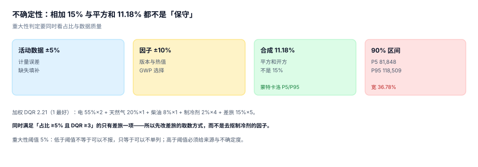

# 数据质量、不确定性与重大性

前面六段都在算「多少」，这一段回答「这个数有多可信」。两者缺一不可：一个没有区间的排放数，读者只能选择全信或全不信。

不确定性有四个来源（活动数据、因子、方法、边界），它们合成的方式决定了区间宽度；而**重大性判定**决定了哪些不确定度必须解决、哪些可以带着走。

::: tip 一句话理解
不给区间的数，是在宣称「零误差」。这比给一个宽区间更危险——它让读者失去了判断的依据。
:::

## 一、四个误差来源



| 来源 | 典型幅度 | 能否降低 | 降低方式 |
| --- | --- | --- | --- |
| 活动数据 | ±5% | 能 | 装表、对发票、消除估算 |
| 因子 | ±10% | 部分能 | 用更精确层级（区域 > 国家 > 国际） |
| 方法 | ±10%~30% | 不能（只能声明） | 换方法要重述 |
| 边界 | ±5%~20% | 不能（只能一致） | 边界定死不改 |

前两个是「可以改进」的，后两个是「只能声明」的。这个区分很重要：一份报告花大力气把活动数据从 ±5% 降到 ±3%，如果方法本身带 ±20% 的不确定度，那点改进在总量上看不出来。

## 二、合成：三种算法的差别

活动数据 ±5%、因子 ±10%：

| 算法 | 结果 | 问题 |
| --- | --- | --- |
| 直接相加 | 15.0% | 假设两项误差同向且取极值，高估 |
| 平方和开方 | **11.18%** | 假设两项独立，是 1σ 而非区间 |
| 蒙特卡洛 | P5 81,848 / P50 99,669 / P95 118,509 | 90% 区间宽 36.78%（±18.4%） |

第二行是最常用的写法，也是最容易被误用的：**11.18% 是 1 个标准差，不是 90% 区间**。若按正态近似，90% 区间是 ±1.645σ ≈ ±18.4%，与本机蒙特卡洛的 ±18.4% 一致。

所以「不确定性 ±11%」这句话本身没错，但它和「90% 概率落在 ±18% 内」是两件事。披露时写清是哪一种。

::: danger 不确定性的三个常见错法
1. **把 1σ 当区间**：报「±11%」，读者按 ±11% 理解，实际 90% 区间是 ±18.4%。
2. **只给总量的区间，不给分项的**：总量区间被大项主导，小项的误差被平均掉，改进时找不到方向。
3. **相关性当独立**：同一批电量的活动数据误差与因子误差确实独立，但「同一家工厂 12 个月的估算误差」是高度相关的——按月独立合成会低估年度区间。
:::

## 三、DQR：五级评分

数据质量评分（Data Quality Rating）用 1~5 分，1 最好：

| 分 | 含义 | 例子 |
| --- | --- | --- |
| 1 | 实测、有第三方凭证 | 电费单、校准过的表计 |
| 2 | 实测、内部记录 | 自有电表、DCS 记录 |
| 3 | 计算得出、有依据 | 按额定功率 × 运行小时 |
| 4 | 估算、依据较弱 | 按面积/人数分摊 |
| 5 | 推断、无直接依据 | 支出法、行业平均 |

加权 DQR（按排放量加权）本机为 **2.21**：

| 项 | 占比 | DQR | 贡献 |
| --- | --- | --- | --- |
| 电 | 55% | 2 | 1.100 |
| 天然气 | 20% | 1 | 0.200 |
| 柴油 | 8% | 1 | 0.080 |
| 制冷剂 | 2% | 4 | 0.080 |
| 差旅 | 15% | 5 | 0.750 |

加权 DQR 2.21 的意思是「整体接近 2」，也就是大部分排放来自实测数据。但这个平均数掩盖了一件事：**差旅只有 15% 的占比，却贡献了 0.750，与占 55% 的电（1.100）接近**。

## 四、改进优先级：占比 × (DQR − 1)

| 项 | 占比 | DQR | 优先级 | 直觉判断 | 实际 |
| --- | --- | --- | --- | --- | --- |
| 差旅 | 15% | 5 | **0.60** | 占比小，先放 | 数据最差，改进收益最高 |
| 电 | 55% | 2 | 0.55 | 占比最大，先改 | 已接近实测，边际收益低 |
| 制冷剂 | 2% | 4 | 0.06 | 数据差 | 占比太小，改了也看不出来 |
| 天然气 | 20% | 1 | 0.00 | — | 已是最好 |
| 柴油 | 8% | 1 | 0.00 | — | 已是最好 |

这张表是本页最有用的东西：**「占比最大的」和「最该改的」不是同一项**。只看占比会去抠电（已经 DQR 2），只看 DQR 会去抠制冷剂（占比 2%）。乘起来才知道差旅是那个「又差又有一点量」的项。

::: warning 优先级公式的边界
「占比 × (DQR − 1)」是一个启发式，它假设 DQR 每降一级带来的不确定度下降相同。实际不完全如此：DQR 5→4 的改进（从支出法到按量估算）往往大于 DQR 3→2。

更严谨的做法是把 DQR 映射到不确定度区间（如 1:±2%、2:±5%、3:±15%、4:±30%、5:±50%），再按平方和合成，看降一级能把总量区间收窄多少。但对企业实践来说，启发式足够用来排序。
:::

## 五、重大性：多少算「必须解决」

核查与披露都绕不开「重大性」（materiality）。它不是统计概念，是**判断阈值**：低于阈值的不必单列，但必须计入；高于阈值的必须给来源、方法与不确定度。

| 阈值用法 | 常见取值 | 说明 |
| --- | --- | --- |
| 相对总量 | 5% | 单项占总排放 5% 以上 → 重大 |
| 相对类别 | 10% | 类别内占比 |
| 绝对额 | 按企业规模 | 如 1,000 tCO₂e 以上 |

本机的判定：同时满足「占比 ≥5% 且 DQR ≥3」的只有差旅一项。这意味着：

- 差旅必须单列并说明估算方法（占 15%、DQR 5）。
- 制冷剂 DQR 4 但占 2%，可不单列，但要计入。
- 电与天然气虽然占比大，但 DQR ≤2，可达标披露。

**「低于阈值」不等于「可以不报」**，只等于「可以不单列」。这条区分是很多报告出问题的地方：把低于阈值的小项直接删掉，总量就少了一块，而且没人能发现。

## 六、怎么把区间写进披露

三层写法，从粗到细：

```text
1) 只给点估计：「范围一 212.30 tCO2e」                     ← 不推荐
2) 给区间：  「范围一 212.30 tCO2e（±5%，95% 置信）」        ← 最低要求
3) 给区间 + 分项 + 方法：「范围一 212.30 tCO2e，其中天然气
   ±3%（实测）、柴油 ±8%（估算），合成 ±5%」                ← 推荐
```

第三层的价值在于：读者能看出「这个区间是被哪一项撑开的」。如果一家企业的区间是 ±30%，第三层会立刻告诉你是差旅那 15% 造成的——改进方向自明。

## 七、本页判据：`CBU-A` ~ `CBU-H`

| 编号 | 判据 | 怎么判 |
| --- | --- | --- |
| `CBU-A` | 每个活动数据行有 DQR（1~5） | `dqr` 非空且取值合法 |
| `CBU-B` | 加权 DQR 可计算并披露 | 按排放量加权的 SQL 有结果 |
| `CBU-C` | 总量给出不确定度（点估计 + 区间） | 披露表有 `uncertainty` 与 `ci_level` |
| `CBU-D` | 区间标明是 1σ 还是置信区间 | 有 `ci_type` 字段 |
| `CBU-E` | 重大性阈值与判定结果落库 | 有阈值配置与逐项判定 |
| `CBU-F` | 低于阈值项仍计入总量 | 明细合计 = 披露总量（含小项） |
| `CBU-G` | 改进优先级可排序（占比 × DQR） | 一条 SQL 能出排序表 |
| `CBU-H` | 方法类不确定度单独声明（不可降低） | 报告含方法不确定度声明 |

## 八、验证方式

先验证三种合成算法，再验证改进优先级的排序翻转：

```shell
# 1) 本页判据 8 条
grep -o 'CBU-[A-H]' docs/Backend/CarbonAccounting/Uncertainty/index.md | sort -u | wc -l

# 2) 合成：相加 vs 平方和
python3 - <<'PY'
import math
a, f = 0.05, 0.10
print("相加 %.1f%% / 平方和 %.2f%%" % ((a+f)*100, math.sqrt(a*a+f*f)*100))
PY

# 3) 改进优先级
python3 - <<'PY'
rows = [("差旅",0.15,5),("电",0.55,2),("制冷剂",0.02,4),("天然气",0.20,1),("柴油",0.08,1)]
for n,w,d in sorted(rows, key=lambda r: -r[1]*(r[2]-1)):
    print("%-4s 占比 %2.0f%% DQR %d -> %.2f" % (n, w*100, d, w*(d-1)))
PY
```

预期输出：第一条 `8`；第二条打印 `相加 15.0% / 平方和 11.18%`；第三条按优先级降序打印，第一行是 `差旅 占比 15% DQR 5 -> 0.60`，第二行是 `电 占比 55% DQR 2 -> 0.55`。

如果第三条输出的第一行是「电」，说明你按占比排序了——那会得出「先改最大的」这个结论，而它恰好是边际收益最低的一项。

## 参考资料

- [分配与产品碳足迹](../Allocation/index.md)
- [披露、重述与履约](../Disclosure/index.md)
- GHG Protocol《Corporate Standard》第 6 章与《Quantifying GHG Reductions》中关于不确定性的说明：<https://ghgprotocol.org/corporate-standard>
- ISO 14064-1:2018 第 6.3 节（不确定性评估）：<https://www.iso.org/standard/66453.html>
- IPCC《2006 年国家温室气体清单指南》第 1 卷（不确定性的误差传播方法）：<https://www.ipcc-nggip.iges.or.jp/public/2006gl/>
