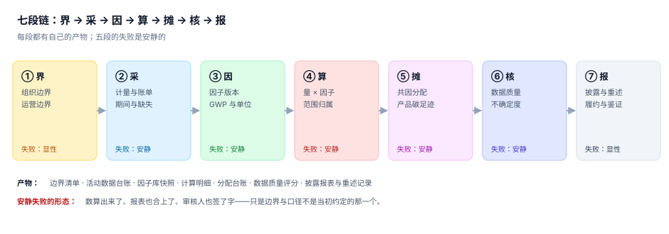
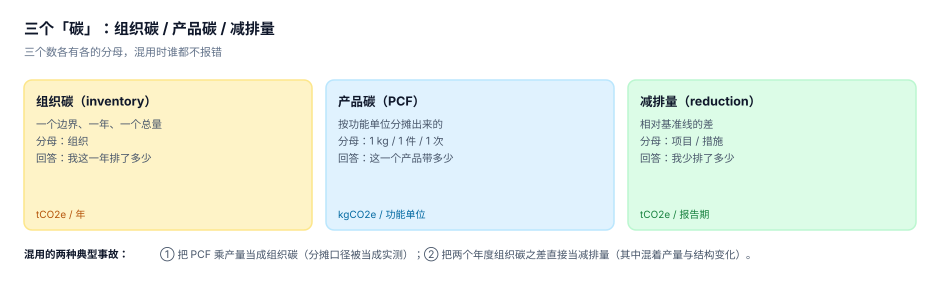

# 碳排放核算与 ESG 披露工程

<p style="text-align:center;"></p>

一家公司说自己「去年排了 12 万吨碳」。这句话里有五个变量没被说出来：**按哪个边界**（哪些子公司算进来）、**按哪个期间**（自然年还是顺延的账单期）、**按哪版因子**（电厂因子每年都在变）、**按哪版 GWP**（甲烷的换算倍数改过三次）、**按哪个方法**（范围二有位置法与市场法两套）。

五个变量各差一点，同一个工厂能算出相差 20% 的「同一件事」。而系统不会报错——它会给你一个漂亮的整数，配上一条上升或下降的折线。

::: tip 一句话理解
碳不是一个数，是一本**带边界、带期间、带版本**的账。**七段链里五段的失败是安静的**：数算出来了、报表合上了、审核人签了字，只是边界与口径不是当初约定的那一个。
:::

## 一、这个专题讲什么

从「各部门交一张电费单」到「一份能过第三方核查、能进披露报告、能应对碳市场与碳关税的清单」，要走七段。本专题按这七段组织，每段都标出产物与失败方式：

| 段 | 这一段在做什么 | 产物 | 失败是否安静 |
| --- | --- | --- | --- |
| ① 界 | 定组织边界与运营边界，列出并进来与不并进来的实体 | `entity` / `facility` | 显性（不并就少一大块） |
| ② 采 | 从结算单、计量表、发票、系统里取活动数据，定期间与缺失处理 | `activity` | **安静**（缺表当月按 0 计） |
| ③ 因 | 选因子与 GWP 版本，处理单位与热值 | `factor` | **安静**（跨年误用旧因子） |
| ④ 算 | 活动数据 × 因子，按范围归属 | `calc_line` | **安静**（范围一/二串号） |
| ⑤ 摊 | 共因分配到设施、租户、产品 | `allocation_run` | **安静**（合计对、各家错） |
| ⑥ 核 | 数据质量评分、不确定度、重大性判定 | `dq_score` | **安静**（不报区间等于报假精度） |
| ⑦ 报 | 披露、基准年重述、履约与鉴证 | `disclosure` / `restatement` | 显性（外部会问） |



七段里**五段的失败是安静的**。它们共同的形态是：清单看起来完整、合计数看起来正常、系统没有任何报错，只有某一次第三方核查、某一次客户问卷、某一次配额清缴，才会把问题翻出来。那时基准年已经过去两年，改一次要重述三年的数。

## 二、三个「碳」，各有各的分母

同一个「碳」字在三种场合指三件不同的事，而 PPT 上通常只有一个数字：

| 说法 | 回答的问题 | 分母 | 说错了的后果 |
| --- | --- | --- | --- |
| 组织碳（inventory） | 我这一年排了多少 | 一个边界、一年 | 目标与配额全部对不上 |
| 产品碳（PCF） | 这一个产品带多少 | 1 kg / 1 件 / 1 次 | 客户的 CBAM 申报被驳回 |
| 减排量（reduction） | 我比基准线少排了多少 | 项目 / 措施 | 把产量下降说成减排成效 |



三种混用的典型事故：

1. **把 PCF 乘产量当成组织碳**。PCF 是按功能单位分摊出来的，分摊口径里的假定（分配方法、边界）与组织清单的假定不是一套；乘出来的数看起来量级正确，实际差了 10%~30%。
2. **把两年组织碳之差当减排量**。这个差里混着产量变化、产品结构变化、边界变化（并购）。本机读数的重述例子里，同一家公司「看起来降了 5%」，把边界与方法变化补回去之后实际降了 8.48%——方向没错，幅度错了 70%。
3. **把范围二的两个数相减当减排量**。位置法 5,568 t 与市场法 4,320 t 的差 1,248 t 是「买了绿电」的结果，不是「少发了电」的结果；它可以披露，但不能进减排量台账。

## 三、三个边界，定一次管三年

七段链的第①段不是「填个表」，是三个只能定一次的决定：

| 边界 | 决定什么 | 定了之后 | 改的代价 |
| --- | --- | --- | --- |
| 组织边界 | 哪些法律实体并进来、按什么方法并 | 合并方法（股权比例 / 运营控制 / 财务控制）写进基准年 | 改方法要重述基准年 |
| 运营边界 | 范围内哪些排放源、按范围一/二/三怎么分 | 排放源清单与归属规则 | 改归属要重算全部历史 |
| 报告边界 | 披露给谁、按哪套准则、什么期间 | 披露准则与报告期 | 换准则要出双份对照 |

三者不是并列的：**组织边界决定「并谁」，运营边界决定「并什么」，报告边界决定「怎么说」**。本机读数里同一组实体在三种合并方法下是 77,250 / 79,000 / 75,000 t，极差 4,000 t（5.06%）——三个数都能自圆其说，所以方法只能选一次。

## 四、与其它专题的分工

库里跟「账」有关的册子已经有六本，问的问题各不相同。先看这张表再决定读哪一册：

| 你关心的问题 | 该读哪一册 | 为什么不是本册 |
| --- | --- | --- |
| 「这笔业务怎么拆成借贷两腿、横平不平」 | [复式记账与分录](../Ledger/DoubleEntry/index.md) | 那册判**记账规则**，本册判**一条排放量的边界与版本** |
| 「产品成本怎么算、月末怎么结」 | [成本核算与月末结账](../CostAccounting/Overview/index.md) | 那册判**金额守恒**，本册判**物理量到 CO₂e 的换算是否可复核** |
| 「资产怎么折旧、账实对不对」 | [资产台账与折旧摊销](../FixedAsset/Overview/index.md) | 那册判**账实相符**，本册只把能耗设备当排放源 |
| 「集团合并时内部交易怎么抵销」 | [合并报表与内部交易抵销](../Consolidation/Overview/index.md) | 那册判**跨主体只数一次**，本册判**跨主体的排放归属**（GHG 与财务的合并口径不同） |
| 「字段标准、主数据怎么治理」 | [数据治理与标准主数据](../../DB/DataGovernance/StandardsMasterData/index.md) | 那册判**标准怎么定**，本册判**因子与实体的版本快照** |
| 「采购到付款怎么三单匹配」 | [采购到付款](../ProcureToPay/Overview/index.md) | 那册判**三份文件一致**，本册只用采购额估范围三 |
| 「多币种怎么折算」 | [多币种与汇率折算](../MultiCurrency/Overview/index.md) | 那册判**汇率时点**，本册在碳关税里用到它 |

::: info 为什么不并入「复式记账与分录」
两册都会出现「借贷平衡」与「合计数」，但守恒的对象不同：复式记账的守恒是**金额的横向平衡**（借 = 贷），碳核算的守恒是**物理量的纵向闭合**（各范围之和 = 总量、分配之和 = 待分总量、十二年之和 = 年度值）。

一组最直观的反例：一家公司的碳排放清单完全满足「借贷平衡」式的自检（每个范围都等于明细之和），同时把 45% 持股的合资公司按 100% 并了进来、把范围二的位置法当成唯一口径——两个错都不破坏任何一条加总恒等式。合计数是平的，边界是错的。
:::

::: info 版本组织说明（为什么这里没有 `v2015/` `v2025/` 版本目录）
本专题涉及两份正在换代的**标准**：GHG Protocol 的《Scope 2 Guidance》2015 版（现行有效）与 2025-10-20 起公开征求意见的修订稿，以及 IPCC 的 AR4 / AR5 / AR6 三套 GWP。按仓库规则，大版本应按版本目录组织并保留旧版；本专题判断不属于该情形，三条理由：

1. **换代的是「取值层级」与「匹配粒度」，判据一条没变**。双报结构（位置法 + 市场法）在 2015 版与征求意见稿里都在；变的是位置法要按「空间精度 → 时间粒度 → 消费侧因子」排序取值、市场法要小时级匹配与可输送性。`CBS-B`（两个口径必须同时出现）与 `CBS-D`（每个数必须能追到合同工具或因子来源）在两版下一字不差。
2. **两版长期并存**。2015 版是现行有效文本，征求意见稿预计 2027 年底才定稿，其间企业只能按现行版报、按草案准备。并存差异是**同一页的两个分支**（见[范围二双报](../CarbonAccounting/Scope2Dual/index.md)的对照表），不是两条内容线。
3. **真正需要版本目录的是「同一份代码两套写法」**。先例可对照 [Spring5](../Java/Frame/Spring/Spring5/index.md) 与 [Spring6](../Java/Frame/Spring/Spring6/index.md)、[Vue2](../../Frontend/Frame/Vue/Vue2/index.md) 与 [Vue3](../../Frontend/Frame/Vue/Vue3/index.md)——那是同一件事的两套实现，读错一行就编译不过。本册的两版标准是**同一套判据的两组参数**，写在同页反而更容易对照。

旧版状态标注（保留，不覆盖）：**2015 版 = 现行有效**（企业今年报的数按它算）；**2025 征求意见稿 = 草案，不得作为报告依据**，只能用于影响评估与系统改造准备。
:::

## 五、本机读数（种子 20261102）

6 个实体、12 个设施、216 条活动数据、12 个月，跑完七段得到七个数字，后面每一页都会用到：

| 环节 | 读数 | 说明 |
| --- | --- | --- |
| 边界 | 77,250 / 79,000 / 75,000 t | 三种合并方法，极差 5.06%，都不报错 |
| 活动数据 | 缺 3 个月只报观测 → −24.49% | 「保守地不估」= 系统性低估 |
| 因子 | 跨年误用旧因子 +2.42% | 因子每年都变，不是常数 |
| GWP | AR4→AR6 +3.95%，AR5→AR6 +0.21% | 换版本的方向不单调 |
| 范围二 | 位置 5,568 / 市场 4,320 t（−22.41%） | 两个都要报，且不能相减 |
| 范围三 | 支出法与供应商法差 13.20% | 同一笔采购，两套算法 |
| 分配 | 能量法 42.11% vs 火用法 70.80% | 同一座热电厂，电力的排放差 68.1% |
| 重述 | 不重述 −5.00% → 重述后 −8.48% | 幅度错了 70% |

::: warning 这七个数字之间的关系
它们不是七个独立指标，是**同一条链上七次「安静失败」的度量**。少报的那 24.49%、误用的那 2.42%、被藏起来的那 979.2 t 残差、被挪走的那 17,215 t 电力排放，没有一次会让接口返回 500，也没有一次会出现在「本年排放同比下降 X%」这一句话里。这正是本专题要建立判据的理由。
:::

## 六、章节索引

| 章 | 章节 | 判据族 | 条数 |
| --- | --- | --- | --- |
| 1 | [总览：七段链与三个「碳」](Overview/index.md) | `CBO-A` ~ `CBO-H` | 8 |
| 2 | [组织边界与合并方法：并谁、并多少](BoundaryOrg/index.md) | `CBB-A` ~ `CBB-H` | 8 |
| 3 | [活动数据：来源、期间与缺失](ActivityData/index.md) | `CBA-A` ~ `CBA-H` | 8 |
| 4 | [排放因子与 GWP：两个版本维度](EmissionFactor/index.md) | `CBF-A` ~ `CBF-H` | 8 |
| 5 | [范围二双报：位置法、市场法与残差](Scope2Dual/index.md) | `CBS-A` ~ `CBS-H` | 8 |
| 6 | [范围三：十五类与两种算法](Scope3/index.md) | `CBT-A` ~ `CBT-H` | 8 |
| 7 | [分配与产品碳足迹：只改归属不改合计](Allocation/index.md) | `CBL-A` ~ `CBL-H` | 8 |
| 8 | [数据质量、不确定性与重大性](Uncertainty/index.md) | `CBU-A` ~ `CBU-H` | 8 |
| 9 | [披露、重述与履约：给谁看、怎么改、欠多少](Disclosure/index.md) | `CBD-A` ~ `CBD-H` | 8 |
| 10 | [实战：八张表跑通一次核算与披露](Practice/index.md) | `CBX-A` ~ `CBX-H` | 8 |

## 七、版本与事实核对（2026-11-02 检索）

核算口径类内容最怕「三年前的博客」。本册涉及的外部事实按下表口径使用，读者复核时以官方原文为准：

| 事项 | 口径 | 来源 |
| --- | --- | --- |
| 企业核算标准 | GHG Protocol《Corporate Accounting and Reporting Standard》（修订版 2004）与《Corporate Value Chain (Scope 3) Standard》（2011）；企业标准套件自 2022 年起整体修订中 | <https://ghgprotocol.org/> |
| 范围二 | 《Scope 2 Guidance》2015 版为现行有效；修订稿 2025-10-20 起公开征求意见（60 天），定稿预计 2027 年底 | <https://ghgprotocol.org/blog/scope-2-standard-advances-isb-approves-consultation-market-and-location-based-revisions> |
| GWP | AR4：CH₄ 25 / N₂O 298；AR5：CH₄ 化石 30、非化石 28 / N₂O 265；AR6：CH₄ 化石 29.8、非化石 27.0 / N₂O 273 | IPCC AR6 WGIII 附件 II；GHG Protocol《Global Warming Potential Values》 |
| 组织层面国内标准 | GB/T 32150 系列（工业企业温室气体排放核算和报告通则），修订版以国家标准全文公开系统的最新版本为准 | <https://openstd.samr.gov.cn/> |
| 产品碳足迹 | GB/T 24067—2024《温室气体 产品碳足迹 量化要求和指南》，2024-08 发布、2024-10-01 实施，修改采用 ISO 14067:2018 | <https://www.mee.gov.cn/ywdt/zbft/202409/t20240910_1085481.shtml> |
| 全国碳市场 | 《碳排放权交易管理暂行条例》2024-05-01 施行；2025-03-20 发布钢铁、水泥、铝冶炼扩围工作方案，新增重点排放单位约 1,300 家、覆盖约 30 亿吨 CO₂e | <https://www.mee.gov.cn/> |
| 碳关税 | 欧盟 CBAM 过渡期 2023-10-01 至 2025-12-31，征收期自 2026-01-01 起；覆盖钢铁、水泥、铝、化肥、电力、氢 | <https://taxation-customs.ec.europa.eu/> |
| 欧盟披露 | CSRD 经 2025 年「停表」指令（Directive (EU) 2025/794）推迟第 2/3 批两年，范围收窄至员工 ≥1,000 人且净营业额 ≥4.5 亿欧元；ESRS E1（气候变化）保留独立标准地位 | <https://finance.ec.europa.eu/> |

::: danger 三条纪律
1. **因子与 GWP 不许「凭印象」写**。任何出现在披露里的数，都要能追到「哪一版、哪个发布机构、哪一天取的」。
2. **征求意见稿不得当依据**。草案阶段的条款可以用于系统改造与影响评估，不能写进今年的报告。
3. **本册所有读数都是本机演示**（Python 3.13.12 + SQLite 3.50.4，固定种子 20261102，脚本不入库）。因子数值为**演示用示范值**，不是任何官方发布值；结论（差多少、往哪个方向差）可复跑，具体数字不可引用。
:::

## 八、验证方式

先确认目录结构与判据编号，再复现「三种合并方法给出三个总量」这个论断：

```shell
# 1) 目录页 + 10 章齐备
ls -d docs/Backend/CarbonAccounting/*/ | grep -v assets | wc -l

# 2) 本专题判据族 10 个、每个 8 条
grep -rho 'CB[A-Z]-[A-H]' docs/Backend/CarbonAccounting | sort -u | wc -l

# 3) 全库判据不撞号
python3 utils/audit/judgeidcheck.py --root . | tail -1

# 4) 复现「同一组实体、三种方法」
python3 - <<'PY'
ent = [("HQ",1.00,True,True,12000),("M1",1.00,True,True,45000),("M2",0.80,True,True,18000),
       ("JV1",0.45,False,False,9000),("JV2",0.30,False,False,6000),("LEASE",0.00,True,False,4000)]
eq = sum(e*s for _,s,_,_,e in ent)
op = sum(e for _,_,o,_,e in ent if o)
fc = sum(e for _,_,_,f,e in ent if f)
print("股权 %.0f / 运营控制 %.0f / 财务控制 %.0f，极差 %.2f%%" % (eq, op, fc, (op-fc)/op*100))
PY
```

预期输出：第一条 `10`；第二条 `80`；第三条 `E=0`；第四条打印 `股权 77250 / 运营控制 79000 / 财务控制 75000，极差 5.06%`——**三个总量同时成立**，就是本专题要防的第一件事：一份没有任何报错的清单，可以有三种合法答案。

## 参考资料

- [总览：七段链与三个「碳」](Overview/index.md)
- [组织边界与合并方法](BoundaryOrg/index.md)
- [范围二双报](Scope2Dual/index.md)
- [实战：八张表跑通一次核算与披露](Practice/index.md)
- GHG Protocol 企业核算标准与范围三标准：<https://ghgprotocol.org/corporate-standard>
- GHG Protocol《Scope 2 Guidance》（2015）与修订征求意见稿说明：<https://ghgprotocol.org/scope-2-guidance>
- ISO 14064-1:2018《温室气体 第 1 部分：组织层次上对温室气体排放和清除的量化与报告的规范及指南》：<https://www.iso.org/standard/66453.html>
- IPCC AR6 WGIII 附件 II（GWP100 取值与化石/非化石甲烷区分）：<https://www.ipcc.ch/report/ar6/wg3/>
