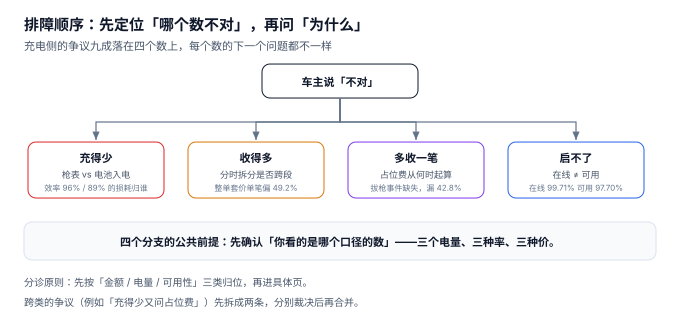

# 常见问题与分诊

凌晨两点的一条客服工单：「充了 41 度电，我的车才涨了 39 度，你们是不是多收了？」这条工单会流向三个不同的团队——如果是效率损耗，归技术支持；如果是计价错误，归计费；如果是桩的问题，归运维。**分错了，就要转三次，而车主在电话那头等了三天。**

这一页把充电侧最常见的争议压成一张分诊树和 20 条快问快答。

::: tip 一句话理解
先问「**哪个数不对**」，再问「**为什么**」。充电侧的争议九成落在四个数上：充了多少、收了多少、多收了什么、为什么启不了。
:::

## 一、分诊树：四个分支



| 分支 | 车主的话 | 第一个要核的数 | 最常见的原因 |
| --- | --- | --- | --- |
| 充得少 | 「我电池涨的度数比账单少」 | 枪表 vs BMS 入电 | 转换效率：直流 96%、交流 89% |
| 收得多 | 「同一度电为什么别人比我便宜」 | 是否跨时段、是否按分钟拆 | 整单套价，单笔偏 49.2% |
| 多收一笔 | 「我没超时，为什么收占位费」 | 拔枪时间从哪儿来 | 采集缺失，用下一次启充反推 |
| 启不了 | 「插上枪没反应」 | 在线还是可用 | 心跳正常、启充失败，占 2.01 个点 |

四个分支的公共前提是：**先确认「你看的是哪个口径的数」**。本册有三个电量、三个价、三个率——同一个问题用不同口径回答，会得出完全不同的结论。

## 二、充得少：41.20 度与 39.55 度的差

这是最高频的一类争议。拆开看：

| 数 | 值 | 谁记的 | 是什么 |
| --- | --- | --- | --- |
| 枪端电表 | 41.20 kWh | 桩内电能表 | 出桩的直流电量，**计费依据** |
| 平台积分 | 40.66 kWh | `MeterValues` 累加 | 每 15 秒取一个高度，少了首段 |
| 车端 BMS | 39.55 kWh | 车机 | 实际进入电池的电量 |
| 电池标称 | 60 kWh × 69% = 41.4 kWh | 车主自己算 | 把「标称容量」当成了「可用容量」 |

四者的大小关系永远是 `枪表 ≥ 积分` 与 `枪表 ≥ BMS`，差额分别来自采样与效率。

::: danger 三个会被问倒的问题
1. **「效率损耗凭什么我出？」** 回答要点：计量点在充电机输出端（GB/T 18487.1 规定），转换损耗发生在充电机内部与线缆上，属于服务成本。若计量点改到电池侧，充电机就要为效率买单——这是另一种定价模型，行业内不通行。
2. **「我的车标称 60 度，为什么充进 41 度只涨了 69%？」** 回答要点：标称容量是**总容量**，实际可用容量受电池健康度（SOH）、温度、BMS 保留区间影响，通常只有 90%~95%。
3. **「积分比电表少，是不是你们系统有问题？」** 回答要点：积分是**看板口径**，按 15 秒采样算，天然少 1.32%；账单按电表出。两个数不一致是设计如此，不是故障。
:::

## 三、收得多：为什么同一度电两个价

看两个时间点：

```text
车主 A：11:30 插枪，11:58 拔枪，28 分钟，23.4 度，全在尖峰（1.20）→ 28.08 元
车主 B：11:58 插枪，12:31 拔枪，33 分钟，23.4 度，跨尖峰→峰     → 23.68 元
```

同样 23.4 度，B 比 A 便宜 4.40 元。这不是「系统偏心」，是 B 的 33 分钟里有 31 分钟落在便宜时段（1.418 度 × 1.20 + 21.982 度 × 1.00）。

反过来，如果系统用的是「整单按开始时刻」或「整单按结束时刻」：

| 算法 | 车主 A | 车主 B | 结果 |
| --- | --- | --- | --- |
| 按分钟拆分（正确） | 28.08 元 | 23.68 元 | 各自按实际时段 |
| 整单按开始 | 28.08 元 | **28.08 元** | B 被按尖峰整单计费，多付 4.40 元 |
| 整单按结束 | **23.40 元** | 23.40 元 | A 被按峰段整单计费，少付 4.68 元 |

**「整单按结束」这一种最危险**：它会让跨到便宜时段的单整体变便宜，看起来是「对车主友好」，实际上是系统性少收。本机实测这种算法总额只差 +0.01%，但单笔最大偏 42.9%。

## 四、多收一笔：占位费从什么时候开始算

| 口径 | 起算点 | 本机影响 |
| --- | --- | --- |
| `StopTransaction`（充电结束） | 桩报告充电停止 | 最常用，但「充完立刻走」的人也被计费 |
| `StatusNotification(Available)`（拔枪） | 桩报告枪已拔出 | 最准确，但 42% 的固件不发这条 |
| 下一次 `StartTransaction`（反推） | 下一辆车插枪的时刻 | 该枪当天不再用则永远不知道 |

本机占位费应收 15,326.86 元、实收 8,761.12 元、漏收 42.84%。**漏收的钱不是「算错了」，是「不知道车什么时候走的」。**

::: warning 三个不能承诺的回答
1. **不要承诺「占位费一定准确」。** 在桩固件不发拔枪事件的前提下，准确性取决于「这枪后续有没有被用」。
2. **不要让客服手工改占位费。** 手工改一次，就要为所有同类工单建立判例。
3. **不要在账单上把占位费和电费写成一行。** 车主看到「58.9 元」会以为全是电费；拆成「电费 35.30 + 服务费 18.54 + 占位费 5.10」时，争议点立刻收敛到那一笔 5.10。
:::

## 五、启不了：在线不等于可用

| 现象 | 在线率里算 | 可用率里算 | 归谁 |
| --- | --- | --- | --- |
| 桩断网 | ✗ 离线 | ✗ 不可用 | 网络 |
| 桩在线但启充失败 | ✓ 在线 | ✗ 不可用 | 设备/固件 |
| 桩在线、能启充、金额算错 | ✓ 在线 | ✓ 可用 | 计量/计费 |
| 桩在线、能启充、账户没钱 | ✓ 在线 | ✓ 可用 | 鉴权/支付 |

本机的三个率是 99.71% → 97.70% → 95.68%。**如果客服只拿到「在线率 99.71%」这一个数，他无法解释为什么这一周有 812 条投诉。**

## 六、20 条快问快答

1. **问：充了 41 度但车只涨 39 度，正常吗？** 正常。直流充电机效率约 96%，41.20 × 0.96 ≈ 39.55。
2. **问：交流桩为什么差更多？** 交流桩的车载充电机效率约 89%，41.20 × 0.89 ≈ 36.67。
3. **问：为什么积分比电表少？** 积分每 15 秒采样一次，首段 10 秒无读数，本机少 1.32%。
4. **问：账单按哪个数算？** 按枪端电表，除非合同另约（`billing_basis`）。
5. **问：同一度电为什么两个价？** 分时电价。跨时段的单按分钟拆分，不是整单套价。
6. **问：11:58 插枪算尖峰还是峰？** 按实际发生：11:58–12:00 两分钟按尖峰，之后按峰。
7. **问：为什么总额看起来差得很少，单笔差很多？** 因为跨贵时段与跨便宜时段的单相互抵消，本机总量只差 0.02%，单笔最大 49.2%。
8. **问：占位费什么时候开始收？** 充电结束后 30 分钟起，0.34 元/分钟，封顶 30 元。
9. **问：我充完立刻走了，为什么还有占位费？** 可能是桩没上报拔枪事件，平台按「下一次启充时刻」反推——这类单应当人工核减。
10. **问：占位费为什么不能全给运营商？** 它补偿的是车位占用，车位是场地方的，本机按 90% 归场地方。
11. **问：为什么桩标 120 kW 实际只有 60 kW？** 站容量共享。4 辆车以内不降额，第 5 辆起按 `480 / n` 分配。
12. **问：站里 8 把枪 960 kW，为什么变压器只有 480？** 同时满载概率极低，本机并发 P99 是 4 辆、超容时长仅 0.89%。
13. **问：为什么「预计 30 分钟」实际充了 50 分钟？** 按铭牌恒功率估的。80% 以后功率降到额定的 22%，最后 20% 占全过程 40% 的时间。
14. **问：为什么我的车充到 80% 就慢了？** BMS 限流保护电池，不是桩的问题。
15. **问：离线充的电会不会丢？** 不会，桩本地缓存，联网补传。本机离线单只占 0.32%。
16. **问：补传会不会重复计费？** 有幂等键就不会。键是「枪 + 起始时刻」，不是桩自增序号。本机重复 2 单。
17. **问：补传时电价变了按哪个算？** 按充电发生的时刻，且按当时生效的电价版本。
18. **问：在线率 99.7% 为什么还有投诉？** 在线只代表心跳通。可用率 97.70%、计费正确率 95.68%。
19. **问：电网账单为什么比平台电量多 3 万度？** 站用电 12,960 度 + 线损 8,945 度 + 积分漏计 9,462 度。
20. **问：电费为什么会亏？** 电费是代收代付，站用电与线损也按充电电价买进来，本机电费项毛利 −2.88%。

## 七、判据族 `CNQ-A ~ CNQ-H`

本页判据族 `CNQ-A` ~ `CNQ-H`，共 8 条。它们描述「一次争议是否能在三步内定位到责任方」。

| 编号 | 判据 | 怎么验 |
| --- | --- | --- |
| `CNQ-A` | 账单上三段金额分列展示，不合并 | 车主能看到电费 / 服务费 / 占位费三行 |
| `CNQ-B` | 客服可查「三个电量」而不只是账单金额 | 工单页能显示枪表 / 积分 / BMS |
| `CNQ-C` | 占位费可追溯到采集来源（STATUS / NEXT_TXN / UNKNOWN） | 存在 `source` 字段并展示 |
| `CNQ-D` | 跨时段单可展示分段明细 | 车主能看到「18 min 平 + 26 min 峰」 |
| `CNQ-E` | 启充失败按三类归因展示 | 桩不可用 / 鉴权拒绝 / 预授权失败 |
| `CNQ-F` | 人工改单必须留原因与操作人 | 存在 `adjust_reason` 与 `operator` |
| `CNQ-G` | 同一问题的答复口径有唯一出处 | 20 条快答能对应到具体页 |
| `CNQ-H` | 争议单可按「口径」批量筛出 | 能按「偏差 > 10%」筛出待核清单 |

## 八、验证方式

```shell
# 1. 直流与交流的入电差异（期望 39.55 与 36.67）
python3 -c "
m=41.20
for eff in (0.96,0.89): print(round(m*eff,2))"
# 期望输出：39.55 / 36.67

# 2. 跨时段与整单套价的差异（期望 23.68 / 28.08 / 23.40）
python3 -c "
m=23.4; sm,pm=2/33,31/33
print('按分钟', round(m*sm*1.20+m*pm*1.00,2),
      '整单按开始', round(m*1.20,2), '整单按结束', round(m*1.00,2))"
# 期望输出：按分钟 23.68 整单按开始 28.08 整单按结束 23.4

# 3. 占位费封顶（期望 5.1 / 30.0 / 30.0）
python3 -c "
for occ in (45,130,300): print(min(max(0,occ-30)*0.34, 30.0))"
# 期望输出：5.1 / 30.0 / 30.0
```

第 3 步说明：**封顶不是「优惠」，是让争议可收敛**。没有封顶，一次三小时的占位要收 51 元，比充电本身还贵，这类工单几乎无法用规则说服车主。

## 参考资料

- GB/T 18487.1—2023《电动汽车传导充电系统 第 1 部分：通用要求》：计量点位置与充电效率的工程依据。
- JJG 1149—2018《电动汽车非车载充电机检定规程》：直流充电机的计量最大允许误差，争议裁决的技术依据。
- 国家发展改革委《关于进一步完善分时电价机制的通知》（发改价格〔2021〕1093 号）：分时段划分与跨时段计价的政策基础。
- Open Charge Alliance《OCPP 2.0.1 Specification》：`StatusNotification` 与拔枪事件的语义，占位费采集的协议依据。
- 与本页相邻：[总览](../Overview/index.md)、[充电与计量](../Metering/index.md)、[运维与可用率](../Operations/index.md)。
