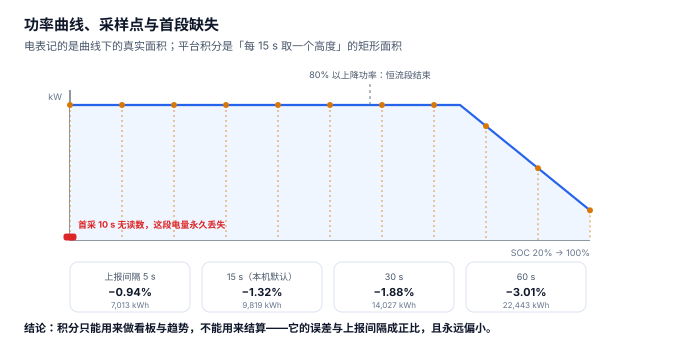

# 充电与计量：电表、积分、抄见三个数

一辆车充了 41.20 度，车主说「我的电池只涨了 39.55 度」，运营说「我的平台只记了 40.66 度」，电网说「你这个站这个月一共用了 76.7 万度」。**三个数字都真实，都在描述同一件事，而且没有一个是「错的」。**

计量是充电系统里唯一一个「真值不可得」的环节：桩内电能表有精度等级，平台采样有积分误差，关口表有站用电与线损。工程能做的是**把三条路径都留下，并且明确哪一条是计费依据**。

::: tip 一句话理解
电表记的是**曲线下的真实面积**，平台积分记的是**每 15 秒取一个高度的矩形面积**。两者的差与上报间隔成正比，且**永远偏小**——因为第一次采样之前那一段永远没有读数。
:::

## 一、三个口径的定义与来源

| 口径 | 物理来源 | 精度 | 谁在用 | 本机合计 |
| --- | --- | --- | --- | --- |
| 枪端电表 `meter_kwh` | 桩内电能表，`meter_end − meter_start` | 1.0 级或 0.5S 级 | 车主账单 | 745,450.0 kWh |
| 平台积分 `sampled_kwh` | `MeterValues` 功率 × Δt 累加 | 取决于间隔 | 运营看板 | 735,988.4 kWh（−1.27%） |
| 站总表 `grid_kwh` | 关口表月度抄见 | 0.5S 级 | 电网结算 | 767,355.4 kWh（+2.94%） |

三者之间的关系是一条**包含链**，不是三个平行估计：

```text
站总表  ≥  枪端电表之和  ≥  平台积分
  ↑            ↑              ↑
站用电       表计误差        首段缺失
线损         车端损耗        矩形积分
待机功耗                    上报抖动
```



## 二、积分为什么永远偏小

积分损失的公式很简单：

```text
丢失比例 ≈ (首采延迟 + 上报间隔 / 2) / 充电时长
```

两项来源不同：

1. **首采延迟**：从 `StartTransaction` 到第一条 `MeterValues`，平台没有读数，这段时间的电量计入不了积分。本机按 10 s 建模。
2. **矩形积分**：把「每 15 秒一个功率值」当成「这 15 秒内功率不变」，误差等于曲线在该区间内的平均偏差。用半个间隔来估，是这类误差的经典一阶估计。

本机 20,254 单按四种上报间隔重算积分：

| 上报间隔 | 积分合计 | 相对电表 | 与电表的差 |
| --- | --- | --- | --- |
| 5 s | 738,436.6 kWh | −0.94% | 7,013.4 kWh |
| **15 s（本机默认）** | **735,631.2 kWh** | **−1.32%** | **9,818.8 kWh** |
| 30 s | 731,423.2 kWh | −1.88% | 14,026.8 kWh |
| 60 s | 723,007.1 kWh | −3.01% | 22,442.9 kWh |

（本机实际积分合计 735,988.4 kWh，与 15 s 理论值 735,631.2 差 357.2 kWh，来自 ±0.2% 的上报抖动。）

**这组数字的用法**：不要用它去选择上报间隔，用它去说服财务——「积分口径不能用来结算」，因为它的误差是**系统性的、单向的、与配置相关的**，任何一次间隔调整都会让历史对账失效。

::: danger 三个计量上的必错
1. **拿积分当计费依据。** 本机 15 s 间隔下少 1.27%，按度电 1.1847 元算是 1.1 万元/两月。更麻烦的是它随间隔变化：从 15 s 调到 30 s，同一批单的账单会「自动」少 0.56%。
2. **拿枪表之和去对电网账单。** 差额 21,905.4 kWh（2.94%）不是误差，是站用电（12,960.0 kWh）加线损（8,945.4 kWh）。这部分钱必须有人承担，通常落在服务费里。
3. **把车端 BMS 上报当成「真实入电量」。** 直流桩的转换效率约 96%、交流桩约 89%。41.20 度出桩、39.55 度入电池，差的 1.65 度真实发生过——它不是「多收」，是物理损耗。
:::

## 三、功率曲线：为什么 80% 以后会慢下来

直流快充的功率曲线有两段：

| SOC 区间 | 功率行为 | 原因 | 对本机读数的影响 |
| --- | --- | --- | --- |
| 0% ~ 80% | 近似恒功率（额定值） | 电池可接受大电流 | 单次时长的下限由这一段决定 |
| 80% ~ 100% | 线性降功率至约 22% 额定 | 析锂风险与温升限制 | 最后 20% 的耗时约占全过程的 40% |

本机模型按 `P = rated × (1 − 0.78 × (SOC − 80) / 20)` 建模，即 SOC = 100% 时功率降到额定的 22%。这解释了 20,254 单的**时长中位数只有 23 分钟**而**单均电量是 36.81 度**：大量会话在 80% 附近就结束了，只有少数会充到 100% 并承受那段陡降。

对产品的影响：**「预计充满时间」如果按恒功率算，对充到 100% 的用户会低估 40% 以上**。正确做法是按目标 SOC 分段估算，或者直接按历史同车型的 P50 时长给区间。

## 四、站用电与线损：代收代付里必亏的那部分

| 项 | 本机数值 | 归属 | 能不能转嫁给车主 |
| --- | --- | --- | --- |
| 充电电量（枪表） | 745,450.0 kWh | 车主付 | 是 |
| 线损 | 8,945.4 kWh | 站承担 | 否（已在服务费里） |
| 站用电（照明/空调/监控） | 12,960.0 kWh | 站承担 | 否 |
| 站总表 | 767,355.4 kWh | 电网收 | — |

按 0.65 元/度折算，站承担的 21,905.4 度是 **14,239 元**，占本机服务费收入（372,889.28 元）的 **3.82%**。

这 3.82% 就是「电费项毛利 −2.88%」的全部来源：电费本身是平进平出的代收代付，但因为站用电与线损也按充电电价计入了成本，**电费这一项永远是负毛利**。看懂这一点，才不会把「电费亏了」当成定价问题去调价。

::: warning 一个反直觉的结论
**「把电费调高」不能改善毛利，只会让车主比价走人。** 因为电费是代收代付：车主付多少，电网就收多少（按枪表），中间只差站用电与线损。真正能改善毛利的只有三件事：

1. 提高单枪日均电量（本机 103.5 kWh，功率利用率仅 3.6%）；
2. 提高服务费单价（受竞争约束）；
3. 降低站用电（空调与照明的分时控制）。

前两件是运营问题，第三件才是「计量能帮上忙」的地方——**只有把站用电单独计量，才能知道它花在哪**。
:::

## 五、判据族 `CNM-A ~ CNM-H`

本页判据族 `CNM-A` ~ `CNM-H`，共 8 条。它们描述「三个电量是否各自可复核、差异是否可归因」。

| 编号 | 判据 | 怎么验 |
| --- | --- | --- |
| `CNM-A` | 会话同时存电表起止值，不只存差值 | 存在 `meter_start_kwh` 与 `meter_end_kwh` 两列 |
| `CNM-B` | 积分不高于电表（越界即实现错误） | `COUNT(*) WHERE sampled > meter` 为 0 |
| `CNM-C` | 上报间隔写在配置里，可追溯到每一条历史积分 | 每条积分能查到当时的间隔版本 |
| `CNM-D` | 站用电单独计量或单独估算，不混进充电电量 | 存在独立的站用电流量列或系数 |
| `CNM-E` | 线损按比例分摊，比例可配置 | 参数化，不是写死的 1.2% |
| `CNM-F` | 充电效率按交直流分列（DC 96% / AC 89%） | 存在 `kind` 判断分支 |
| `CNM-G` | 能输出「关口表 vs 积分」的月度差额表 | 存在该视图或报表 |
| `CNM-H` | 目标 SOC 与完成 SOC 都记录，可复算功率曲线 | 两列均非空 |

## 六、验证方式

```shell
# 1. 积分损失与间隔成正比（期望 -0.94 / -1.32 / -1.88 / -3.01）
python3 -c "
dur=23*60
for iv in (5,15,30,60): print(iv, round((1-(10+iv/2)/dur)*100-100,2))"
# 期望输出：5 -0.94 / 15 -1.32 / 30 -1.88 / 60 -3.01

# 2. 三个口径的包含关系（期望 767355.4 > 745450.0 > 735988.4）
python3 -c "
meter=745450.0; line=meter*0.012; aux=12*60*18.0
grid=meter+line+aux; sampled=735988.4
print(round(grid,1), round(meter,1), round(sampled,1))
print('站用电', round(aux,1), '线损', round(line,1))"
# 期望输出：767355.4 745450.0 735988.4 / 站用电 12960.0 线损 8945.4

# 3. 直流与交流的入电差异（期望 39.55 与 36.67）
python3 -c "
m=41.20
for eff in (0.96,0.89): print(round(m*eff,2))"
# 期望输出：39.55 / 36.67
```

第 2 步是本页最重要的一步：**三个数必须能一次算出来并保持大小关系**。任何一次「差不多相等」的实现，都说明有一列其实是另一列的副本。

## 参考资料

- GB/T 18487.1—2023《电动汽车传导充电系统 第 1 部分：通用要求》：计量点位置（充电机输出端）与电能表准确度等级。
- JJG 1148—2018《电动汽车交流充电桩检定规程》、JJG 1149—2018《电动汽车非车载充电机检定规程》：充电桩电能计量的检定方法与最大允许误差。
- GB/T 27930—2015《电动汽车非车载传导式充电机与电池管理系统之间的通信协议》：BMS 请求电流与降功率的依据。
- Open Charge Alliance《OCPP 2.0.1 Specification》：`MeterValues` 的 `sampledValue` 字段与上报周期配置。
- 与本页相邻：[启充与鉴权](../SessionAuth/index.md)、[分时与账单](../TariffBilling/index.md)、[实战](../Practice/index.md)。
