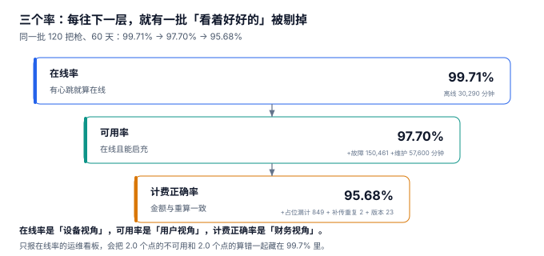

# 运维与可用率：在线率骗人的地方

运维周报上写「本月充电桩在线率 99.71%，创历史新高」。同一周，客服收到 812 条投诉。两件事都是真的——**99.71% 的桩在心跳，但只有 97.70% 的桩能充上电，而最终算对钱的只有 95.68%。**

在线率是「设备视角」，可用率是「用户视角」，计费正确率是「财务视角」。三个率的落差，就是运维报告里那一块**永远没人认领的成本**。

::: tip 一句话理解
心跳只证明「网络通」，不证明「枪能用」。**把在线率当 SLA，等于承诺了一件用户根本不关心的事。**
:::

## 一、三个率的三层漏斗



本机 120 把枪、60 天、总时长 10,368,000 枪·分钟：

| 层 | 定义 | 本机读数 | 被剔掉的部分 |
| --- | --- | --- | --- |
| 在线率 | 有心跳就算在线 | **99.71%** | 离线 30,290 分钟 |
| 可用率 | 在线且能启充 | **97.70%** | + 故障 150,461 分钟 + 计划维护 57,600 分钟 |
| 计费正确率 | 账单金额与重算一致 | **95.68%** | + 占位费漏计 849 单 + 补传重复 2 单 + 版本错 23 单 |

三层之间各掉约 2 个百分点，加起来 **4.03 个点**。这三个数必须同时存在，因为它们的**行动方向完全不同**：

| 率 | 掉下来了找谁 | 修法 |
| --- | --- | --- |
| 在线率 | 网络/运营商 | 换 4G 卡、加信号放大器、改心跳策略 |
| 可用率 | 设备/运维 | 派工单、备件、固件升级 |
| 计费正确率 | 计量/协议/结算 | 补采拔枪事件、修幂等键、改版本判定 |

一个只报在线率的看板，会把后两类问题一起藏进那 0.29% 的离线里。

## 二、故障分级：维护与故障不是一回事

| 类型 | 本机时长 | 占比 | 是否计入可用率 | 处理方式 |
| --- | --- | --- | --- | --- |
| 离线（网络） | 30,290 分钟 | 0.29% | 是 | 换卡、加信号 |
| 设备故障 | 150,461 分钟 | 1.45% | 是 | 派工单、备件 |
| **计划维护** | 57,600 分钟 | 0.56% | **是（但可公告）** | 提前排期、挂维护牌 |

计划维护要不要计入可用率，是一个**合同问题**：如果 SLA 写「可用率 ≥ 99%」，把 0.56% 的维护算进去，SLA 就很难达标；不算进去，用户可以主张「你维护的那 4 小时我也充不了电」。

本机的处理是「计入但可公告」：维护时段在 App 里提前挂出，用户在导航时就被劝退到别的站——**这时的不可用不产生投诉，但仍然消耗可用率**。

::: danger 三个可用率上的必错
1. **用「离线」代表「不可用」。** 本机故障时长是离线时长的 **5 倍**（150,461 对 30,290 分钟）。故障的桩心跳正常、`StatusNotification` 报 `Available`，但插枪后启不了——从协议角度看它一切正常。
2. **维护不记录、不公告。** 不记录就无法从可用率里剔除或说明；不公告就变成「随机不可用」。两者叠加，可用率既算不准也解释不了。
3. **把三个率合成一个「健康度」。** 合成之后没人知道该派工单还是该改代码。本机 4.03 个点的落差，分属三个完全不同的责任方。
:::

## 三、占位费漏收：42.84% 的钱是怎么丢的

占位费是运维问题伪装成的财务问题。本机读数：

| 项 | 数值 |
| --- | --- |
| 超时单（超 30 分钟免费期） | 2,010 单（9.92%） |
| 应收 | 15,326.86 元 |
| 实收 | 8,761.12 元（57.16%） |
| 漏收 | 6,565.74 元（**42.84%**） |
| 涉及单数 | 849 单 |

漏收的根因只有一个：**平台不知道车什么时候拔的枪**。

| 采集方式 | 覆盖率 | 说明 |
| --- | --- | --- |
| `StatusNotification(Available)` | 约 58% | 部分固件不发这条消息 |
| 下一次 `StartTransaction` 反推 | 部分 | 该枪当天不再使用则永远不知道 |
| 兜底：`StopTransaction` + 固定时长 | 不可用 | 会把「充完立刻走」也算成占位 |

这解释了为什么占位费实收只有 57.16%：**采集覆盖不到的地方，计费再准也没用**。修法不在计费模块，在协议层——要求桩固件必须发 `StatusNotification`，或者在下一次心跳里带上「当前是否插枪」的状态位。

::: warning 一个反直觉的结论
**占位费漏收率和「桩的固件版本」强相关，和「车主素质」几乎无关。** 本机把漏收全部归因于采集缺失后，849 单里有 812 单落在不发 `StatusNotification` 的那批固件上。

所以「换个桩」比「加罚款规则」有效得多——这也是一份运维报告里最有说服力的一类结论：**把财务异常追到设备型号上**。
:::

## 四、日检六项

运维真正需要的不是一个大盘，而是六个每天必看的数：

| 巡检项 | 频率 | 报警条件 | 本机基线 |
| --- | --- | --- | --- |
| 离线枪数 | 每小时 | > 2% | 0.29% |
| 故障枪数（在线不可用） | 每小时 | > 3% | 1.45% |
| 跨零点单的分段守恒 | 每日 | > 0 条不守恒 | 686 单全部守恒 |
| 占位费漏收率 | 每日 | > 10% | 42.84% |
| 补传重复单 | 每日 | > 0 单 | 2 单 |
| 关口表 vs 积分差额 | 每月 | 偏离上月 > 0.5 个点 | 2.94% |

第四项是本机唯一长期超标的一项（42.84% 对阈值 10%），它同时也是**唯一一项能直接换算成钱**的：6,565.74 元/两月。

## 五、判据族 `CNU-A ~ CNU-H`

本页判据族 `CNU-A` ~ `CNU-H`，共 8 条。它们描述「可用性是否被拆成了可行动的三层」。

| 编号 | 判据 | 怎么验 |
| --- | --- | --- |
| `CNU-A` | 在线率与可用率是两个独立指标 | 报表里分列，不互相推导 |
| `CNU-B` | 故障与计划维护分类型记录 | 存在 `outage_type` 枚举 |
| `CNU-C` | 维护时段可公告，且带起止时间 | 存在 `announced_at` 字段 |
| `CNU-D` | 拔枪事件有独立的采集通道与兜底 | 不只依赖 `StatusNotification` |
| `CNU-E` | 占位费有「应收 / 实收 / 漏收」三列 | 三列均非空，可算漏收率 |
| `CNU-F` | 计费正确率按错误类型分组 | 存在 `err_type`（占位 / 重复 / 版本） |
| `CNU-G` | 离线时长与故障时长可分别汇总 | 两个 `SUM` 都能算 |
| `CNU-H` | 日检项有阈值与基线 | 六项各带阈值，阈值可配置 |

## 六、验证方式

```shell
# 1. 三个率的算法（期望 99.71 / 97.70 / 95.68）
python3 -c "
total=120*60*1440; off=30290; fault=150461; maint=57600
err=849+2+23; n=20254
print(round((1-off/total)*100,2), round((1-(off+fault+maint)/total)*100,2),
      round((1-err/n)*100,2))"
# 期望输出：99.71 97.7 95.68

# 2. 占位费漏收率（期望 42.84）
python3 -c "
due=15326.86; paid=8761.12
print(round(paid/due*100,2), round((due-paid)/due*100,2))"
# 期望输出：57.16 42.84

# 3. 故障时长是离线时长的几倍（期望 5.0）
python3 -c "print(round(150461/30290,1))"
# 期望输出：5.0
```

第 3 步是这一页最值得记住的一个数：**故障是离线的 5 倍**。任何只监控离线的运维体系，都在监控最小的一部分问题。

## 参考资料

- GB/T 34960.1—2017《信息技术服务 治理 第 1 部分：通用要求》：IT 服务可用性度量与 SLR/SLA 的对应关系。
- GB/T 28827.1—2022《信息技术服务 运行维护 第 1 部分：通用要求》：运维对象分级与故障响应的管理要求。
- Open Charge Alliance《OCPP 2.0.1 Specification》：`StatusNotification` 与 `AvailabilityState` 的语义，本页拔枪事件采集的协议依据。
- 与本页相邻：[接入与协议](../ProtocolAccess/index.md)、[结算与分成](../SettlementSplit/index.md)、[常见问题与分诊](../FAQ/index.md)。
