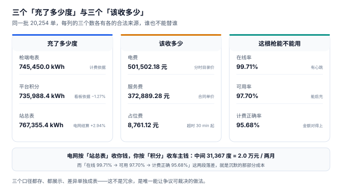

# 总览：三个「充了多少度」与三个「该收多少」

一位运营主管接到财务的电话：「这个月电网账单比平台流水里的电量多了 3 万度，是不是有人偷电？」他去查，发现不是偷电——**电网按站总表收钱，平台按采样积分收车主的钱，中间那 3 万度是站用电、线损和积分漏计**。三个月前这个差额就有，只是没人把两个数放在一张表里看过。

**充电运营的复杂度不在「把电充进电池」，而在于同一度电会被至少三套口径各描述一次，而这三套口径之间没有强制的一致性。** 电商的库存有唯一答案（能不能卖），充电没有：充了多少度，取决于你用桩端电表、平台积分还是站总表去量；该收多少钱，取决于你按整单计价、按结束时刻计价还是按分钟拆分计价。

::: tip 一句话理解
充电的每一个关键量都有**三个版本**，而且三个版本各有各的合法来源。工程的难点不是「选出正确的那一个」，而是**把三个都存下来、把差异做成可归因的表**。
:::

## 一、同一根枪的九个数字



一根枪从上线到月度结算，会被九个数字描述：

| 问题 | 口径一 | 口径二 | 口径三 | 本机实测的差距 |
| --- | --- | --- | --- | --- |
| 充了多少度 | 枪端电表 745,450.0 kWh | 平台积分 735,988.4 kWh | 站总表 767,355.4 kWh | 极差 **2.94%**（21,905.4 度） |
| 该收多少 | 电费（分时）501,502.18 元 | 服务费（合同）372,889.28 元 | 占位费（超时）8,761.12 元 | 占位费漏收 **42.84%** |
| 这根枪能不能用 | 在线率 99.71% | 可用率 97.70% | 计费正确率 95.68% | 三层落差 **4.03 个点** |

九个数字里，**只有「服务费单价」是谈出来的**，其余八个都是从数据里算出来的。算错了不会报错——它会安静地变成一张看起来完全正常的账单。

### 为什么不能只留一个

很多人第一反应是「统一口径」：定一个标准，全部按它算。这在充电里做不到，因为三个口径的服务对象不同：

| 口径 | 谁在用 | 换掉它的后果 |
| --- | --- | --- |
| 枪端电表 | 车主账单、争议裁决 | 车主拿 BMS 上报来对账，差 4%（直流）/ 11%（交流）说不清 |
| 平台积分 | 运营看板、告警、容量规划 | 看板比实际少 1.27%，扩站决策建立在偏小的需求上 |
| 站总表 | 电网结算、站用电分摊 | 拿枪表去对电网账单，2.94% 的差额无处安放 |
| 在线率 | 设备运维 | 只报在线率，等于把「在心跳但充不了」的桩算成健康 |
| 可用率 | 用户侧 SLA | 与在线率混用，SLA 条款没法执行 |
| 计费正确率 | 财务对账 | 不统计就不知道有多少单的钱算错了 |

所以正确做法不是「统一」，而是**三个都存、明确谁是权威、差异单独成表**。这也是本册反复出现的模式：`charging_session` 存 `meter_kwh` / `sampled_kwh` / `settle_kwh` 三列（而不是只存算好的 `billed_kwh`），`session_segment` 按时段分行存电量（而不是只存合计），`fee_line` 把三段金额拆开存（而不是只存 `total_amount`）。

::: danger 三个「只存结果」的建模错误
1. **只存 `billed_kwh`，不存三个原始口径**：`billing_basis` 一改，历史单据无法重算；车主来问「为什么这单按积分算」，你只有积分数，没有电表数可对照。本机实测两种口径相差 1.31%，一批 146.10 度的单会变成 144.18 度。
2. **只存一个 `total_amount`**：账单的三段构成（电费 / 服务费 / 占位费）必须分开存。合并之后，「为什么这个月流水涨了 8% 而利润没动」只能靠猜——它其实是占位费涨了，而占位费的 90% 要分给场地方。
3. **只存一个「健康状态」**：在线、可用、计费正确是三个不同的问题，塞进一个 `status` 字段，运维看板会长期显示 99.7% 的绿色，而用户实际遇到的失败率是 4.3%。
:::

## 二、七段链上，失败都长什么样

| 段 | 输入 | 输出 | 典型失败 | 谁能发现 |
| --- | --- | --- | --- | --- |
| 建 | 站址、配电容量 | `station` / `connector` | 容量配小，第 5 辆车起全体降额 | **三年后扩站时** |
| 接 | 桩上线、固件 | OCPP 会话 | 离线缓存交易补传重复 | 车主投诉「我没充两遍」 |
| 启 | 卡 / 二维码 / 车辆 | `charging_session` | 鉴权放行但账户没钱 | 月末坏账 |
| 充 | 电表脉冲、采样 | `meter_kwh` / `sampled_kwh` | 积分比电表少 1.27% | **几乎无人发现** |
| 计 | 分时表、电量 | `fee_line` | 整单套价，单笔偏 49% | 车主投诉时 |
| 结 | 账单、分成比例 | `settlement_batch` | 分成口径换一次差 4% | 场地方对账时 |
| 维 | 心跳、故障、拔枪 | 三个率的报表 | 在线率掩盖 2 个点不可用 | **几乎无人发现** |

第四段与第七段的失败之所以「几乎无人发现」，是因为它们不影响任何一笔单据的正确性：账单自洽、明细自洽，只是**少收了钱、算错了可用性**。本机读数里，积分比枪表少 9,461.6 度（−1.27%），而所有账单的金额勾稽都是通过的；在线率 99.71% 与可用率 97.70% 之间那 2.01 个点，是 150,461 分钟故障加上 57,600 分钟计划维护。

## 三、四个必失的接缝

充电系统有四道接缝，只要不专门处理，就一定会裂：

1. **电量的接缝**：枪端电表、平台积分、站总表之间。三者的差不是精度问题，是「谁承担转换损耗与站用电」的合同问题。本机实测极差 2.94%。
2. **时间的接缝**：分时边界（本机 10 个时段、24 小时）、跨零点、电价版本切换日之间。跨时段的单占 24.43%，跨零点的占 3.39%——它们是最容易被整单套价糊弄过去的那批。
3. **资金的接缝**：车主付款、平台代收、电网扣款、场地方分成之间。四笔钱时间不同步、口径不同源，本机实测电费项毛利 −2.88%（代收代付必然亏）。
4. **可用性的接缝**：心跳、可启充、金额正确之间。三个率每往下一层都掉 2 个点，而 SLA 通常只写第一层。

::: warning 一个反直觉的结论
**「总量对得上」恰恰是最危险的信号。** 本机 20,254 单里，如果按「整单套一个价」计费，总额只比正确算法多 **0.02%**——看起来完全没问题。但拆到单笔：P90 偏差 13.08%、最大 49.2%、**12.42% 的单偏超 10%**。原因是跨时段的单有的落在更贵时段、有的落在更便宜时段，两种错误在总量上互相抵消了。

所以「平均差 0.02%」这个数字毫无意义——**账单是按单笔出的，不是按总量出的**。任何用总量差异来证明计费正确的对账方法，都会漏掉这批最容易被投诉的单。
:::

## 四、判据族 `CNO-A ~ CNO-H`

本页判据族 `CNO-A` ~ `CNO-H`，共 8 条。它们描述「一根枪的三个口径是否都被留存且可复核」。

| 编号 | 判据 | 怎么验 |
| --- | --- | --- |
| `CNO-A` | 会话同时存 `meter_kwh` / `sampled_kwh` / `settle_kwh`，计费电量是**选出来的**而不是写进去的 | 全表检索无 `billed_kwh` 字段，只有视图 |
| `CNO-B` | 三个电量两两不相等（排除「复制一份」的假实现） | `COUNT(*) WHERE meter<>sampled AND sampled<>settle` 等于总单数 |
| `CNO-C` | 分时表按「分钟偏移」存，不按 `HH:MM` 字符串存 | 表结构里只有 `start_min` / `end_min` 两个整数列 |
| `CNO-D` | 一个版本的分时段覆盖满 1440 分钟且互不重叠 | `SUM(end_min-start_min) = 1440`，重叠插入报错 |
| `CNO-E` | 账单三段分列存储，合计由三段算出 | 改任一段，`total_amount` 必须同步变化 |
| `CNO-F` | 占位费有封顶值，且封顶写在 `CHECK` 里 | 插入 60 元占位费被数据库拒绝 |
| `CNO-G` | 三个率分别成字段或视图，不存在名为 `health` 的裸字段 | 检索无 `status='OK'` 式的一揽子判断 |
| `CNO-H` | 同一枪的活动会话被唯一约束挡住 | 同枪第二次插 `CHARGING` 报 `ACTIVE_SESSION_EXISTS` |

## 五、验证方式

```shell
# 1. 三个电量是否都在，且计费电量是「选」出来的（期望 3 列 + 1 个 CASE）
sqlite3 :memory: "
create table s(meter_kwh real, sampled_kwh real, settle_kwh real, basis text);
insert into s values (41.20,40.66,41.28,'METER'),(41.20,40.66,41.28,'SAMPLED');
select basis, case basis when 'METER' then meter_kwh when 'SAMPLED' then sampled_kwh
  else settle_kwh end from s;"
# 期望输出：METER|41.2 与 SAMPLED|40.66

# 2. 分时表覆盖 1440 分钟（期望 1440 与 5）
sqlite3 :memory: "
create table b(band text, a int, z int, p real);
insert into b values ('VALLEY',0,420,0.32),('FLAT',420,600,0.65),('PEAK',600,660,1.0),
  ('SHARP',660,720,1.2),('FLAT',720,1440,0.65);
select sum(z-a), count(*) from b;"
# 期望输出：1440|5

# 3. 跨零点时长的算法（期望 45，而不是 -1391）
sqlite3 :memory: "
select cast(round((julianday('2026-11-06 00:31')-julianday('2026-11-05 23:46'))*1440) as int);"
# 期望输出：45
```

三步的输出就是本册的起点：**三个电量必须能各自复核、分时表必须能用整数分钟表达、跨零点必须靠绝对时间而不是时钟读数**。任何一步拿不到期望值，后面九章的判据都不成立。

## 参考资料

- 国家发展改革委《关于进一步完善分时电价机制的通知》（发改价格〔2021〕1093 号）：峰谷时段划分、尖峰电价上浮比例的政策依据。
- GB/T 18487.1—2023《电动汽车传导充电系统 第 1 部分：通用要求》：计量点位置（充电机输出端）与电能表准确度等级要求。
- Open Charge Alliance《OCPP 2.0.1 Specification》：`MeterValues` 的上报周期与 `TransactionEvent` 的事务边界定义。
- 与本页相邻：[站址与桩资产](../SiteAsset/index.md)、[充电与计量](../Metering/index.md)、[实战](../Practice/index.md)。
