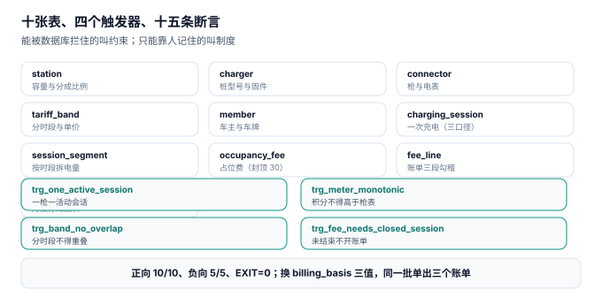

# 实战：十张表、四个触发器、十五条断言

前面九页讲的所有判据，都要落到一个能被机器执行的地方。这一页把整册的约束压成**十张表、四个触发器、十五条断言**，并给出本机的真实输出——**10 条正向断言全过、5 条负向用例全拦、退出码 0**。

::: tip 一句话理解
能被数据库拦住的叫约束，只能靠人记住的叫制度。**制度会失效，约束不会。**
:::

## 一、十张表与它们的分工



| 表 | 一行代表什么 | 关键约束 | 谁写它 |
| --- | --- | --- | --- |
| `station` | 一个场站 | 容量 > 0、分成比例之和 < 100% | 建站 |
| `charger` | 一台充电机 | 直流/交流枚举、额定功率 > 0 | 设备台账 |
| `connector` | 一把枪 | `meter_no` 唯一、`(charger, gun)` 唯一 | 安装 |
| `tariff_band` | 一个分时段 | 区间合法、同版本不重叠 | 定价 |
| `member` | 一位车主 | 车牌唯一 | 注册 |
| `charging_session` | 一次充电 | 三口径均 > 0、SOC 单调、幂等键唯一 | 桩上报 |
| `session_segment` | 一段时段电量 | `(txn, band, minutes)` 主键 | 计费 |
| `occupancy_fee` | 一笔占位费 | 金额 0 ~ 30 元封顶 | 平台 |
| `fee_line` | 一条账单 | 三段之和 = 合计 | 计费 |
| `settlement_batch` | 一个结算批次 | 四方分成之和 = 流水 | 财务 |

十张表里最关键的一处设计是**计费电量不存在表里**，而是由一个视图按 `billing_basis` 选出来：

```sql
CREATE VIEW v_billable AS
SELECT s.txn_id, s.billing_basis,
       CASE s.billing_basis
         WHEN 'METER'   THEN s.meter_kwh
         WHEN 'SAMPLED' THEN s.sampled_kwh
         WHEN 'SETTLE'  THEN s.settle_kwh
       END AS billed_kwh
FROM charging_session s;
```

这样做等于把「按哪个口径计费是合同约定的，不是写死的」这条规则写进了数据层。本机同一批 5 单，换一次 `billing_basis`，计费电量就变：

| `billing_basis` | 计费电量 | 相对 METER |
| --- | --- | --- |
| `METER` | 146.10 kWh | 基准 |
| `SAMPLED` | 144.18 kWh | **−1.31%** |
| `SETTLE` | 146.39 kWh | +0.20% |

**同一批充电、三种合同口径、三张不同金额的账单——但它们共用一份数据，谁也不能改历史。**

## 二、四个触发器：只拦四件事

| 触发器 | 时机 | 拦什么 | 报错码 |
| --- | --- | --- | --- |
| `trg_one_active_session` | `BEFORE INSERT ON charging_session` | 同一把枪第二个活动会话 | `ACTIVE_SESSION_EXISTS` |
| `trg_meter_monotonic` | `BEFORE INSERT ON charging_session` | 积分高于电表 2%（电表回退） | `METER_ROLLBACK` |
| `trg_band_no_overlap` | `BEFORE INSERT ON tariff_band` | 同版本时段重叠 | `TARIFF_OVERLAP` |
| `trg_fee_needs_closed_session` | `BEFORE INSERT ON fee_line` | 未结束会话开账单 | `SESSION_NOT_CLOSED` |

```sql
CREATE TRIGGER trg_one_active_session
BEFORE INSERT ON charging_session
WHEN NEW.state = 'CHARGING'
BEGIN
  SELECT RAISE(ABORT, 'ACTIVE_SESSION_EXISTS')
  WHERE EXISTS (SELECT 1 FROM charging_session
                WHERE connector_no = NEW.connector_no AND state = 'CHARGING');
END;

CREATE TRIGGER trg_band_no_overlap
BEFORE INSERT ON tariff_band
BEGIN
  SELECT RAISE(ABORT, 'TARIFF_OVERLAP')
  WHERE EXISTS (SELECT 1 FROM tariff_band
                WHERE version = NEW.version
                  AND NEW.start_min < end_min
                  AND NEW.end_min  > start_min);
END;
```

**只拦四件事**是有意的：触发器越多，写入路径越难推理，出了问题越难定位。其余规则（三个率、分成闭合、差额分列）都放在日检脚本里，因为它们需要「事后批量看」，而不是「当场拦住」。

::: danger 四个触发器写法上的坑
1. **时段重叠判定写成 `BETWEEN`。** 区间是半开的 `[start, end)`，重叠条件是 `NEW.start < old.end AND NEW.end > old.start`。写成 `NEW.start BETWEEN old.start AND old.end` 会把「首尾相接」（11:00 结束、11:00 开始）误判为重叠，于是正常的分段表永远建不起来。
2. **`WHEN` 子句里用 `NEW.state = 'CHARGING'` 之外的条件。** 如果改成「任何状态都拦」，历史会话归档、数据修复脚本全部会被挡住。约束要拦的是**活动会话**，不是所有会话。
3. **电表回退用 `sampled > meter` 判定。** 严格来说积分本来就该小于等于电表，但上报抖动会带来 ±0.2% 的越界。本机的写法留了 2% 容差：`NEW.sampled_kwh > NEW.meter_kwh * 1.02`——**这不是放宽标准，是把「抖动」和「回退」区分开**。
:::

## 三、十五条断言

十条正向（必须全过）+ 五条负向（必须全拦）：

| 编号 | 断言 | 判定 |
| --- | --- | --- |
| `C1` | 三口径齐全且互不相等 | 5 / 5 |
| `C2` | 分段电量守恒且无缺段 | 最大偏差 = 0.000000 |
| `C3` | 分段分钟数守恒 | 最大偏差 = 0 |
| `C4` | 积分不高于枪表 | 越界 0 条 |
| `C5` | 每枪活动会话 ≤ 1 | MAX = 1 |
| `C6` | 占位费不超 30 元上限 | MAX = 30.00 |
| `C7` | 账单金额勾稽 | 不平 0 条 |
| `C8` | 三方分成之和 < 100% | 场地方 + 平台 = 28.0% |
| `C9` | 分时表覆盖满 1440 分钟 | 1440 分钟 / 5 段 |
| `C10` | 跨零点单拆成 FLAT→VALLEY 两段 | VALLEY 31 min + FLAT 14 min |
| `N1` | 同枪并发会话 | 拦，报 `ACTIVE_SESSION_EXISTS` |
| `N2` | 积分高于枪表 2% | 拦，报 `METER_ROLLBACK` |
| `N3` | 新增时段与既有重叠 | 拦，报 `TARIFF_OVERLAP` |
| `N4` | 未结束会话开账单行 | 拦，报 `SESSION_NOT_CLOSED` |
| `N5` | 占位费超上限 | 拦，`CHECK` 拒绝 |

`C10` 是这一组里最值得单独说的一条。它不是「跨零点能算对」，而是「跨零点的时候仍然能拆成两段，且两段的分钟数之和等于会话时长」：

```sql
SELECT band, minutes FROM session_segment
WHERE txn_id = 'TX003' ORDER BY minutes DESC;
-- 期望：VALLEY 31 / FLAT 14
```

TX003 从 23:46 充到 00:31，共 45 分钟。23:46–24:00 落在「平」（14 分钟），00:00–00:31 落在「谷」（31 分钟）。**如果拆分用的是时钟读数而不是绝对分钟，这一单会算出 −1395 分钟。**

## 四、本机真实输出

```text
== 正向断言 ==
  C1 三口径齐全且互不相等: PASS  5/5
  C2 分段电量守恒且无缺段: PASS  max|Δ|=0.000000 缺段 0
  C3 分段分钟数守恒: PASS  max|Δ|=0
  C4 积分不高于枪表: PASS  越界 0 条
  C5 每枪活动会话 ≤ 1: PASS  MAX=1
  C6 占位费不超 30 元上限: PASS  MAX=30.00
  C7 账单金额勾稽: PASS  不平 0 条
  C8 三方分成之和 < 100%: PASS  场地方+平台=28.0%
  C9 分时表覆盖满 1440 分钟: PASS  1440 分钟 / 5 段
  C10 跨零点单拆成 FLAT→VALLEY 两段: PASS  VALLEY 31min + FLAT 14min
== 负向用例 ==
  N1 同枪并发会话（C3 已有活动会话） -> ACTIVE_SESSION_EXISTS PASS
  N2 积分高于枪表 2%（电表回退） -> METER_ROLLBACK PASS
  N3 新增时段与既有重叠 -> TARIFF_OVERLAP PASS
  N4 未结束会话开账单行（TX005 仍在充电） -> SESSION_NOT_CLOSED PASS
  N5 占位费超上限 30 元 -> CHECK PASS
== 汇总 ==
  billing_basis=METER    → 计费电量  146.10 kWh
  billing_basis=SAMPLED  → 计费电量  144.18 kWh
  billing_basis=SETTLE   → 计费电量  146.39 kWh
  电费合计   74.78 元（TX001=9.09 TX002=35.30 TX003=14.20 TX004=16.18）
  服务费 57.65 元   占位费 35.10 元
  账单合计 167.52 元；结算 场地方 41.88 / 平台 5.03 / 运营商 120.61
  正向 10 / 10，负向 5 / 5
```

四个读数值得注意：

- **电费 74.78 元的四行**：9.09（纯谷时，28.40 × 0.32）、35.30（跨平→峰，按分钟拆）、14.20（跨零点，平 14 min + 谷 31 min）、16.18（离线补传，全在平段）。四行刚好覆盖了四种计价分支。
- **`SAMPLED` 比 `METER` 少 1.92 kWh**：−1.31%，与[充电与计量](../Metering/index.md)里「15 s 间隔 −1.32%」的结论一致。**同一套 DDL，换一个枚举值，账单就少 1.31%——这就是为什么计费口径必须是合同约定，不能是代码里的一个常量。**
- **占位费 35.10 元**：TX002 超时 45 分钟收 5.10 元（15 min × 0.34），TX003 超时 130 分钟本该收 34 元，被 `CHECK(amount <= 30)` 封顶到 30.00 元。
- **N5 的报错是 `CHECK` 而不是触发器的报错码**：说明封顶这条规则落在列约束上，比触发器更早生效。这也解释了为什么它不需要触发器——**约束能表达的，就不要用触发器表达**。

## 五、验证方式

把本页的 DDL、种子数据与十五条断言存成 `cn_practice.py`（约 300 行，标准库 `sqlite3`，不需要装任何依赖），然后：

```shell
# 1. 建库并跑全部断言（期望「正向 10 / 10，负向 5 / 5」，退出码 0）
python3 cn_practice.py; echo "EXIT=$?"

# 2. 单验「时段重叠」这条约束（期望报错）
sqlite3 :memory: "
create table b(ver text, s int, e int);
create trigger t before insert on b
begin
  select raise(abort,'TARIFF_OVERLAP')
  where exists (select 1 from b where ver=new.ver and new.s < e and new.e > s);
end;
insert into b values ('V1',600,660);
insert into b values ('V1',650,700);" 2>&1 | head -1
# 期望输出：Error: stepping, TARIFF_OVERLAP (19)

# 3. 首尾相接不算重叠（期望插入成功、计数为 2）
sqlite3 :memory: "
create table b(ver text, s int, e int);
insert into b values ('V1',600,660),('V1',660,720);
select count(*) from b;"
# 期望输出：2
```

第 3 步是本页最容易写错的一处：**「11:00 结束」与「11:00 开始」不是重叠，是相邻**。半开区间的判定必须写成 `new.s < old.e AND new.e > old.s`，任何一侧改成 `<=` 或 `>=`，都会让正常的分段表建不起来。

## 六、从断言到日检

十五条断言是「建库时的一次性验证」，生产上还要变成每日巡检：

| 巡检项 | 频率 | 报警条件 |
| --- | --- | --- |
| 分段电量不守恒的会话 | 每日 | > 0 条 |
| 同枪活动会话 > 1 | 每小时 | > 0 把枪 |
| 积分高于电表的会话 | 每日 | > 0 条 |
| 分时表覆盖不等于 1440 | 每次改价 | ≠ 1440 分钟 |
| 账单金额不勾稽 | 每次结算前 | > 0 条 |
| 结算批次与明细差 | 每次结算前 | > 0.01 元 |
| 占位费漏收率 | 每日 | > 10% |

这七项覆盖了本册九成以上的「安静失败」。它们不需要复杂的监控系统，一条 SQL 加一个定时任务就够了——**关键是有人每天看这七个数**。

## 七、判据族 `CNX-A ~ CNX-H`

本页判据族 `CNX-A` ~ `CNX-H`，共 8 条。它们描述「这套约束是否真的能拦住东西」。

| 编号 | 判据 | 怎么验 |
| --- | --- | --- |
| `CNX-A` | 每条断言都有期望值，不是「跑通即可」 | 15 条全部带具体数值或报错码 |
| `CNX-B` | 负向用例真的会失败 | 5 条各报出预期的错误码 |
| `CNX-C` | 负向用例产生的残留被显式清理 | 断言之后 `COUNT` 回到种子规模 |
| `CNX-D` | 计费电量由视图选出，不是字段 | 表里无 `billed_kwh`，只有 `v_billable` |
| `CNX-E` | 生成列或视图不可被直接写入 | 直接写 `billed_kwh` 报错 |
| `CNX-F` | 触发器数量 ≤ 4，且每个只拦一件事 | 逐个核对，无复合触发器 |
| `CNX-G` | 区间重叠判定用半开区间 | 首尾相接插入成功 |
| `CNX-H` | 断言集合可一次运行、退出码可判 | `EXIT=0` 表示全过 |

## 参考资料

- SQLite 官方文档《CREATE TRIGGER》：`RAISE(ABORT, ...)`、`WHEN` 子句与 `BEFORE INSERT` 的语义。
- SQLite 官方文档《CREATE VIEW》与《Generated Columns》：视图与生成列的取舍，本页 `v_billable` 的实现依据。
- SQLite 官方文档《Date And Time Functions》：`julianday()` 的精度与跨日计算，本页「绝对分钟」的实现基础。
- Open Charge Alliance《OCPP 2.0.1 Specification》：`TransactionEvent` 的事务边界，决定 `idem_key` 的构成。
- 与本页相邻：[充电与计量](../Metering/index.md)、[分时与账单](../TariffBilling/index.md)、[结算与分成](../SettlementSplit/index.md)。
