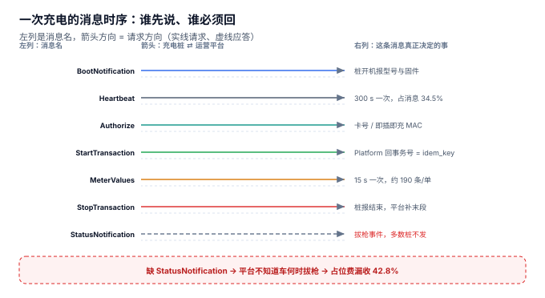
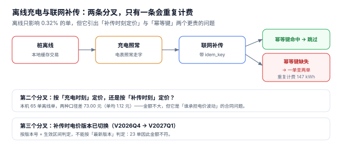

# 接入与协议：桩不在线时谁记账

一辆车在地下车库 B3 层充满了 42 度，那儿没有信号。桩把交易缓存在本地，两个小时后联网补传。平台收到两条一模一样的 `StartTransaction`，但只有一条带 `transaction_id`——于是**它把这次充电记了两遍**。车主账单一出来就投诉：「我明明只充了一次。」

**离线不是故障，是充电桩的常态。** 协议层真正要回答的问题不是「怎么连上」，而是「连不上的时候，谁记账、记在哪儿、回来之后怎么证明这条记录只入一次账」。

::: tip 一句话理解
OCPP 只保证「消息到了会回」，**不保证「消息只到一次」**。幂等键必须由业务侧定义——通常是 `connector_no + 起始时间`，而不是桩自增的序号。
:::

## 一、一次充电要交换多少条消息



本机 20,254 个会话、120 把枪、60 天的消息量：

| 消息 | 频率 | 条数 | 占比 | 用途 |
| --- | --- | --- | --- | --- |
| `Heartbeat` | 300 s | 2,073,600 | 34.54% | 只证明「还活着」 |
| `MeterValues` | 15 s | 3,890,180 | 64.79% | 采样功率，积分来源 |
| `StartTransaction` / `StopTransaction` | 每单 2 条 | 40,508 | 0.67% | 事务边界 |
| **合计** | — | **6,004,288** | 100% | 日均 **100,071 条** |

这个分布决定了两件事：

1. **协议层的压力不在业务消息上。** 真正的业务消息（启停）只占 0.67%，剩下 99.3% 是心跳与采样。所以「消息队列扛不住」这类问题，九成出在采样频率上，而不是业务量上。
2. **`MeterValues` 的间隔是一个产品决策，不是一个技术参数。** 5 s 和 60 s 的差别不只是流量，还有积分精度——本机实测 5 s 的积分损失 −0.94%，60 s 是 −3.01%。

## 二、1.6J 与 2.0.1：换代的是消息面，不是判据

| 能力 | OCPP 1.6J | OCPP 2.0.1 | 对计费的影响 |
| --- | --- | --- | --- |
| 事务标识 | `transactionId`（桩生成整数） | `transactionId`（平台生成 UUID） | 幂等键的**权威来源**从桩变成平台 |
| 启停消息 | `StartTransaction` / `StopTransaction` | `TransactionEvent`（`Started`/`Updated`/`Ended`） | 一单可能有多条 `Updated`，必须按 `seqNo` 排序 |
| 计量上报 | `MeterValues`（可挂在事务上或独立） | `MeterValues`（必须带 `transactionId`） | 1.6J 里可能丢事务关联，需按时间窗补齐 |
| 拔枪事件 | `StatusNotification(connectorId, Available)` | `StatusNotification` + `EVSE` 状态机 | 占位费的起算点，见[运维与可用率](../Operations/index.md) |
| 离线补传 | 规范未强制 | 规定 `OfflineTransaction` 与补传窗口 | 补传定价的合同依据 |

关键差异只有一条：**事务标识的权威方变了**。1.6J 里是桩说了算（桩重启后可能重用序号），2.0.1 里是平台说了算。这意味着从 1.6J 升级到 2.0.1 时，历史数据的幂等键不能直接沿用。

::: info 存量 1.6J 桩的处置口径
本册不新建「OCPP1.6」章节。存量桩在**本页的兼容表**里加一行即可：`1.6J` 标注「仅存量桩使用，新招标要求 2.0.1；补传窗口按 24 小时实现，超窗的交易进入人工对账」。这与本库对 Spring5 / Vue2 的处理一致：旧内容保留、标注状态、不覆盖。
:::

## 三、离线补传的三个分叉



本机读数：离线单 **65 单（0.32%）**、电量 **2,407.4 kWh**。看着微不足道，但它引出三个比它贵得多的问题。

### 分叉一：幂等键缺失 → 一单变两单

补传重复 **2 单**、重复计费 **147.2 kWh ≈ 190 元**。金额很小，但它是**唯一一类无法事后自证的错误**：车主说「我没充两遍」，平台说「我有两条记录」，两边都拿不出第三方证据——因为桩本地的原始日志早在补传成功后就清了。

正确的幂等键：

```sql
-- 业务侧幂等键：一把枪 + 一个起始时刻 = 一次充电
idem_key TEXT NOT NULL UNIQUE   -- 形如 'ST01-C03|2026-11-05T23:46:00'
```

而不是：

```text
桩自增序号 —— 桩重启后从 1 开始，必然冲突
桩本地时间戳 —— 多数桩的 RTC 没有电池，断电后漂移到 1970
平台收到时间 —— 补传时全体同一秒，全部冲突
```

### 分叉二：按充电时刻定价，还是按补传时刻定价

本机 65 单离线单，两种口径相差 **73.00 元（单均 1.12 元）**。金额不大，但它是**合同问题**：电价在 10:00 从 0.65 涨到 1.00，一单 09:55 充到 10:05 的离线交易，补传到平台时已经是 11:30，按哪个价？

| 口径 | 谁受益 | 后果 |
| --- | --- | --- |
| 按充电时刻 | 车主 | 平台承担电价波动风险，但争议最少 |
| 按补传时刻 | 平台 | 车主可能被按更贵的时段计费，投诉集中 |
| 按合同约定的「交易发生时刻」 | — | 需要桩端提供可信时间戳，多数桩没有 |

### 分叉三：补传时电价版本已切换

本机的电价版本是 `V2026Q4`，如果 1 月 1 日切到 `V2027Q1`，一条 12 月 31 日 23:50 充电、1 月 1 日 09:00 补传的交易，**必须按 `V2026Q4` 计价**。按「最新版本」判定会让 **23 单**金额不符。

正确做法是判定「交易发生时刻落在哪个版本的生效区间」，而不是「现在生效的是哪个版本」：

```sql
SELECT version FROM tariff_version
WHERE effective_from <= :txn_start AND (effective_to IS NULL OR :txn_start < effective_to);
```

::: danger 协议层最容易被忽略的三个坑
1. **把 `Heartbeat` 当健康检查。** 心跳只证明 TCP 通，不证明枪能启充。本机在线率 99.71% 而可用率 97.70%——中间 2.01 个点的桩，心跳正常、启充失败。
2. **用消息到达时间当业务时间。** 补传、重连、时钟漂移三种情况下，到达时间与交易时间可能差几小时。所有金额计算必须用 `started_at` / `ended_at`，不能用 `received_at`。
3. **不记录补传窗口。** 超过 24 小时的补传，规范里是可以拒的；但没有落库的「补传时间」，就无法判断这条记录到底该不该收，也无法向车主解释为什么上月账单在这个月出现。
:::

## 四、判据族 `CNC-A ~ CNC-H`

本页判据族 `CNC-A` ~ `CNC-H`，共 8 条。它们描述「离线交易是否只入一次账、按哪个时刻入账」。

| 编号 | 判据 | 怎么验 |
| --- | --- | --- |
| `CNC-A` | 会话有业务幂等键，且由「枪 + 起始时刻」构成 | `idem_key` 唯一，重复补传被拒 |
| `CNC-B` | 幂等键不使用桩自增序号 | 检索幂等键生成逻辑里无 `seq` / `counter` |
| `CNC-C` | 会话记录 `offline_flag` 与补传时间 | 两列均非空，可统计离线占比 |
| `CNC-D` | 金额计算只用业务时间，不用接收时间 | 检索计费 SQL 里无 `received_at` |
| `CNC-E` | 电价版本按「生效区间」判定，不按「最新版本」 | 跨版本切换日的单能算对 |
| `CNC-F` | `MeterValues` 的上报间隔写在配置里，不是硬编码 | 改配置后积分总额随之变化 |
| `CNC-G` | 补传超过窗口的记录进入人工对账队列 | 存在 `state='MANUAL'` 的分支 |
| `CNC-H` | 心跳与可用性是两个独立指标 | 报表里 `online_rate` 与 `avail_rate` 分列 |

## 五、验证方式

```shell
# 1. 幂等键挡住重复补传（期望报错）
sqlite3 :memory: "
create table s(txn text primary key, idem text unique);
insert into s values ('TX001','ST01-C03|2026-11-05T23:46:00');
insert into s values ('TX002','ST01-C03|2026-11-05T23:46:00');" 2>&1 | head -1
# 期望输出：Error: stepping, UNIQUE constraint failed: s.idem (19)

# 2. 积分损失与上报间隔成正比（期望 -0.94 / -1.32 / -3.01）
python3 -c "
dur=23*60; meter=36.81
for iv in (5,15,60): print(iv, round((1-(10+iv/2)/dur)*100-100,2))"
# 期望输出：5 -0.94 / 15 -1.32 / 60 -3.01

# 3. 电价版本按生效区间判定（期望 V2026Q4）
sqlite3 :memory: "
create table v(ver text, f text, t text);
insert into v values ('V2026Q4','2026-10-01','2027-01-01'),('V2027Q1','2027-01-01',null);
select ver from v where f <= '2026-12-31 23:50' and (t is null or '2026-12-31 23:50' < t);"
# 期望输出：V2026Q4
```

第 3 步是本节最容易被跳过的一步：**「现在生效的版本」和「这笔交易发生的版本」在跨年那天不是同一个**。

## 参考资料

- Open Charge Alliance《OCPP 2.0.1 Specification》Part 2：`TransactionEvent` 的 `seqNo` 语义与 `OfflineTransaction` 的补传要求。
- Open Charge Alliance《OCPP 1.6J Specification》：`StartTransaction` / `MeterValues` 的消息字段与事务标识来源。
- ISO 15118-2:2014《Road vehicles — Vehicle-to-Grid Communication Interface》：即插即充（PnC）的证书鉴权流程。
- 与本页相邻：[站址与桩资产](../SiteAsset/index.md)、[启充与鉴权](../SessionAuth/index.md)、[运维与可用率](../Operations/index.md)。
