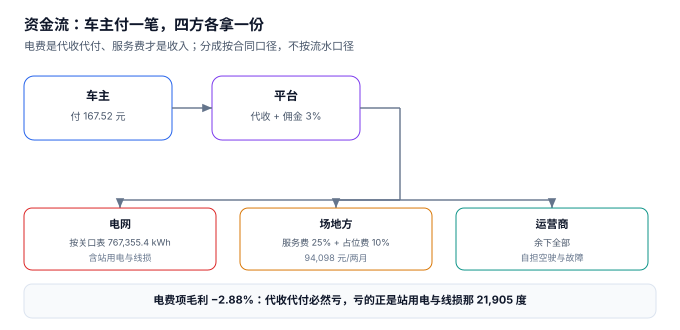

# 结算与分成：车主付的一笔钱分给谁

月底对账，财务把三张表放在一起：平台账单 883,152.58 元、电网电费单 515,944.21 元、场地方结算单 94,098.43 元。三张表都是自己系统出的，但**它们描述的不是同一件事**：账单是「应收」，电网是「成本」，场地方是「应付」。把它们相减得到的 273,109.94 元，既不是利润，也不是现金。

**充电站的钱有五个流向，而只有一个流向是「收入」。** 电费是代收代付（收多少付多少），服务费才是收入，占位费大部分要分出去，平台佣金按流水的百分比抽。搞不清这五个流向，任何「毛利率」都是自己编出来的。

::: tip 一句话理解
电费是**代收代付**，服务费才是**收入**。所以「电费项毛利 −2.88%」不是定价错了，是站用电与线损被记在了电费这一项里。
:::

## 一、一笔钱分成五份



| 流向 | 口径 | 本机金额 | 是不是收入 |
| --- | --- | --- | --- |
| 车主付 | 电费 + 服务费 + 占位费 | 883,152.58 元 | — |
| 电网收 | 站总表 × 分时价 | 515,944.21 元 | 否（成本） |
| 场地方分成 | 服务费 25% + 占位费 10% | 94,098.43 元 | 否（应付） |
| 平台佣金 | 流水 3% | 26,494.58 元 | 否（应付） |
| 运营商留存 | 余下全部 | 246,615.36 元 | **是（净利）** |

本机的度电口径：流水 **1.1847 元/度**、净利 **0.3308 元/度**、净利率 **27.92%**。

## 二、电费项为什么必然亏

把电费单独拿出来看：

| 项 | 金额 |
| --- | --- |
| 电费收入（按枪表 × 分时价） | 501,502.18 元 |
| 购电成本（按站总表 × 分时价） | 515,944.21 元 |
| **电费项毛利** | **−14,442.03 元（−2.88%）** |

差额的来源已经在[充电与计量](../Metering/index.md)算过：站用电 12,960.0 度 + 线损 8,945.4 度 = 21,905.4 度，按 0.65 元/度是 14,239 元。**电费项永远为负，因为站用电与线损也按充电电价买进来了，却没有任何车主为它付钱。**

这不是定价问题，是**成本归属问题**。能做的只有两件事：

1. 把站用电单独计量，让它进「运营成本」而不是「电费成本」，这样毛利率的分母才干净；
2. 在服务费里显式覆盖这部分（本机服务费收入 372,889.28 元，站用电与线损折电费占 3.82%）。

::: danger 三个分成上的必错
1. **按流水分成，而不是按服务费分成。** 场地方如果按流水的 25% 分成，他分走的是 220,788 元；按服务费的 25% 分成，只有 93,222 元。**差 2.4 倍**。合同里写「分成 25%」而不写基数，是这个行业最常见的纠纷来源。
2. **把电费算进分成基数。** 电费是代收代付，运营商在这部分上一分钱不赚（本机 −2.88%）。把电费算进基数，等于运营商倒贴钱给场地方分红。
3. **占位费全额入账。** 占位费的实质是「车位占用补偿」，本机按 90% 归场地方（他只出车位、不出电）。全额入账会让运营商的毛利虚高，而场地方年底对账时一定会提出来。
:::

## 三、分成两口径：差 4%

场地方分成有两种常见写法，本机两种都算了一遍：

| 口径 | 算式 | 本机金额 | 相对 |
| --- | --- | --- | --- |
| 按服务费比例 | 372,889.28 × 25% | 93,222.32 元 | 基准 |
| 按度电固定额 | 745,450.0 × 0.12 | 89,454.00 元 | **−4.04%** |

差 3,768.32 元/两月。这个差额本身不大，但它的**性质**完全不同：

- 按服务费比例：场地方的收入随运营商定价浮动，**共担风险**。
- 按度电固定额：场地方的收入只随电量浮动，**运营商独担价格风险**。

选哪种不是技术问题，是**谁承担「服务费降价竞争」的风险**。合同里必须写清基数与调整机制，否则每次服务费调价都要重新谈一次。

## 四、三方对账：应收 / 实收 / 应结

结算的难点不在算，在**三个数必须能对上且允许有差额**：

| 口径 | 含义 | 本机 | 差额来源 |
| --- | --- | --- | --- |
| 应收（账单） | `fee_line` 合计 | 167.52 元（示例批次） | — |
| 实收（支付） | 实际到账 | 占位费只收到 57.16% | 漏收、退款、拒付 |
| 应结（分成） | 按合同应付 | 场地方 41.88 / 平台 5.03 / 运营商 120.61 | 分成基数 |

占位费是三者差异最大的一项：应收 **15,326.86 元**、实收 **8,761.12 元**、漏收 **6,565.74 元（42.84%）**、涉及 **849 单**。漏收的原因不在计费，在**采集**——桩不发拔枪事件，平台不知道车什么时候走的（见[运维与可用率](../Operations/index.md)）。

::: warning 一个反直觉的结论
**「三方差额为 0」是错误的对账目标。** 应收与实收之间天然存在差额（漏收、退款、拒付），应收与应结之间天然存在差额（分成基数、封顶）。正确做法是：

1. 每一类差额都**单独成行**，不互相冲抵；
2. 每类差额设**容忍阈值**（如占位费漏收 > 5% 报警）；
3. 差额**逐月累计**，不按月清零。

本机如果用「净额」对账（应收 − 实收 − 应结 = 0 即通过），42.84% 的占位费漏收会被「分成算少了」冲抵掉，看起来完全平衡。
:::

## 五、判据族 `CNB-A ~ CNB-H`

本页判据族 `CNB-A` ~ `CNB-H`，共 8 条。它们描述「一笔钱是否按合同口径分给了正确的人」。

| 编号 | 判据 | 怎么验 |
| --- | --- | --- |
| `CNB-A` | 分成比例与**基数**都落在表里 | 存在 `share_base`（SERVICE / GROSS / KWH）字段 |
| `CNB-B` | 三方分成之和 + 运营商留存 = 100% | `owner + plat + oper = 100` |
| `CNB-C` | 结算批次有「应收 / 实收 / 应结」三列 | 三列均非空，不互相推导 |
| `CNB-D` | 电费与成本分列，不混进毛利分子 | 存在 `energy_cost` 与 `svc_revenue` 两列 |
| `CNB-E` | 占位费按合同比例分给场地方 | 存在 `occ_owner_pct` 参数 |
| `CNB-F` | 差额按类分列，不净额冲抵 | 存在 `diff_type` 枚举 |
| `CNB-G` | 分成口径可切换（服务费比例 / 度电固定） | 两种口径都能算出金额 |
| `CNB-H` | 结算批次金额与明细勾稽 | `ABS(batch − Σfee_line) < 0.01` |

## 六、验证方式

```shell
# 1. 分成基数不同，金额差 2.4 倍（期望 25% 与 25% 的对比）
python3 -c "
svc=372889.28; gross=883152.58
print('按服务费 25%', round(svc*0.25,2))
print('按流水   25%', round(gross*0.25,2))"
# 期望输出：按服务费 25% 93222.32 / 按流水 25% 220788.15

# 2. 两口径差 4.04%（期望 -4.04）
python3 -c "
a=372889.28*0.25; b=745450.0*0.12
print(round(b,2), round((b/a-1)*100,2))"
# 期望输出：89454.0 -4.04

# 3. 五方之和必须闭合（期望 883152.58）
python3 -c "
cost=515944.21; owner=94098.43; plat=26494.58; oper=246615.36
print(round(cost+owner+plat+oper,2))"
# 期望输出：883152.58
```

第 3 步是本页的收官校验：**成本 + 三方应付 + 运营商净利 必须精确等于流水**。差一分钱都说明有一项被重复计入或被漏掉。

## 参考资料

- 《中华人民共和国民法典》第三编第二分编「合同」：分成合同、代收代付的法律性质与结算义务。
- 国家发展改革委《关于电动汽车用电价格政策有关问题的通知》（发改价格〔2014〕1668 号）：电费与服务费分离计价的要求。
- 《企业会计准则第 14 号——收入》（财会〔2017〕22 号）：主要责任人与代理人的判断，决定电费应按「总额」还是「净额」确认收入。
- 《中华人民共和国会计法》第十四条：原始凭证的填制与审核要求，本页「应收 / 实收 / 应结」三列留痕的依据。
- 与本页相邻：[分时与账单](../TariffBilling/index.md)、[运维与可用率](../Operations/index.md)、[实战](../Practice/index.md)。
