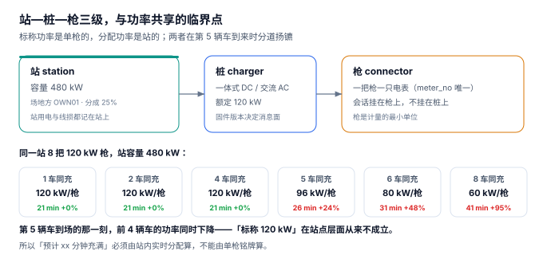

# 站址与桩资产：一把枪的边界在哪

一个站配了 8 把 120 kW 的枪，铭牌上写着 960 kW，而配电房的变压器只有 480 kVA。平时只有两三辆车同时充，一切正常；国庆第一天来了 8 辆车，**每把枪的功率同时掉到 60 kW**，车主群里炸了：「标称 120 kW，实际只有 60。」

这不是故障，是设计。**「这把枪多快」从来不是铭牌上的那个数，而是「在站容量约束下，这一刻分给它的那个数」。**

::: tip 一句话理解
站、桩、枪是三级资产，但**只有枪是计量的最小单位**。容量是站的属性，功率是枪的属性，两者之间的桥是「同一时刻有几辆车在充」。
:::

## 一、三级资产：站 / 桩 / 枪



| 层级 | 一行代表什么 | 关键属性 | 谁写它 |
| --- | --- | --- | --- |
| 站 `station` | 一个物理场站 | 配电容量 `cap_kw`、场地方、分成比例、站用电 | 建站时录入，极少变 |
| 桩 `charger` | 一台充电机（一体式/分体式） | 型号、额定功率、固件版本 | 设备台账，随固件升级变 |
| 枪 `connector` | 一把充电枪 | 枪号、电表编号 `meter_no`（唯一） | 安装时录入，一条不可复用 |

三级里最容易设计错的是「会话挂在哪一级」。正确答案是**枪**：

- 挂站：一站多枪同时充，会话分不清是哪把枪，电量对不上电表。
- 挂桩：一体式桩一桩一枪还凑合，分体式桩一桩多枪直接错位。
- 挂枪：电表编号、枪号、会话三者一一对应，向上能聚合到桩和站。

```sql
CREATE TABLE connector(
  connector_no TEXT PRIMARY KEY,          -- ST01-C03
  charger_no   TEXT NOT NULL REFERENCES charger(charger_no),
  gun_no       INTEGER NOT NULL CHECK(gun_no >= 1),
  meter_no     TEXT NOT NULL UNIQUE,      -- 一只电表只能属于一把枪
  UNIQUE(charger_no, gun_no)              -- 同一台桩上枪号不重复
);
```

`meter_no` 上的 `UNIQUE` 不是形式主义：电表编号是**唯一的计量溯源锚点**，一旦两把枪共用一个编号，月度抄见就无法还原到单。

## 二、容量、额定与分配：三个不同的功率

| 名称 | 含义 | 谁决定 | 典型数 |
| --- | --- | --- | --- |
| 站容量 `cap_kw` | 配电房能给出的总功率 | 变压器与配电设计 | 480 kW |
| 额定功率 `rated_kw` | 单枪铭牌功率 | 充电机规格 | 120 kW |
| 分配功率 `share_kw` | 这一刻实际给到这辆车的功率 | `min(rated, cap / n)` | 60~120 kW |

分配规则几乎都是这一条：

```text
share_kw = min(rated_kw, cap_kw / n)      -- n = 该站当前在充的车数
```

这条公式的含义是：**站容量是硬上限，先到的人不优先，后到的人会把前人的功率稀释**。本机实测的单站并发分布是 P50 = 1、P90 = 3、P99 = 4、最大 6 辆车——也就是说真正触发降额的时刻不多，但一旦触发就是全体。

## 三、功率共享的临界点

一个 480 kW 的站、8 把 120 kW 的枪，每辆车各需 40 kWh（60 度电池从 20% 到 87%）：

| 同时在充 | 每枪分配 | 充满用时 | 相对独占 |
| --- | --- | --- | --- |
| 1 辆 | 120 kW | 21 分钟 | 基准 |
| 2 辆 | 120 kW | 21 分钟 | +0.0% |
| 4 辆 | 120 kW | 21 分钟 | +0.0% |
| **5 辆** | **96 kW** | **26 分钟** | **+23.8%** |
| 6 辆 | 80 kW | 31 分钟 | +47.6% |
| 8 辆 | 60 kW | 41 分钟 | +95.2% |

**临界点在 4 辆与 5 辆之间**：4 × 120 = 480，正好把站容量吃满；第 5 辆车到场的那一刻，前 4 辆车的功率**同时**从 120 掉到 96。

这解释了两件事：

1. **为什么「预计 xx 分钟充满」不能按铭牌算。** 本机实测的 P90 并发是 3，意味着高峰时段有 10% 的时间至少 4 辆车在充——按铭牌估的 21 分钟，实际要按 26~41 分钟报。
2. **为什么「加枪」不等于「加容量」。** 在一个已经跑满的站上再加 4 把枪，单枪功率会从 120 掉到 80，总吞吐只涨一点点，而用户体验显著变差。加枪之前先看并发 P99。

::: danger 站址设计上的三个必错
1. **按「枪数 × 额定功率」配变压器。** 8 × 120 = 960 kW，但实际同时满载的概率极低。按 960 配的变压器，三年里有 99% 的时间在空转；按 480 配的，只需要在 P99 之外的 0.89% 时间里接受降额。
2. **把「站容量」写成代码常量。** 同一个运营商的不同站，容量从 120 kW 到 1200 kW 都有；写成常量，扩站就要发版。正确做法是 `station.cap_kw` 字段。
3. **会话挂在桩上而不是枪上。** 分体式桩（一台主机拖 4~8 把枪）在商用站里是主流，挂桩会让「这把枪充了多久」变成「这台机器充了多久」，电量与电表彻底对不上。
:::

## 四、车位与占位：容量之外的第二个约束

充电站的吞吐不只受功率限制，还受**车位**限制。本机模型里没有建车位表，但真实站里它是第三个约束：

| 约束 | 卡住什么 | 观测指标 | 本机读数 |
| --- | --- | --- | --- |
| 配电容量 | 单枪功率 | 并发车数 P99 | P99 = 4，超容时长 0.89% |
| 车位数 | 能不能停进来 | 排队时长、放弃率 | 未建模 |
| 枪数 | 能不能插上 | 枪利用率 | 单枪日均 103.5 kWh |

单枪日均 103.5 kWh 这个数值得算一下：24 小时 × 120 kW = 2,880 kWh 是理论上限，实际 103.5 kWh 意味着**枪的功率利用率只有 3.6%**。所以「桩不够用」的抱怨，九成不是功率不够，而是**车位不够或分布不均**。

::: warning 一个反直觉的结论
**提高单枪功率对收入的贡献，远小于提高枪的周转率。** 本机 120 把枪的单枪日均是 103.5 kWh，平均单次 36.81 kWh、时长中位 23 分钟——一把枪一天平均只被用 2.8 次。把功率从 120 提到 180，单次时长从 23 分钟降到 15 分钟，理论上能多接 1.5 次；但如果车位只有 120 个，多出来的 1.5 次根本停不进来。

这也是为什么运营侧的第一指标通常是「单枪日均电量」而不是「单枪功率」。
:::

## 五、判据族 `CNS-A ~ CNS-H`

本页判据族 `CNS-A` ~ `CNS-H`，共 8 条。它们描述「三级资产是否可追溯到一把枪」。

| 编号 | 判据 | 怎么验 |
| --- | --- | --- |
| `CNS-A` | 会话只挂枪（`connector_no`），不挂桩也不挂站 | 会话表里没有 `charger_no` / `station_no` 字段 |
| `CNS-B` | 一只电表只能属于一把枪 | `meter_no` 上有 `UNIQUE`，重复插入报错 |
| `CNS-C` | 同一台桩的枪号不重复 | `UNIQUE(charger_no, gun_no)` |
| `CNS-D` | 站容量是字段不是常量 | 修改 `station.cap_kw` 后分配功率随之变化 |
| `CNS-E` | 能算出「某一时刻该站有几辆车在充」 | 用 `started_at <= t AND ended_at > t` 可数出并发 |
| `CNS-F` | 能算出「需求功率超过站容量的时长」 | 按分钟切片求和，本机 3,062 分钟（0.89%） |
| `CNS-G` | 枪有独立状态，不继承桩的状态 | `connector` 上有自己的状态列，不是 `charger.state` 的副本 |
| `CNS-H` | 桩的固件版本可查 | `charger.firmware` 非空，且能按版本统计故障率 |

## 六、验证方式

```shell
# 1. 一只电表只能属于一把枪（期望报错）
sqlite3 :memory: "
create table c(no text primary key, meter text unique);
insert into c values ('ST01-C01','MTR-0001');
insert into c values ('ST01-C02','MTR-0001');" 2>&1 | head -1
# 期望输出：Error: stepping, UNIQUE constraint failed: c.meter (19)

# 2. 分配功率随并发数变化（期望 120 / 96 / 60）
python3 -c "
cap=480; rated=120
for n in (2,5,8): print(n, min(rated, cap/n))"
# 期望输出：2 120.0 / 5 96.0 / 8 60.0

# 3. 某一时刻的并发车数（期望 2）
sqlite3 :memory: "
create table s(a text, z text);
insert into s values ('2026-11-05 09:00','2026-11-05 10:00'),
                     ('2026-11-05 09:30','2026-11-05 09:50'),
                     ('2026-11-05 10:10','2026-11-05 10:40');
select count(*) from s where a <= '2026-11-05 09:40' and z > '2026-11-05 09:40';"
# 期望输出：2
```

第 3 步是本页所有容量结论的基础：**并发是「时刻」的函数，不是「当天」的函数**。任何按日聚合的容量报表，都算不出「第 5 辆车到场时前 4 辆被降额」这件事。

## 参考资料

- GB/T 18487.1—2023《电动汽车传导充电系统 第 1 部分：通用要求》：充电机额定功率、连接方式与安全要求。
- GB 50052—2009《供配电系统设计规范》：配电容量与变压器选择，站址容量设计的工程依据。
- GB/T 51313—2018《电动汽车分散充电设施工程技术标准》：充电设施布置、车位与配电的配置要求。
- Open Charge Alliance《OCPP 2.0.1 Specification》：`Connector` 与 `EVSE` 的层级定义，本页三级资产的对应关系。
- 与本页相邻：[总览](../Overview/index.md)、[接入与协议](../ProtocolAccess/index.md)、[运维与可用率](../Operations/index.md)。
