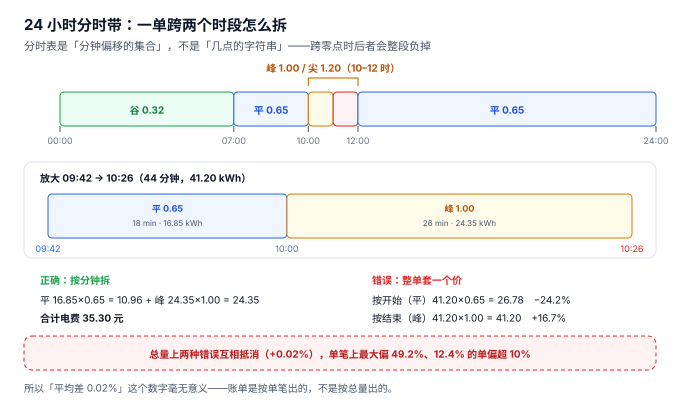

# 分时与账单：一单跨两个时段怎么拆

11:58 插枪，12:31 拔枪。这一单在 12:00 那一刻从「尖峰 1.20 元」跨到「峰 1.00 元」。财务的算法是「按结束时刻算」，于是整单 33 分钟全按 1.00 元计；隔壁那位 11:30 到 11:58 充完的车主，整单按 1.20 元计。**同一根枪、同一个小时、同样的电，两个人单价差 20%。**

分时计费是充电系统里唯一一个「算法错了不会报错、只在单笔上暴露」的环节。本册所有页里，这一页的缺陷最隐蔽。

::: tip 一句话理解
分时表是**「分钟偏移的集合」**，不是「几点的字符串」。前者在跨零点时仍然正确，后者在 23:46 到 00:31 这一单上会直接得出负数。
:::

## 一、分时表的正确形态



一张分时表就是「版本 + 若干不重叠的区间 + 单价」：

```sql
CREATE TABLE tariff_band(
  version      TEXT NOT NULL,               -- V2026Q4
  band         TEXT NOT NULL CHECK(band IN ('VALLEY','FLAT','PEAK','SHARP')),
  start_min    INTEGER NOT NULL CHECK(start_min BETWEEN 0 AND 1439),
  end_min      INTEGER NOT NULL CHECK(end_min BETWEEN 1 AND 1440),
  energy_price REAL NOT NULL CHECK(energy_price >= 0),
  PRIMARY KEY(version, band, start_min),
  CHECK(end_min > start_min)
);
```

三个设计要点：

1. **用分钟偏移，不用 `HH:MM`。** `start_min = 660` 就是 11:00，`end_min = 720` 就是 12:00。整数相减得到时长，跨日不存在负值问题。
2. **`band` 可以重复。** 同一天里「平段」出现两次（07:00–10:00 与 12:00–24:00），靠 `(version, band, start_min)` 主键区分，靠 `start_min` 排序。
3. **覆盖满 1440 且不重叠**，两条都要验：`SUM(end_min − start_min) = 1440` 保证没漏，`trg_band_no_overlap` 保证没重。

本机建模用了 10 个区间（谷 / 平 / 峰 / 尖峰交替），实践页为了可读性压缩成 5 段——结论一样，只是颗粒度不同。

## 二、拆分算法：必须用绝对分钟

一段会话从 `started_at` 到 `ended_at`，要按分时边界切成若干段，每段的电量再按 **时长占比** 分摊。关键在于「分钟的表示」：

```text
正确：绝对分钟索引（自某个基准日起算）
  基准 = 2026-11-05 00:00
  11-05 23:46 → 1426      11-06 00:31 → 1471
  时长 = 1471 − 1426 = 45 分钟 ✓

错误：时钟读数
  23:46 → 23×60+46 = 1426      00:31 → 0×60+31 = 31
  时长 = 31 − 1426 = −1395 分钟 ✗
```

差一天不是最坏的；最坏的是**沉默**：`−1395` 分钟会让按比例分摊的电量变成负数，而负电量在很多实现里会被 `CHECK(kwh > 0)` 拦下——于是那一单的账单**直接缺失**，而不是报错。

本机 20,254 单里，跨零点的有 **686 单（3.39%）**、电量 **23,767.6 kWh（3.19%）**。也就是说：一个只按时钟读数拆分的实现，会让每个月 **3.19% 的电量**出现负数或缺失。

## 三、三种算法：总量几乎相等，单笔天差地别

| 算法 | 总额 | 相对正确 | 单笔中位偏差 | 单笔 P90 | 单笔最大 | 偏超 10% 的单 |
| --- | --- | --- | --- | --- | --- | --- |
| **按分钟拆分（正确）** | 874,391.46 元 | — | — | — | — | — |
| 整单按开始时刻 | 874,562.69 元 | +0.02% | 0.00% | 13.08% | 49.2% | 12.42% |
| 整单按结束时刻 | 874,496.44 元 | +0.01% | 0.00% | 16.87% | 42.9% | 15.48% |

这张表是本册最重要的一张表。它说明：

1. **总额差 0.02%，几乎不可测。** 用「本月流水与上月比」这类总量对账，永远发现不了这个错误。
2. **单笔中位偏差 0.00%**：一半以上的单压根不跨时段（本机跨时段占 24.43%），所以中位数是 0。
3. **单笔 P90 是 13.08% / 16.87%**：跨时段那 24.43% 的单里，偏差集中在 10%~20% 区间。
4. **偏超 10% 的单占 12.42% / 15.48%**：这是投诉的实际来源。

::: danger 分时计费的三个必错
1. **按开始时刻或结束时刻整单套价。** 本机 12.42% 的单会偏超 10%，最大 49.2%。这类错误在总量上互相抵消（跨到更贵时段与跨到更便宜时段的单大致相等），所以**永远通不过总量对账发现**。
2. **按「时段电量」而非「分钟」摊分。** 有人用「这一单横跨两个时段，各占 50%」来简化。在 24 小时均匀分布的时段里这看起来没问题，但本机的时段长度是 420 / 180 / 60 / 60 / 720 分钟——**最长的谷段是最短的尖峰段的 12 倍**，按 50/50 摊分会系统性高估贵时段。
3. **电价版本按「最新」判定。** 跨年、跨季度切换时，一条 12 月 31 日充电、1 月 1 日补传的交易必须按旧版本计价，否则 23 单金额不符（见[接入与协议](../ProtocolAccess/index.md)）。
:::

## 四、时段电量分布：一个必须先声明的对照

| 时段 | 时长占比 | 电量占比 | 单价 |
| --- | --- | --- | --- |
| 谷 | 33.3% | 33.1% | 0.32 |
| 平 | 33.3% | 33.8% | 0.65 |
| 峰 | 25.0% | 25.0% | 1.00 |
| 尖峰 | 8.3% | 8.1% | 1.20 |

两组数几乎完全重合。**这不是「分时电价没有引导作用」的结论，而是本文模型的输入假设造成的**：本机的到站时刻按均匀分布生成，车主不问价。这组数据的作用是**对照组**——如果某天真要评估「价差能不能把负荷从峰段挪到谷段」，拿它当基线，看实际分布偏离了多少。

::: warning 一个反直觉的结论
**「分时电价能削峰」这件事，在充电场景里比在工业负荷里弱得多。** 工业负荷可以在谷段加班生产，充电的需求是「车没电了才来」。本机模型的均匀到站假设下，电量分布与时长分布几乎一致（33.1/33.8/25.0/8.1 对 33.3/33.3/25.0/8.3），说明**价差本身没有改变到站时刻**。

真正能削峰的是**有序充电**（平台调度充电功率，而不是调度到站时刻）：车还是那时候插上，但功率在谷段才拉满。这条路要求桩支持功率调节，属于协议层能力，见[站址与桩资产](../SiteAsset/index.md)的功率共享。
:::

## 五、账单的三段构成

一条账单行必须分三段存，合计由三段算出：

```sql
CREATE TABLE fee_line(
  txn_id        TEXT PRIMARY KEY REFERENCES charging_session(txn_id),
  energy_amount REAL NOT NULL,      -- 电费：按分段电量 × 分时单价
  svc_amount    REAL NOT NULL,      -- 服务费：按电量 × 合同单价
  occ_amount    REAL NOT NULL DEFAULT 0,  -- 占位费：按超时分钟 × 费率，封顶
  total_amount  REAL NOT NULL,
  CHECK(ABS(total_amount - (energy_amount + svc_amount + occ_amount)) < 0.005)
);
```

本机三段的比例：电费 501,502.18 元（56.8%）、服务费 372,889.28 元（42.2%）、占位费 8,761.12 元（1.0%）。合并成 `total_amount` 之后，「为什么这个月流水涨了而利润没动」就查不出来了——它可能是占位费涨了，而占位费的 90% 要分给场地方。

## 六、判据族 `CNP-A ~ CNP-H`

本页判据族 `CNP-A` ~ `CNP-H`，共 8 条。它们描述「一笔电量是否被拆到了正确的时段上」。

| 编号 | 判据 | 怎么验 |
| --- | --- | --- |
| `CNP-A` | 分时表用整数分钟偏移，不用 `HH:MM` 字符串 | 表结构只有 `start_min` / `end_min` |
| `CNP-B` | 同一版本的分时段覆盖 1440 分钟且不重叠 | `SUM` 为 1440，重叠插入报 `TARIFF_OVERLAP` |
| `CNP-C` | 分段电量和等于会话电量 | `MAX(ABS(Σseg − meter)) < 0.01` |
| `CNP-D` | 分段分钟数和等于会话时长 | `MAX(ABS(Σmin − dur)) = 0` |
| `CNP-E` | 拆分用绝对分钟索引，跨零点不出负数 | 23:46→00:31 得到 45 分钟 |
| `CNP-F` | 电价版本按生效区间判定 | 跨版本切换日的单能算对 |
| `CNP-G` | 账单三段分列，`CHECK` 保证勾稽 | 改任一段则 `total_amount` 必须同步 |
| `CNP-H` | 存在「整单套价 vs 分钟拆分」的差异报表 | 能按单笔输出偏差 > 10% 的清单 |

## 七、验证方式

```shell
# 1. 跨零点拆分（期望 45 分钟、两段 14+31）
sqlite3 :memory: "
select cast(round((julianday('2026-11-06 00:31')-julianday('2026-11-05 23:46'))*1440) as int);"
# 期望输出：45

# 2. 错误写法会得到负数（期望 -1395）
python3 -c "
a=23*60+46; b=0*60+31; print(b-a)"
# 期望输出：-1395

# 3. 一单跨时段的正确算法（期望 35.30，而不是 26.78 或 41.20）
python3 -c "
m=41.20; flat=18/44*m; peak=26/44*m
print('拆分', round(flat*0.65+peak*1.00,2))
print('按开始', round(m*0.65,2), '按结束', round(m*1.00,2))"
# 期望输出：拆分 35.3 / 按开始 26.78 / 按结束 41.2
```

## 参考资料

- 国家发展改革委《关于进一步完善分时电价机制的通知》（发改价格〔2021〕1093 号）：峰谷时段划分原则、尖峰电价上浮比例与执行月份。
- 国家发展改革委《关于电动汽车用电价格政策有关问题的通知》（发改价格〔2014〕1668 号）：充换电设施用电执行峰谷分时电价。
- GB/T 18487.1—2023《电动汽车传导充电系统 第 1 部分：通用要求》：充电电量计量与计费的信息交互要求。
- 与本页相邻：[充电与计量](../Metering/index.md)、[结算与分成](../SettlementSplit/index.md)、[实战](../Practice/index.md)。
