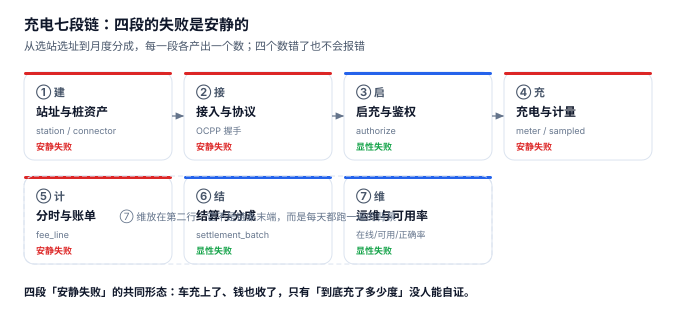

# 充电桩运营与计费工程

凌晨两点，一位车主在 App 上看到账单：41.2 度、58.9 元。他打电话投诉——「我的车电池才 60 度，从 18% 充到 87%，怎么会用掉 41.2 度？」客服查桩端电表，确实是 41.20；查车端 BMS 上报，入电 39.55。差的 1.65 度是充电机的转换损耗，**它真实发生过，两个系统也都没算错**，但车主认的是第三个数字。

**充电桩系统最贵的错误不是「桩坏了」，而是「同一度电被三套口径各记了一次，每套都能自证，却谁也不等于对方」。** 电商的库存有唯一答案（能不能卖），充电没有：充了多少度，取决于你问电表、问平台采样、还是问电网关口表；该收多少钱，取决于你按整单计价、按结束时刻计价、还是按分钟拆分计价。

::: tip 一句话理解
充电不是「把电灌进电池」，而是一根枪在一段时间里被**三套计量口径同时描述**：桩端电表（计费依据）、平台积分（看板依据）、站总表（与电网结算依据）。三者的差不是精度问题，是**谁承担损耗**的合同问题。
:::

## 一、这个专题讲什么

从站址选址到月度分成，一根枪要走七段：

| 段 | 这一段在做什么 | 产物 | 失败是否安静 |
| --- | --- | --- | --- |
| ① 建 | 定站址、配枪、算容量 | `station` / `connector` | **安静**（容量配小了要到第三年才发现） |
| ② 接 | 桩上线、协议握手、心跳 | OCPP 会话 | 半显性（离线会掉线，但补传可能重复） |
| ③ 启 | 鉴权、锁枪、启充 | `charging_session` | 显性（启不了当场就投诉） |
| ④ 充 | 充电、采样、计量 | `meter_kwh` / `sampled_kwh` | **安静**（积分比电表少，永远偏小） |
| ⑤ 计 | 分时拆分、算账单 | `fee_line` | **安静**（总量对得上，单笔偏 49%） |
| ⑥ 结 | 分成、开票、对账 | `settlement_batch` | 半显性（对账时差几百块） |
| ⑦ 维 | 可用率、故障、补单 | 三个率的报表 | **安静**（在线 99.7% 掩住 2 个点不可用） |

七段里**四段的失败是安静的**。它们的共同形态是：枪在线、车充上了、账单也出了，只有「这一单到底该记多少度、收多少钱」没人能自证。

本机读数最能说明问题的一组数字：20,254 单里，桩端电表合计 **745,450.0 kWh**，平台积分 **735,988.4 kWh**（−1.27%），站总表 **767,355.4 kWh**（+2.94%）。三个数都来自同一批充电，最大与最小相差 **31,367.0 度**——按 0.65 元/度算是 **2.0 万元**，两个月、12 个站、120 把枪。

| 视角 | 读数 | 它掩盖了什么 |
| --- | --- | --- |
| 平台积分 | −1.27% | 看板显示「这个月充了 73.6 万度」，实际车主用了 74.5 万度 |
| 站总表 | +2.94% | 电网按这个数收钱，多出来的正是站用电与线损 |
| 在线率 | 99.71% | 故障与维护期间桩「在心跳」但充不了，占 2.01 个点 |
| 计费正确率 | 95.68% | 占位费漏计 849 单、补传重复 2 单、版本错 23 单 |

这就是充电运营最典型的缺陷形态：**每个数字单独看都正常，放在一起就互相矛盾**。一个只盯「本月总电量」的看板，永远发现不了「积分少收 1.27%、关口表多收 2.94%、中间 4.2 个点被站自己吃掉」这件事。

## 二、三个「充了多少度」与三个「该收多少」

| 口径 | 定义 | 谁在关心 | 常见错法 |
| --- | --- | --- | --- |
| 枪端电表 `meter_kwh` | `meter_end − meter_start`，桩内电能表 | 计费、争议裁决 | 直接把积分当电表用 |
| 平台积分 `sampled_kwh` | `MeterValues` 功率 × 时间累加 | 看板、趋势、告警 | 15 s 采样去替代结算 |
| 站总表 `grid_kwh` | 关口表月度抄见 | 与电网结算 | 拿枪表之和去对电网账单 |

### 一个必须自己算一遍的例子

一单 44 分钟、41.20 kWh，从 09:42 充到 10:26，跨过 10:00 这个分时边界（平 0.65 → 峰 1.00）。

| 算法 | 表达式 | 电费 | 后果 |
| --- | --- | --- | --- |
| 整单按开始时刻 | 41.20 × 0.65 | 26.78 元 | 少收 24.2%，车主高兴、运营商亏 |
| 整单按结束时刻 | 41.20 × 1.00 | 41.20 元 | 多收 16.7%，投诉与退款 |
| 按分钟拆分 | 16.85×0.65 + 24.35×1.00 | **35.30 元** | 正确：一度电按它实际发生的时段计价 |

三种算法都能写进代码，只有第三种回答了「这一度电是什么时候充的」。

::: danger 三件事必须写进数据模型
1. **三个电量必须分列存**（`meter_kwh` / `sampled_kwh` / `settle_kwh`），不能只存一个 `kwh`：本机实测三者相差 1.27% 与 2.94%，合并之后「为什么电网账单比我的收入多 2 万元」永远查不清。
2. **计费电量不能存成字段，要按 `billing_basis` 选**：合同写「按电表」还是「按积分」是一个枚举值，不是一个 `UPDATE`。本机实测换一次口径，同一批单的计费电量从 146.10 变成 144.18 kWh（−1.31%）。
3. **分时表必须用「分钟偏移」而不是「HH:MM 字符串」**：跨零点的单（本机 686 单、3.39%）一旦用 `strftime('%H')` 取小时再相减，会得到负数，整段电量直接消失。
:::

## 三、专题地图

按「一根枪的一天」读：

| 阶段 | 页面 | 一句话 |
| --- | --- | --- |
| 立资产 | [站址与桩资产](SiteAsset/index.md) | 标称功率是单枪的，分配功率是站的 |
| 通协议 | [接入与协议](ProtocolAccess/index.md) | 桩不在线时，谁记账、记在哪 |
| 启充 | [启充与鉴权](SessionAuth/index.md) | 四条路径，四种失败形态 |
| 计量 | [充电与计量](Metering/index.md) | 电表是面积，积分是矩形 |
| 算钱 | [分时与账单](TariffBilling/index.md) | 一单跨两个时段，必须按分钟拆 |
| 分账 | [结算与分成](SettlementSplit/index.md) | 一笔钱分给四方，各按各的口径 |
| 运维 | [运维与可用率](Operations/index.md) | 在线率骗人的地方 |
| 落地 | [实战：十张表、四个触发器、十五条断言](Practice/index.md) | 能被触发器拦住的才叫约束 |
| 排障 | [常见问题与分诊](FAQ/index.md) | 先问哪个数不对，再问为什么 |

## 四、和相邻专题的分工

本册只讲「一根枪卖出去多少度电、该收多少钱、这笔钱怎么分」。相邻主题各自讲透的部分，这里不重复：

| 相邻专题 | 它讲什么 | 本专题不重复讲 |
| --- | --- | --- |
| [车队运输与调度](../FleetTransport/Overview/index.md) | 车辆装载、里程口径、运费结算 | 车队自建桩只讲**自用成本**，不讲对外售电 |
| [物联网设备接入](../IoTDevice/Overview/index.md) | 设备影子、指令下发、心跳 | 桩的心跳只讲「在线 ≠ 可用」这一条 |
| [订阅与计费](../SubscriptionBilling/Overview/index.md) | 计费周期、按量与阶梯、账单 | 充电是**按次按分钟**，不讲周期订阅 |
| [账务与清结算](../Ledger/Settlement/index.md) | 分录、结算批次、对账 | 结算只讲**分成比例与口径**，不讲记账 |
| [定价与优惠](../PricingPromotion/Overview/index.md) | 规则引擎、优惠券、分摊 | 电价是**政府目录价**，不是营销手段 |
| [仓储作业](../WarehouseOps/Overview/index.md) | 库内货位、波次拣选 | 备件仓只讲「故障桩等件」的平均时长 |
| [预约与资源档期](../AppointmentBooking/Overview/index.md) | 时段、占量、放号 | 充电预约只讲**锁枪与过期解锁** |
| [分布式调度](../DistributedScheduling/Overview/index.md) | 定时任务、分片、补偿 | 离线补传是**设备侧缓存**，不是任务重跑 |
| [指标平台](../MetricPlatform/Overview/index.md) | 指标定义、口径契约 | 三个率的口径差异只在本册展开一次 |
| [批量数据交换](../BulkDataExchange/Overview/index.md) | 大批量导入导出的校验与幂等 | 桩档案导入只讲「一桩多枪」的幂等键 |

## 五、版本组织：为什么不建版本目录

充电侧最常见的疑问是「从 OCPP 1.6 到 2.0.1，文档是不是要分一代」。本册**不建 `ChargingNetwork/V1` 这类目录**，三条理由：

1. **换代的是消息面，判据一字没变。** `BootNotification` 的字段变了、`StartTransaction` 变成了 `TransactionEvent`，但「一枪一活动会话、电表单调、分段守恒」这三条从 1.6 时代就成立。把协议版本做成目录层级，会让读者以为「这三条在 2.0 里不适用」。
2. **并存差异是结算主体，不是代际。** 自营站、加盟站、第三方运营平台的差别在**谁定价、谁分成、谁承担站用电**，不在链路本身。用版本目录去装「加盟站」，会把商务条款问题伪装成代码分支问题。
3. **真正需要版本目录的是「同一份代码两套写法」。** 本库已有先例：[Spring5](../Java/Frame/Spring/Spring5/index.md) / [Spring6](../Java/Frame/Spring/Spring6/index.md)、[Vue2](../../Frontend/Frame/Vue/Vue2/index.md) / [Vue3](../../Frontend/Frame/Vue/Vue3/index.md)——同一框架两代 API 并存，旧版必须原样保留并标注维护状态。充电侧不是这种情形：一套 OCPP 适配层接不同固件版本，差异落在能力协商表里。

::: info 旧桩与旧固件的处置口径
遇到只支持 OCPP 1.6J 的老桩，**不新建章节**，在[接入与协议](ProtocolAccess/index.md)的兼容表里加一行，标注「1.6J 仅存量桩使用，新招标要求 2.0.1」。这条口径和本库对 Spring5 / Vue2 的处理一致：旧内容保留、标注状态、不覆盖。
:::

## 六、建议阅读顺序

1. 先读[总览](Overview/index.md)——把「三个电量、三个价、三个率」立起来，后面九页都在往这三个格子里填东西。
2. 再读[站址与桩资产](SiteAsset/index.md)与[接入与协议](ProtocolAccess/index.md)——决定一根枪能不能被平台看见。
3. 然后读[启充与鉴权](SessionAuth/index.md)与[充电与计量](Metering/index.md)——一次充电怎么开始、怎么记账。
4. 接着读[分时与账单](TariffBilling/index.md)与[结算与分成](SettlementSplit/index.md)——钱怎么算、怎么分。
5. 最后按[实战](Practice/index.md)把十张表建出来，跑一遍十五条断言；卡住了查[常见问题](FAQ/index.md)。

## 七、本册的读数从哪来

所有数字来自一台 16 GB 笔记本上的 SQLite 3.50.4 / Python 3.13，种子 `20261105`，规模是 60 天 × 12 个站 × 120 把枪 = **20,254 个充电会话、745,450.0 度电**，**不是生产数据，也不是压测结论**。写进正文的每一个数都可以按附录口径重跑：

| 读数 | 值 | 出现在 |
| --- | --- | --- |
| 电量三口径 | 745,450.0 / 735,988.4 / 767,355.4 kWh | [充电与计量](Metering/index.md) |
| 采样间隔敏感性 | 5 s −0.94% / 15 s −1.32% / 60 s −3.01% | [充电与计量](Metering/index.md) |
| 跨时段 / 跨零点单 | 24.43% / 3.39% | [分时与账单](TariffBilling/index.md) |
| 整单计价单笔偏差 | P90 13.08% / 最大 49.2% | [分时与账单](TariffBilling/index.md) |
| 功率共享临界点 | 4 车 0% / 5 车 +23.8% / 8 车 +95.2% | [站址与桩资产](SiteAsset/index.md) |
| 占位费漏收 | 42.84%（849 / 2,010 单） | [运维与可用率](Operations/index.md) |
| 在线 / 可用 / 计费正确率 | 99.71% / 97.70% / 95.68% | [运维与可用率](Operations/index.md) |
| 电费项毛利 | −2.88%（代收代付必亏） | [结算与分成](SettlementSplit/index.md) |
| 度电流水 / 净利 | 1.1847 / 0.3308 元每度 | [结算与分成](SettlementSplit/index.md) |
| 断言通过 | 10 正向 + 5 负向，退出码 0 | [实战](Practice/index.md) |

::: warning 这些数字不能直接当 SLA
单机 SQLite 的毫秒级与真实充电平台的高并发不是一回事。本文用它们判断**方向和量级**（例如「积分永远偏小」「总量差 0.02% 掩盖单笔差 49%」），不用它们承诺性能或收益。凡涉及金额的结论，文中都注明了「按本机读数」。
:::

## 参考资料

- 国家发展改革委《关于进一步完善分时电价机制的通知》（发改价格〔2021〕1093 号）：峰谷时段划分与尖峰电价的上浮规则，本册分时表的政策依据。
- 国家发展改革委《关于电动汽车用电价格政策有关问题的通知》（发改价格〔2014〕1668 号）：充换电设施用电执行峰谷分时电价、免收基本电费的口径。
- GB/T 18487.1—2023《电动汽车传导充电系统 第 1 部分：通用要求》：充电连接、计量点位置与安全要求。
- GB/T 27930—2015《电动汽车非车载传导式充电机与电池管理系统之间的通信协议》：直流充电 BMS 通信，决定 80% 以上降功率的曲线形状。
- Open Charge Alliance《OCPP 2.0.1 Specification》：`BootNotification` / `TransactionEvent` / `MeterValues` 的消息定义与幂等要求。
- 与本册相邻：[车队运输与调度](../FleetTransport/Overview/index.md)、[物联网设备接入](../IoTDevice/Overview/index.md)、[订阅与计费](../SubscriptionBilling/Overview/index.md)。
