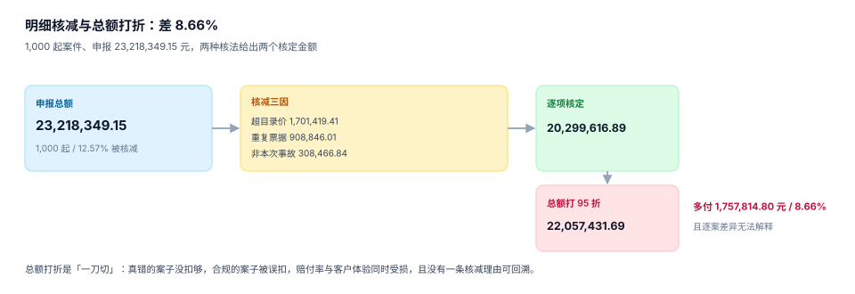

# 查勘定损与明细核定

定损是理赔里唯一一个「把物理损失翻译成金额」的环节。翻译的质量取决于两件事：**有没有逐项核**，以及**每一项的允许价从哪来**。

不逐项核，就只能按申报金额打折——看起来省事，实际上是把「该不该赔」和「赔多少」两件事混成了一件。

## 一、查勘任务：先固化事实，再谈金额

| 查勘类型 | 触发条件 | 必须产出 | 常见缺失 |
| --- | --- | --- | --- |
| 现场查勘 | 车损 ≥ 5,000 / 人伤 / 火灾 | 现场照片、事故认定书 | 照片没有拍摄时间 |
| 远程查勘 | 小额车损 | 视频、GPS 定位 | 定位与报案地点不符 |
| 单证查勘 | 医疗、财产 | 发票、清单、诊断证明 | 发票与清单金额不一致 |
| 复勘 | 争议、重开 | 复勘报告 | 复勘不引用原结论 |

**查勘报告的价值不在结论，在证据**。一份只写「损失约 4 万」的报告，三个月后无法支撑任何争议；一份写着「左前翼子板更换（配件 A-1231，目录价 2,800，实报 3,200）、喷漆 2 幅」的报告，任何时候都能复核。

## 二、明细核定：逐项核 vs 总额打折

本机 1,000 起案件、申报 23,218,349.15 元，两种核法给出两个数：



| 口径 | 金额 | 说明 |
| --- | --- | --- |
| 申报总额 | 23,218,349.15 | 客户/修理厂提交 |
| 逐项核定 | **20,299,616.89** | 按目录价 + 去重 + 除外，核减 12.57% |
| 总额打 95 折 | 22,057,431.69 | 一刀切，核减 5% |
| 两法差 | **1,757,814.80（8.66%）** | 总额法多付 |

逐项核减的构成：

| 理由码 | 核减金额 | 占比 |
| --- | --- | --- |
| `PRICE_CAP` 超目录价 | 1,701,419.41 | 58.3% |
| `DUPLICATE` 重复票据 | 908,846.01 | 31.1% |
| `NOT_COVERED` 非本次事故 | 308,466.84 | 10.6% |

总额打折的问题不在于「少了 8.66%」，而在于**三个理由被抹成了一个折扣**：真错的案子没扣够（超目录价 170 万只扣了 116 万），合规的案子被误扣（重复票据之外的正常单据也打了折），而且**没有一条核减能回答「凭什么」**——客诉时只能答「公司规定」。

::: danger 三个定损实现里的坑
1. **核减不写理由码**：`allowed_price = min(unit_price, cap)` 一行代码很优雅，但核减原因丢了。正确做法是 `allowed_price` 与 `cut_reason` 同写，且用 `CHECK (allowed_price = unit_price OR cut_reason IS NOT NULL)` 强制。
2. **用「总额 × 系数」代替逐项**：系数从哪来？通常是「去年的平均核减率」，于是今年的核减率永远等于去年，永远发现不了新的高报模式。
3. **重复票据只按发票号去重**：同一张发票换号重开、同一配件分两张单开，都能绕过。正确做法是按 `(code, qty, 金额)` 三元组在**同一赔案内**去重，并对跨赔案同号发票单独告警。
:::

## 三、目录价：允许价的来源必须可追溯

```sql
CREATE TABLE price_catalog (
  code        TEXT PRIMARY KEY,          -- 配件码 / 工时码 / 医疗项目码
  name        TEXT NOT NULL,
  cap_price   REAL NOT NULL CHECK (cap_price >= 0),
  effective_from TEXT NOT NULL,
  effective_to   TEXT,                   -- NULL 表示当前有效
  source      TEXT NOT NULL              -- 厂商指导价 / 医保目录 / 行业指导
);
```

三条纪律：

1. **目录价带生效区间**。配件涨价是常态，用「当前价」回溯核去年的案子，会得出「当时多赔了」的错误结论。
2. **允许价取「申报价与目录价孰低」**，不是「一律按目录价」。修理厂实际采购价低于目录价时，按实际价赔；高于时按目录价赔。
3. **目录价不是免赔依据**。目录价只回答「这个配件值多少」，免赔与限额是条款的事，两者不能混在一个函数里。

## 四、实际现金价值与重置成本

车损险按「实际价值」赔，财产险可能按「重置成本」赔。两者的差是折旧：

| 口径 | 计算 | 金额（重置成本 120,000，车龄 3 年，年折旧 15%） |
| --- | --- | --- |
| 重置成本 RC | 直接取新车价 | 120,000.00 |
| 实际现金价值 ACV（复利） | 120,000 × 0.85³ | **73,695.00** |
| 实际现金价值 ACV（直线） | 120,000 × (1 − 0.15 × 3) | 66,000.00 |
| RC 与 ACV（复利）之差 | — | 46,305.00（38.59%） |

复利与直线两种折旧口径差 **7,695 元**。选哪一种不是技术问题，是条款问题——但**必须在系统里显式存 `depreciation_method`**，不能一处用复利、一处用直线。

残值处理是同一件事的另一面：换下来的旧件归谁、值多少，要在定损结论里写 `salvage`，并从核定额里扣。不扣残值等于「赔了新件还把旧件留给客户」，这是审计最容易抓的一条。

## 五、定损与发票的偏差

核定额与最终发票金额不一致是常态（修理厂加项、客户自费升级）。系统要能回答两个问题：

1. **偏差有多大**：`(invoice_amount - assessed_amount) / assessed_amount`，超过阈值（建议 10%）触发复核。
2. **偏差花在谁身上**：客户自费的部分要写 `self_paid_amount`，否则会被误算成「公司少赔了」。

```sql
CREATE TABLE assessment (
  assessment_id   INTEGER PRIMARY KEY,
  claim_id        INTEGER NOT NULL UNIQUE REFERENCES claim(claim_id),
  assessed_amount REAL NOT NULL CHECK (assessed_amount >= 0),
  salvage         REAL NOT NULL DEFAULT 0 CHECK (salvage >= 0),
  basis           TEXT NOT NULL CHECK (basis IN ('RC','ACV','AGREED')),
  depreciation_method TEXT CHECK (depreciation_method IN ('COMPOUND','STRAIGHT')),
  assessed_at     TEXT NOT NULL,
  CHECK (salvage <= assessed_amount)
);
```

## 六、判据清单

本页判据族 `INA-A` ~ `INA-H`，共 8 条。

| 编号 | 判据 | 判定方式 |
| --- | --- | --- |
| `INA-A` | 定损必须有明细 | `assessment` 存在时，`assessment_item` 至少一行 |
| `INA-B` | 核减必须带理由码 | `CHECK (allowed_price = unit_price OR cut_reason IS NOT NULL)` |
| `INA-C` | 允许价不超过申报价 | `CHECK (allowed_price <= unit_price)` |
| `INA-D` | 目录价带生效区间 | `price_catalog` 有 `effective_from` / `effective_to` |
| `INA-E` | 折旧口径显式 | `depreciation_method` 有值，且同类产品口径一致 |
| `INA-F` | 残值不超过核定额 | `CHECK (salvage <= assessed_amount)` |
| `INA-G` | 发票偏差可观测 | 存在 `invoice_amount` 与偏差阈值 |
| `INA-H` | 重复票据可检出 | 同一赔案内 `(code, qty)` 重复时有告警或去重 |

## 七、验证方式

```shell
# 1) 核减无理由必须被拦住
sqlite3 /tmp/clm.db "INSERT INTO assessment_item VALUES (99,1,'PART-X',1,1200,900,NULL);"
# 期望：CHECK constraint failed: allowed_price = unit_price OR cut_reason IS NOT NULL

# 2) 允许价超过申报价必须被拦住
sqlite3 /tmp/clm.db "INSERT INTO assessment_item VALUES (98,1,'PART-Y',1,900,1200,'PRICE_CAP');"
# 期望：CHECK constraint failed: allowed_price <= unit_price

# 3) 折旧两口径复算
python3 -c "print(round(120000*0.85**3,2), round(120000*(1-0.15*3),2))"
# 期望：73695.0 66000.0

# 4) 明细汇总等于核定金额（应为 0 条不一致）
sqlite3 /tmp/clm.db "SELECT count(*) FROM assessment a WHERE a.assessed_amount <> (SELECT COALESCE(SUM(allowed_price*qty),0) FROM assessment_item i WHERE i.assessment_id=a.assessment_id);"
# 期望：0（若有残值，差额应等于 salvage）
```

## 参考资料

- [条款与责任判定：四问与四口径](../Coverage/index.md)
- [赔付、支付与追偿](../Payment/index.md)
- GB/T 36687—2018《保险术语》「实际价值」「重置成本」「残值」：<https://openstd.samr.gov.cn/>
- 机动车维修工时定额与配件价格管理的行业规范（交通运输部相关文件）：<https://www.mot.gov.cn/>
