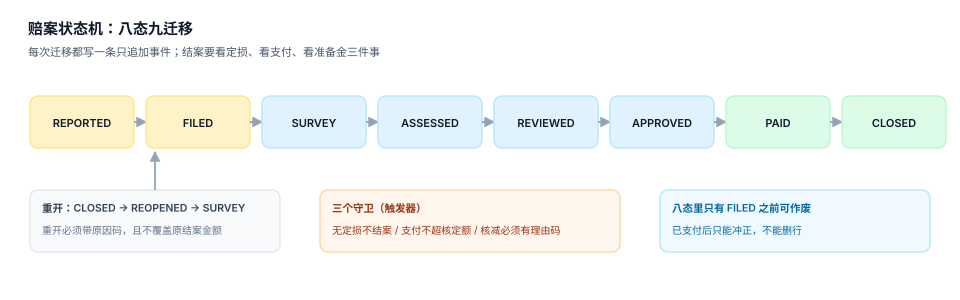

# 案件模型与状态机：八态九迁移

赔案是理赔系统的基本单元，但它不是「一张表」——它是**五样东西绑在一起**：一张保单、一个标的、一起事故、一次责任判定、一组给付。少了任何一样，后面的金额计算都会退化成「看着办」。

这一页讲三件事：赔案的五元组怎么落表、八个状态怎么迁移、事件链怎么重建。这三件事定下来，后面六页才有地方挂。

## 一、五元组：赔案不是一个编号

| 元素 | 回答的问题 | 表 | 关键约束 |
| --- | --- | --- | --- |
| 保单 | 按哪份合同赔 | `policy` | `policy_no` 唯一，限额与免赔落在这里 |
| 标的 | 赔的是哪件东西 | `subject` | `(policy_id, subject_key)` 唯一 |
| 事故 | 赔的是哪一次事件 | `incident` | `incident_key` 唯一（见 [报案归并](../Intake/index.md)） |
| 责任 | 条款允不允许赔 | `claim` + 条款参数 | 产品码 + 事故原因码 |
| 给付 | 赔哪些项目 | `assessment_item` | 项目码 + 允许金额 + 核减理由 |

```sql
CREATE TABLE claim (
  claim_id        INTEGER PRIMARY KEY,
  claim_no        TEXT NOT NULL UNIQUE,
  policy_id       INTEGER NOT NULL REFERENCES policy(policy_id),
  subject_id      INTEGER NOT NULL REFERENCES subject(subject_id),
  incident_id     INTEGER NOT NULL UNIQUE REFERENCES incident(incident_id),
  reported_at     TEXT NOT NULL,
  filed_at        TEXT,
  status          TEXT NOT NULL CHECK (status IN
                  ('REPORTED','FILED','SURVEY','ASSESSED','REVIEWED','APPROVED','PAID','CLOSED','REOPENED')),
  reported_amount REAL NOT NULL CHECK (reported_amount >= 0),
  CHECK (filed_at IS NULL OR filed_at >= reported_at)
);
```

三处约束值得单独说明：

1. **`incident_id` 上的 `UNIQUE`**。它不是「一个事故只能有一张赔案」的业务规则，而是「一起事故在本系统只能立案一次」的技术守卫。人伤 + 车损需要拆案时，拆的是**责任**，不是事故——`incident_id` 仍然只能被一张主赔案引用，子案通过 `parent_claim_id` 挂上去。
2. **`status` 用 `CHECK` 而不是枚举表**。枚举表更"规范"，但理赔系统的状态是与代码强耦合的（每个状态都有对应的界面与权限），放进表里只会让「代码支持八态、表里有十态」这种漂移长期存在。
3. **`reported_amount` 不许为负**。冲正不走负数，走独立的 `payment` 反向流水（见 [赔付与支付](../Payment/index.md)）。

## 二、八态九迁移

```text
REPORTED → FILED → SURVEY → ASSESSED → REVIEWED → APPROVED → PAID → CLOSED
                 ↘ REOPENED ↗
```



| 迁移 | 触发 | 必须留下的证据 |
| --- | --- | --- |
| `REPORTED → FILED` | 立案 | 事故指纹、单证清单 |
| `FILED → SURVEY` | 派工查勘 | 查勘员、派工时间 |
| `SURVEY → ASSESSED` | 提交定损 | 定损结论 + 明细 |
| `ASSESSED → REVIEWED` | 复核 | 复核人、复核意见 |
| `REVIEWED → APPROVED` | 审批 | 审批人、权限额度 |
| `APPROVED → PAID` | 支付成功 | 支付流水号 |
| `PAID → CLOSED` | 结案 | 准备金已释放 |
| `CLOSED → REOPENED` | 重开 | 原因码（新证据 / 计算错误 / 客户申诉） |
| `REOPENED → SURVEY` | 重新查勘 | 重开单号 |

**为什么是八个而不是十个**：`SURVEY` 与 `ASSESSED` 之间常有人想加「待补充材料」，`APPROVED` 与 `PAID` 之间常有人想加「待付款」。这两个状态都是**时间**，不是**阶段**——它们可以用 `survey_due_at`、`payment_due_at` 两个字段表达，加了状态只会让「这个案子到底走到哪了」更难回答。

::: danger 三个常见的状态机写错法
1. **用 `UPDATE` 直接改状态，不写事件**：三个月后客户申诉，你无法回答「当时是谁批的、批了多少」。正确做法是状态迁移与事件写入在同一个事务里。
2. **允许跨状态跳转**（如 `FILED → APPROVED`）：小案子看起来省事，但一旦出现争议，卷宗里没有查勘记录也没有定损记录，只剩一句「已审批」。
3. **重开时清空原结论**：`UPDATE claim SET status='REOPENED', assessed_amount=NULL`。正确做法是保留原结论，新增一条 `assessment` 版本（`version` 递增），让「第一次核了多少、第二次核了多少」都能查到。
:::

## 三、事件链：只追加，不更新

状态是「现在」，事件是「怎么走到现在」。两者必须能互相验证。

```sql
CREATE TABLE claim_event (
  event_id    INTEGER PRIMARY KEY,
  claim_id    INTEGER NOT NULL REFERENCES claim(claim_id),
  from_status TEXT,
  to_status   TEXT NOT NULL,
  at          TEXT NOT NULL,
  actor       TEXT NOT NULL,
  reason      TEXT
);
```

重建当前状态只需要一条窗口函数：

```sql
SELECT claim_id,
       to_status AS status,
       at
FROM (
  SELECT claim_id, to_status, at,
         row_number() OVER (PARTITION BY claim_id ORDER BY event_id DESC) AS rn
  FROM claim_event
)
WHERE rn = 1;
```

拿它和 `claim.status` 对比，差异条数就是「事件链与状态表不一致」的案子数——这是本专题五个正向自检之一（`C3`），正常情况下恒为 0。

## 四、重开：一个必须带原因的动作

重开是理赔系统里唯一「往回走」的迁移，也是最容易被滥用的一个。三条纪律：

1. **重开必须有原因码**，且原因码决定后续动作：`NEW_EVIDENCE`（重新查勘）、`CALC_ERROR`（重算，不查勘）、`CUSTOMER_APPEAL`（复核，不查勘）。
2. **重开不覆盖原结案金额**。`payment` 表里的历史流水不动，新赔款用新的 `pay_seq`。
3. **重开有次数上限**（建议 3 次）。超过就该走「争议处理」，而不是无限重开——无限重开的案子，账面上永远结不掉。

## 五、判据清单

本页判据族 `INM-A` ~ `INM-H`，共 8 条。

| 编号 | 判据 | 判定方式 |
| --- | --- | --- |
| `INM-A` | 赔案五元组齐全且各有外键 | `claim` 上三个外键 + 条款参数可从 `policy` 取到 |
| `INM-B` | 事故在系统内唯一 | `incident_id` 上存在 `UNIQUE` 或等价守卫，`C4` 查询为 0 |
| `INM-C` | 状态取值受约束 | `status` 有 `CHECK`，插入非法值报错 |
| `INM-D` | 时间不倒流 | `filed_at >= reported_at`，违者报错 |
| `INM-E` | 每次迁移都有事件 | `C3` 查询为 0 |
| `INM-F` | 事件只追加 | 代码中不存在 `UPDATE claim_event` / `DELETE FROM claim_event` |
| `INM-G` | 重开带原因码且不覆盖原金额 | 重开后 `payment` 历史行数与金额不变 |
| `INM-H` | 报案金额与核定金额分列 | 两个字段同时存在，且 `assessed ≤ reported` 不是硬约束（可超申报） |

::: warning 最后一条为什么不是硬约束
客户申报 30,000，查勘发现实际损失 45,000，核定额超过申报额是合法的（车险常见于「先估后修」）。把它写成 `CHECK (assessed <= reported)` 会让真实业务被卡住，然后开发去改约束——约束一改，这条判据就名存实亡。
:::

## 六、验证方式

```shell
# 1) 状态取值受约束：插入一个不存在的状态应失败
sqlite3 /tmp/clm.db "INSERT INTO claim VALUES (99,'C-X',1,1,1,'2026-01-01','2026-01-01','PENDING',0);"
# 期望：CHECK constraint failed: status IN (...)

# 2) 时间不倒流：立案早于报案应失败
sqlite3 /tmp/clm.db "INSERT INTO claim VALUES (98,'C-Y',1,1,2,'2026-02-01','2026-01-01','FILED',0);"
# 期望：CHECK constraint failed: filed_at IS NULL OR filed_at >= reported_at

# 3) 同一事故二次立案应失败
sqlite3 /tmp/clm.db "INSERT INTO claim VALUES (97,'C-Z',1,1,1,'2026-03-01','2026-03-01','FILED',0);"
# 期望：UNIQUE constraint failed: claim.incident_id

# 4) 事件链与状态表一致（应为 0）
sqlite3 /tmp/clm.db "SELECT count(*) FROM claim c WHERE c.status <> COALESCE((SELECT e.to_status FROM claim_event e WHERE e.claim_id=c.claim_id ORDER BY e.event_id DESC LIMIT 1),'');"
# 期望：0
```

## 参考资料

- [报案受理与归并：事故指纹怎么写](../Intake/index.md)
- [实战：九张表、三个触发器、十一条断言](../Practice/index.md)
- SQLite 外键与 `CHECK` 约束：<https://www.sqlite.org/lang_createtable.html>
- 状态机与事件溯源的分工，见库内 [事件溯源](../../EventSourcing/Overview/index.md)
