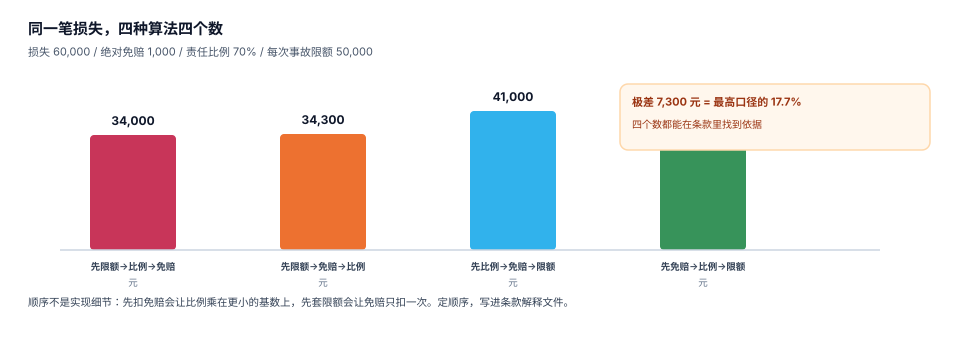

# 条款与责任判定：四问与四口径

核赔员每天要回答一个问题：「这个案子，条款允不允许赔、允许赔多少」。听起来是判断题，其实是四道判断题加一次算术：在不在保险期间、是不是承保风险、有没有踩除外责任、够不够等待期——四道都过了，才轮到算钱。

算钱这一步最容易被低估。同一份条款，「免赔、比例、限额」三步的先后顺序可以排出四个结果，极差 7,300 元（占最高口径的 17.7%）。这一页把四问、四型免赔、四口径顺序和不足额投保一次讲清。

## 一、四问：任何一条不过，就没有后面

| 问 | 判据 | 常见坑 | 后果 |
| --- | --- | --- | --- |
| ① 在不在保险期间 | `valid_from <= occurred_at < valid_to` | 用「报案时间」判断 | 跨期事故赔错年度 |
| ② 是不是承保风险 | `cause_code ∈ policy.covered_causes` | 用「事故描述」关键词匹配 | 「自燃」被当成「碰撞」 |
| ③ 有没有除外责任 | 除外清单命中即拒 | 除外只写在条款正文，没进系统 | 该拒的赔了，事后追不回 |
| ④ 够不够等待期 | `occurred_at >= valid_from + waiting_days` | 等待期用自然日还是保单年度 | 医疗险首月理赔争议 |

四问的顺序也不能换：先判期间再判原因，是因为**期间外的事故根本不需要看原因**；先判除外再判等待期，是因为除外是「永远不赔」，等待期是「暂时不赔」，两者对客户的说法完全不同。

::: danger 用「报案时间」替代「事故时间」
`WHERE reported_at BETWEEN valid_from AND valid_to` 是最常见的写法，也是最贵的一个。客户 12 月 31 日出险、1 月 2 日报案，按报案时间算就落到新保单年度——**上年末的准备金少提，新年初的赔付率突然飙升**，精算会来找你，但账面上一切正常。

正确写法只有一个：`occurred_at`，且它必须来自事故本身（查勘记录 / 交警认定书），不能默认等于报案时间。
:::

## 二、四型免赔额：名字像，行为完全不同

| 类型 | 规则 | 损失 9,999 | 损失 10,001 | 适用 |
| --- | --- | --- | --- | --- |
| 绝对免赔 | 赔款 = 损失 − 免赔额 | 8,999 | 9,001 | 车损险最常见 |
| 相对免赔（franchise） | 损失 ≤ 门槛不赔，超过则全赔 | **0** | **10,001** | 财产险、货运险 |
| 比例免赔 | 赔款 = 损失 × (1 − 比例) | 8,999.10 | 9,000.90 | 高免赔产品 |
| 免赔额 + 比例 | 先扣固定额再乘比例 | 8,099.10 | 8,100.90 | 组合型 |

本机读数（损失梯度 800 / 5,000 / 9,500 / 9,999 / 10,000 / 10,001 / 20,000，绝对免赔 1,000、相对免赔门槛 10,000、比例 10%）：

| 损失 | 绝对免赔 | 相对免赔 | 比例免赔 |
| --- | --- | --- | --- |
| 800 | 0.00 | 0.00 | 720.00 |
| 5,000 | 4,000.00 | 0.00 | 4,500.00 |
| 9,999 | 8,999.00 | 0.00 | 8,999.10 |
| 10,000 | 9,000.00 | 0.00 | 9,000.00 |
| 10,001 | 9,001.00 | **10,001.00** | 9,000.90 |
| 20,000 | 19,000.00 | 20,000.00 | 18,000.00 |

**相对免赔有一个 10,001 元的悬崖**：损失从 10,000 涨到 10,001，赔款从 0 跳到 10,001。这个断点在系统里必须能被解释——客户问「为什么多损失 1 元多赔 1 万」，客服要能指着条款说「这是相对免赔的定义」。

## 三、四口径顺序：写下来，别留给实现



| 顺序 | 表达式 | 结果（损失 60,000 / 免赔 1,000 / 比例 70% / 限额 50,000） |
| --- | --- | --- |
| 比例 → 免赔 → 限额 | `min(max(loss*ratio - ded, 0), cap)` | 41,000.00 |
| 免赔 → 比例 → 限额 | `min(max((loss - ded)*ratio, 0), cap)` | 41,300.00 |
| 限额 → 免赔 → 比例 | `min(max(min(loss,cap) - ded, 0)*ratio, cap)` | 34,300.00 |
| 限额 → 比例 → 免赔 | `min(max(min(loss,cap)*ratio - ded, 0), cap)` | 34,000.00 |

**极差 7,300 元**。四种写法都能自圆其说，所以顺序不能由开发定，必须写进「条款解释文件」，并在系统里做成**一个函数、一处调用**：

```python
from decimal import Decimal, ROUND_HALF_UP

def payable(loss, ratio, deductible, cap, mode="RATIO_DED_CAP"):
    d = lambda x: Decimal(str(x))
    loss, ratio, ded, cap = d(loss), d(ratio), d(deductible), d(cap)
    if mode == "RATIO_DED_CAP":
        v = min(max(loss * ratio - ded, 0), cap)
    elif mode == "DED_RATIO_CAP":
        v = min(max((loss - ded) * ratio, 0), cap)
    elif mode == "CAP_DED_RATIO":
        v = min(max(min(loss, cap) - ded, 0) * ratio, cap)
    elif mode == "CAP_RATIO_DED":
        v = min(max(min(loss, cap) * ratio - ded, 0), cap)
    else:
        raise ValueError("unknown mode")
    return v.quantize(Decimal("0.01"), rounding=ROUND_HALF_UP)
```

用 `Decimal` 不是洁癖：`0.1 + 0.2` 在浮点里是 `0.30000000000000004`，理赔金额要精确到分，且要能对上财务的账。

## 四、不足额投保：比例分摊与第一危险

保额 800,000，出险时实际价值 1,000,000，损失 300,000：

| 赔偿方式 | 计算 | 赔款 |
| --- | --- | --- |
| 比例分摊 | 300,000 × 800,000 / 1,000,000 | **240,000.00** |
| 第一危险 | min(300,000, 800,000) | **300,000.00** |

差 60,000 元（25%）。两种方式都合法，区别在条款怎么写：比例分摊（《保险法》第五十五条的不足额投保处理）是默认规则，第一危险需要条款明示。

系统里要存的是 `indemnity_basis`（`PRO_RATA` / `FIRST_LOSS` / `AGREED_VALUE`），而不是在代码里 `if 保额 < 实际价值` 猜。**实际价值本身也是一个估计**（见 [查勘定损](../Assessment/index.md) 的 ACV 与 RC），两个估计相乘，误差会放大。

## 五、条款参数化：把「解释」变成数据

```sql
CREATE TABLE policy (
  policy_id       INTEGER PRIMARY KEY,
  policy_no       TEXT NOT NULL UNIQUE,
  product_code    TEXT NOT NULL,
  sum_insured     REAL NOT NULL CHECK (sum_insured > 0),
  deductible      REAL NOT NULL DEFAULT 0 CHECK (deductible >= 0),
  deductible_kind TEXT NOT NULL CHECK (deductible_kind IN ('ABSOLUTE','FRANCHISE','RATIO')),
  deductible_ratio REAL NOT NULL DEFAULT 0 CHECK (deductible_ratio BETWEEN 0 AND 1),
  limit_per_claim REAL NOT NULL CHECK (limit_per_claim > 0),
  indemnity_basis TEXT NOT NULL CHECK (indemnity_basis IN ('PRO_RATA','FIRST_LOSS','AGREED_VALUE')),
  waiting_days    INTEGER NOT NULL DEFAULT 0 CHECK (waiting_days >= 0),
  valid_from      TEXT NOT NULL,
  valid_to        TEXT NOT NULL,
  status          TEXT NOT NULL CHECK (status IN ('IN_FORCE','LAPSED','CANCELLED')),
  CHECK (valid_to > valid_from)
);
```

`deductible_kind` 这一列是整个页面最重要的设计：**四型免赔的差异不在金额，而在规则形态**。只存 `deductible = 1000` 的库，永远算不出相对免赔的悬崖。

## 六、判据清单

本页判据族 `INP-A` ~ `INP-H`，共 8 条。

| 编号 | 判据 | 判定方式 |
| --- | --- | --- |
| `INP-A` | 期间判断用事故时间 | SQL 中不出现 `reported_at BETWEEN valid_from` |
| `INP-B` | 承保风险是枚举，不是文本匹配 | `cause_code` 有白名单 |
| `INP-C` | 除外责任进系统 | 存在 `exclusion` 表或 `product_code` 维度的除外清单 |
| `INP-D` | 免赔类型可区分 | `deductible_kind` 三值齐全，相对免赔有悬崖用例 |
| `INP-E` | 计算顺序唯一 | 全系统只有一个 `payable()` 实现，或一个 SQL 函数 |
| `INP-F` | 顺序写进解释文件 | 存在非代码载体（Markdown / 条款附件）说明顺序 |
| `INP-G` | 不足额投保有显式依据 | `indemnity_basis` 有值，不靠 `if 保额 < 实际价值` 推断 |
| `INP-H` | 金额用定点数 | 代码中不出现 `float` 直接累加金额 |

## 七、验证方式

```shell
# 1) 四口径结果（Python 标准库 Decimal，可直接复跑）
python3 - <<'PY'
from decimal import Decimal as D
loss, ded, ratio, cap = D("60000"), D("1000"), D("0.70"), D("50000")
print(min(max(loss*ratio-ded,0),cap), min(max((loss-ded)*ratio,0),cap))
print(min(max(min(loss,cap)-ded,0)*ratio,cap), min(max(min(loss,cap)*ratio-ded,0),cap))
PY
# 期望：41000.00 41300.00 / 34300.00 34000.00

# 2) 相对免赔的悬崖（10,000 与 10,001）
python3 -c "f=lambda L: 0 if L<=10000 else L; print(f(10000), f(10001))"
# 期望：0 10001

# 3) 不足额投保的比例分摊
python3 -c "print(round(300000*800000/1000000,2))"
# 期望：240000.0
```

## 与「承保与保单管理」专题的分工（第 247 天补充）

本页四道判断题里的第②道「是不是承保风险」直接依赖 `coverage` 表。那份数据由承保侧生成，边界如下：

| 问题 | 读哪一册 | 本页不重复讲 |
| --- | --- | --- |
| 这张保单适用哪一版条款 | [险种、条款与责任](../../UnderwritingPolicy/ProductModel/index.md) | 版本生效期与「按起保日归版」 |
| 除外责任是怎么被写进合同的 | [核保与风险选择](../../UnderwritingPolicy/Underwriting/index.md) | 五结局里 `EXCLUSION` 的落库位置 |
| 免赔额、等待期、赔付比例存在哪 | [险种、条款与责任](../../UnderwritingPolicy/ProductModel/index.md) | 责任参数是字段不是条款正文 |
| 四道判断题与计算顺序 | 本页 | 承保侧只保证参数正确 |

::: danger 本页特有的一个坑：条款版本变更后，旧保单的除外项不能跟着变
本机 18,000 张保单里 **31.12%（5,602 张）跨版本**——起保在旧版期内、终止在新版期内。如果 `coverage` 按 `product_code` 关联（而不是按 `clause_id`），条款一升级，这 5,602 张合同的除外项会被静默替换。理赔侧的判断依据必须是**保单上冻结的 `clause_id`**，不能是「该险种当前生效的条款」。
:::

## 参考资料

- [查勘定损与明细核定](../Assessment/index.md)
- [赔付、支付与追偿](../Payment/index.md)
- 《中华人民共和国保险法》第五十五条（不足额保险的比例赔付）：<https://www.gov.cn/>
- GB/T 36687—2018《保险术语》「免赔额」「责任限额」「实际价值」：<https://openstd.samr.gov.cn/>
- Python `decimal` 模块（定点数与舍入模式）：<https://docs.python.org/3/library/decimal.html>
