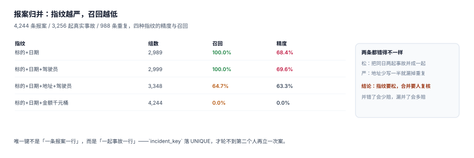

# 报案受理与归并：事故指纹怎么写

同一起事故，客户可能打三次电话：第一次说撞了，第二次补充对方车牌，第三次催进度。三个电话在系统里是三条报案，如果每条都立案，就会赔三次（或者更糟：赔一次、拒两次，客户投诉）。

反过来，同一个客户同一天在同一路口被别人追尾两次（真的发生过），如果系统把所有「同标的 + 同日期」都并成一起，客户就少赔一次。

归并这件事没有「对」的答案，只有**你愿意承担哪一种错**。这一页把四种指纹的代价都量出来，再给出可落地的写法。

## 一、报案不是赔案，事故才是主体

| 概念 | 一次事故会产生 | 可否重复 | 唯一键 |
| --- | --- | --- | --- |
| 报案（report） | 1~N 条（多渠道路径） | 可以 | `report_no` |
| 事故（incident） | 恰好 1 条 | 不可以 | `incident_key` |
| 赔案（claim） | 1~N 张（多保单 / 多责任） | 按责任拆 | `claim_no` |

关键设计：**报案与事故是「多对一」，事故与赔案是「一对多」**。把报案直接当赔案，等于承认「客户打几次电话就赔几次」；把事故与赔案做成一对一，等于承认「一次事故只能有一张保单赔」。

## 二、事故指纹：四个字段，四种代价

指纹的候选字段只有四个：标的、日期、地点、驾驶员（或受损部位）。组合方式决定精度与召回：



| 指纹 | 合并后组数 | 召回 | 精度 | 主要错法 |
| --- | --- | --- | --- | --- |
| 标的 + 日期 | 2,989 | 100.0% | 68.4% | 把同日两起事故并成一起 |
| 标的 + 日期 + 驾驶员 | 2,999 | 100.0% | 69.6% | 同上（同一驾驶员一天两次） |
| 标的 + 日期 + 地址 + 驾驶员 | 3,348 | 64.7% | 63.3% | 地址少写一半就漏并 |
| 标的 + 日期 + 金额千元桶 | 4,244 | 0.0% | 0.0% | 金额一改就完全对不上 |

读数来自本机 4,244 条报案 / 3,256 起真实事故（其中 23.3% 的案子会被二次报案，8% 的标的同一天真有两起事故）。

三条结论，与直觉相反：

1. **加字段不一定更准**。「标的 + 日期 + 地址」看起来更严格，但地址是**自由文本**，多渠道录入时 35% 会写得不一致（「杭州市西湖区文一西路」vs「西湖区」），结果是漏并 349 条，召回掉到 64.7%，精度还降了 6 个点——因为漏并的重复报案被当成了新案子，而误并的那部分一起留了下来。
2. **金额不能进指纹**。客户第一次报 8,000、第二次报 9,500 是常态，按金额分桶等于「永不归并」，召回 0。
3. **精度 68% 意味着三成的合并是错的**。这个数字不是实现缺陷，而是「只看结构化字段」的上限——要往上走，必须引入人工复核或模糊匹配（地址归一化 + 编辑距离），而不是继续加字段。

::: danger 三个把归并做坏的做法
1. **用报案时间做指纹**：同一事故两次报案相差 20 分钟，指纹不同，归并率约等于 0。
2. **自动合并后不允许拆**：并错了要能拆。设计上要给 `claim_merge` 表（`from_claim_id`、`to_claim_id`、`merged_at`、`merged_by`），拆的时候按记录反向还原，而不是「删掉重来」。
3. **把归并做成「去重删除」**：重复报案的那条记录不能删——它是「客户确实打过这个电话」的证据。正确做法是保留报案行，把它指向同一个 `incident_id`。
:::

## 三、可落地的指纹写法

```sql
CREATE TABLE incident (
  incident_id  INTEGER PRIMARY KEY,
  incident_key TEXT NOT NULL UNIQUE,   -- 指纹
  occurred_at  TEXT NOT NULL,
  location     TEXT NOT NULL,
  cause_code   TEXT NOT NULL
);

CREATE TABLE report (
  report_id    INTEGER PRIMARY KEY,
  report_no    TEXT NOT NULL UNIQUE,   -- 渠道单号，幂等键
  channel      TEXT NOT NULL CHECK (channel IN ('APP','HOTLINE','AGENT','PARTNER')),
  subject_key  TEXT NOT NULL,
  occurred_on  TEXT NOT NULL,          -- 只到日，不到秒
  location_raw TEXT NOT NULL,
  driver_name  TEXT,
  incident_id  INTEGER REFERENCES incident(incident_id),  -- 归并结果
  received_at  TEXT NOT NULL
);
```

指纹的生成规则（应用层，便于调整而不改表）：

```python
import hashlib, re

def norm_name(s: str) -> str:
    return re.sub(r"\s+", "", s or "")

def incident_key(subject_key: str, occurred_on: str, driver: str) -> str:
    raw = "|".join([subject_key, occurred_on, norm_name(driver)])
    return hashlib.sha1(raw.encode("utf-8")).hexdigest()[:16]
```

三处刻意：

- **`occurred_on` 只到日**。到秒会让「客户说 8:20、查勘说 8:25」变成两起事故。
- **姓名去空白**。「张 伟」与「张伟」是同一个人，不去空白就漏并。
- **不把地址放进键**，而是留给复核环节做**辅助判断**（同键但地址差异大 → 标记为「疑似误并」）。

## 四、五步受理流程

```text
① 收（渠道单号幂等） → ② 归一（姓名/日期/车牌） → ③ 算指纹
   → ④ 查重（同键是否存在） → ⑤ 建案或挂接（挂接要写 merge 记录）
```

第 ① 步的幂等键是**渠道单号**，不是赔案号。原因很直接：客户在 App 上点两次「提交」，服务端收到两次请求，两次都该返回同一个 `report_no`，而不是建两条报案。

```sql
-- 幂等上报：同一个渠道单号只落一行
INSERT INTO report (report_no, channel, subject_key, occurred_on, location_raw, driver_name, received_at)
VALUES (?, ?, ?, ?, ?, ?, ?)
ON CONFLICT (report_no) DO NOTHING;

SELECT report_id, incident_id FROM report WHERE report_no = ?;
```

## 五、归并之后：三件事必须跟着做

1. **未立案池要清**。重复报案归并后，原报案行仍在池子里，如果不改状态，坐席会反复看到「待立案」。
2. **单证要合并**。两次报案各自上传了照片，归并后应汇总到同一个事故下，且保留来源（否则查勘员只看到一半材料）。
3. **时效要取最早**。报案到立案的时长，第二次报案不能重新计时——用 `min(received_at)`，否则归并反而让时效变好看。

## 六、判据清单

本页判据族 `INK-A` ~ `INK-H`，共 8 条。

| 编号 | 判据 | 判定方式 |
| --- | --- | --- |
| `INK-A` | 报案与事故分离 | 存在 `report.incident_id`，且 `report` 无 `UNIQUE(incident_id)` |
| `INK-B` | 事故指纹有唯一约束 | `incident.incident_key` 为 `UNIQUE` |
| `INK-C` | 渠道单号幂等 | 同 `report_no` 重复提交只落一行 |
| `INK-D` | 指纹不含秒级时间 | 指纹输入只有日期 |
| `INK-E` | 姓名归一化 | 指纹输入经过空白字符归一 |
| `INK-F` | 归并可拆 | 存在 `claim_merge` 或等价反查表 |
| `INK-G` | 归并后时效取最早 | 报案到立案时长用 `min(received_at)` |
| `INK-H` | 归并率与误并率可观测 | 报表同时给出「合并条数」与「被拆回条数」 |

## 七、验证方式

```shell
# 1) 同一个渠道单号提交两次，只应落一行
sqlite3 /tmp/clm.db "INSERT INTO report VALUES (1,'R-001','APP','VIN-1','2026-03-14','杭州市西湖区','张伟',NULL,'2026-03-14 09:02');"
sqlite3 /tmp/clm.db "INSERT INTO report (report_no,channel,subject_key,occurred_on,location_raw,driver_name,received_at) VALUES ('R-001','APP','VIN-1','2026-03-14','杭州市西湖区','张伟','2026-03-14 09:02') ON CONFLICT (report_no) DO NOTHING;"
sqlite3 /tmp/clm.db "SELECT count(*) FROM report WHERE report_no='R-001';"
# 期望：1

# 2) 归并后同一事故只挂一个赔案
sqlite3 /tmp/clm.db "SELECT r.report_no, r.incident_id FROM report r WHERE r.incident_id IS NOT NULL;"
# 期望：多条报案共享同一个 incident_id

# 3) 指纹复算（可复跑）
python3 -c "import hashlib; print(hashlib.sha1('VIN-1|2026-03-14|张伟'.encode()).hexdigest()[:16])"
# 期望：一个固定的 16 位十六进制串（与你库里 incident_key 一致）
```

## 参考资料

- [案件模型与状态机：八态九迁移](../ClaimModel/index.md)
- [条款与责任判定：四问与四口径](../Coverage/index.md)
- SQLite UPSERT（`ON CONFLICT DO NOTHING`）：<https://www.sqlite.org/lang_upsert.html>
- 实体解析与分块召回的一般方法，见库内 [客户身份归并](../../CustomerIdentity/Overview/index.md)
