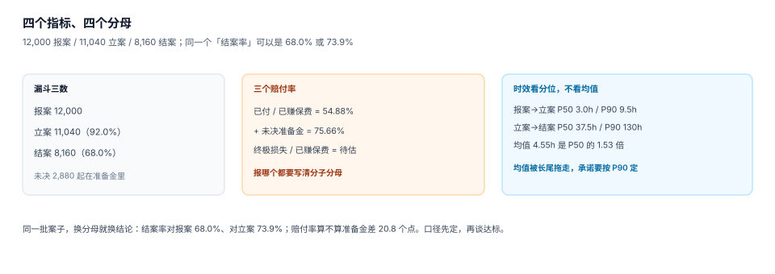

# 度量与反欺诈：四个分母

理赔的指标不多，但每一个都有至少三个分母。同一个「结案率」，对报案算是 68.0%，对立案算是 73.9%——差 5.9 个百分点，足够决定一个分公司今年是达标还是挨批。

这一页把四个核心指标（结案率、赔付率、案均、时效）的分子分母定死，再讲反欺诈的成本结构——因为反欺诈是唯一一个「做得越好，短期报表越难看」的动作。

## 一、四个指标，十二个分母

| 指标 | 分子 | 分母选项 | 本机读数 |
| --- | --- | --- | --- |
| 结案率 | 已结案件数 | 报案数 / 立案数 / 期初未决 | 68.0% / 73.9% |
| 赔付率 | 已付赔款 | 已赚保费 / 签单保费 / 满期保费 | 54.88% / — |
| 案均赔款 | 已付赔款 | 已结案件数 / 已立案件数 | 5,784.23 |
| 时效 | 各节点时间差 | 自然小时 / 工作小时 | P50 3.0h / P90 9.5h |



**定分母的规矩只有一条：分母必须和分子是同一批案子**。用「已付赔款 / 签单保费」算出来的赔付率，分子是今年赔的（含往年案子的后续赔款），分母是今年卖的（大部分还没到期），两个不是一批，这个数没有意义。

## 二、赔付率：三个口径必须同时报

| 口径 | 公式 | 本机读数 | 用途 |
| --- | --- | --- | --- |
| 已付赔付率 | 已付 / 已赚保费 | 54.88% | 现金流视角 |
| 综合赔付率 | （已付 + 未决准备金）/ 已赚保费 | **75.66%** | 经营视角（对外口径） |
| 终极赔付率 | 终极损失 / 已赚保费 | 待精算 | 定价视角 |

只报「已付赔付率」是最常见的误导：**它永远比真实值低**，因为还没赔的钱不在分子里。本机差 **20.78 个百分点**，足够让一个亏损业务看起来盈利。

::: danger 三个度量上的常见错法
1. **赔付率不扣追偿**：追回的 80,000 记在费用里，赔付率虚高 1.6 个点（见 [赔付与支付](../Payment/index.md)）。
2. **时效用平均值**：报案到立案均值 4.55 小时，P50 只有 2.98 小时——均值是 P50 的 1.53 倍，说明长尾很长。承诺应该按 P90 定，考核按 P90 考。
3. **案均赔款跨险种比较**：车险案均 5,784 与医疗险案均 3,200 放在一张表里排名，结论必然是「车险赔得多」——这不是发现，是算术。
:::

## 三、时效：三个节点，两把尺子

| 节点 | 起点 | 终点 | 本机 P50 | P90 | P99 |
| --- | --- | --- | --- | --- | --- |
| 报案到立案 | `received_at` | `filed_at` | 2.98 h | 9.52 h | 26.27 h |
| 立案到结案 | `filed_at` | 结案时间 | 37.54 h | 130.36 h | 407.16 h |
| 报案到到账 | `received_at` | `paid_at` | — | — | — |

两把尺子是**自然小时**与**工作小时**。工作日 9:00-18:00 之外的时间不算，P90 会显著变好看（因为大部分等待发生在夜里）。用哪把尺子要写在指标定义里，且**同一张报表不能混用**。

第三个节点（报案到到账）是最贴近客户体验的，但也是最难算的——它跨越了支付系统，需要把银行回单时间回写。很多公司只统计到「结案」，客户体验的最后一公里没有度量。

## 四、反欺诈：精度与召回的交换

反欺诈规则的输出不是「欺诈 / 不欺诈」，而是「要不要查」。查，要花钱；不查，可能赔错。

本机 10,000 起案子、真实欺诈率 3.23%：

| 指标 | 读数 |
| --- | --- |
| 命中案件 | 386 |
| 其中真欺诈（TP） | 222 |
| 其中误杀（FP） | 164 |
| 漏掉（FN） | 101 |
| 精度 | **57.51%** |
| 召回 | 68.73% |
| 拦截金额 | 2,664,000.00 |
| 调查成本（386 × 800） | 308,800.00 |
| 其中误杀成本（164 × 800） | 131,200.00 |
| 净收益 | 2,355,200.00 |

**精度 57.51% 意味着每查两个案子就有一个是白查的**。这个数字不难看——只要误杀成本（每案 800）远低于欺诈金额（每案 12,000），就值得查。判断规则很简单：

```text
值得查 ⟺ 精度 × 案均欺诈金额 > 单案调查成本
        ⟺ 0.5751 × 12,000 = 6,901 > 800
```

但如果把规则放宽（多查 1,000 个案子，多抓 30 个真欺诈），边际收益是 `30 × 12,000 = 360,000`，边际成本是 `1,000 × 800 = 800,000`——**这时候不该放宽**。这条边际判据比任何「命中率」都更能指导规则调优。

## 五、日报五行

每天早上只看五个数，每个数都带分母：

```text
① 昨日报案 412 / 立案 379（92.0%）/ 结案 96
② 已付 5,412,300.00 / 未决准备金 41,000,000（充足率 98.2%）
③ 时效 P50 3.0h / P90 9.5h（超 24h 的 12 件）
④ 反欺诈命中 14 / 确认 8 / 误杀 6（精度 57.1%）
⑤ 追偿回收 82,000.00（冲减赔款 62,000 / 冲减费用 20,000）
```

五行的设计原则：**每一行都能回答「比昨天好还是坏」，且不依赖上一行**。第五行的拆分尤其重要——冲减口径不统一时，总回收额好看，赔付率不变。

## 六、判据清单

本页判据族 `INT-A` ~ `INT-H`，共 8 条。

| 编号 | 判据 | 判定方式 |
| --- | --- | --- |
| `INT-A` | 每个指标有唯一定义 | 存在指标字典，分子分母各一句 |
| `INT-B` | 结案率报两个分母 | 对报案 / 对立案同时给出 |
| `INT-C` | 赔付率至少报两个口径 | 已付与综合（含准备金） |
| `INT-D` | 时效按分位报 | P50 / P90 / P99 同时给出 |
| `INT-E` | 时效尺子显式 | 自然小时或工作小时，同一报表只用一种 |
| `INT-F` | 反欺诈报精度与召回 | 命中数、TP、FP、FN 四个数齐全 |
| `INT-G` | 反欺诈成本可算 | 调查成本与欺诈金额都有值 |
| `INT-H` | 案均不跨险种混算 | 报表按 `product_code` 分组 |

## 七、验证方式

```shell
# 1) 结案率两个分母
python3 -c "print(round(8160/12000*100,2), round(8160/11040*100,2))"
# 期望：68.0 73.91

# 2) 赔付率两个口径
python3 -c "paid=47199316.8; res=17870800; prem=86000000; print(round(paid/prem*100,2), round((paid+res)/prem*100,2))"
# 期望：54.88 75.66（综合口径 = 已付 + 未决准备金）

# 3) 反欺诈的边际判据
python3 -c "print(round(0.5751*12000,2), 800)"
# 期望：6901.2 800（精度 × 案均 > 单案成本，规则值得保留）
```

::: tip 一个不必自己算的结论
所有指标都不需要「更复杂」，需要的是**定义写在报表上**。一张写着「结案率 68.0%（分母：报案数 12,000）」的报表，比一张写着「结案率 73.9%」的报表有用十倍——后者看起来更好，但你无法判断它是不是换了分母。
:::

## 参考资料

- [准备金与 IBNR：三角怎么读](../Reserve/index.md)
- [常见问题与分诊](../FAQ/index.md)
- 保险行业赔付率与费用率的监管口径（原银保监会统计制度）：<http://www.cbirc.gov.cn/>
- 精度 / 召回 / 边际成本的通用表述，见库内 [实时风控决策](../../RiskDecision/Overview/index.md)
