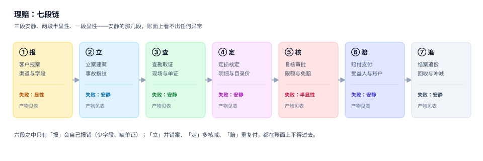
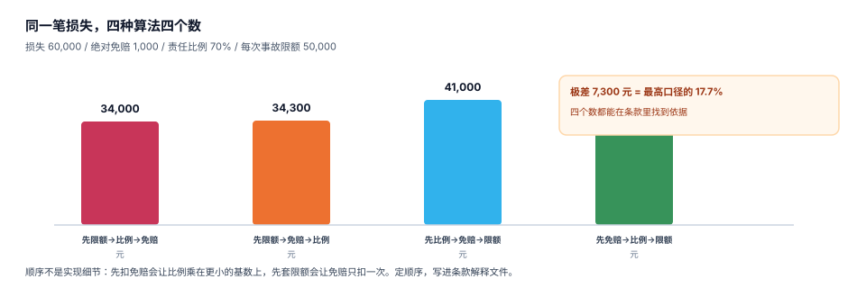

# 总览：七段链与三个「赔多少」

理赔系统的输入是一次事故，输出是一个金额。中间隔着七段作业，每段都会产生自己的「结论」，而结论之间并不天然一致——查勘员说损失 60,000，核赔员说条款只允许 41,000，财务说已经付了 41,000，客户说还差 19,000。四个数字都对，因为它们回答的是四个不同的问题。

这一页要做三件事：把七段链讲清楚、把三个「赔多少」分开、把四个必失接缝标出来。后面九页都在补这三件事的细节。

## 一、七段链：每段都在产生一个「结论」

| 段 | 输入 | 动作 | 产物 | 结论形态 | 失败是否安静 |
| --- | --- | --- | --- | --- | --- |
| ① 报 | 客户叙述 | 收字段、收单证 | 报案单 | 「发生了什么」 | 显性 |
| ② 立 | 报案单 | 建案、写事故指纹 | `claim` | 「这是哪一起事故」 | **安静** |
| ③ 查 | 赔案 | 现场查勘、取证 | 查勘记录 | 「事实是什么」 | **安静** |
| ④ 定 | 查勘记录 + 单据 | 逐项核定、核减 | `assessment` | 「损失值多少」 | **安静** |
| ⑤ 核 | 定损结论 + 条款 | 套限额、扣免赔、算比例 | 核赔结论 | 「条款允许赔多少」 | 半显性 |
| ⑥ 赔 | 核赔结论 | 计算实付、支付 | `payment` | 「实际付了多少」 | **安静** |
| ⑦ 追 | 赔案 + 责任方 | 追偿、回收、释放准备金 | `recovery` | 「最后净损失多少」 | **安静** |



**为什么只有第 ① 段是显性的**：报案是唯一一个「外部输入直接进系统」的环节，字段缺失、单证不全、车牌格式不对，校验当场就能拦。从第 ② 段开始，每一段的输入都是**上一段认为对的东西**——上一段错了，这一段没有能力发现。

举一个最典型的例子：第 ② 段把同一天的两起刮蹭并成了一起（因为指纹只用了「标的 + 日期」），第 ④ 段照样按合并后的材料定损，第 ⑥ 段照样付款。全过程没有一处报错，客户拿到钱也不会投诉——**他只是少拿了一次赔款，而那一次根本没有立案**。

## 二、三个「赔多少」

| 口径 | 公式 | 谁在关心 | 常见错法 |
| --- | --- | --- | --- |
| 责任额 | `min(损失 × 责任比例, 每次事故限额)` | 核赔员 | 用「保额」当限额 |
| 核定额 | `Σ 明细允许金额 − 残值` | 查勘员 / 核赔员 | 用申报金额打折 |
| 实付额 | `核定额 − 免赔额 − 已付 + 追回` | 财务 / 客户 | 把追回记进费用 |

三者必须分列存。合在一起，就再也回答不了「为什么这个案子只赔了 41,000」。

### 一个必须自己算一遍的例子

损失 60,000，绝对免赔 1,000，责任比例 70%，每次事故限额 50,000。四步的先后顺序不同，结果如下：

| 顺序 | 计算过程 | 结果 |
| --- | --- | --- |
| 先比例 → 免赔 → 限额 | 60,000 × 0.7 = 42,000；−1,000 = 41,000；min(50,000) | **41,000.00** |
| 先免赔 → 比例 → 限额 | 60,000 − 1,000 = 59,000；× 0.7 = 41,300；min(50,000) | **41,300.00** |
| 先限额 → 免赔 → 比例 | min(60,000, 50,000) = 50,000；−1,000 = 49,000；× 0.7 | **34,300.00** |
| 先限额 → 比例 → 免赔 | 50,000 × 0.7 = 35,000；−1,000 | **34,000.00** |



**极差 7,300 元，占最高口径的 17.7%**。四个数都能在条款里找到「依据」，因为它们对应四种不同的条款表述：免赔额是「每次事故扣除」还是「赔款计算后扣除」，限额是「损失限额」还是「赔款限额」，条款里通常只有一句话，而这句话决定了四个数中的哪一个。

::: danger 顺序必须写进条款解释文件，不能留给实现
1. **不要用「看起来合理」的顺序**：`min(max(loss * ratio - ded, 0), limit)` 和 `min(max(min(loss, limit) - ded, 0) * ratio, limit)` 都「看起来合理」，差 6,700 元。
2. **不要把顺序写进代码注释**：条款解释文件是核赔、审计、客服三方共用的依据，代码注释只有开发看得见。
3. **不要在一个系统里混用两种顺序**：车险按「先限额」、财产险按「先免赔」，混用之后同一个客户的两张保单会给出互相矛盾的答案。
:::

## 三、四个必失接缝

接缝是两段之间的交界，也是「两边都以为对方会管」的地方。

| 接缝 | 左边认为 | 右边认为 | 实际丢失的东西 |
| --- | --- | --- | --- |
| ② → ③ | 案子已建，材料齐了 | 材料不齐也能先查勘 | 单证清单没有强制项 |
| ④ → ⑤ | 定损已核减到位 | 核赔会再核一遍 | 核减理由码缺失，复核无从下手 |
| ⑤ → ⑥ | 核定额就是上限 | 支付按核定额放行 | 多张保单分摊时上限被各自套用 |
| ⑥ → ⑦ | 钱付完了，案子快关了 | 追偿是另一个部门的事 | 回收没有冲减赔款，赔付率虚高 |

四个接缝的共同点是**责任在中间，记录在两边**。修法不是加流程，而是给每个接缝留一个可判定的字段：单证清单的 `required` 标记、核减的 `cut_reason`、支付的 `pay_seq` 与 `UNIQUE(claim_id, pay_seq)`、回收的 `offset_target`。

## 四、五个角色，四种视角

| 角色 | 关心 | 看哪个数 | 典型诉求 |
| --- | --- | --- | --- |
| 报案坐席 | 快 | 报案单完整度 | 「能不能先受理后补材料」 |
| 查勘员 | 准 | 损失明细 | 「现场就这些，别再让我跑一趟」 |
| 核赔员 | 合规 | 责任额 | 「条款允许的上限在哪」 |
| 财务 | 对 | 实付额 | 「这个月和银行流水对不对得上」 |
| 再保 / 精算 | 稳 | 准备金 | 「未决赔款够不够」 |

四种视角对应四个数，任何两个角色拿同一个字段去对，都会吵起来。系统的责任是**让每个人拿到自己那个数，且四个数之间的换算关系可追溯**。

## 五、这一册的边界

本册讲的是「赔案本身」：案件模型、报案归并、条款判定、定损核定、赔付支付、准备金、度量。

不讲的内容与去处：

- 保单承保、批改、续保：属于承保系统，本册只假设保单参数可用。
- 会计分录与总账：见 [记账与分录](../../Ledger/DoubleEntry/index.md)。
- 资金头寸与银行对账：见 [资金管理](../../Treasury/Overview/index.md)。
- 客服工单与 SLA：见 [客服工单](../../SupportTicket/Overview/index.md)。
- 反洗钱与制裁名单：见 [隐私工程](../../../Others/PrivacyEngineering/index.md) 与合规相关页面。

## 六、判据清单

本页判据族 `INO-A` ~ `INO-H`，共 8 条。

| 编号 | 判据 | 判定方式 |
| --- | --- | --- |
| `INO-A` | 七个环节各自有一个持久化产物 | 每段至少一张表或一个视图，缺一即不成立 |
| `INO-B` | 三个「赔多少」分列存储 | 责任额 / 核定额 / 实付额三个字段同时存在，不允许只有一个 `amount` |
| `INO-C` | 每段的失败形态被显式标注 | 链上每一段都能回答「错了会不会报错」 |
| `INO-D` | 条款计算顺序写进解释文件 | 存在一份可被非开发人员读懂的顺序说明 |
| `INO-E` | 四个接缝各有一个可判定字段 | 单证 `required` / 核减 `cut_reason` / 支付 `pay_seq` / 回收 `offset_target` |
| `INO-F` | 赔案状态与事件链可重建 | 任意赔案能按事件表回放出当前状态 |
| `INO-G` | 同一事故只能有一个赔案主体 | `incident_key` 上有唯一约束或等价守卫 |
| `INO-H` | 度量口径与金额口径一致 | 报表里出现的每个率都能追到分子分母定义 |

## 七、验证方式

```shell
# 1) 建库并确认九张表（完整 DDL 见 Practice 页）
sqlite3 /tmp/clm.db < /tmp/clm_schema.sql
sqlite3 /tmp/clm.db ".tables"
# 期望：assessment assessment_item claim claim_event incident payment policy reserve subject

# 2) 三个金额字段必须同时存在（少一个就说明被合并了）
sqlite3 /tmp/clm.db "SELECT count(*) FROM pragma_table_info('claim') WHERE name IN ('reported_amount');"
# 期望：1（申报额）；责任额与实付额分别在 assessment 与 payment 里，见下一行

# 3) 同一事故不允许两个赔案
sqlite3 /tmp/clm.db "SELECT count(*) FROM (SELECT incident_id FROM claim GROUP BY incident_id HAVING count(*)>1);"
# 期望：0

# 4) 四口径计算可复算（Python 标准库，不依赖第三方包）
python3 -c "loss,ded,ratio,cap=60000,1000,.7,50000; print(min(max(loss*ratio-ded,0),cap), min(max((loss-ded)*ratio,0),cap), min(max(min(loss,cap)-ded,0)*ratio,cap), min(max(min(loss,cap)*ratio-ded,0),cap))"
# 期望：41000.0 41300.0 34300.0 34000.0
```

## 参考资料

- [案件模型与状态机：八态九迁移](../ClaimModel/index.md)
- [条款与责任判定：四问与四口径](../Coverage/index.md)
- 《中华人民共和国保险法》第五十五条（不足额投保的比例赔付）：<https://www.gov.cn/>
- GB/T 36687—2018《保险术语》「免赔额」「责任限额」「实际价值」三条：<https://openstd.samr.gov.cn/>
- IBNR 与未决赔款准备金的精算口径：Friedland, J. *Estimating Unpaid Claims Using Basic Techniques*, CAS 2010
