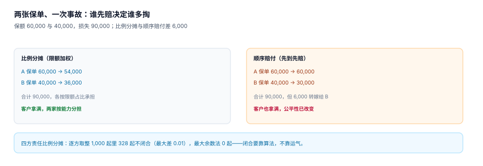
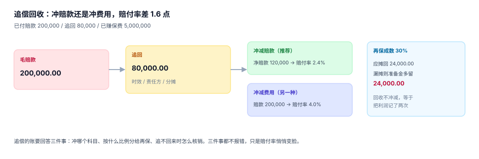

# 赔付、支付与追偿

核定额出来之后，还有三件事：**按什么项目付、付给谁、付了之后能不能追回来**。三件事都在「钱已经出去或即将出去」的位置上，错一次的代价是真实的资金损失，而不是报表不好看。

这一页把给付项目、多保单分摊、支付幂等、追偿冲减讲清楚，因为这四件事加起来构成「实付额」的完整定义。

## 一、给付项目：一个赔案可以有多笔钱

| 项目 | 计算依据 | 常见上限 |
| --- | --- | --- |
| 车辆维修 | 定损明细 | 每次事故限额 |
| 医疗费用 | 医保目录内金额 | 每人限额 |
| 伤残给付 | 保额 × 伤残等级比例 | 保额 |
| 误工费 | 日均收入 × 误工天数 | 当地标准 |
| 施救费 | 实际支出 | 另行约定 |
| 精神损害 | 协商或判决 | 条款约定 |

伤残比例表是「一张必须写进系统」的表：十级 10%、九级 20%……一级 100%，每级 10%。它不能写在代码里 `if level == 1: 1.0`，因为：
- 不同产品比例不同（有些产品十级 5%）；
- 多处伤残要「晋级」（两处十级可晋九级），规则在表里；
- 比例表调整是监管动作，需要版本。

```sql
CREATE TABLE disability_ratio (
  product_code TEXT NOT NULL,
  level        INTEGER NOT NULL CHECK (level BETWEEN 1 AND 10),
  ratio        REAL NOT NULL CHECK (ratio > 0 AND ratio <= 1),
  effective_from TEXT NOT NULL,
  PRIMARY KEY (product_code, level, effective_from)
);
```

## 二、多保单分摊：谁先赔，决定谁多掏

同一次事故落在两张保单上（交强险 + 商业险、两张财产险），赔付顺序有讲究：



| 口径 | A 保单（限额 60,000） | B 保单（限额 40,000） | 客户到手 |
| --- | --- | --- | --- |
| 比例分摊 | 54,000.00 | 36,000.00 | 90,000.00 |
| 顺序赔付 | 60,000.00 | 30,000.00 | 90,000.00 |

客户拿到的钱一样，但 **6,000 元从 B 转嫁到了 A**（或反过来）。比例分摊是「按能力分担」，顺序赔付是「先到先赔」——前者公平，后者简单。选哪一种要写进条款，而不是由代码里 `ORDER BY policy_id` 决定。

四舍五入在这里也会咬人：四方责任比例分摊 1,000 起案子，**328 起逐方取整后合计不等于总额**（最大差 0.01 元），最大余数法 **0 起**。金额小时看不出，金额大时财务对账会天天差一分。

```python
def allocate(total, weights):
    """最大余数法：保证 sum(parts) == total，误差不超过 1 分。"""
    raw = [total * w for w in weights]
    parts = [int(x * 100) / 100 for x in raw]          # 向下取整到分
    rest = int(round((total - sum(parts)) * 100))       # 还差多少分
    order = sorted(range(len(raw)), key=lambda i: -(raw[i] * 100 - int(raw[i] * 100)))
    for i in order[:rest]:
        parts[i] = round(parts[i] + 0.01, 2)
    return parts
```

## 三、支付幂等：重试不是「再付一次」

支付接口超时是常态。客户端重试、网关重试、人工补单，三次请求落到服务端就是三笔付款。

本机读数（2,000 笔赔案、每笔重投 3 次）：

| 方案 | 支付行数 | 支付总额 |
| --- | --- | --- |
| 无唯一键 | 6,000 | 184,927,560.63 |
| `UNIQUE(claim_id, pay_seq)` | 2,000 | **61,642,520.21** |

多付 **1.23 亿**，而且每一笔都是「成功」状态——对账时只能靠人工逐笔核。

```sql
CREATE TABLE payment (
  payment_id INTEGER PRIMARY KEY,
  claim_id   INTEGER NOT NULL REFERENCES claim(claim_id),
  pay_seq    INTEGER NOT NULL CHECK (pay_seq > 0),   -- 第几次支付：1=首次，2+=补付
  payee      TEXT NOT NULL,
  amount     REAL NOT NULL CHECK (amount > 0),
  status     TEXT NOT NULL CHECK (status IN ('PENDING','SUCCESS','FAILED')),
  paid_at    TEXT,
  UNIQUE (claim_id, pay_seq)
);
```

`pay_seq` 的设计要点：**幂等键是「业务序号」，不是「请求 ID」**。请求 ID 每次重试都不同，用它做唯一键等于没有唯一键；`(claim_id, pay_seq)` 在业务上是「这个案子的第 N 笔付款」，重试带的是同一个 N。

## 四、账户核验：付给谁比付多少更容易出错

| 检查 | 目的 | 手段 |
| --- | --- | --- |
| 收款人与被保险人一致 | 防冒领 | 姓名 + 证件号后四位 |
| 账户状态正常 | 防退票 | 银行四要素校验 |
| 单笔金额阈值 | 防大额错付 | 超阈值人工复核 |
| 同一账户多案 | 防集中套现 | 按账户聚合告警 |

第四条最容易被忽略：一个账户在一个月内接收 20 笔赔款，可能是修理厂代收（正常），也可能是团伙作案（异常）。系统不需要判断，只需要**能查出来**。

## 五、追偿：钱回来了，记在哪

追偿（代位求偿）是「先赔后追」：保险公司先赔客户，再向责任方追回。



| 口径 | 计算 | 赔付率 |
| --- | --- | --- |
| 毛赔款 | 200,000 / 5,000,000 | 4.00% |
| 冲减赔款（推荐） | (200,000 − 80,000) / 5,000,000 | **2.40%** |
| 冲减费用 | 200,000 / 5,000,000，费用 −80,000 | 4.00% |

同一个 80,000，记在赔款里还是费用里，**赔付率差 1.6 个百分点**。赔付率是核保定价的核心输入，记错一次，下一轮定价就偏了。

再保摊回是另一个容易漏的地方：成数再保 30% 时，追回的 80,000 里应摊回 24,000。不摊回，等于把再保人那份利润也记成了自己的。

```sql
CREATE TABLE recovery (
  recovery_id  INTEGER PRIMARY KEY,
  claim_id     INTEGER NOT NULL REFERENCES claim(claim_id),
  target       TEXT NOT NULL,                 -- 责任方
  amount       REAL NOT NULL CHECK (amount > 0),
  offset_target TEXT NOT NULL CHECK (offset_target IN ('PAID_LOSS','EXPENSE')),
  received_at  TEXT NOT NULL,
  ceded_share  REAL NOT NULL DEFAULT 0 CHECK (ceded_share BETWEEN 0 AND 1)
);

-- 净赔款：只冲减 PAID_LOSS，不冲费用
SELECT c.claim_id,
       COALESCE(SUM(p.amount), 0) - COALESCE((
         SELECT SUM(r.amount) FROM recovery r
          WHERE r.claim_id = c.claim_id AND r.offset_target = 'PAID_LOSS'), 0) AS net_paid
FROM claim c LEFT JOIN payment p ON p.claim_id = c.claim_id AND p.status = 'SUCCESS'
GROUP BY c.claim_id;
```

## 六、冲正：不能删，只能反向

支付成功后发现有错（金额错、收款人错、重复付），**唯一正确的做法是新增一条反向流水**：

```sql
INSERT INTO payment (claim_id, pay_seq, payee, amount, status, paid_at)
VALUES (?, ?, ?, ?, 'SUCCESS', ?);
```

三条纪律：

1. **反向流水也占 `pay_seq`**，且金额为正（用 `direction` 字段区分收付，或约定偶数序号为支出、奇数序号为冲正——两种都行，但必须统一）。
2. **不许 `DELETE FROM payment`**。删掉之后，银行流水里那笔钱就永远对不上。
3. **冲正要有审批与原因码**，原因码至少覆盖 `AMOUNT_ERROR` / `PAYEE_ERROR` / `DUPLICATE`。

## 七、判据清单

本页判据族 `INY-A` ~ `INY-H`，共 8 条。

| 编号 | 判据 | 判定方式 |
| --- | --- | --- |
| `INY-A` | 伤残比例是表，不是常量 | `disability_ratio` 存在且带生效区间 |
| `INY-B` | 多保单分摊口径显式 | 存在分摊方式字段，且同一事故只用一种 |
| `INY-C` | 分摊闭合 | 四方以上分摊时合计等于总额（最大余数法） |
| `INY-D` | 支付幂等 | `UNIQUE(claim_id, pay_seq)`，重投 3 次仍 1 行 |
| `INY-E` | 收款人核验 | 姓名 + 证件后四位比对，不一致即拦截 |
| `INY-F` | 冲正不删行 | 代码中不存在 `DELETE FROM payment` |
| `INY-G` | 追偿冲减赔款 | `offset_target='PAID_LOSS'` 参与净赔款，费用不参与 |
| `INY-H` | 再保摊回可算 | `ceded_share` 有值，回收 × 成数 = 摊回额 |

## 八、验证方式

```shell
# 1) 同一 pay_seq 重复插入必须失败
sqlite3 /tmp/clm.db "INSERT INTO payment VALUES (99,1,1,'张伟',1,'SUCCESS','2026-03-25 10:00:00');"
# 期望：UNIQUE constraint failed: payment.claim_id, payment.pay_seq

# 2) 超额支付必须被触发器拦住
sqlite3 /tmp/clm.db "INSERT INTO payment (claim_id,pay_seq,payee,amount,status,paid_at) VALUES (1,2,'张伟',1,'SUCCESS','2026-03-26 10:00:00');"
# 期望：E_OVERPAID（累计已付 41,000 = 核定额，再加 1 元即超）

# 3) 分摊闭合：最大余数法 1,000 次全部闭合
python3 - <<'PY'
import random
random.seed(20261103)
bad = 0
for _ in range(1000):
    L = round(random.uniform(10000, 900000), 2)
    w = [random.uniform(.5, 2) for _ in range(4)]
    s = sum(w); w = [x/s for x in w]
    raw = [L*x for x in w]
    parts = [int(x*100)/100 for x in raw]
    rest = int(round((L - sum(parts))*100))
    order = sorted(range(4), key=lambda i: -(raw[i]*100 - int(raw[i]*100)))
    for i in order[:rest]:
        parts[i] = round(parts[i]+0.01, 2)
    if abs(sum(parts)-L) > 0.004:
        bad += 1
print(bad)
PY
# 期望：0

# 4) 追偿冲减后的净赔款
python3 -c "print(round((200000-80000)/5000000*100,2), round(200000/5000000*100,2))"
# 期望：2.4 4.0
```

## 参考资料

- [查勘定损与明细核定](../Assessment/index.md)
- [准备金与 IBNR：三角怎么读](../Reserve/index.md)
- 《中华人民共和国保险法》第六十条（代位求偿权）：<https://www.gov.cn/>
- 人身保险伤残评定标准（JR/T 0083—2013）十级伤残给付比例：<http://www.cbirc.gov.cn/>
- 最大余数法（Largest Remainder Method）与分摊闭合：Balinski & Young, *Fair Representation*, 1982
