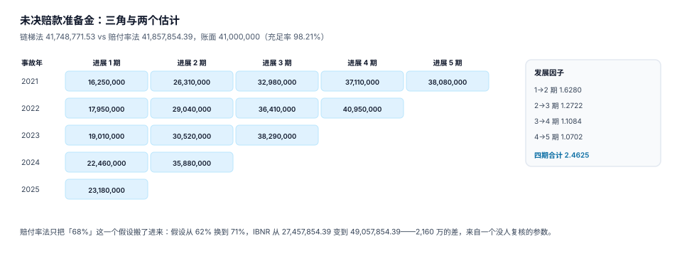

# 准备金与 IBNR：三角怎么读

已经报案但还没赔完的案子，在报表上叫「未决赔款准备金」。它有两个来源：**已经报了案、还没结案的**（RBNS），和**已经出险、还没报案的**（IBNR，已发生未报案）。

前者能逐案估，后者只能靠模型。两者的共同点是：**都是估计，都没有发票，都不会自己报错**。

## 一、两个池子，两种方法

| 池子 | 定义 | 估计方式 | 主要误差来源 |
| --- | --- | --- | --- |
| RBNS | 已报案未结案 | 逐案准备金（查勘员估） | 估高/估低、案子拖着不结 |
| IBNR | 已发生未报案 | 链梯法 / 赔付率法 | 发展因子不稳、假设过时 |

逐案准备金的偏差有多大？本机 1,200 起案子（估计值 vs 最终实际赔款）：

| 指标 | 读数 |
| --- | --- |
| 逐案估计合计 | 15,016,010.42 |
| 最终实际合计 | 15,745,534.22 |
| 总偏差 | +729,523.80（**+4.86%**） |
| 低估案件占比 | 54.5% |
| 单案最大低估 | 58,787.38 |

**总偏差只有 4.86%，看起来很好，但 54.5% 的案子被低估**——高估的案子把低估的盖住了。这就是「总量正确、逐案错误」的典型形态：报表上准备金够用，具体到每个案子都不准。

## 二、三角：把「发展」画出来

未决赔款的发展规律是：事故年越老，累计赔款越接近终极。把「事故年 × 发展期」排成表，就是三角：



| 事故年 | 1 期 | 2 期 | 3 期 | 4 期 | 5 期 |
| --- | --- | --- | --- | --- | --- |
| 2021 | 16,250,000 | 26,310,000 | 32,980,000 | 37,110,000 | 38,080,000 |
| 2022 | 17,950,000 | 29,040,000 | 36,410,000 | 40,950,000 | — |
| 2023 | 19,010,000 | 30,520,000 | 38,290,000 | — | — |
| 2024 | 22,460,000 | 35,880,000 | — | — | — |
| 2025 | 23,180,000 | — | — | — | — |

**读三角只看三件事**：对角线（最新一期）、列（同一发展期不同事故年）、行（同一事故年的发展）。

- 列在涨，说明**赔付通胀**（同样发展期，新事故年赔得更多）。
- 行在某期突然跳，说明**大案**（单案改变整行）。
- 对角线斜率异常，说明**当年报案延迟**（不是赔得少，是还没报上来）。

## 三、链梯法：用发展因子把未来补出来

链梯法的核心是一句话：**「上一期到下一期还会涨多少」这个比例，明年也成立**。

```text
f(k) = Σ(事故年 i 的 k+1 期累计) / Σ(事故年 i 的 k 期累计)      —— 对 i 求和，只取两期都有数的年份
```

本机三角算出的因子：

| 发展期 | 因子 |
| --- | --- |
| 1 → 2 | 1.6280 |
| 2 → 3 | 1.2722 |
| 3 → 4 | 1.1084 |
| 4 → 5 | 1.0702 |
| 合计（1 → 5） | 2.4625 |

用因子把每个事故年推到终极，加总得到 **163,090,917.14**；减去已付 **121,342,145.61**，未决赔款准备金 **41,748,771.53**。

真实终极（用真实赔付率反算）是 165,760,000，链梯误差 **−1.61%**——对一个只有 5 个事故年、加了 2% 观测噪声的三角来说，这个误差是可以接受的。

```sql
-- 三角的原料：按事故年 × 发展期汇总
SELECT strftime('%Y', i.occurred_at) AS accident_year,
       CAST((julianday('2025-12-31') - julianday(i.occurred_at)) / 365 AS INTEGER) AS dev,
       SUM(p.amount) AS paid_cum
FROM claim c
JOIN incident i ON i.incident_id = c.incident_id
JOIN payment p  ON p.claim_id = c.claim_id AND p.status = 'SUCCESS'
GROUP BY 1, 2
ORDER BY 1, 2;
```

## 四、赔付率法：把一个假设搬进来

赔付率法更简单：`IBNR = 已赚保费 × 预期赔付率 − 已付`。本机用 68% 的预期赔付率，得到 **41,857,854.39**，与链梯法只差 109,082.86（**0.26%**）。

两个方法几乎一样，是不是说明「随便用一个就行」？不是。赔付率法把**一个假设**搬了进来，而这个假设没人复核：

| 预期赔付率 | IBNR |
| --- | --- |
| 62% | 27,457,854.39 |
| 65% | 34,657,854.39 |
| 68% | 41,857,854.39 |
| 71% | 49,057,854.39 |

**极差 2,160 万**。链梯法至少是从数据里算出来的，赔付率法是从会议室的某句话里算出来的。

::: danger 三个准备金上的常见错法
1. **只报一个数**：报表上写「未决准备金 4,100 万」，没人知道是 4,100 万还是 4,100 万 ± 800 万。正确做法是同时给点估计与区间（P50 / P75）。
2. **链梯法用「最近一年」的因子**：单年因子受大案影响极大，正确做法是用加权平均（Σ分子 / Σ分母），而不是各年因子的算术平均。
3. **准备金不释放就结案**：结案后准备金还挂在账上，等于同一笔损失被计了两次。正确做法是结案事务里同时把 `reserve.amount` 置 0，并用触发器守住。
:::

## 五、充足性：账面够不够

账面准备金 41,000,000，链梯估计 41,748,771.53，充足率 **98.21%**——差 748,771.53，约 1.8%。这个量级属于正常波动，但要看方向：**连续两个季度低于 100%，就该重估假设**，而不是等下一年度结算。

充足性检验的四个输入，缺一个都做不了：

| 输入 | 来源 | 常见问题 |
| --- | --- | --- |
| 已付赔款 | `payment` | 含追偿冲减吗？（口径要固定） |
| 逐案准备金 | `reserve` | 老案子不更新 |
| 已赚保费 | 承保系统 | 短期险与长期险混算 |
| 终极损失估计 | 精算模型 | 一年只跑一次 |

## 六、释放：结案那一刻

```sql
-- 结案前必须把准备金清零，否则触发器拒绝
UPDATE reserve SET amount = 0 WHERE claim_id = ? AND amount > 0;
UPDATE claim SET status = 'CLOSED' WHERE claim_id = ?;
```

对应守卫（见 [实战](../Practice/index.md) 的 `trg_claim_close`）：

```sql
SELECT RAISE(ABORT, 'E_RESERVE_LEFT')
 WHERE EXISTS (SELECT 1 FROM reserve WHERE claim_id = NEW.claim_id AND amount > 0);
```

## 七、判据清单

本页判据族 `INR-A` ~ `INR-H`，共 8 条。

| 编号 | 判据 | 判定方式 |
| --- | --- | --- |
| `INR-A` | RBNS 与 IBNR 分列 | 报表上两个数分开，不合并成「准备金」 |
| `INR-B` | 三角可按事故年 × 发展期复算 | 一条 SQL 能出三角 |
| `INR-C` | 发展因子用加权平均 | 因子 = Σ分子 / Σ分母 |
| `INR-D` | 至少两种方法交叉 | 链梯与赔付率法同时给出 |
| `INR-E` | 假设有敏感性分析 | 赔付率 ±3 个点对应的 IBNR 变化可算 |
| `INR-F` | 充足率按月可算 | 账面 / 估计，且口径固定 |
| `INR-G` | 结案释放准备金 | `C5` 查询为 0 |
| `INR-H` | 逐案估计可回看 | 存在 `reserve` 历史快照（`as_of` 唯一） |

## 八、验证方式

```shell
# 1) 三角与因子（用本页数表复算，可直接跑）
python3 - <<'PY'
tri = {2021:[16250000,26310000,32980000,37110000,38080000],
       2022:[17950000,29040000,36410000,40950000],
       2023:[19010000,30520000,38290000],
       2024:[22460000,35880000],
       2025:[23180000]}
for k in range(4):
    num = sum(v[k+1] for v in tri.values() if len(v) > k+1)
    den = sum(v[k]   for v in tri.values() if len(v) > k+1)
    print(f"{k+1}->{k+2}: {num/den:.4f}")
PY
# 期望：1.6280 / 1.2722 / 1.1084 / 1.0702

# 2) 赔付率法对假设的敏感性
python3 -c "p=121342145.61; base=240000000; print([round(base*a/100-p,2) for a in (62,65,68,71)])"
# 期望：[27457854.39, 34657854.39, 41857854.39, 49057854.39]

# 3) 结案时准备金未释放必须被拦住
sqlite3 /tmp/clm.db "INSERT INTO reserve VALUES (99,1,'2026-06-30',1000,'CASE');"
sqlite3 /tmp/clm.db "UPDATE claim SET status='CLOSED' WHERE claim_id=1;"
# 期望：E_RESERVE_LEFT
```

## 参考资料

- [赔付、支付与追偿](../Payment/index.md)
- [度量与反欺诈：四个分母](../Metrics/index.md)
- Friedland, J. *Estimating Unpaid Claims Using Basic Techniques*, CAS 2010（链梯法与 IBNR 的标准教材）
- 《保险公司偿付能力监管规则（Ⅱ）》准备金评估相关要求：<http://www.cbirc.gov.cn/>
- Mack, T. *Distribution-Free Calculation of the Standard Error of Chain Ladder Reserve Estimates*, ASTIN Bulletin, 1993
