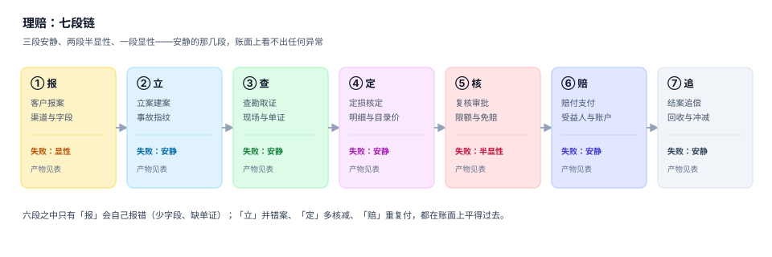

# 理赔作业与赔付计算工程

一次事故发生后，被保险人想要的是一句话：「赔多少、什么时候到账」。这句话背后是七段作业、九张表、四次金额换算，而其中**有五段的失败是安静的**——系统照常运行，报表照常出，只有那个数悄悄偏了几千块。

理赔系统最难的地方不在「流程能不能走通」，而在**同一个案子在三个人眼里必须是同一个数**：查勘员看到的是损失，核赔员看到的是条款允许的上限，财务看到的是已经付出去的钱。三个数各有各的算法，任何一次换算是「先扣免赔还是先套限额」这种看起来无关紧要的选择，都可能让最终金额差 17.7%。

::: tip 一句话理解
理赔不是「赔一笔钱」，而是**把一次事故翻译成一个可以被三方复核的数**——翻译过程要留依据，依据要能重放，重放出来的结果必须和当初一致。
:::

## 一、这个专题讲什么

从「客户打进来报案」到「钱打出去、追偿追回来、案子关掉」，要走七段。每一段都有自己的产物，也都有自己的失败方式：

| 段 | 这一段在做什么 | 产物 | 失败是否安静 |
| --- | --- | --- | --- |
| ① 报 | 接报案，收字段与单证 | 报案单 | 显性（缺字段当场报错） |
| ② 立 | 建赔案，写下事故指纹 | `claim` + `incident` | **安静**（并错案只是「案子少了一起」） |
| ③ 查 | 查勘取证，固化现场事实 | 查勘记录 | **安静**（没去现场也能交报告） |
| ④ 定 | 定损核定，逐项核减 | `assessment` + 明细 | **安静**（多核减、少核减都不报错） |
| ⑤ 核 | 复核审批，套限额与免赔 | 审批记录 | 半显性（超权限会被拦） |
| ⑥ 赔 | 计算实付，支付到账 | `payment` | **安静**（重复支付要等对账才发现） |
| ⑦ 追 | 结案、追偿、回收冲减 | `recovery` + 准备金释放 | **安静**（回收冲错科目，赔付率变脸） |

七段里**五段的失败是安静的**。它们的共同形态是：案子的状态是对的、金额是能加总的、报表是平的，只有「这个数该不该是这些」没人能回答。本机实测最能说明问题的一组读数——同一笔 60,000 元的损失，因为「免赔、比例、限额」三步的先后顺序不同，得到 **34,000 / 34,300 / 41,000 / 41,300** 四个数，**极差 7,300 元，占最高口径的 17.7%**，而四个数都能在条款里找到「依据」。

## 二、三个「赔多少」，只有一个能进账

| 说法 | 判据 | 典型错法 | 后果 |
| --- | --- | --- | --- |
| 责任额 | 条款允许赔的上限 | 用「损失金额」当上限 | 超额赔付，再保拒赔 |
| 核定额 | 单据核出来的金额 | 用「申报金额」直接打折 | 核减无法解释，客诉与审计同时来 |
| 实付额 | 扣免赔、扣已付、加追回后的钱 | 把追回记在费用里 | 赔付率虚高，考核失真 |

三者必须分列存，且每一步都要能回答「凭什么」。把它们合并成一个 `amount` 字段，是理赔系统最常见、也最难补救的设计错误——因为合并之后，**没有任何一条 SQL 能区分「少赔了」和「该少赔」**。

## 三、三个「同一事故」

「一起事故」在系统里有三种含义，混用就会出现重复立案或错误合并：

| 口径 | 定义 | 风险 |
| --- | --- | --- |
| 物理事故 | 同一时间、同一地点、同一原因的一次事件 | 定义最准，但系统里没有「时间地点」的权威值 |
| 报案 | 客户或代理人提交的一次请求 | 一次事故可以有多条报案（车险 23.3% 会二次报案） |
| 赔案 | 系统里可赔付的最小单元 | 一起事故可能对应多张保单、多个赔案（人伤 + 车损） |

本专题的做法是：**报案可以多，事故只能有一个**（`incident_key` 唯一），**赔案按「保单 × 标的 × 责任」拆**。三者的关系写在 [报案受理与归并](./Intake/index.md) 一页里。

## 四、与其它专题的分工

库里写「钱」和「流程」的册子不少，问的问题完全不同：

| 你关心的问题 | 该读哪一册 | 为什么不是本册 |
| --- | --- | --- |
| 「这张凭证借贷平不平」 | [记账与分录](../Ledger/DoubleEntry/index.md) | 那册判**横平**，本册判**这一笔该不该赔** |
| 「这笔钱什么时候到账、头寸够不够」 | [资金管理](../Treasury/Overview/index.md) | 那册判**余额的时间**，本册判**赔款金额** |
| 「准备金在报表里怎么列」 | [合并报表](../Consolidation/Overview/index.md) | 那册判**跨主体抵销**，本册判**逐案估计** |
| 「收入什么时候确认」 | [收入确认](../RevenueRecognition/Overview/index.md) | 那册判**义务消失**，本册判**损失发生** |
| 「产品质量不合格怎么处置」 | [生产执行](../Manufacturing/Quality/index.md) | 那册判**过程良率**，本册判**事后赔付** |
| 「工单多久响应、SLA 怎么算」 | [客服工单](../SupportTicket/Overview/index.md) | 那册判**服务承诺**，本册判**赔案时效** |
| 「审批流引擎怎么配」 | [审批流](../WorkflowEngine/ApprovalFlow/index.md) | 那册判**流程编排**，本册判**审批后的金额落库** |
| 「客户身份怎么归并」 | [客户身份](../CustomerIdentity/Overview/index.md) | 那册判**同一个人**，本册判**同一起事故** |
| 「支付幂等键怎么设计」 | [幂等状态机](../IdempotencyStateMachine/IdempotencyKey/index.md) | 那册判**通用幂等**，本册判**赔付特有的额度与受益人** |
| 「批量导入赔案清单」 | [批量数据交换](../BulkDataExchange/Overview/index.md) | 那册判**文件与行级回执**，本册判**核减规则** |

::: info 为什么不并入「记账与分录」
两册都会出现「金额」和「凭证」，但判据一条不重合：记账判「**借贷两腿是否相等**」，本册判「**这一笔该不该赔、该赔多少**」。

一组最直观的反例：一笔 41,000 元的赔款，借贷完全平衡（记账全绿），同时它比条款允许的上限多赔了 7,300 元（责任判定全错）。前者是记账问题，后者是条款问题——把两者塞进一册，只会写出第二个「基础 + 进阶」。
:::

## 五、为什么不建版本目录

本专题**不设 `V1/V2` 之类的版本目录**，理由有三条：

1. **换代的是条款与监管口径，不是判据**。从纸质保单到互联网保险，判据一直是「在不在保险期间、在不在责任范围、扣不扣免赔、超不超限额」；条款换了，`min(max(loss × ratio − deductible, 0), limit)` 一字未改。
2. **并存的差异是险种与辖区，不是代际**。车险、医疗险、财产险、责任险同时存在于一家公司，它们不是新旧关系，而是同一张表上的不同 `product_code`。
3. **真正需要版本目录的是「同一份代码两套写法」**。本专题只有一套写法：条款参数化 + 明细核定 + 只追加事件。若未来出现「按赔款穿透（claims-made）」这类根本不同的责任基础，再建 `ClaimsMade/` 目录，旧内容保留并标注状态。

作为对照，库内已有的版本化先例见 [Spring 5](../Java/Frame/Spring/Spring5/index.md) 与 [Spring 6](../Java/Frame/Spring/Spring6/index.md)、[Vue 2](../../Frontend/Frame/Vue/Vue2/index.md) 与 [Vue 3](../../Frontend/Frame/Vue/Vue3/index.md)——那里换的是框架大版本，两套写法必须并存，旧版目录保留并标注「维护中 / 仅存量项目使用」。

## 六、本专题的十章与十个判据族

| 章 | 章节 | 判据族 | 条数 |
| --- | --- | --- | --- |
| 1 | [总览：七段链与三个「赔多少」](./Overview/index.md) | `INO-A` ~ `INO-H` | 8 |
| 2 | [案件模型与状态机：八态九迁移](./ClaimModel/index.md) | `INM-A` ~ `INM-H` | 8 |
| 3 | [报案受理与归并：事故指纹怎么写](./Intake/index.md) | `INK-A` ~ `INK-H` | 8 |
| 4 | [条款与责任判定：四问与四口径](./Coverage/index.md) | `INP-A` ~ `INP-H` | 8 |
| 5 | [查勘定损与明细核定](./Assessment/index.md) | `INA-A` ~ `INA-H` | 8 |
| 6 | [赔付、支付与追偿](./Payment/index.md) | `INY-A` ~ `INY-H` | 8 |
| 7 | [准备金与 IBNR：三角怎么读](./Reserve/index.md) | `INR-A` ~ `INR-H` | 8 |
| 8 | [度量与反欺诈：四个分母](./Metrics/index.md) | `INT-A` ~ `INT-H` | 8 |
| 9 | [实战：九张表、三个触发器、十一条断言](./Practice/index.md) | `INX-A` ~ `INX-H` | 8 |
| 10 | [常见问题与分诊](./FAQ/index.md) | `INQ-A` ~ `INQ-H` | 8 |

十章共 80 条判据，每章 8 条，均可逐条判定。

## 七、读这一册之前

::: warning 先确认你的问题属于哪一类
如果你的问题是「这个案子赔了多少钱」，任何一张带 `paid_amount` 的赔案表都能回答，不需要本册。

只有当问题里出现**依据**——「凭什么是这个数」「为什么不是另一个数」「上个月同一类案子为什么多赔了 3,000」——本册才开始有用。而一旦问题带依据，`UPDATE claim SET amount = ?` 这种写法就永久性地毁掉了答案。
:::

本册所有示例都可以在本机用 SQLite 跑通。实测环境：Python 3.13.12 + SQLite 3.50.4，种子 `20261103`，数据规模与读数见各页「验证方式」。九张表的最小可运行版本见 [实战](./Practice/index.md)。

## 参考资料

- [总览：七段链与三个「赔多少」](./Overview/index.md)
- [实战：九张表、三个触发器、十一条断言](./Practice/index.md)
- 《中华人民共和国保险法》（2015 年修正）第二章保险合同、第五章保险代理人与保险经纪人：<https://www.gov.cn/>
- GB/T 36687—2018《保险术语》：<https://openstd.samr.gov.cn/>
- IBNR 与链梯法（Chain Ladder）经典表述：Friedland, J. *Estimating Unpaid Claims Using Basic Techniques*, CAS 2010
- ISO 2859-1 计数抽样（本册用于查勘抽检比例，非核心）：<https://www.iso.org/standard/61516.html>
