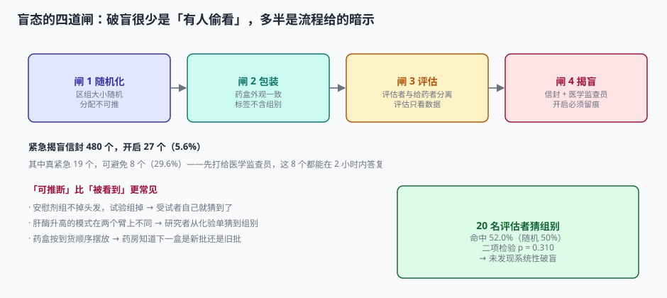

# 盲态与揭盲：破盲很少是「有人偷看」

说到破盲，多数人想到的画面是「有人偷偷打开了随机信封」。真实场景更平淡：

- 药盒的铝箔背面印着「试验药」，撕开才看得到，但药房备药时已经看到了；
- 安慰剂组不掉头发，试验组第三周开始掉，受试者互相交流后自己猜到了；
- 某中心连续入组 12 人，药房按顺序取盒，前 3 个都是试验组，第 4 个必然是安慰剂。

这三种破盲**没有任何人违规**，也不需要打开信封。它们的共同点是：**系统给了暗示**。

::: tip 一句话理解
盲态不是「把答案藏起来」，是**让每个角色只拿到自己干活需要的那一点信息**——而且这点信息在逻辑上不足以反推组别。
:::

## 一、四道闸，各有各的漏法



| 闸 | 防什么 | 手段 | 典型漏法 |
| --- | --- | --- | --- |
| 闸 1 随机化 | 入组前推断组别 | 区组大小随机、中央随机系统 | 方案公开区组长度 4 |
| 闸 2 包装 | 拿到药后看出组别 | 外观、重量、气味一致；标签不含组名 | 试验药片大一圈，或铝箔印字不同 |
| 闸 3 评估 | 评估者被组别影响判断 | 评估者与给药者分离；评估只看数据 | 同一个医生既发药又评疗效 |
| 闸 4 揭盲 | 紧急情况外随便开盲 | 信封 + 医学监查员审批 + 留痕 | 信封放在护士站抽屉里，谁都能开 |

四道闸是**串联**的：任何一道失效，前面的努力都归零。而它们的成本并不相同——闸 1、2 是一次性设计成本，闸 3、4 是持续运营成本。

## 二、紧急揭盲：27 个信封，8 个本可以不拆

本机口径：480 例受试者对应 480 个紧急揭盲信封，实际开启 **27 个（5.6%）**。

把 27 个逐一回看：

| 分类 | 数量 | 判断依据 |
| --- | --- | --- |
| 真紧急（需立即知晓组别以决定救治） | 19 | 涉及具体用药冲突、过敏性休克抢救 |
| 可以避免（先问医学监查员即可） | **8（29.6%）** | 症状处理不依赖组别，或监查员 2 小时内可答复 |

这 8 例的共性：**开信封的人不知道还有别的路径**。方案里写了「紧急情况可揭盲」，但没写「什么算紧急」「先联系谁」「多久没答复才可以拆」。

::: danger 紧急揭盲的三条硬规则
1. **定义「紧急」**：只有「不知组别就无法做出救治决策」才算紧急。单纯「想知道」不算。
2. **规定顺序**：先联系医学监查员（24 小时电话），2 小时内无答复才可拆信封。
3. **拆了必须报**：拆封后 24 小时内提交揭盲报告，说明理由、时间、知情人员，并评估对该受试者后续评估的影响。

第 3 条最容易被省。省了之后，这 8 例在数据库里就是「无原因破盲」，稽查时无法解释。
:::

## 三、盲态是否守住：一个可以量的指标

盲态没法直接测，但可以问：**评估者能不能猜出组别**。

本机模拟 20 名疗效评估者对 200 个病例做二选一猜测，命中 104 次（52.0%）：

| 指标 | 读数 | 解读 |
| --- | --- | --- |
| 命中率 | 52.0% | 略高于随机的 50% |
| 二项检验 p | 0.310 | 不足以拒绝「就是随机猜」 |
| 结论 | 未发现系统性破盲 | — |

这个检验的效力依赖样本量：200 次猜测只能发现比较大的偏倚（比如 60%）。所以它是**筛查工具**，不是**证明工具**——p > 0.05 只能说明「没查出问题」，不能说「盲态完好」。

::: warning 猜组别本身会污染盲态
让评估者对每个病例「猜一下组别」，等于要求他们主动寻找组别线索。这项调查只能在试验结束后做，且必须告诉评估者「猜错不影响任何事」。在试验进行中做，会训练出一批专门找线索的评估者。
:::

## 四、破盲之后：影响的是「评估」，不是「人群」

一个常见误解是「破盲的受试者要剔除」。这是错的，而且错得很危险。

破盲影响的是**评估的客观性**，不是**受试者是否该被分析**。所以：

| 处理方式 | 是否可取 | 理由 |
| --- | --- | --- |
| 从 FAS 剔除破盲者 | 不可取 | FAS 按随机分组，剔除等于引入选择偏倚 |
| 从 PPS 剔除破盲者 | 需在 SAP 预先定义 | 若方案写明「破盲为主要偏离」，可以，但必须同时报 FAS |
| 做敏感性分析（剔除破盲者） | **推荐** | 主分析不变，敏感性分析看结论是否稳健 |
| 只报告剔除后的结果 | 不可取 | 相当于用破盲做了人群筛选 |

本机算了一下剔除 8 例的直接影响：

| 情形 | 每组 n | SE | 差值 | 结论 |
| --- | --- | --- | --- | --- |
| 全部纳入 | 240 | 0.822 | −3.4 | 稳健 |
| 剔除 8 例（4/组） | 236 | 0.829 | −3.4 | 几乎不变 |

标准误从 0.822 变 0.829，几乎没影响。**这说明剔除破盲者对统计结果没有实质帮助，却引入了人群选择的争议**——所以正确做法是纳入主分析、做事后敏感性分析。

## 五、谁该知道组别：一张访问控制表

盲态的工程实现，本质是一张权限表。同一个受试者的组别，不同角色看到的东西必须不同：

| 角色 | 可见内容 | 不可见内容 | 实现方式 |
| --- | --- | --- | --- |
| 研究者 | 随机号、发药记录 | 组别、盲底 | 接口不返回 `arm` 字段 |
| 药师 | 药盒号、组别（配药需要） | 受试者的疗效数据 | 只开配药接口 |
| 数据管理员 | 全部临床数据 | 组别 | 数据视图脱敏 |
| 非盲统计师 | 组别 + 全部数据 | — | 独立账号 + 独立环境 |
| 盲态统计师 | 以 `TRT01A`（占位）表示的数据 | 真实组别 | 数据集层面替换组名 |
| 监查员 | 除组别外全部 | 组别 | 与研究者相同 |

::: danger 三个最常见的「技术性破盲」
1. **接口返回了多余字段**：前端不显示，但 `GET /subjects/{id}` 的响应里有 `"arm": "TEST"`——打开开发者工具就看到了。
2. **排序暴露组别**：按「组别」排序的结果集，即使不显示组别，顺序也泄露了。
3. **样本量差异暴露**：两组人数不一致时（比如 240 vs 232），最后几个受试者的组别可被推断。

第 1 条尤其常见，也最容易查——只要把接口响应打出来看一遍。
:::

## 六、揭盲：一次事件，不是一次操作

揭盲分三种，性质完全不同：

| 类型 | 时机 | 谁执行 | 影响 |
| --- | --- | --- | --- |
| 紧急揭盲（individual unblinding） | 试验进行中，单个受试者 | 研究者（按 SOP） | 该受试者评估可能受影响 |
| 期中分析揭盲 | 预先计划的节点 | 独立数据监查委员会（IDMC） | 只有 IDMC 与非盲统计师知情 |
| 最终揭盲（database unblinding） | 锁库后 | 非盲统计师 | 全部数据可分析 |

三者的共同要求是**留痕**：谁、何时、为什么、知晓范围。区别在于前两种的知晓范围必须被严格限制。

```sql
CREATE TABLE unblinding (
  unblind_id   TEXT PRIMARY KEY,
  subject_no   TEXT,                     -- 期中/最终揭盲为空
  unblind_type TEXT NOT NULL CHECK (unblind_type IN ('EMERGENCY','INTERIM','FINAL')),
  reason       TEXT NOT NULL,
  requested_by TEXT NOT NULL,
  approved_by  TEXT,                     -- 紧急揭盲可事后补，期中/最终必须事前
  occurred_at  TEXT NOT NULL,
  aware_roles  TEXT NOT NULL,            -- 知晓范围，逗号分隔
  impact_note  TEXT                      -- 对后续评估的影响说明
);
```

`aware_roles` 这个字段看着不起眼，却是稽查时第一个被问的：**「这次揭盲，谁知道了？」** 答不出来，就无法证明盲态只破了一个人。

## 七、判据

本页判据族 `CTB-A` ~ `CTB-H`，共 8 条。八条都能被单独判定，任何一条不成立就不算这篇文档写完。

| 判据 | 验收点 | 不合格的表现 |
| --- | --- | --- |
| `CTB-A` | 区组大小随机且不公开 | 方案写明固定区组长度 |
| `CTB-B` | 药盒外观、标签、重量在组间不可区分 | 试验药与安慰剂片重不同 |
| `CTB-C` | 疗效评估者与给药者分离，且有授权记录 | 同一人既发药又评疗效 |
| `CTB-D` | 紧急揭盲有「紧急」定义与联系顺序 | 只写「紧急情况可揭盲」 |
| `CTB-E` | 揭盲记录含原因、批准人、知晓范围 | 只有「已揭盲」标记 |
| `CTB-F` | 接口响应不含 `arm` 等组别字段 | 前端隐藏但接口返回 |
| `CTB-G` | 破盲者不剔除出 FAS，做事后敏感性分析 | 直接从 FAS 剔除 |
| `CTB-H` | 盲态评估者以占位组名分析 | 盲态统计师能拿到真实组别 |

## 八、验证方式

```shell
# 1) 紧急揭盲的可避免比例
python3 -c "
opened=27; real=19
print('可避免', opened-real, '占 %.1f%%' % ((opened-real)/opened*100))
"
# 预期：可避免 8 占 29.6%

# 2) 猜组别是否显著
python3 - <<'PY'
import math
n,k=200,104
p=sum(math.comb(n,i)*.5**n for i in range(k,n+1))
print("命中 %.1f%%" % (k/n*100), "p=%.3f" % p, "→", "显著" if p<.05 else "不显著")
PY
# 预期：命中 52.0% p=0.310 → 不显著

# 3) 剔除破盲者对标准误的影响
python3 -c "
import math
sd=9.0
for n in (240,236):
    print(n, 'SE', round(sd*math.sqrt(2/n),3))
"
# 预期：240 SE 0.822 / 236 SE 0.829
```

## 参考资料

- ICH E6(R3)（2025-01-06 Step 4）：第 3.3 节「设盲」，要求「揭盲应记录并说明理由」。
- ICH E9（1998）第 2.3 节：盲态保持与破盲对分析的影响。
- NMPA《药物临床试验质量管理规范》（2020 年第 57 号公告）第三十五条：盲底保存与紧急揭盲的程序要求。
- FDA *Guidance for Clinical Trial Sponsors: Establishment and Operation of Clinical Trial Data Monitoring Committees*（2006）：IDMC 与期中揭盲的边界。
- 与本页相邻：[随机化与发药](../Randomization/index.md)、[安全性事件与编码](../Safety/index.md)、[权限模型](../../Auth/Authorization/index.md)。
