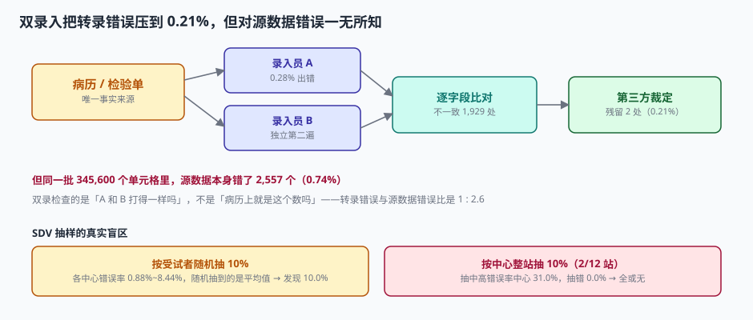

# 双人录入与质疑：三种错误，只有一种能被双录抓到

「双重录入」听起来像一道保险：两个人各打一遍，不一致的地方就是错的。这个理解对了一半——它只对**转录错误**成立。

本机对 345,600 个单元格的三类错误做了区分：

| 错误类型 | 定义 | 发生率 | 双录能抓到吗 | 谁能抓到 |
| --- | --- | --- | --- | --- |
| 转录错误 | 病历上是 68，录成 86 | 0.28%（967 个） | **能**，残留 2 个（0.21%） | 双录 + 第三方裁定 |
| 源数据错误 | 病历上本来就写错/理解为磅 | 0.74%（2,557 个） | **不能**，0 检出 | SDV 到现场比对 |
| 逻辑错误 | 两个字段各自正确但互相矛盾 | 依规则覆盖 | 部分能，取决于规则 | 跨字段核查 |

转录错误 : 源数据错误 = **1 : 2.6**。也就是说，双录辛苦抓出来的那 967 个错，只是问题总量的 27%；剩下 73% 在双录的视野之外。

::: tip 一句话理解
双录检查的是「A 和 B 打得一样吗」，不是「病历上就是这个数吗」。前者靠流程，后者只能靠人到现场看。
:::

## 一、双录为什么有效：两个独立错误碰撞的概率

设单次录入的错误率为 p，两个录入员独立工作。逐字段比对能发现的不一致有两类：

- A 错 B 对：概率 p(1−p)
- A 对 B 错：概率 p(1−p)

合计 **2p(1−p)**。p = 0.28% 时，不一致率约 0.558%，在 345,600 个格子上就是 **1,929 处**。

这 1,929 处里，绝大多数是「一错一对」，由一个第三方（通常是 DM 或监查员）回到病历裁定，取正确值。裁定后仍会残留「两人都错成同一个值」的情况，概率 **p²**，即 345,600 × 0.28%² ≈ **2 个**。

| 阶段 | 数量 | 相对原始错误 |
| --- | --- | --- |
| 原始转录错误 | 967 | 100% |
| 双录发现的不一致 | 1,929 | —（含 962 处误报：A 对 B 错也算） |
| 裁定后残留 | 2 | **0.21%** |

::: warning 1,929 处不一致里有一半是「B 打错了」
这是双录的成本所在：每发现一个真错误，平均要处理两个不一致。这就是为什么很多试验只对**关键字段**（主要终点、安全性指标）做双录，其余做单录 + 100% 逻辑核查。

关键字段清单必须在建库时确定并写进数据管理计划（DMP），**不能事后按结果挑**——那就成了「哪有错补哪」，失去可预期性。
:::

## 二、SDV：抽样 10%，能看见什么

源数据核查（Source Data Verification）是唯一能抓源数据错误的手段。它的问题只有一个：**太贵**，所以只能抽样。

本机 12 个中心的源数据错误率实测在 0.88%~8.44% 之间（差近 10 倍，符合真实世界「中心质量不均」的形态）：

| 抽样策略 | 覆盖 | 能发现的源数据错误 |
| --- | --- | --- |
| 按受试者随机抽 10% | 48 例 | 10.0%（把中心差异平均掉） |
| 按中心整站抽 10%（2/12 站） | 100% 的 2 个中心 | 抽中高错误率中心 **31.0%**；抽错 **0.0%** |
| 按中心整站抽 30%（4/12 站） | 4 个中心 | 取决于选站，方差极大 |



结论很直接：**错误是聚集在中心上的，所以抽样必须按中心分层，并按风险选站**。这就是风险导向监查（Risk-Based Monitoring，RBM）的核心逻辑：

1. 用中心层面的过程指标（质疑数量、质疑关闭时长、偏离率、录入延迟）算出风险分；
2. 高风险中心全查或高比例查，低风险中心低比例查；
3. 每季度重算风险分，动态调整。

::: danger 三个让 SDV 白做的细节
1. **只查 eCRF 不查源文件**：坐在办公室对着两张屏幕比对，那叫「数据比对」，不叫 SDV。
2. **查了但不留记录**：SDV 报告必须写清「查了哪些受试者、哪些字段、发现什么、怎么处理」，否则无法证明做过。
3. **抽样名单由中心提供**：中心知道要被查，会提前整理。抽样名单必须由申办方从数据库直接生成。
:::

## 三、质疑（Query）：像工单，但不能当工单管

质疑是 DM 发给中心的问题记录：某字段值可疑、某字段缺失、某两字段矛盾。中心必须回答或修改，DM 确认后关闭。

它的生命周期本机实测（4,120 条 query）：

| 分位 | 天数 |
| --- | --- |
| P50 | 8 天 |
| P90 | 28 天 |
| P99 | 71 天 |
| 最长 | 209 天 |

锁库时仍有 **118 条（2.86%）未关闭**，涉及 94 个数据点。这 118 条是锁库前必须清掉的硬账。

### 3.1 质疑与工单的三点本质差异

| 维度 | 工单（SupportTicket） | 质疑（Query） |
| --- | --- | --- |
| 关闭标准 | 用户确认问题解决 | 数据被澄清或更正，且留痕 |
| 能否批量关闭 | 可以（同类问题批量处理） | **不可以**，逐条裁定 |
| 超时处理 | 升级、催办、SLA 扣分 | **不允许「超时自动关闭」** |
| 与数据的关系 | 独立的服务记录 | 直接改变数据库里的值 |

::: danger 四条质疑管理红线
1. **不允许「无回答关闭」**：关闭时必须存在 `response` 或一次真实的数据变更。
2. **不允许批量关闭**：一次操作关闭 > 1 条质疑的系统设计，等于给数据造假开后门。
3. **不允许超时自动关闭**：逾期只能升级提醒，不能替中心「默认同意」。
4. **关闭后的修改必须新开质疑**：直接改值等于绕过质疑流程。
:::

### 3.2 质疑的数据模型

```sql
CREATE TABLE query (
  query_id     TEXT PRIMARY KEY,
  subject_no   TEXT NOT NULL,
  visit_code   TEXT NOT NULL,
  item_code    TEXT NOT NULL,
  rule_code    TEXT,                      -- 由哪条规则触发，手工质疑为空
  opened_at    TEXT NOT NULL,
  opened_by    TEXT NOT NULL,
  text         TEXT NOT NULL,
  status       TEXT NOT NULL CHECK (status IN ('OPEN','ANSWERED','CLOSED','CANCELLED')),
  answer       TEXT,
  answered_at  TEXT,
  closed_at    TEXT,
  closed_by    TEXT,
  -- 关闭必须有依据
  CHECK (status <> 'CLOSED' OR (answer IS NOT NULL AND closed_at IS NOT NULL))
);
```

这条 `CHECK` 就是「不允许无回答关闭」的数据库级实现。应用层可以再拦一次，但**数据库层的约束才是最后一道**——因为总有人会写脚本批量改。

## 四、裁定：谁来定「哪个值是对的」

双录发现不一致后，必须有人裁定。裁定的依据只能是源文件：

| 裁定结果 | 处理 | 留痕要求 |
| --- | --- | --- |
| A 对 B 错 | 保留 A，B 的记录标记作废 | 记录裁定人与依据（源文件页码/日期） |
| A 错 B 对 | 保留 B，A 的记录标记作废 | 同上 |
| 两值都错 | 录入正确值（第三个值） | 必须附源文件摘录 |
| 无法判定 | 开质疑给中心 | 质疑里写清「需要提供什么」 |

::: warning 裁定不能由录入员自己做
录入员裁定自己的错误，等于自证清白。裁定人必须是 DM 或监查员，且与被裁定数据无录入关系。系统上要落 `adjudicated_by` 字段，并在权限上禁止「录入人 = 裁定人」。
:::

## 五、录入延迟：一个被低估的质量指标

数据从「访视发生」到「录入系统」的间隔，直接决定质疑还有没有意义。

| 延迟 | 后果 |
| --- | --- |
| ≤ 5 个工作日 | 中心还记得当时情况，质疑可答 |
| 2~4 周 | 需要翻病历，质疑质量下降 |
| > 1 个月 | 只能答「已核对病历，无误」，等于没答 |

本机 query 的 P90 是 28 天——意味着 10% 的质疑在提出时，中心已经不太记得了。这不是中心的问题，是**录入延迟 + 质疑批量发出**的结构性问题。

正确做法是把质疑拆成两类：

| 类型 | 触发时机 | 例子 |
| --- | --- | --- |
| 实时质疑（on-entry） | 录入当下立即弹 | 范围越界、必填缺失、日期倒置 |
| 批量质疑（batch） | 定期集中审阅 | 跨访视趋势异常、AE 与合并用药矛盾 |

实时质疑走「当场改」，批量质疑走「集中答」。混在一起，就会让本该当场改的错等 28 天。

## 六、判据

本页判据族 `CTD-A` ~ `CTD-H`，共 8 条。八条都能被单独判定，任何一条不成立就不算这篇文档写完。

| 判据 | 验收点 | 不合格的表现 |
| --- | --- | --- |
| `CTD-A` | 关键字段清单在建库时确定，双录覆盖全部关键字段 | 事后按结果挑字段双录 |
| `CTD-B` | 双录不一致有第三方裁定记录与依据 | 录入员自行裁定 |
| `CTD-C` | 质疑关闭时 `answer` 非空（数据库级约束） | 允许无回答关闭 |
| `CTD-D` | 不支持批量关闭质疑 | 提供「全部关闭」按钮 |
| `CTD-E` | 质疑超时只升级，不自动关闭 | 定时任务把逾期质疑置 CLOSED |
| `CTD-F` | 关闭后修改必须新开质疑并关联原质疑 | 直接覆盖 `item.value` |
| `CTD-G` | SDV 抽样名单由申办方生成，按中心风险分层 | 中心自报抽样名单 |
| `CTD-H` | 录入延迟（访视日 → 录入日）可统计 | 只有 `created_at`，无访视日期 |

## 七、验证方式

```shell
# 1) 双录残留量与不一致量
python3 - <<'PY'
cells = 480*12*60; p = .0028
print("单元格", cells)
print("原始错误", int(cells*p))
print("不一致", int(cells*2*p*(1-p)))
print("残留", int(cells*p*p), "占比 %.2f%%" % (cells*p*p/(cells*p)*100))
PY
# 预期：345600 / 967 / 1929 / 2 / 0.21%

# 2) 转录错误与源数据错误的比
python3 -c "
cells=345600
print('源数据错误', int(cells*0.0074), '比', round(cells*0.0074/int(cells*0.0028),1))
"
# 预期：源数据错误 2557 比 2.6

# 3) 数据库级「无回答不可关闭」是否生效
sqlite3 :memory: <<'SQL'
CREATE TABLE query (query_id TEXT PRIMARY KEY, status TEXT, answer TEXT,
  CHECK (status <> 'CLOSED' OR answer IS NOT NULL));
INSERT INTO query VALUES ('Q1','CLOSED',NULL);
SQL
# 预期：Error: CHECK constraint failed —— 无回答的关闭被拒
```

## 参考资料

- ICH E6(R3)（2025-01-06 Step 4）：第 4.2 节对源数据、源文件与核查的要求；附录 B 对数据管理计划的建议。
- 21 CFR Part 11（1997 生效）：§11.10(e) 要求保留变更前的值，且变更不得掩盖原值。
- NMPA《药物临床试验质量管理规范》（2020 年第 57 号公告）第七十一条：数据修改应留痕，不得覆盖原始数据。
- SCDM（Society for Clinical Data Management）*Good Clinical Data Management Practices*：质疑分类与关闭标准的行业共识。
- 与本页相邻：[逻辑核查与单位](../EditCheck/index.md)、[偏离、锁库与留痕](../LockAudit/index.md)、[审批流引擎](../../WorkflowEngine/ApprovalFlow/index.md)。
