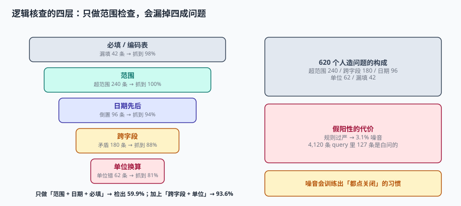

# 逻辑核查与单位：规则越严，真问题越没人看

逻辑核查（Edit Check）是数据管理里最像「写代码」的部分：一条条 `if` 语句，把不合理的数据拦在门外。它也是最容易被写成「越多越好」的部分——而越多越好恰恰是它失效的原因。

本机给 2,336 个字段配了 386 条规则，规则覆盖率 40.2%。这个数字看着不高，但真正的约束不在覆盖率，在**噪音比**：假阳性率 3.1% 意味着 4,120 条质疑里有 **127 条是白问的**。当中心连续答了二十条「已核对，无误」之后，第二十一条真问题也会被同样对待。

::: tip 一句话理解
逻辑核查的设计目标不是「抓出所有错误」，而是**让每一条质疑都值得回答**。一条噪音换来的不是一次澄清，是一次信任损耗。
:::

## 一、五种规则，五类漏检

| 类型 | 条数 | 表达式示例 | 能抓 | 抓不到 | 误报诱因 |
| --- | --- | --- | --- | --- | --- |
| 范围 | 210 | `0 < sbp < 300` | 越界、量级异常 | 范围内的错值 | 极端但真实的生理值 |
| 日期先后 | 58 | `ae_start >= first_dose` | 事件早于给药 | 同日顺序反了 | 既往病史的 AE（本就早于给药） |
| 跨字段 | 74 | `pregnant=Y → sex=F` | 字段自相矛盾 | 两字段同向错 | 未考虑「不适用」分支 |
| 单位换算 | 22 | `unit=lb → kg = v*0.4536` | 单位与量级不匹配 | 单位选错但量级相近 | 混合单位报告（如儿童体重 g） |
| 必填 | 22 | `not null` | 漏填 | 填占位符 `NA/999/.` | 访视未做但表单已开 |

同一批 620 个人造问题上，两种规则集的检出能力差了 33.7 个百分点：

| 规则集 | 构成 | 检出 | 检出率 |
| --- | --- | --- | --- |
| A：朴素集 | 范围 + 日期 + 必填（290 条） | 371 / 620 | **59.9%** |
| B：完整集 | A + 跨字段 + 单位（386 条） | 580 / 620 | **93.6%** |

差的这 209 条里，180 条是跨字段矛盾、62 条是单位错——正好是最难被肉眼发现的两类。



## 二、单位：一个数值正确、含义错误的经典陷阱

单位错有三种，危害完全不同：

| 情形 | 例子 | 数值变化 | 能否被范围检查抓到 |
| --- | --- | --- | --- |
| 量级错（大） | 肌酐 88 µmol/L 录成 88 mg/dL | 放大 88.4 倍 | 能（远超上限） |
| 量级错（小） | 体重 68 kg 录成 68 lb（系统按 kg 读） | 缩小到 30.8 kg | 勉强（BMI 越界） |
| 单位错（同量级） | 剂量 500 mg 录成 0.5 g | 数值正确，单位未换 | **不能**（两个都在合理范围） |

第三类最危险：`0.5 g` 和 `500 mg` 在医学上完全等价，但如果系统只存数字不存单位，汇总时就会把 0.5 和 500 加在一起，得出「总剂量 500.5」这种荒谬结果——而每一条单独看都没问题。

### 2.1 三个必须亲手算一遍的例子

```python
# 例 1：BMI 派生检查能抓住「68 lb 当成 68 kg」
w, h = 68, 1.72
print("按 kg 解释：BMI", round(w / h**2, 1))          # 22.9 正常
print("按 lb 解释：BMI", round(w * 0.4536 / h**2, 1)) # 10.4 越界 → 触发质疑

# 例 2：肌酐单位放大 88.4 倍
cr_umol = 88
print("µmol/L → mg/dL：", round(cr_umol / 88.4, 2))   # 1.00 正常
print("若数值不变只改单位：", cr_umol, "mg/dL → 超上限 88 倍")

# 例 3：同量级单位错，数值本身合法
dose_mg = 500
print("500 mg =", dose_mg / 1000, "g；若存成 0.5 而单位字段丢失 → 汇总差 1000 倍")
```

**单位必须是独立字段，且参与所有派生计算。** 把单位塞进字符串（`"500mg"`）或塞进字段名（`dose_mg`），都会在某个环节丢掉它。

## 三、规则设计的四条纪律

### 3.1 每条规则必须能说清「触发后要做什么」

写规则时最容易犯的错，是写出一条「技术上正确但没有行动含义」的规则。判断标准很简单：

| 规则 | 触发后中心的动作 | 合格吗 |
| --- | --- | --- |
| `sbp > 300` | 核对血压计与录入值 | 合格 |
| `sbp != 120` | 无（120 不是唯一正确值） | 不合格 |
| `ae_end < ae_start` | 核对事件起止日期 | 合格 |
| `visit_date != planned_date` | 无（窗期内本就允许偏移） | 不合格（应改为判越窗） |

**规则的消息文案必须包含「错在哪、去查什么」**。写「数据异常」的规则等于没写。

### 3.2 优先做「派生量核查」而不是「原值核查」

原值范围只能抓越界，派生量能抓关系：

| 派生量 | 表达式 | 能抓的原值错 |
| --- | --- | --- |
| BMI | `weight_kg / height_m²` | 体重或身高的单位错 |
| 肌酐清除率 | Cockcroft-Gault | 体重、年龄、肌酐三者的单位错 |
| 给药间隔天数 | `next_visit − last_dose` | 日期录入错位 |
| 累计剂量 | `Σ dose` | 单次剂量单位错 |

派生量核查的代价是要维护派生逻辑，收益是**一次检查覆盖多个字段的组合错误**。

### 3.3 假阳性要当成缺陷来管

| 假阳性来源 | 典型规则 | 修法 |
| --- | --- | --- |
| 未排除「不适用」 | `pregnant=Y → sex=F`，男性受试者该字段为 `N/A` | 加 `if applicable` 条件 |
| 未区分「既往」与「治疗期」 | AE 开始日期早于首次给药 | 加「若为既往病史则不检查」分支 |
| 未考虑生理极端值 | 运动员心率 42 次/分 | 改下限或加「若为运动员备注」 |
| 未考虑药物特性 | 某药预期引起肝酶升高 | 该字段单独放宽并记录理由 |

::: danger 假阳性率的红线
经验口径：单条规则的假阳性率超过 **10%**，这条规则就该重写或下线；整体假阳性率超过 **5%**，说明规则库需要一次系统审阅。

本机 3.1% 属于可接受区间，但已经产生 127 条噪音——这 127 条对应的中心工时，足够做一次完整的中心培训。
:::

### 3.4 实时核查与批量核查要分开

| 类型 | 触发时机 | 适用规则 | 用户体验 |
| --- | --- | --- | --- |
| 实时（on-entry） | 保存表单时立即 | 单字段范围、必填、日期先后 | 当场改，不产生质疑 |
| 批量（batch） | 每晚 / 每周 | 跨访视趋势、跨表单矛盾、派生量 | 生成质疑，中心集中答 |

把跨访视趋势做成实时核查，会让中心在录第 3 次访视时被「与前两次不一致」拦住——但那时第 4 次访视还没发生，趋势判断没有依据。**实时核查只能判「本表单内自洽」，不能判「跨时间合理」。**

## 四、规则的可维护性：规则库也是一份代码

386 条规则如果没有编号、没有版本、没有测试，三个月后没人敢改。

```text
rule_id       : R-CROSS-014
severity      : ERROR | WARN
scope         : form:VITAL_SIGNS
expression    : weight_kg / (height_m * height_m) between 10 and 60
message_zh    : 体重或身高可能录入有误（BMI = {bmi}），请核对单位
trigger       : on_save
effective_from: 2026-11-04
test_cases    : TC-014-P (BMI 22.9 通过) / TC-014-N (BMI 10.4 拒绝)
owner         : dm-team
```

七个字段缺一不可。其中 `test_cases` 最容易被省，也最致命——**没有反例的规则，等于没测过**。

::: warning 规则的生效期
方案修订会带来规则变更。旧规则不能直接删（历史数据要按当时的规则解释），只能置 `effective_to`。查询时要按数据发生时间匹配规则版本，否则会出现「用今天的规则判三年前的数据」。
:::

## 五、一个完整的核查链示例

以「给药后肝功能异常」为例，四层规则各自负责一段：

| 层 | 规则 | 触发条件 | 产出 |
| --- | --- | --- | --- |
| 1 范围 | `alt <= 2000` | ALT 超上限 | 实时质疑：核对单位与录入 |
| 2 日期 | `lab_date >= first_dose` | 化验早于首次给药 | 实时质疑：是否基线漏录 |
| 3 跨字段 | `alt > 3×ULN → ae_related_record required` | 肝酶升高 3 倍但没记 AE | 批量质疑：请补记 AE |
| 4 派生 | `alt_ratio = alt / uln`，与 CTCAE 分级一致性 | 分级与比值不符 | 批量质疑：请复核分级 |

四层里，第 3 层（跨字段）是最容易被漏掉的一层，也是稽查最常抓的一层：**数据都对，但该有的记录没有**。

## 六、判据

本页判据族 `CTK-A` ~ `CTK-H`，共 8 条。八条都能被单独判定，任何一条不成立就不算这篇文档写完。

| 判据 | 验收点 | 不合格的表现 |
| --- | --- | --- |
| `CTK-A` | 每条规则有编号、严重级、作用域、表达式、消息、生效期 | 规则只存在代码里 |
| `CTK-B` | 每条规则至少一个正例与一个反例 | 只测正例 |
| `CTK-C` | 单位是独立字段并参与派生计算 | 单位拼进字段名或字符串 |
| `CTK-D` | 关键指标有派生量核查（BMI、清除率、剂量合计） | 只有原值范围 |
| `CTK-E` | 单条规则假阳性率 < 10%，整体 < 5% | 从未统计过假阳性 |
| `CTK-F` | 实时核查不含跨访视趋势判断 | 录第 3 次访视被「趋势」拦住 |
| `CTK-G` | 规则变更走 `effective_to`，不物理删除 | 直接删旧规则，历史无法解释 |
| `CTK-H` | 规则的触发能区分「数据错误」与「记录缺失」 | 两者都用「数据异常」提示 |

## 七、验证方式

```shell
# 1) 两种规则集的检出率
python3 - <<'PY'
types = {"超范围":240,"日期倒置":96,"跨字段矛盾":180,"单位错":62,"漏填":42}
A = {"超范围":1.0,"日期倒置":.94,"跨字段矛盾":0.0,"单位错":0.0,"漏填":.98}
B = {**A, "跨字段矛盾":.88, "单位错":.81}
tot=sum(types.values())
for n,s in [("A",A),("B",B)]:
    print(n, sum(types[k]*s[k] for k in types), "/", tot)
PY
# 预期：A 371/620（59.9%）  B 580/620（93.6%）

# 2) BMI 派生检查抓单位错
python3 -c "
w,h=68,1.72
print('kg:',round(w/h**2,1),'lb:',round(w*0.4536/h**2,1))
"
# 预期：kg: 22.9  lb: 10.4 → 10.4 低于下限 15，触发质疑

# 3) 假阳性规模
python3 -c "q=4120;print('噪音',int(q*0.031),'条，占',round(3.1,1),'%')"
# 预期：噪音 127 条，占 3.1 %
```

## 参考资料

- ICH E6(R3)（2025-01-06 Step 4）：第 4.2.3 节「数据核查」，要求核查范围与方式基于风险。
- FDA *Guidance for Industry: Oversight of Clinical Investigations — A Risk-Based Approach to Monitoring*（2013-08）：中心分层与抽样策略的监管口径。
- NMPA《药物临床试验质量管理规范》（2020 年第 57 号公告）第六十九条：数据核查与质疑处理。
- CTCAE v5.0（2017-11-27）：不良事件分级的判定标准，是派生量核查的上游依据。
- 与本页相邻：[双人录入与质疑](../DataEntry/index.md)、[方案到建库](../ProtocolBuild/index.md)、[数据质量](../../../DB/DataGovernance/DataQuality/index.md)。
