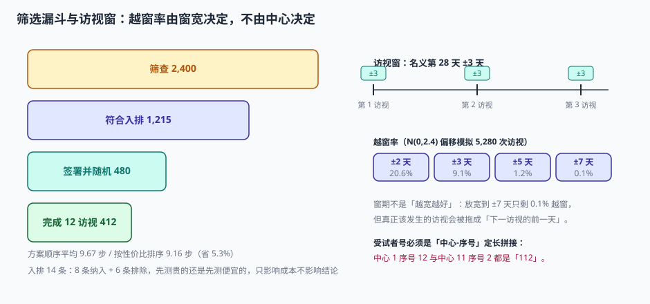

# 入排与筛选：把临床判断变成可复核的记录

「这个患者能不能进组」在诊室里是一个临床判断，在数据库里必须变成**十四条标准逐条留痕的判定**。两者之间的差距，就是稽查时最常被挑战的地方：

> 稽查员：「这位受试者 5 年前有过一次结肠癌，你们排除标准第 2 条写的是『5 年内其他恶性肿瘤』，为什么入组了？」
> 研究者：「那是 5 年零 2 个月，已经过了。」
> 稽查员：「依据在哪？」
> 研究者：「……病历上。」

如果入组时没有把「5 年零 2 个月」这个计算过程写进筛查记录，事后就只能靠回忆。**入排的产物不是「入组了 480 人」，而是「480 份可复核的判定记录」。**

::: tip 一句话理解
入排标准不是筛人的尺子，是**提前写好的举证责任**：你要证明这个人符合每一条纳入标准、不符合每一条排除标准，而且证据在入组当时就固定下来了。
:::

## 一、筛选漏斗：2,400 人里为什么只剩 480 人

| 阶段 | 人数 | 相对上一阶段 | 关键动作 |
| --- | --- | --- | --- |
| 到院并同意筛查 | 2,400 | — | 签署筛查知情同意 |
| 符合全部入排 | 1,215 | 50.6% | 14 条逐条判定 |
| 签署主知情并随机 | 480 | 39.5% | 复筛 + 随机化 |
| 完成 12 次访视 | 412 | 85.8% | 依从性管理 |



三个比例各有名字，且**分母完全不同**，混用就是数据造假的常见起点：

| 指标 | 公式 | 本机读数 | 常见错法 |
| --- | --- | --- | --- |
| 筛选失败率 | 筛败人数 / 筛查人数 | (2,400−1,215)/2,400 = 49.4% | 用「1 − 随机/筛查」算成 80% |
| 随机/筛查比 | 随机人数 / 筛查人数 | 480/2,400 = 20.0% | 当成「入组成功率」对外宣传 |
| 脱落率 | (随机 − 完成)/随机 | (480−412)/480 = 14.2% | 用「完成/随机」当完成率，漏掉失访 |

::: danger 三个分母必须写进数据字典
「我们的入组成功率是 20%」这句话，在申办方嘴里、在中心嘴里、在注册申报材料里，指的可能是三个不同的数。工程上的解法不是「大家统一口径」，而是**每个指标在系统里存它的分子和分母，不允许只存比值**。

`metric_value` 只有比值时，永远无法回答「这个 20% 是怎么来的」。
:::

## 二、入排 14 条：顺序只影响成本，不影响结论

14 条标准（8 条纳入 + 6 条排除）在逻辑上是「与」关系，所以**谁先谁后不影响最终通过人数**——但影响要做多少次检查。

本机按两条路径各跑一遍 2,400 名候选者：

| 排序策略 | 通过人数 | 平均检查步数 |
| --- | --- | --- |
| 按方案书写顺序 | 1,215 | 9.67 |
| 按「失败率 × 检查成本」降序 | 1,196 | 9.16（−5.3%） |

通过人数差 19 人（−1.6%）纯属随机波动——**两条路径在数学上等价**。选性价比排序的唯一理由是省下 5.3% 的检查次数：把「器官功能达标」（失败率 14%、成本 6 倍）放在前面，能让更多不合格者在早期出局。

::: tip 排序的正确目标函数
不是「先查便宜的」，也不是「先查容易失败的」，而是 **失败率 / 单次成本** 降序——即每花一块钱能淘汰多少人。这个顺序在方案定稿时就该写进筛查流程，而不是让各中心自由发挥：不同中心用不同顺序，会让「平均检查步数」这个运营指标失去可比性。
:::

## 三、访视窗：9.1% 的越窗是怎么来的

方案写「第 28 天 ±3 天」。这不只是一个提醒，它是一个**会产生偏离记录的硬边界**。

本机用 N(0, 2.4) 的偏移模拟 5,280 次访视（480 例 × 11 次随访）：

| 窗宽 | 越窗次数 | 越窗率 |
| --- | --- | --- |
| ±2 天 | 1,089 | 20.6% |
| ±3 天 | 480 | 9.1% |
| ±5 天 | 61 | 1.2% |
| ±7 天 | 7 | 0.1% |

窗宽从 ±3 放到 ±7，越窗率从 9.1% 掉到 0.1%——看起来「放宽就好了」。但代价是：**放宽窗期不会让访视更准时，只会让不准时不再被记录**。而窗期在方案里的作用是保证「第 28 天的指标」和「第 56 天的指标」在时间上可区分；窗期宽到 ±7 天，相邻两次访视的窗口就开始重叠（28±7 与 56±7 之间只隔 14 天）。

::: warning 窗期重叠的判定
相邻两次访视的名义间隔是 `Δ`，窗期是 `±w`，当 `2w >= Δ` 时窗口重叠。此时同一个日期可以同时满足两次访视，系统必须拒绝其中一次——否则同一个化验单会被录进两个访视，而两个访视的核查规则都不会报错。

正确的实现是：录入选定访视时，按 `visit_date` 反查所有窗口，若命中多个则要求选择，并记录选择理由。
:::

## 四、受试者号：一个必须定长拼接的字段

真实试验的中心入组量极不均衡。本机按 12 个中心模拟：一家 118 例、一家 62 例、其余各 30 例。

如果编号规则是「中心号（2 位）+ 序号（2 位）不补零」：

| 组合 | 拼接结果 |
| --- | --- |
| 中心 1，序号 12 | `112` |
| 中心 11，序号 2 | `112` |

两条不同的受试者，得到同一个字符串。而 118 例的中心还会让序号突破两位数（`99` 之后是 `100`），拼接直接变成三段。

正确的规则只有一条：**定长 + 分隔符 + 校验位**。

```text
S-01-012
│  │  └── 中心内序号，3 位补零（单中心上限 999）
│  └───── 中心号，2 位补零（上限 99 个中心）
└──────── 研究前缀，便于多研究共库时区分
```

::: danger 受试者号与随机号必须是两个字段
把「受试者号」当「随机号」用，会引发三个连锁问题：

1. **筛败者占号**：筛败的 37 例如果已经占了随机号，后续所有受试者的组别全部错位。
2. **重筛**：同一人二次筛查要不要给新号？给了新号，历史数据怎么关联？不给，筛查记录怎么区分两次？
3. **揭盲**：随机号是揭盲的钥匙，受试者号是业务主键。合并成一个字段，等于把钥匙挂在门上。

行业做法：`subject_no`（业务主键，中心内唯一）+ `random_no`（随机化系统发放）+ `screen_no`（筛查号，可一对多），三个字段三张表。
:::

## 五、筛查失败记录：比入组记录更重要

1,185 例筛败者（2,400 − 1,215）如果只在你系统里留下一行「筛败」，那你就无法回答三个必答题：

| 问题 | 需要什么字段 | 为什么必答 |
| --- | --- | --- |
| 主要筛败原因是什么 | 每条的 `pass/fail` + 首个失败条目 | 影响方案可行性与后续中心选择 |
| 是否有人「多次筛查」 | `screen_no` + `subject_identity_hash` | 重复筛查是选择性入组的信号 |
| 筛败者有没有发生 AE | 筛败后 30 天内的 AE 记录 | 筛查期用药也可能导致 SAE，必须报告 |

```sql
CREATE TABLE screening (
  screen_no     TEXT PRIMARY KEY,          -- S-01-0007
  site_no       TEXT NOT NULL,
  identity_hash TEXT NOT NULL,             -- 身份指纹，用于识别重复筛查
  consent_date  TEXT NOT NULL,
  result        TEXT NOT NULL CHECK (result IN ('PASS','FAIL')),
  fail_item     TEXT,                      -- 首个失败的标准编号，如 E02
  fail_reason   TEXT,
  screen_date   TEXT NOT NULL
);
-- 同一身份在同一研究内多次筛查必须可查
CREATE INDEX idx_screen_identity ON screening(identity_hash, screen_date);
```

## 六、判据

本页判据族 `CTE-A` ~ `CTE-H`，共 8 条。八条都能被单独判定，任何一条不成立就不算这篇文档写完。

| 判据 | 验收点 | 不合格的表现 |
| --- | --- | --- |
| `CTE-A` | 每条入排标准独立存 `pass/fail` 与判定日期 | 只存一个「符合入排 Y/N」 |
| `CTE-B` | 筛败记录含首个失败标准编号与原因 | 只有 `result=FAIL`，无原因 |
| `CTE-C` | 受试者号定长、带分隔符、中心内唯一 | 两段拼接不补零，出现 `112` 撞号 |
| `CTE-D` | `screen_no` / `subject_no` / `random_no` 三字段分离 | 三者合一，筛败即占号 |
| `CTE-E` | 窗期上下界存库，越窗自动生成偏离 | 窗期写在 SOP 里，系统不判 |
| `CTE-F` | 相邻访视窗口重叠时拒绝或要求选择 | 同一化验单可录入两个访视 |
| `CTE-G` | 筛败者 30 天内 AE 可记录 | 筛败后系统无 AE 入口 |
| `CTE-H` | 每个比率指标分子分母都可单独查 | 只存比值，无法复核 |

## 七、验证方式

```shell
# 1) 定长编号消除撞号
python3 - <<'PY'
sites = {1:118, 2:62}
for i in range(3,13): sites[i]=30
bad=set(); good=set()
for s,n in sites.items():
    for i in range(1,n+1):
        bad.add(f"{s}{i}"); good.add(f"{s:02d}-{i:03d}")
total=sum(sites.values())
print("总数",total,"不补零唯一",len(bad),"补零唯一",len(good))
PY
# 预期：总数 480 / 不补零唯一 478 / 补零唯一 480

# 2) 窗期越窗率（N(0,2.4) 偏移，固定种子）
python3 - <<'PY'
import random
random.seed(20261104)
offs=[int(random.gauss(0,2.4)) for _ in range(480*11)]
for w in (2,3,5,7):
    print(f"±{w} 天 → 越窗 {sum(1 for o in offs if abs(o)>w)}")
PY
# 预期：±2 → 约 1,089；±3 → 约 480；±5 → 约 61；±7 → 约 7

# 3) 窗口重叠判定
python3 -c "
d=28; w=7
print('重叠' if 2*w>=d else '不重叠', '2w =', 2*w, 'Δ =', d)
"
# 预期：重叠 2w = 14 Δ = 28 → 14 < 28，不重叠；把 w 改成 14 则重叠
```

## 参考资料

- ICH E6(R3)（2025-01-06 Step 4）：第 3 章「受试者」对入排判定与知情同意时点的要求。
- NMPA《药物临床试验质量管理规范》（2020 年第 57 号公告）第十六条、第二十三条：入选标准、排除标准与筛选失败记录。
- ICH E9(R1)（2019-11-20 Step 4）：筛选期事件（screening failure）与伴发事件的区分，直接影响 FAS 的边界。
- 与本页相邻：[总览](../Overview/index.md)、[随机化与发药](../Randomization/index.md)。
