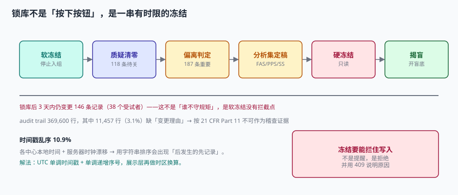

# 偏离、锁库与留痕：锁的不是数据，是「这批人算不算数」

数据库锁定的前一天，数据管理员会做三件事：清质疑、判偏离、定分析集。三件事里最容易做错的是第二件——因为它不是技术判断，是**临床与统计的联合判断**。

一个受试者在第 3 次访视超窗 5 天入组了后续治疗。这算不算「重要偏离」？算，他可能要从 PPS 里剔除；不算，他就留在 PPS 里。两种选择都「有道理」，但选完之后主分析的结果会不一样。

**所以偏离的判定标准必须在揭盲前写死**，而不是锁库前逐条商量。

::: tip 一句话理解
锁库（Database Lock）锁的不是「数据不能改」，而是**「这批人算不算数」这件事已经定了**。定了之后还能改数据，等于把结论建立在流沙上。
:::

## 一、偏离：1,104 条，只有 187 条重要

本机口径：480 例受试者、12 次访视，共记录方案偏离 **1,104 条**（人均 2.30 条），其中判为「重要偏离」的 **187 条（16.9%）**。

| 偏离类型 | 条数 | 常见是否重要 | 判定要点 |
| --- | --- | --- | --- |
| 访视超窗 | 421 | 视窗宽而定 | 超窗是否影响该访视指标的时效性 |
| 使用禁用药 | 236 | 多数重要 | 是否影响主要终点或安全性判断 |
| 依从性 < 80% | 198 | 多数重要 | 是否影响暴露-效应关系 |
| 未做规定检查 | 164 | 视检查而定 | 主要终点相关检查缺失 = 重要 |
| 知情同意时点 | 52 | **全部重要** | 先操作后签字，属重大违规 |
| 随机化错误 | 33 | **全部重要** | 分配与实际不符，直接影响 ITT |

这张表的最后两行值得单独说：**知情同意时点与随机化错误，无论是否影响结果，一律判为重要偏离**。前者涉及伦理合规，后者涉及分析基础，都不是「影响大小」能衡量的。

::: danger 偏离判定的三个反模式
1. **按结果判**：先看这个人的数据是否支持结论，再决定算不算重要——这是最隐蔽的造假。
2. **按人数摊**：为了让 PPS 的人数「好看」，把 187 条重要偏离压缩到 120 条。
3. **事后新增类别**：锁库前临时增加一类「轻微访视偏移」，把原本重要的偏离降级。

三条的共同特征是：判定标准在数据已经知道之后变化。防它的办法只有一个——**偏离分类表随方案 v1.0 一起冻结，之后只能新增不能重分类**。
:::

## 二、三个分析集：同一批数据的三种身份

| 分析集 | 定义 | 本机 n | 用途 |
| --- | --- | --- | --- |
| FAS（全分析集） | 所有随机化的受试者，按分配组别分析 | 480 | 主分析（最保守，避免选择偏倚） |
| PPS（符合方案集） | FAS 中剔除重要偏离者 | 418 | 敏感性分析（看结论是否依赖依从性） |
| SS（安全性集） | 至少接受一次给药的受试者，按实际用药分析 | 472 | 安全性分析 |

三集的关系用一句话概括：**FAS 判「有没有效」，PPS 判「按规矩做有没有效」，SS 判「吃下去安不安全」**。

### 2.1 同一批数据，三个结论

主终点（SD 9.0）：

| 分析集 | n | 差值 | SE | 95% CI | p |
| --- | --- | --- | --- | --- | --- |
| FAS | 480 | −3.42 | 0.822 | [−5.03, −1.81] | <0.0001 |
| PPS | 418 | −2.87 | 0.880 | [−4.60, −1.14] | 0.0011 |
| SS | 472 | −3.51 | 0.829 | [−5.13, −1.89] | <0.0001 |

效应量从 −3.42 变 −2.87（差 16.1%），CI 下界从 −5.03 变 −4.60。三个结论方向一致——这是一个「稳健」的试验。

但把真实差值换成 −1.75（弱效应）再算：

| 分析集 | n | 差值 | p | 结论 |
| --- | --- | --- | --- | --- |
| FAS | 480 | −1.75 | **0.0332** | 显著 |
| PPS | 418 | −1.35 | **0.1252** | 不显著 |

**同一个试验，同一批数据，换个分析集，结论从「显著」变「不显著」。** 这就是为什么分析集必须在揭盲前写死，也是为什么监管要求同时报告多个分析集的结果。

::: warning 「显著性翻转」不是数据造假
它只是说明效应量本来就处在边界上。真正的问题在于：如果 PPS 的定义是在看到结果之后调整的，那「选哪个分析集」就变成了「选哪个结论」。ICH E9(R1) 的估计目标框架，本质就是把「选哪个」提前到方案设计阶段。
:::

## 三、锁库：从软冻结到硬冻结

锁库不是一次操作，是一串有时限的状态迁移：

| 阶段 | 允许的操作 | 禁止的操作 | 时长（本机口径） |
| --- | --- | --- | --- |
| 软冻结（Soft Freeze） | 关闭质疑、修正错值 | 新增受试者、新增访视 | 2~4 周 |
| 偏离判定 | 标记偏离、定分析集 | 改原始数据 | 1 周 |
| 硬冻结（Hard Lock） | 只读查询 | 一切写入 | 持续 |
| 揭盲 | — | 揭盲后回改数据 | 锁库后 |



本机的关键读数是：**锁库后 3 天内仍然产生了 146 条记录变更，涉及 38 个受试者**。

这 146 条不是「有人违规」，而是**软冻结阶段没有拦截点**：系统照常接受写入，只是发了一封「数据库已锁定」的邮件。真正要拦，必须在数据访问层做：

```sql
-- 硬冻结的数据库级实现：用触发器拒绝写入
CREATE TRIGGER trg_item_locked
BEFORE UPDATE ON item_value
WHEN (SELECT locked FROM study WHERE study_id = NEW.study_id) = 1
BEGIN
  SELECT RAISE(ABORT, 'database_locked: 数据库已锁定，禁止写入');
END;
```

```text
-- 应用层也应该拒绝，并返回可解释的错误
HTTP/1.1 423 Locked
{
  "error": "database.locked",
  "detail": "数据库已于 2026-11-04T09:00:00Z 锁定，如需变更请提交 post-lock change request",
  "request_id": "PLCR-2026-0031"
}
```

::: danger 锁库后要改数据，唯一正确的路径
1. 提交「锁库后变更申请」（Post-Lock Change Request，PLCR），写明改什么、为什么、影响哪些分析；
2. 由非盲统计师评估是否需要重跑分析；
3. 临时解锁（记录起止时间），改完立即重锁；
4. 在临床研究报告（CSR）里披露这次变更及其影响。

**没有第 4 步，这次变更就等于没发生。** 而稽查员一定会问「锁库后有没有变更」，答「没有」而系统里有 146 条，是最难解释的一种情况。
:::

## 四、稽查追踪：五个字段缺一不可

21 CFR Part 11 对 audit trail 的要求可以压成五个问题：

| 问题 | 字段 | 本机缺失情况 |
| --- | --- | --- |
| 谁改的 | `changed_by` | 0 |
| 何时改的 | `changed_at`（UTC + 单调序号） | 0 |
| 改前是什么 | `old_value` | 0 |
| 改后是什么 | `new_value` | 0 |
| **为什么改** | `reason` | **11,457 / 369,600（3.1%）缺失** |

前四个字段是「记录变更」，第五个字段是「解释变更」。缺了它，这条留痕在稽查眼里等于**「有人改了这个数，但没人说为什么」**——按 Part 11 §11.10(e)，这样的记录不可作为可靠的稽查证据。

```sql
CREATE TABLE audit_log (
  audit_id    INTEGER PRIMARY KEY AUTOINCREMENT,
  table_name  TEXT NOT NULL,
  row_key     TEXT NOT NULL,
  field_name  TEXT NOT NULL,
  old_value   TEXT,
  new_value   TEXT,
  changed_by  TEXT NOT NULL,
  changed_at  TEXT NOT NULL,       -- ISO8601 UTC
  mono_seq    INTEGER NOT NULL,    -- 单调递增，解决同一秒内的顺序
  reason      TEXT NOT NULL CHECK (length(trim(reason)) > 0),
  request_id  TEXT
);
-- 留痕表本身不可改、不可删
CREATE TRIGGER trg_audit_no_update BEFORE UPDATE ON audit_log
BEGIN SELECT RAISE(ABORT, 'audit_log is append-only'); END;
CREATE TRIGGER trg_audit_no_delete BEFORE DELETE ON audit_log
BEGIN SELECT RAISE(ABORT, 'audit_log is append-only'); END;
```

### 4.1 时间戳：10.9% 的乱序从哪来

本机对 2,000 条留痕按时间排序，发现 **218 处（10.9%）后发生的记录排在了前面**。原因有两个：

| 原因 | 机制 | 表现 |
| --- | --- | --- |
| 中心时区差 | 各中心用本地时间写入，未转 UTC | 北京 14:00 与伦敦 06:00 排序颠倒 |
| 服务器时钟漂移 | 多台应用服务器时钟不同步 | 同一秒内的事件顺序随机 |

解法不是「让大家对表」，而是**双时间戳 + 单调序号**：

| 字段 | 类型 | 作用 |
| --- | --- | --- |
| `changed_at` | UTC ISO 8601，精确到毫秒 | 人类可读的时刻 |
| `mono_seq` | 单调递增整数（可由数据库序列生成） | 保证严格顺序，不受时钟影响 |
| `tz_offset` | 原时区偏移 | 需要还原本地时间时用 |

**排序永远用 `mono_seq`，展示才用 `changed_at` 换算时区。**

## 五、判据

本页判据族 `CTL-A` ~ `CTL-H`，共 8 条。八条都能被单独判定，任何一条不成立就不算这篇文档写完。

| 判据 | 验收点 | 不合格的表现 |
| --- | --- | --- |
| `CTL-A` | 偏离分类表随方案冻结，变更需版本化 | 锁库前临时新增类别 |
| `CTL-B` | 知情同意时点与随机化错误一律判重要偏离 | 按「影响大小」酌情降级 |
| `CTL-C` | FAS / PPS / SS 定义在 SAP 中预先写死 | 揭盲后调整人群定义 |
| `CTL-D` | 主分析与敏感性分析同时报告 | 只报最显著的那个 |
| `CTL-E` | 硬冻结后写入被数据库触发器拒绝 | 只发通知，写入照常成功 |
| `CTL-F` | audit trail 五要素齐全，`reason` 非空约束 | 3.1% 的记录缺理由 |
| `CTL-G` | 排序用单调序号，展示用时区换算 | 用本地时间字符串排序 |
| `CTL-H` | 锁库后变更有 PLCR 记录并在 CSR 披露 | 变更 146 条，报告称「无变更」 |

## 六、验证方式

```shell
# 1) 三集与弱效应下的结论翻转
python3 - <<'PY'
import math
sd=9.0
def p_of(n,d):
    se=sd*math.sqrt(2/(n/2)); z=d/se
    return se, 2*(1-.5*(1+math.erf(abs(z)/math.sqrt(2))))
for name,n,d in [("FAS",480,-3.42),("PPS",418,-2.87),("SS",472,-3.51)]:
    se,p=p_of(n,d); print(f"{name} n={n} d={d} SE={se:.3f} p={p:.4f}")
print("--- 弱效应 ---")
for name,n,d in [("FAS",480,-1.75),("PPS",418,-1.35)]:
    se,p=p_of(n,d); print(f"{name} d={d} p={p:.4f} -> {'显著' if p<.05 else '不显著'}")
PY
# 预期：FAS p=0.0000 / PPS p=0.0011 / SS p=0.0000；弱效应 FAS 0.0332 显著、PPS 0.1252 不显著

# 2) 硬冻结拒绝写入
sqlite3 :memory: <<'SQL'
CREATE TABLE study (study_id TEXT PRIMARY KEY, locked INT);
CREATE TABLE item_value (study_id TEXT, item_code TEXT, val TEXT);
CREATE TRIGGER trg_lock BEFORE UPDATE ON item_value
WHEN (SELECT locked FROM study WHERE study_id=NEW.study_id)=1
BEGIN SELECT RAISE(ABORT,'database_locked'); END;
INSERT INTO study VALUES ('S1',1);
INSERT INTO item_value VALUES ('S1','WEIGHT','68');
UPDATE item_value SET val='70' WHERE study_id='S1';
SQL
# 预期：Error: database_locked —— 锁库后写入被拒

# 3) 留痕五要素与非空理由
sqlite3 :memory: <<'SQL'
CREATE TABLE audit_log (audit_id INTEGER PRIMARY KEY, old_value TEXT, new_value TEXT,
  changed_by TEXT NOT NULL, changed_at TEXT NOT NULL, reason TEXT NOT NULL
  CHECK (length(trim(reason))>0));
INSERT INTO audit_log (old_value,new_value,changed_by,changed_at,reason)
  VALUES ('68','70','dm01','2026-11-04T09:12:00Z','');
SQL
# 预期：Error: CHECK constraint failed —— 空理由被拒
```

## 参考资料

- 21 CFR Part 11（1997 生效，2023 指南问答）：§11.10(e) 稽查留痕的保存要求；§11.10(k) 系统文档控制。
- ICH E9(R1)（2019-11-20 Step 4）：估计目标、分析集与敏感性分析的规范框架。
- ICH E6(R3)（2025-01-06 Step 4）：第 4.2.5 节「数据保留与可溯源性」。
- NMPA《药物临床试验质量管理规范》（2020 年第 57 号公告）第七十二条：数据库锁定后不得修改，确需修改的应记录并说明理由。
- 与本页相邻：[盲态与揭盲](../BlindMaintenance/index.md)、[双人录入与质疑](../DataEntry/index.md)、[电子签名与存证](../../ESignature/Overview/index.md)。
