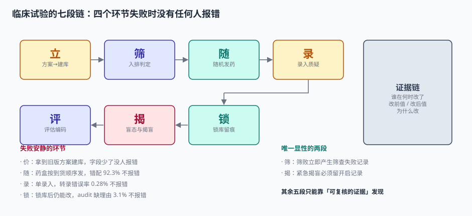
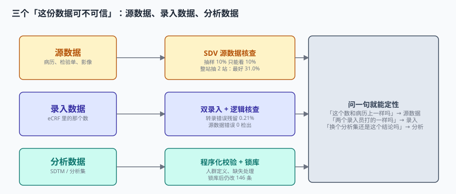

# 总览：七段链与三个「这份数据可不可信」

一个受试者签完知情同意走进诊室，从这一刻起，他的每一次抽血、每一次量血压、每一次说「这两天有点恶心」，都要变成数据库里的一行记录。几个月后，这些记录要支撑一句结论：**试验组的疗效比对照组好 3.42 分**。

这句话能不能成立，不取决于 3.42 有多大，而取决于它下面那 345,600 个数据点是不是都能被独立复核。这一页先把整条链和「可信」的三种含义搭起来，后面的九页各自展开一段。

::: tip 一句话理解
临床试验的数据管理，本质是**把「临床判断」翻译成「可复核的证据」**——翻译过程中每一个省略的步骤，最后都会变成审评时答不上来的问题。
:::

## 一、七段链：数据从哪来，证据在哪一段产生

| 段 | 输入 | 动作 | 产物 | 谁负责 | 失败形态 |
| --- | --- | --- | --- | --- | --- |
| ① 立 | 方案 v1.0 | 建库：字段、编码表、核查规则 | 建库规格书 + eCRF | 数据管理员（DM） | 字段漏建，谁都不报错 |
| ② 筛 | 候选患者 | 14 条入排逐条判定 | 筛查记录 + 受试者号 | 研究者 | 判定无依据，事后补记录 |
| ③ 随 | 已签署知情者 | 分配组别、发药盒 | 随机号 ↔ 药盒号 | 研究者 + 药房 | 药盒错配，药效照样出结果 |
| ④ 录 | 病历 / 检验单 | 双人录入、发质疑 | eCRF 数据 + query | 录入员 + DM | 单录错的数，看着完全正常 |
| ⑤ 评 | 访视数据 | 疗效评估、AE 编码、因果判定 | 评估表 + 编码 | 研究者 + 编码员 | 编码归错系统，统计照跑 |
| ⑥ 揭 | 盲底 | 维持盲态、处理紧急揭盲 | 盲底 + 揭盲记录 | 非盲统计师 | 流程给暗示，没人意识到破了盲 |
| ⑦ 锁 | 全部数据 | 判定偏离、定分析集、锁库、留痕 | 冻结数据库 + audit trail | DM + 统计师 | 锁完还能改，系统不拦 |



前三段决定「数据有没有」，中间两段决定「数据对不对」，最后两段决定「数据能不能用」。**只有第②段的筛败和第⑥段的揭盲是显性的**——因为它们天然产生一条「我做过这件事」的记录。其余五段都只产生「结果」，不产生「过程」，所以失败时静悄悄。

## 二、三个「这份数据可不可信」

### 2.1 源数据：病历上写的是不是这个数

源数据（Source Data）指原始记录：病历、检验单、影像报告、心电图打印条。它的可信度由**源数据的可溯源性**保证——ICH E6(R3) 把它概括成 ALCOA+：可归属（Attributable）、易读（Legible）、同时（Contemporaneous）、原始（Original）、准确（Accurate），加上完整、一致、持久、可获得。

工程上要解决的是「怎么证明」。答案是 SDV（Source Data Verification，源数据核查）：监查员带着 eCRF 到中心，逐条比对病历。问题是**成本极高**，所以行业普遍抽样 10%。

按本机读数，这个 10% 有一个致命盲区：

| 抽样方式 | 覆盖率 | 实际能发现的源数据错误 |
| --- | --- | --- |
| 按受试者随机抽 10% | 10% 的受试者 | 10.0%（各中心错误率被平均） |
| 按中心整站抽 2/12 站 | 16.7% 的中心 | 抽中高错误率中心 31.0%，抽错 **0.0%** |

各中心的源数据错误率实测在 0.88%~8.44% 之间，差近 10 倍。**随机抽受试者等于把「中心差异」抹平成平均值**，而错误恰恰是聚集在中心上的。这就是为什么风险导向监查（RBM）要按中心分层，而不是按受试者随机。

### 2.2 录入数据：系统里的数和病历上一致吗

从病历到 eCRF，多了一道人工转录。这道工序的错误率本机实测 0.28%，用双人录入（Double Data Entry，DDE）可以压到原始错误的 0.21%——345,600 个单元格里从 967 个错误降到残留 2 个。

但要注意一个反直觉的结论：**同一批数据里，源数据本身的错误率是 0.74%，是转录错误的 2.6 倍**。双录对源数据错误**0 检出**——它只保证「A 和 B 打得一样」，不保证「病历上就是这个数」。

### 2.3 分析数据：换个分析集，结论还成立吗

数据都对了，还有最后一关：这批人算不算数。

本机模拟的主分析（480 例随机、主终点 SD 9.0）：

| 分析集 | n | 差值 | 95% CI | p |
| --- | --- | --- | --- | --- |
| FAS（全分析集） | 480 | −3.42 | [−5.03, −1.81] | <0.0001 |
| PPS（符合方案集） | 418 | −2.87 | [−4.60, −1.14] | 0.0011 |
| SS（安全性集） | 472 | −3.51 | [−5.13, −1.89] | <0.0001 |

三集方向一致，但效应量差 16.1%。把真实差值换成 −1.75（弱效应）再看：FAS 的 p=0.033 显著，PPS 的 p=0.125 **不显著**。同一个试验、同一批数据，换个人群定义，结论就翻了。



::: danger 分析集必须在揭盲前写死
揭盲之后再决定「这批人算 PPS 还是剔除」，无论主观上多诚实，都构成**结果导向的人群选择**。所以 ICH E9(R1) 要求分析集在方案与统计分析计划（SAP）里预先定义，任何事后调整都要在 SAP 里留修订记录，并同时报告原口径与调整口径的结果。
:::

## 三、五组必须先分清的术语

| 术语 | 是什么 | 不是什么 | 常见误用 |
| --- | --- | --- | --- |
| CRF / eCRF | 病例报告表 / 电子版 | 不是病历 | 把 eCRF 当源数据，源数据无从追溯 |
| Query（质疑） | 数据管理员发给中心的问题，要求澄清或更正 | 不是工单，没有「优先级」概念 | 按 SLA 硬压关闭时间，逼出「已修改」三个字 |
| SDV | 源数据核查，比对 eCRF 与病历 | 不是数据清理 | 以为做了 SDV 就不用做逻辑核查 |
| 分析集（FAS/PPS/SS） | 进入分析的受试者集合 | 不是「所有有数据的人」 | 用「做完所有访视的人」当 FAS，引入幸存者偏倚 |
| 锁库（Database Lock） | 数据库进入只读、可分析状态 | 不是「备份一下」 | 只发通知不拦写入，锁完仍能改 |

## 四、判据：这一页能验收什么

本页判据族 `CTO-A` ~ `CTO-H`，共 8 条。八条都能被单独判定，任何一条不成立就不算这篇文档写完。

| 判据 | 验收点 | 不合格的表现 |
| --- | --- | --- |
| `CTO-A` | 七段链的每一段都有明确的产物字段 | 只有「数据已录入」，没有 query / 留痕 / 分析集记录 |
| `CTO-B` | 源数据、录入数据、分析数据三者分列存储 | 只有一个 `value` 字段，无来源标记 |
| `CTO-C` | 每个数据点可回答「谁、何时、依据什么」 | audit trail 缺变更理由 |
| `CTO-D` | 受试者号在中心内与全库均唯一 | 两段拼接不补零，出现同号 |
| `CTO-E` | 随机号与药盒号一对一绑定且可反查 | 药房按到货顺序发药 |
| `CTO-F` | 分析集在揭盲前定义并版本化 | SAP 无版本，锁库后补写 |
| `CTO-G` | 锁库后写入被系统拒绝（非仅提示） | 锁库后仍产生 146 条变更 |
| `CTO-H` | 每一个计数指标都写明分母 | 「脱落率 14%」不说是谁的分母 |

## 五、和本册其他页面的关系

| 你想解决的问题 | 该读哪一页 |
| --- | --- |
| 方案改了三版，数据库怎么跟着改 | [方案到建库](../ProtocolBuild/index.md) |
| 入排标准怎么落成可判定的记录 | [入排与筛选](../Eligibility/index.md) |
| 怎么保证下一个人分到哪组猜不到 | [随机化与发药](../Randomization/index.md) |
| 录入错误怎么压到最低 | [双人录入与质疑](../DataEntry/index.md) |
| 核查规则怎么写才不制造噪音 | [逻辑核查与单位](../EditCheck/index.md) |
| 不良事件怎么编码、怎么按时报 | [安全性事件与编码](../Safety/index.md) |
| 盲态怎么守、破了怎么办 | [盲态与揭盲](../BlindMaintenance/index.md) |
| 偏离怎么判、库怎么锁、痕怎么留 | [偏离、锁库与留痕](../LockAudit/index.md) |
| 想看能跑的表结构和断言 | [实战](../Practice/index.md) |

## 六、验证方式

读完这一页，可以用三条命令确认本页的结论站得住：

```shell
# 1) 本机环境（版本不同则读数会有小幅差异，方向不变）
python3 -c "import sys,sqlite3;print(sys.version.split()[0], sqlite3.version, sqlite3.sqlite_version)"
# 预期：3.13.x 2.6.0 3.50.x

# 2) 复跑本页引用的三组读数（脚本不入库，按文中公式重写即可）
python3 - <<'PY'
import math
sd=9.0
for name,n,d in [("FAS",480,-3.42),("PPS",418,-2.87),("SS",472,-3.51)]:
    se=sd*math.sqrt(2/(n/2)); z=d/se
    p=2*(1-.5*(1+math.erf(abs(z)/math.sqrt(2))))
    print(name, f"差值 {d:+.2f} SE {se:.3f} z {z:+.2f} p={p:.4f}")
PY
# 预期：FAS p=0.0000 / PPS p=0.0011 / SS p=0.0000，与上表一致

# 3) 弱效应翻转（把差值换成 -1.75）
python3 -c "
import math
for n,d in [(480,-1.75),(418,-1.35)]:
    se=9.0*math.sqrt(2/(n/2)); z=d/se
    print(n, round(2*(1-.5*(1+math.erf(abs(z)/math.sqrt(2)))),4))
"
# 预期：480 → 0.0332（显著）；418 → 0.1252（不显著）
```

## 参考资料

- ICH E6(R3)《Good Clinical Practice》（2025-01-06 Step 4）：第 4 章数据治理，明确「源数据可溯源」与「计算机化系统风险管理」的关系。
- ICH E9(R1)（2019-11-20 Step 4）：估计目标框架，分析集与伴发事件的规范定义。
- 21 CFR Part 11（1997 生效，2023 指南问答）：电子记录与电子签名的十一项要求。
- NMPA《药物临床试验质量管理规范》（2020 年第 57 号公告）：第四章「研究者」、第七章「数据处理」。
- 与本页相邻：[方案到建库](../ProtocolBuild/index.md)、[偏离、锁库与留痕](../LockAudit/index.md)。
