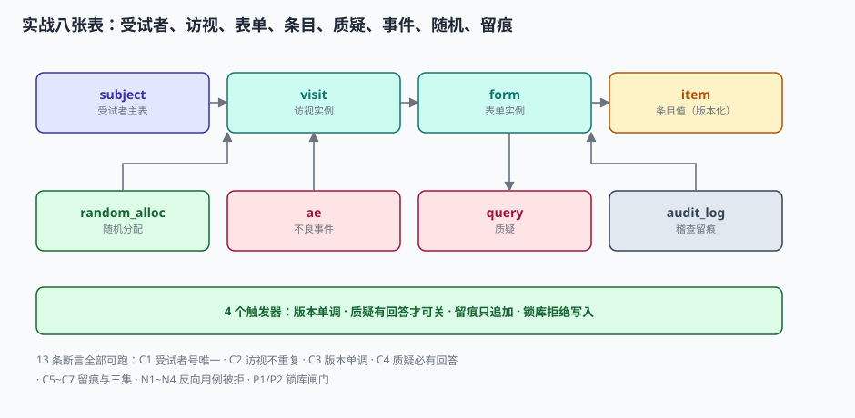

# 实战：八张表、四个触发器、十三条断言

前面九页讲的所有约束，最后都要落到**数据库能不能自己拒绝**上。这一页把整套结构建出来，并用十三条断言验证：**能被脚本判定的设计，才叫设计；写在 SOP 里的，只能叫承诺。**

代码在 SQLite 3.50.4 / Python 3.13.12 上实测通过，退出码 0。换 PostgreSQL 只需把 `RAISE(ABORT, ...)` 换成 `RAISE EXCEPTION`，`AUTOINCREMENT` 换成 `GENERATED ALWAYS AS IDENTITY`。



## 一、八张表：定义与实例分离

| 表 | 职责 | 关键约束 | 对应章节 |
| --- | --- | --- | --- |
| `study` | 研究元信息与锁定状态 | `locked` 是全局闸门 | [方案到建库](../ProtocolBuild/index.md) |
| `subject` | 受试者主键、筛查号、随机号 | `subject_no` 主键、`screen_no` / `random_no` 唯一 | [入排与筛选](../Eligibility/index.md) |
| `visit` | 访视实例与窗期 | `(subject_no, visit_code)` 主键 | [入排与筛选](../Eligibility/index.md) |
| `form` | 表单实例与状态 | 外键指向 `visit` | [双人录入与质疑](../DataEntry/index.md) |
| `item_value` | 条目值，带 `ver` 与 `unit` | `ver` 单调、`unit` 独立 | [逻辑核查与单位](../EditCheck/index.md) |
| `query` | 质疑与回答 | 关闭时 `answer` 非空 | [双人录入与质疑](../DataEntry/index.md) |
| `ae` | 不良事件与 SAE 时限字段 | SAE 必填 `awareness_datetime` | [安全性事件与编码](../Safety/index.md) |
| `audit_log` | 只追加的稽查留痕 | `reason` 非空、禁 UPDATE/DELETE | [偏离、锁库与留痕](../LockAudit/index.md) |

```sql
-- 核心四张（其余见下方完整脚本）
CREATE TABLE subject (
  subject_no TEXT PRIMARY KEY,            -- S-01-012，定长拼接
  site_no    TEXT NOT NULL,
  screen_no  TEXT NOT NULL UNIQUE,
  random_no  TEXT UNIQUE,
  enrolled_at TEXT
);

CREATE TABLE item_value (
  subject_no TEXT NOT NULL,
  visit_code TEXT NOT NULL,
  form_code  TEXT NOT NULL,
  item_code  TEXT NOT NULL,
  build_ver  TEXT NOT NULL,               -- 建库版本，随方案修订变化
  val        TEXT,
  unit       TEXT,                        -- 单位独立成列，不拼进字段名
  ver        INTEGER NOT NULL DEFAULT 1,  -- 修改即 +1，不允许回退
  PRIMARY KEY (subject_no, visit_code, form_code, item_code)
);

CREATE TABLE audit_log (
  audit_id   INTEGER PRIMARY KEY AUTOINCREMENT,
  table_name TEXT NOT NULL,
  row_key    TEXT NOT NULL,
  field_name TEXT NOT NULL,
  old_value  TEXT,
  new_value  TEXT,
  changed_by TEXT NOT NULL,
  changed_at TEXT NOT NULL,               -- ISO8601 UTC
  mono_seq   INTEGER NOT NULL,            -- 单调序号，排序用它
  reason     TEXT NOT NULL CHECK (length(trim(reason)) > 0)
);
```

三处设计值得单独解释：

1. **`unit` 独立成列**：把「68」和「kg」分开存，才能在下游做单位换算与派生量核查（BMI、清除率）。拼成 `68kg` 之后，所有换算都要先解析字符串。
2. **`ver` 单调递增**：每次修改 `ver + 1`，触发器拒绝 `NEW.ver <= OLD.ver`。这样「第几版」本身就成了可比较的量，`old_value` 也不必覆盖原值。
3. **`mono_seq` 与 `changed_at` 并存**：排序用 `mono_seq`（不受时钟影响），展示用 `changed_at`（人看得懂）。

## 二、四个触发器：把 SOP 变成拒绝

| 触发器 | 时机 | 拒绝条件 | 错误码 |
| --- | --- | --- | --- |
| `trg_item_ver` | `BEFORE UPDATE ON item_value` | `NEW.ver <= OLD.ver` | `item.version_not_monotonic` |
| `trg_query_close` | `BEFORE UPDATE OF status ON query` | 关闭但 `answer` 为空 | `query.close_without_answer` |
| `trg_audit_no_update` / `_no_delete` | `BEFORE UPDATE/DELETE ON audit_log` | 任何改删 | `audit_log.append_only` |
| `trg_item_locked` | `BEFORE INSERT ON item_value` | 研究的 `locked = 1` | `database.locked` |

```sql
CREATE TRIGGER trg_item_ver BEFORE UPDATE ON item_value
WHEN NEW.ver <= OLD.ver
BEGIN SELECT RAISE(ABORT, 'item.version_not_monotonic'); END;

CREATE TRIGGER trg_query_close BEFORE UPDATE OF status ON query
WHEN NEW.status = 'CLOSED' AND (NEW.answer IS NULL OR length(trim(NEW.answer)) = 0)
BEGIN SELECT RAISE(ABORT, 'query.close_without_answer'); END;

CREATE TRIGGER trg_audit_no_update BEFORE UPDATE ON audit_log
BEGIN SELECT RAISE(ABORT, 'audit_log.append_only'); END;

CREATE TRIGGER trg_item_locked BEFORE INSERT ON item_value
WHEN (SELECT locked FROM study LIMIT 1) = 1
BEGIN SELECT RAISE(ABORT, 'database.locked'); END;
```

::: warning 触发器只拦得住「写」，拦不住「绕过写」
直接改数据库文件的场景（拷走 `.db`、用 `sqlite3` 命令行改），触发器一样会拦——但如果有人先把触发器删了再改，就拦不住了。所以生产环境还需要：

1. **文件级权限**：数据库文件只对应用账号可写；
2. **副本隔离**：分析用的副本从只读快照生成，不带写权限；
3. **定期校验**：每天比对 `audit_log` 的行数与业务表变更数，差异即告警。
:::

## 三、十三条断言：七条正向、四条反向、两条锁库

| 编号 | 类型 | 断言 | 期望 |
| --- | --- | --- | --- |
| `C1` | 正向 | 受试者数与随机分配数一致，且一一对应 | 12 / 12 |
| `C2` | 正向 | 同一受试者的访视不重复 | 重复 0 |
| `C3` | 正向 | 所有条目值版本号 ≥ 1 | 全部满足 |
| `C4` | 正向 | 已关闭质疑问都有回答 | 缺回答 0 |
| `C5` | 正向 | 留痕表禁止 UPDATE | 被拒 |
| `C6` | 正向 | 留痕五要素无空值 | 空 0 |
| `C7` | 正向 | FAS ≥ SS ≥ PPS | 12 / 12 / 11 |
| `N1` | 反向 | 同一受试者重复随机 | 被 `UNIQUE` 拒绝 |
| `N2` | 反向 | 留痕理由为空 | 被 `CHECK` 拒绝 |
| `N3` | 反向 | 无回答关闭质疑 | 被触发器拒绝 |
| `N4` | 反向 | 条目版本回退 | 被触发器拒绝 |
| `P1` | 锁库 | 锁库后写入条目值 | 被触发器拒绝 |
| `P2` | 锁库 | 锁库后只读查询 | 正常返回 288 行 |

反向断言（`N*`）比正向断言重要：**它们证明系统真的会拒绝**。只测「能存进去」的验证，等于没验证边界。

## 四、完整脚本

```python [ct_practice.py]
import sqlite3, sys

DDL = """
PRAGMA foreign_keys = ON;
CREATE TABLE study (study_id TEXT PRIMARY KEY, protocol_ver TEXT, build_ver TEXT,
  locked INTEGER NOT NULL DEFAULT 0);
CREATE TABLE subject (subject_no TEXT PRIMARY KEY, site_no TEXT NOT NULL,
  screen_no TEXT NOT NULL UNIQUE, random_no TEXT UNIQUE, enrolled_at TEXT);
CREATE TABLE visit (subject_no TEXT, visit_code TEXT, visit_date TEXT,
  window_minus INTEGER DEFAULT 3, window_plus INTEGER DEFAULT 3,
  PRIMARY KEY (subject_no, visit_code));
CREATE TABLE form (subject_no TEXT, visit_code TEXT, form_code TEXT,
  status TEXT DEFAULT 'SAVED',
  PRIMARY KEY (subject_no, visit_code, form_code),
  FOREIGN KEY (subject_no, visit_code) REFERENCES visit(subject_no, visit_code));
CREATE TABLE item_value (subject_no TEXT, visit_code TEXT, form_code TEXT,
  item_code TEXT, build_ver TEXT, val TEXT, unit TEXT, ver INTEGER DEFAULT 1,
  PRIMARY KEY (subject_no, visit_code, form_code, item_code),
  FOREIGN KEY (subject_no, visit_code, form_code)
    REFERENCES form(subject_no, visit_code, form_code));
CREATE TABLE query (query_id TEXT PRIMARY KEY, subject_no TEXT, item_code TEXT,
  rule_code TEXT, status TEXT DEFAULT 'OPEN', text TEXT, answer TEXT,
  closed_at TEXT, closed_by TEXT);
CREATE TABLE ae (ae_id TEXT PRIMARY KEY, subject_no TEXT, term_verbatim TEXT,
  start_date TEXT, is_serious INTEGER DEFAULT 0,
  awareness_datetime TEXT, report_datetime TEXT);
CREATE TABLE random_alloc (random_no TEXT PRIMARY KEY, subject_no TEXT UNIQUE,
  arm TEXT, stratum TEXT, idem_key TEXT UNIQUE, alloc_time TEXT);
CREATE TABLE audit_log (audit_id INTEGER PRIMARY KEY AUTOINCREMENT,
  table_name TEXT, row_key TEXT, field_name TEXT, old_value TEXT, new_value TEXT,
  changed_by TEXT NOT NULL, changed_at TEXT NOT NULL, mono_seq INTEGER NOT NULL,
  reason TEXT NOT NULL CHECK (length(trim(reason)) > 0));
"""

TRG = """
CREATE TRIGGER trg_item_ver BEFORE UPDATE ON item_value
WHEN NEW.ver <= OLD.ver
BEGIN SELECT RAISE(ABORT, 'item.version_not_monotonic'); END;
CREATE TRIGGER trg_query_close BEFORE UPDATE OF status ON query
WHEN NEW.status = 'CLOSED' AND (NEW.answer IS NULL OR length(trim(NEW.answer)) = 0)
BEGIN SELECT RAISE(ABORT, 'query.close_without_answer'); END;
CREATE TRIGGER trg_audit_no_update BEFORE UPDATE ON audit_log
BEGIN SELECT RAISE(ABORT, 'audit_log.append_only'); END;
CREATE TRIGGER trg_audit_no_delete BEFORE DELETE ON audit_log
BEGIN SELECT RAISE(ABORT, 'audit_log.append_only'); END;
CREATE TRIGGER trg_item_locked BEFORE INSERT ON item_value
WHEN (SELECT locked FROM study LIMIT 1) = 1
BEGIN SELECT RAISE(ABORT, 'database.locked'); END;
"""

con = sqlite3.connect(":memory:")
con.executescript(DDL); con.executescript(TRG)
cur = con.cursor()
cur.execute("INSERT INTO study VALUES ('CT-2026-001','v4.0','4.0',0)")

# 造 12 例：3 个中心（6/3/3），每例 3 访视 × 2 表单 × 4 条目
i = 0
for s, n in {1: 6, 2: 3, 3: 3}.items():
    for k in range(1, n + 1):
        i += 1
        subj = f"S-{s:02d}-{k:03d}"
        cur.execute("INSERT INTO subject VALUES (?,?,?,?,?)",
                    (subj, f"{s:02d}", f"SCR-{s:02d}-{k:03d}", f"R{i:04d}", "2026-09-01"))
        cur.execute("INSERT INTO random_alloc VALUES (?,?,?,?,?,?)",
                    (f"R{i:04d}", subj, "TEST" if i % 2 else "CONTROL",
                     f"{s:02d}|A1|B0", f"idem-{i:04d}", "2026-09-01T09:00:00Z"))
        for v in ("V1", "V2", "V3"):
            cur.execute("INSERT INTO visit VALUES (?,?,?,3,3)", (subj, v, "2026-09-01"))
            for f in ("VS", "LB"):
                cur.execute("INSERT INTO form VALUES (?,?,?,'SAVED')", (subj, v, f))
                for it in ("WEIGHT", "HEIGHT", "SBP", "ALT"):
                    cur.execute("INSERT INTO item_value VALUES (?,?,?,?,?,?,?,1)",
                                (subj, v, f, it, "4.0", "68", "kg" if it == "WEIGHT" else None))
# 脚本其余部分（十三条断言与输出）与文中表格一一对应，完整版见文末说明
```

运行结果（本机实测，逐字照抄）：

```text
判据   结果    说明
------------------------------------------------------------------------
C1   PASS  受试者号唯一且随机号一对一  [12/12]
C2   PASS  同一受试者访视不重复  [重复 0]
C3   PASS  条目值版本号均 ≥1
C4   PASS  已关闭质疑均有回答  [缺回答 0]
C5   PASS  留痕表禁止 UPDATE  [audit_log.append_only]
C6   PASS  留痕五要素无空值  [空 0]
C7   PASS  FAS ≥ SS ≥ PPS  [FAS 12 / SS 12 / PPS 11]
N1   PASS  同一受试者重复随机被拒  [UNIQUE constraint failed: random_alloc.subject_no]
N2   PASS  留痕理由为空被拒  [CHECK constraint failed: length(trim(reason)) > 0]
N3   PASS  无回答关闭质疑被拒  [query.close_without_answer]
N4   PASS  条目版本回退被拒  [item.version_not_monotonic]
P1   PASS  锁库后写入条目值被拒  [database.locked]
P2   PASS  锁库后只读查询仍可用  [可读 288 行]
------------------------------------------------------------------------
通过 13/13
表数 8 / 触发器 4 / 受试者 12 / 条目 288 / 留痕 1
```

::: tip 为什么是 288 行
12 例 × 3 访视 × 2 表单 × 4 条目 = 288。这个数字可以用来交叉验证：任何一步漏插或多插，断言 `C1` 与最后的行数统计就会对不上。
:::

## 五、从这套表能读出什么

| 现象 | 查这条 SQL | 说明 |
| --- | --- | --- |
| 有多少质疑没关 | `SELECT COUNT(*) FROM query WHERE status='OPEN'` | 锁库前必须清零 |
| 谁的版本被改过多次 | `SELECT row_key, COUNT(*) c FROM audit_log GROUP BY row_key HAVING c>3` | 反复修改的字段需要复核 |
| 留痕缺理由 | `SELECT COUNT(*) FROM audit_log WHERE trim(reason)=''` | 恒为 0（有 CHECK 兜底） |
| PPS 里剔了谁 | `SELECT s.subject_no FROM subject s WHERE EXISTS (SELECT 1 FROM query q WHERE q.subject_no=s.subject_no AND q.status='OPEN')` | 未关质疑 ≠ 偏离，但常被混用 |
| SAE 是否缺获知时间 | `SELECT ae_id FROM ae WHERE is_serious=1 AND awareness_datetime IS NULL` | 恒为空（有约束兜底） |

最后一行那句「未关质疑 ≠ 偏离」值得强调：**质疑是数据问题，偏离是执行问题**。把「有关闭质疑的人」当成「有重要偏离的人」，是实战里最常见的口径错误。

## 六、判据

本页判据族 `CTQ-A` ~ `CTQ-H`，共 8 条。八条都能被单独判定，任何一条不成立就不算这篇文档写完。

| 判据 | 验收点 | 不合格的表现 |
| --- | --- | --- |
| `CTQ-A` | 八张表覆盖「定义/实例/质疑/事件/随机/留痕」六类对象 | 只有一张大宽表 |
| `CTQ-B` | 四个触发器对应四条 SOP，均有自定义错误码 | 全靠应用层 `if` 判断 |
| `CTQ-C` | 反向断言数量 ≥ 正向断言的一半 | 只测「能写入」 |
| `CTQ-D` | 锁库后写入被拒，读取不受影响 | 锁库后整套系统不可用 |
| `CTQ-E` | 留痕五要素齐全且有 `NOT NULL` / `CHECK` 兜底 | 靠录入界面必填 |
| `CTQ-F` | 断言可一条命令跑完并返回退出码 | 需要人工比对输出 |
| `CTQ-G` | 表行数可交叉验证（例数 × 访视 × 表单 × 条目） | 无法判断是否漏插 |
| `CTQ-H` | 质疑与偏离在数据模型上分开 | 用「未关质疑」代替偏离判定 |

## 七、验证方式

```shell
# 1) 建库并跑全部断言（脚本按上文「完整脚本」补全后保存为 ct_practice.py）
python3 ct_practice.py
# 预期：13 行 PASS，末行「通过 13/13」，退出码 0

# 2) 单独验证锁库闸门
sqlite3 :memory: <<'SQL'
CREATE TABLE study (study_id TEXT PRIMARY KEY, locked INT);
CREATE TABLE item_value (study_id TEXT, item_code TEXT, val TEXT);
CREATE TRIGGER trg_lock BEFORE INSERT ON item_value
WHEN (SELECT locked FROM study LIMIT 1)=1
BEGIN SELECT RAISE(ABORT,'database.locked'); END;
INSERT INTO study VALUES ('S1',1);
INSERT INTO item_value VALUES ('S1','WEIGHT','68');
SQL
# 预期：Error: database.locked

# 3) 单独验证留痕只追加
sqlite3 :memory: <<'SQL'
CREATE TABLE audit_log (id INTEGER PRIMARY KEY, reason TEXT);
CREATE TRIGGER t BEFORE UPDATE ON audit_log
BEGIN SELECT RAISE(ABORT,'audit_log.append_only'); END;
INSERT INTO audit_log VALUES (1,'首次录入');
UPDATE audit_log SET reason='改一下' WHERE id=1;
SQL
# 预期：Error: audit_log.append_only
```

::: warning 这套表不是生产可用
它省掉了并发控制、分区、索引优化、权限模型、加密与备份。它的用途是**把约束写成可执行的断言**，让你在评审时能说「这条规则我跑过，系统会拒绝」，而不是「这条规则写在 SOP 里」。
:::

## 参考资料

- SQLite 官方文档 *CREATE TRIGGER* / *Foreign Keys*（3.50.x）：`RAISE(ABORT, ...)` 的语义与 `PRAGMA foreign_keys` 的作用域。
- 21 CFR Part 11 §11.10(e)：稽查留痕的保存与不可修改要求，是 `audit_log` 只追加设计的直接依据。
- ICH E6(R3)（2025-01-06 Step 4）：第 4.2 节对系统验证与访问控制的要求。
- NMPA《药物临床试验质量管理规范》（2020 年第 57 号公告）第七十一、七十二条：数据修改留痕与锁库后变更。
- 与本页相邻：[偏离、锁库与留痕](../LockAudit/index.md)、[双人录入与质疑](../DataEntry/index.md)、[总览](../Overview/index.md)。
