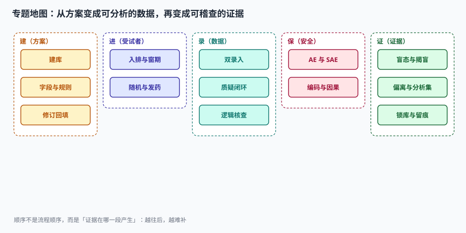

# 方案到建库：把每一句话翻译成可判定的规则

方案里写着「受试者须在随机前 14 天内完成基线评估」。这句话到了数据库里，可能变成三种东西：

1. 一个日期字段 `baseline_date`——**什么也没检查**，全凭录入员自觉；
2. 一个日期字段 + 一条核查规则「`baseline_date` ≥ `random_date − 14`」——**能查出来，但只在录入后**；
3. 一个日期字段 + 规则 + 随机化系统前置校验「`baseline_date` 为空或超窗则不允许随机」——**根本录不进来**。

三种实现都「符合方案」，但只有第三种让这句话真正成立。**建库的本质不是画表格，是决定方案里每一句话在哪一层被强制执行。**

::: tip 一句话理解
建库（Study Build）是把方案从「自然语言」翻译成「机器可判定」的过程。翻译丢了什么，后面所有环节都补不回来——因为数据库里没有的字段，永远不会有人填。
:::

## 一、建库的产物是一张规格书，不是一个空库

| 产物 | 内容 | 谁在用 | 出错后果 |
| --- | --- | --- | --- |
| 建库规格书（Spec） | 字段清单、类型、长度、编码表、规则、跳转逻辑 | 建库员 / 程序员 | 规格错 = 全库错，改一次回填一次 |
| 注释 CRF（aCRF） | 每个 CRF 字段对应 SDTM 哪个变量 | 统计程序员 | 提交时映射不上，要重做 |
| 编码表（Codelist） | 性别、 race、给药途径等受控词表 | 所有录入端 | 自由文本进库，后面无法汇总 |
| 核查规则清单 | 386 条规则的编号、表达式、触发时机、消息文案 | 数据管理员 | 规则漏一条 = 一类错误永久漏检 |
| 测试库（UAT 环境） | 用假数据把每条规则跑一遍 | DM / 申办方 | 直接上生产库，第一条规则就报错 |

### 1.1 字段数是怎么长起来的

一份 12 次访视、8 张 CRF 的三期方案，v1.0 建库时有 **2,108 个字段**（含访视重复：人口学与入排只出现一次，其余表每次访视重复）。三次方案修订后变成 **2,336 个**，增幅 10.8%：

| 版本 | 变更 | 累计新增/改动字段 | 触发原因 |
| --- | --- | --- | --- |
| v1.0 | 初始建库 | 0（基线 2,108） | — |
| v2.0 | +96 | 96 | 增加一个探索性终点 |
| v3.0 | +71 | 167 | 增加一次随访（第 10 次访视） |
| v4.0 | +61 | 228 | 肝功分级改按 CTCAE 5.0 记录 |



::: danger 方案修订最贵的不是改字段，是回填
v3.0 加一次访视、40 个字段，意味着**已经入组的 480 例都要补这一列**：480 × 40 = **19,200 个单元格**。如果这次访视在方案里定义为「回顾性补录」，那这 19,200 个格子里的数据来自病历回顾，源数据可溯源性天然弱于同期记录——这不是技术问题，是证据强度问题。

所以正确的顺序是：**先问这次修订要不要回填，再问字段怎么加**。能定义成「仅新入组受试者适用」的，绝不做全量回填，而是在分析时按版本分层。
:::

## 二、五种核查规则，五种漏检方式

386 条规则的构成直接决定了能抓到什么：

| 规则类型 | 条数 | 典型写法 | 能抓 | 抓不到 |
| --- | --- | --- | --- | --- |
| 范围（Range） | 210 | `0 < sysbp < 300` | 明显越界、单位错导致的量级异常 | 范围内的错值（把 120 录成 102） |
| 日期先后（Date Order） | 58 | `ae_start >= first_dose` | 事件早于首次给药 | 同日但顺序反了 |
| 跨字段（Cross-field） | 74 | `if pregnant=Y then sex must be F` | 字段之间自相矛盾 | 两个字段一起错（同向错） |
| 单位换算（Unit） | 22 | `if unit=lb then value*0.4536` | 单位与量级不匹配 | 单位对了但选错（mg↔g 同量级） |
| 必填（Required） | 22 | `not null` | 漏填 | 填了占位符（`NA`、`999`、`.`） |

规则只覆盖 2,336 个字段里的 **940 个（40.2%）**——其余 1,396 个字段没有任何自动检查，只能靠 SDV 和医学审阅。这不是偷懒，是成本权衡：每加一条规则都要评估「误报率会不会高到让中心不再看质疑」。

### 2.1 一个必须自己算一遍的例子

受试者体重记录 68，单位字段选 `lb`：

| 检查层 | 表达式 | 结果 |
| --- | --- | --- |
| 范围 | `30 <= weight <= 200` | 通过（68 在范围内，单位没参与） |
| 单位换算 | `if unit=lb: weight_kg = 68 × 0.4536 = 30.8` | BMI 变 10.4 → 触发质疑 |
| 跨字段 | `BMI = weight_kg / (height_m^2)`，`15 <= BMI <= 60` | 10.4 越界 → 触发质疑 |

**只做范围检查，这条错会一路走到统计分析。** 而加了单位换算或 BMI 派生检查，它会在录入后 5 分钟内变成一条质疑。

## 三、库结构：四层对象 + 版本化

```sql
-- 四层对象：研究 / 访视 / 表单 / 条目
CREATE TABLE study (
  study_id      TEXT PRIMARY KEY,
  protocol_ver  TEXT NOT NULL,          -- 方案版本，与建库版本分离
  build_ver     TEXT NOT NULL,          -- 建库版本，每次改库 +1
  locked        INTEGER NOT NULL DEFAULT 0
);

CREATE TABLE visit_def (              -- 访视定义（不是访视实例）
  visit_code    TEXT PRIMARY KEY,      -- V1, V2, ...
  visit_name    TEXT NOT NULL,
  day_offset    INTEGER NOT NULL,      -- 名义第几天
  window_minus  INTEGER NOT NULL,      -- 窗期下界（天）
  window_plus   INTEGER NOT NULL
);

CREATE TABLE form_def (
  form_code     TEXT PRIMARY KEY,
  visit_code    TEXT NOT NULL REFERENCES visit_def(visit_code),
  form_name     TEXT NOT NULL,
  repeating     INTEGER NOT NULL DEFAULT 0
);

CREATE TABLE item_def (               -- 条目定义，带生效版本
  item_code     TEXT NOT NULL,
  build_ver     TEXT NOT NULL,
  data_type     TEXT NOT NULL,        -- num/text/date/code
  codelist_code TEXT,
  unit_code     TEXT,
  required      INTEGER NOT NULL DEFAULT 0,
  PRIMARY KEY (item_code, build_ver)
);
```

关键设计就一条：**定义（def）与实例（instance）分离，定义带版本**。`item_def` 的主键是 `(item_code, build_ver)`，所以 v2.0 把「体重」从 `text` 改成 `num` 时，v1.0 录入的历史值仍然按旧定义解释，不会因为类型变更而读不出来。

::: warning 不要在原字段上改语义
把 `weight` 的含义从「磅」改成「千克」而不改字段名，是建库阶段最贵的一类错误：历史数据无法区分新旧口径，只能整列作废。

正确做法有三种，按代价从低到高：
1. 新增 `weight_unit` 字段（推荐，老数据补默认值 `kg`）；
2. 新增 `weight_kg` 字段，旧字段冻结只读；
3. 新建访视/表单版本，整表切换。

**永远不要选第 0 种：直接改。**
:::

## 四、修订管理：三次修订怎么不把库改乱

| 步骤 | 动作 | 判据 |
| --- | --- | --- |
| 1 | 变更申请单（Change Request）写清「为什么改、影响哪些字段、要不要回填」 | 无申请单不改库 |
| 2 | 影响面分析：字段 / 规则 / 衍生变量 / SDTM 映射 / 分析程序 | 五项都要点名 |
| 3 | 在测试库改，导出「变更前后字段对照」 | 对照表可 diff |
| 4 | UAT：为每条新规则造一个正例 + 一个反例 | 反例必须被拒 |
| 5 | 生产库生效，同时更新规格书版本号与生效日期 | 规格书版本 = 库版本 |
| 6 | 通知中心：哪些字段新增、哪些不再填 | 通知留痕 |

本机口径：三次修订累计改动 228 个字段，其中 71 个属于「新增访视」引起的结构性变更、157 个属于字段级变更。**结构性变更永远比字段级变更贵**，因为它会牵动访视实例、窗期计算和 SDTM 的 `--TPT` 变量。

## 五、标准版本速览

| 标准 | 当前版本 | 用途 | 存量情况 |
| --- | --- | --- | --- |
| CDISC SDTM IG | 3.4（2021-11-29）/ SDTM 2.0（2025 发布，过渡至 2027） | 提交数据的组织形态 | 多数在审项目仍是 3.2/3.4 |
| CDISC ADaM IG | 1.3（2022-11-29） | 分析数据集 | 与 SDTM 版本解耦 |
| MedDRA | 28.x（每年 3 月 / 9 月两版） | 不良事件编码 | 一个试验内**不得混版** |
| WHO Drug | 2026-09（季度更新） | 合并用药编码 | 同上 |
| CTCAE | 5.0（2017-11-27） | 不良事件分级 | 4.03 仍在存量项目使用 |
| ICH E6 | R3（2025-01-06） | GCP 总体要求 | R2（2016）仍为多数辖区执行依据 |

::: info 词典版本不能中途换
MedDRA 每半年一版。试验中途换版会导致同一个 AE 在分析时得到两个不同的 PT，除非在锁库前统一重编码并留痕。行业口径是：**一个试验锁一个版本**，跨年试验在 SAP 里写明「编码使用启动时版本，锁库前不升级」。
:::

## 六、判据

本页判据族 `CTC-A` ~ `CTC-H`，共 8 条。八条都能被单独判定，任何一条不成立就不算这篇文档写完。

| 判据 | 验收点 | 不合格的表现 |
| --- | --- | --- |
| `CTC-A` | 规格书版本号与生产库版本一致且可追溯 | 库改了，规格书还是 v1 |
| `CTC-B` | 每个字段有类型、长度、编码表、单位、是否必填 | 一半字段是 `text` 自由输入 |
| `CTC-C` | 定义与实例分离，定义带生效版本 | 改字段类型导致历史数据读不出 |
| `CTC-D` | 每条规则有编号、表达式、触发时机、消息文案 | 规则只有实现，没有文档 |
| `CTC-E` | 每条新规则在 UAT 有正例与反例 | 只测了正例，规则等于没测 |
| `CTC-F` | 每次修订有变更申请单与影响面分析 | 直接改库，事后补记录 |
| `CTC-G` | 编码表引用受控词表且有版本 | 性别字段允许自由文本 |
| `CTC-H` | 回填范围有明确口径（全量 / 仅新入组） | 加了访视就默认全量回填 |

## 七、验证方式

```shell
# 1) 建四层对象并插入一条版本化条目
sqlite3 :memory: <<'SQL'
CREATE TABLE item_def (item_code TEXT, build_ver TEXT, data_type TEXT,
  PRIMARY KEY (item_code, build_ver));
INSERT INTO item_def VALUES ('WEIGHT','v1.0','text'),('WEIGHT','v2.0','num');
SELECT item_code, build_ver, data_type FROM item_def ORDER BY build_ver;
SQL
# 预期：两行 WEIGHT，v1.0 为 text、v2.0 为 num，互不覆盖

# 2) 范围检查抓不到单位错：验证「68 lb」在范围规则下通过
python3 -c "
w,u=68,'lb'
ok = 30 <= w <= 200
print('范围检查通过' if ok else '范围检查拒绝', '→ BMI', round(w*0.4536/(1.72**2),1))
"
# 预期：范围检查通过 → BMI 10.4（越界，只有派生检查能抓）

# 3) 规则覆盖率
python3 -c "print('覆盖字段比例', round(940/2336*100,1), '%')"
# 预期：40.2 %
```

## 参考资料

- CDISC SDTM Implementation Guide 3.4（2021-11-29）与 SDTM 2.0（2025）：域模型、受控术语、`--TPT` 与访视变量的用法。
- CDISC ADaM IG 1.3（2022-11-29）：分析数据集的派生规则与元数据。
- ICH E6(R3)（2025-01-06 Step 4）：第 4.2 节「计算机化系统」对建库与变更控制的要求。
- NMPA《药物临床试验质量管理规范》（2020 年第 57 号公告）第七十条：计算机化系统的验证、访问控制与稽查留痕。
- MedDRA 版本发布说明（MSSO，每年 3 月 / 9 月）：版本号与变更类型（新增 PT、调整层级）。
- 与本页相邻：[入排与筛选](../Eligibility/index.md)、[逻辑核查与单位](../EditCheck/index.md)。
