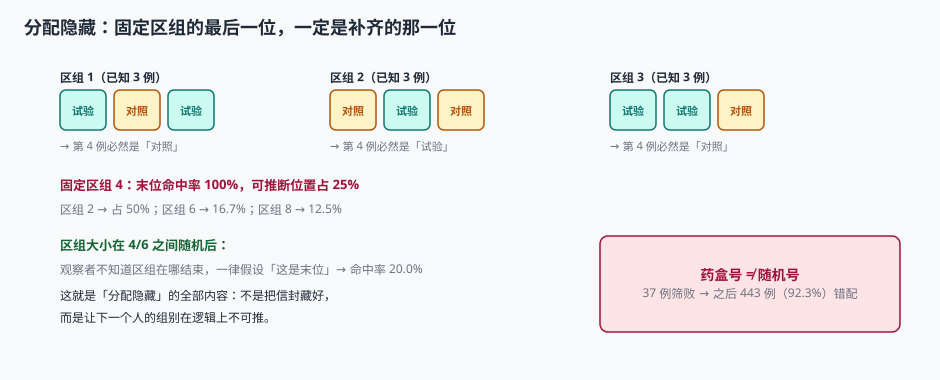

# 随机化与发药：保护不在算法里，在「下一个人是谁你猜不到」里

随机化的目的是让两组在**所有已知和未知的预后因素**上大致可比。这件事在统计学教科书里叫「随机分配」，在工程上叫「两个必须同时成立的条件」：

1. **分配序列不可预测**——研究者在下决定「这个人合格」之前，不能知道他将被分到哪一组；
2. **分配必须被如实执行**——分到试验组的人，实际吃到的必须是试验药。

这两条里任何一条断了，随机化就退化成「一个看起来随机的编号」。而断掉的时候，系统一声不响：组别打了、药发了、数据收了、统计跑了，结果还挺显著。

::: tip 一句话理解
随机化的全部技术含量，是让**下一个人的组别在逻辑上不可推**，同时让**发出去的那盒药与那个组别严格对应**。前者靠区组设计，后者靠编号绑定。
:::

## 一、简单随机：最公平，但会失衡

「每人独立掷硬币」在数学上最无偏，但在有限样本下会失衡。本机模拟 2,000 次 480 例的简单随机：

| 分配方法 | 组间人数差（均值） | 最大差 | 差 > 10 的比例 |
| --- | --- | --- | --- |
| 简单随机（每人 1:1） | **18.31** | 74 | 64.2% |
| 固定区组 4 | 0.00 | 0 | 0% |
| 固定区组 6 | 0.00 | 0 | 0% |
| 区组大小 4/6 随机 | 0.50 | 2 | 0% |

简单随机下，**64.2% 的试验最后两组人数差超过 10 人**，最大能差 74 人。对一个 480 例的试验来说，这意味着有效率的分母可能一边 240、一边 166——不是致命错误，但会让把握度低于设计值，也让「两组可比」这句话变得难以辩护。

区组随机（Block Randomization）解决这个问题：把受试者按区组切分，每个区组内 1:1 平衡。**代价是可预测性**。

## 二、区组的可预测性：末位一定是补齐的那一位

区组 4 意味着「每 4 人中有 2 个试验、2 个对照」。当你已经看到前 3 个人的组别，第 4 个人的组别就唯一确定了：

| 区组内已观察 | 剩余名额 | 第 4 例必然是 |
| --- | --- | --- |
| 试验、对照、试验 | 对照 1 个 | 对照 |
| 对照、试验、对照 | 试验 1 个 | 试验 |
| 试验、试验、对照 | 对照 1 个 | 对照 |

本机对 4,000 个区组做了推演：

| 区组大小 | 末位命中率 | 可推断位置占全部 |
| --- | --- | --- |
| 2 | 100% | 50.0% |
| 4 | 100% | 25.0% |
| 6 | 100% | 16.7% |
| 8 | 100% | 12.5% |



这就是**分配隐藏（Allocation Concealment）**要解决的问题。注意区分两个概念：

| 概念 | 防的是什么 | 手段 |
| --- | --- | --- |
| 分配隐藏 | 研究者在入组前猜到组别 | 区组大小随机、中心分层、中央随机系统 |
| 盲态（Blinding） | 入组后受试者/研究者知道组别 | 包装一致、评估者分离、紧急信封 |

**固定区组破坏了前者，但不破坏后者。** 很多试验做了完美的双盲包装，却用固定区组 4，等于在门口把答案写在墙上。

### 2.1 区组大小随机后，可预测性掉到多少

区组大小在 4 和 6 之间随机，观察者不知道当前区组什么时候结束。此时若他一律假设「这是末位」，只能在真末位猜对：

| 策略 | 命中率 |
| --- | --- |
| 固定区组 4，末位必猜 | 100%（占全部 25% 的位置） |
| 区组 4/6 随机，一律假设末位 | **20.0%** |
| 完全不猜（随机选） | 50% |

20% 低于 50%——因为「假设末位」这个策略在非末位时必错。这个反直觉的读数说明：**可预测性不是「猜对多少」，而是「有没有稳定优于随机的策略」**。区组大小随机后，任何固定策略都无法稳定优于随机。

::: danger 三个让分配隐藏失效的实现细节
1. **区组大小写进方案且公开**：方案里写「区组长度 4」，等于把答案公开。正确做法是写「区组长度随机，范围为 2~6，具体长度不公开」。
2. **随机号按顺序预生成并贴在药盒上**：药房按顺序摆盒子，第 5 个人来的时候，药师知道下一个盒子来自哪个区组。
3. **单中心试验用中心分层**：只有一家中心时，分层因素形同虚设，所有受试者落在同一层，区组可预测性没有任何削弱。
:::

## 三、分层：48 个层，480 例，平均每层 10 例

本机试验的分层因素：12 个中心 × 因素 A（2 水平）× 因素 B（2 水平）= **48 层**。480 例平均每层 10 例——看上去刚好够两个区组 4。

但真实入组是不均匀的（一家中心 118 例、一家 62 例、其余 30 例），所以大量层里根本凑不满一个区组：

| 情况 | 后果 |
| --- | --- |
| 层内例数不足一个区组 | 该层永远不闭合，最后一组不完整 |
| 层内例数只有 1~3 例 | 组别完全由区组剩余名额决定，可预测性极高 |
| 层过多（48 层） | 每层样本太小，分层带来的均衡收益被稀释 |

::: warning 分层的经验上限
分层因素不是越多越好。常用口径是：**层数不超过总样本量的 1/10，且每层预期至少 8~10 例**。480 例的试验，层数控制在 48 以内是勉强可接受的上限；再拆下去，就该改用**最小化（Minimization）**或**协变量自适应随机**。

最小化的代价是「不完全随机」——它牺牲了一部分理论上的无偏性，换取小样本下的协变量均衡。是否使用必须在 SAP 里写明并做敏感性分析。
:::

## 四、药盒错配：92.3% 的受试者吃错药，系统不报错

这是本节最重要的一段。随机号与药盒号是两套编号：

- 随机号（`random_no`）：中央随机系统（IWRS/IRT）发放，决定组别；
- 药盒号（`kit_no`）：药盒上的物理编号，决定你手里那盒是什么。

正确做法是**药盒号按随机号预先分配**：随机号 001 → 药盒 001。筛败者的药盒回收作废，不再使用。

错误做法是**药房按到货顺序发药**：第一个人来拿第 1 盒，第二个人拿第 2 盒……

本机口径：480 例中有 37 例筛败（这些人的随机号已作废但药盒还在架上）。

| 发药方式 | 结果 |
| --- | --- |
| 按随机号发（药盒号 = 随机号） | 错配 0 例 |
| 按发放顺序取盒 | 从第 38 位入组者起，**443 例（92.3%）全部错配** |

错配的后果不是「两组人数不对」——人数依然对，因为错配是整体平移。真正的后果是：

1. **实际接受的治疗与分配的组别不一致**：ITT 分析按分配组别算，等于把试验药的效果算到对照组头上；
2. **盲态被破坏**：药房知道「我发的是第几盒」，也就知道大概的组别顺序；
3. **无法事后纠正**：错配一旦发生，只能按「实际用药」重做分析，并把它列为重大偏离。

::: danger 发药的五个必查点
1. **核对随机号**：IWRS 返回的 `random_no` 与受试者当前状态一致（已随机、未发药）；
2. **核对药盒号**：`kit_no` 由系统按 `random_no` 指定，药师不得自选；
3. **核对有效期**：`kit_expiry` 必须晚于本次访视 + 下次访视间隔；
4. **核对数量**：发放数量 = 方案规定 + 允许的损耗，多发的必须回收记录；
5. **回写发药记录**：`dispense` 表落 `subject_no`、`random_no`、`kit_no`、`dispense_date`、`dispensed_by`。

五步里任何一步只做「提示」不做「拒绝」，错配就会发生。
:::

## 五、随机化系统的幂等与可追溯

IWRS 是一个典型的「不能重复、不能丢」的系统：网络超时后研究者重试，绝不能发出两个随机号。

```sql
CREATE TABLE random_alloc (
  random_no   TEXT PRIMARY KEY,          -- 001, 002, ...
  subject_no  TEXT NOT NULL UNIQUE,      -- 一个受试者只能随机一次
  arm         TEXT NOT NULL,             -- TEST / CONTROL
  stratum     TEXT NOT NULL,             -- 中心|因素A|因素B
  block_id    INTEGER NOT NULL,
  alloc_seq   INTEGER NOT NULL,          -- 层内序号
  alloc_time  TEXT NOT NULL,
  idem_key    TEXT NOT NULL UNIQUE,      -- 客户端生成的幂等键
  operator    TEXT NOT NULL
);

CREATE TABLE kit_assign (
  kit_no      TEXT PRIMARY KEY,
  random_no   TEXT NOT NULL REFERENCES random_alloc(random_no),
  dispense_no INTEGER NOT NULL,
  status      TEXT NOT NULL CHECK (status IN ('AVAILABLE','ASSIGNED','DISPENSED','VOID')),
  expiry      TEXT NOT NULL
);
```

两个唯一约束就是两道闸：

| 约束 | 拦住什么 | 报错 |
| --- | --- | --- |
| `subject_no UNIQUE` | 同一受试者重复随机 | 409 `subject.already_randomized` |
| `idem_key UNIQUE` | 同一请求重放（网络重试） | 返回首次结果，不产生新号 |

::: tip 幂等键要由客户端生成，不要由服务端生成
服务端生成的键在「请求已处理但响应丢失」的场景下无效——客户端重试时会带一个新的键。正确做法是客户端在发起请求前生成 UUID，重试时复用同一个键。
:::

## 六、判据

本页判据族 `CTR-A` ~ `CTR-H`，共 8 条。八条都能被单独判定，任何一条不成立就不算这篇文档写完。

| 判据 | 验收点 | 不合格的表现 |
| --- | --- | --- |
| `CTR-A` | 区组大小随机且不公开具体长度 | 方案写明「区组 4」 |
| `CTR-B` | 末位可推断位置占比 < 30% | 固定区组 4（25%），且已知 |
| `CTR-C` | 分层层数与样本量匹配（每层 ≥ 8 例） | 48 层里 31 层不足 4 例 |
| `CTR-D` | 药盒号由系统按随机号指定，药师不可自选 | 药房按到货顺序发药 |
| `CTR-E` | `subject_no` 在 `random_alloc` 上唯一 | 重复随机只在应用层校验 |
| `CTR-F` | 随机请求带幂等键，重放返回首次结果 | 超时重试产生两个随机号 |
| `CTR-G` | 发药记录含 `random_no` / `kit_no` / 有效期 / 操作人 | 只记「已发药」 |
| `CTR-H` | 筛败者的药盒状态可置 `VOID` 并回收 | 药盒继续留在可用池 |

## 七、验证方式

```shell
# 1) 简单随机的组间失衡（2,000 次模拟）
python3 - <<'PY'
import random, statistics as st
random.seed(20261104)
d=[]
for _ in range(2000):
    a=[1 if random.random()<.5 else 0 for _ in range(480)]
    d.append(abs(sum(a)-(480-sum(a))))
print("均值", round(st.mean(d),2), "最大", max(d),
      "差>10 比例", round(100*sum(1 for x in d if x>10)/len(d),1), "%")
PY
# 预期：均值约 18.3 / 最大约 74 / 比例约 64%

# 2) 固定区组 4 的末位必然可推
python3 - <<'PY'
import random
random.seed(7)
hit=0
for _ in range(4000):
    b=[1,1,0,0]; random.shuffle(b)
    rem=2-sum(b[:3])
    hit += 1 if rem==b[-1] else 0
print("末位命中率", hit/4000*100, "%")
PY
# 预期：100.0 %

# 3) 药盒错配
python3 -c "
skips=37; n=480
print('错配例数', n-skips, '占比', round((n-skips)/n*100,1), '%')
"
# 预期：错配例数 443 占比 92.3 %
```

## 参考资料

- ICH E9《Statistical Principles for Clinical Trials》（1998）第 2.3 节：随机化与分配隐藏的定义与区别。
- ICH E6(R3)（2025-01-06 Step 4）：第 3.3 节「随机化与设盲」，要求分配序列的生成与执行分离。
- NMPA《药物临床试验质量管理规范》（2020 年第 57 号公告）第二十四条：随机化系统的独立性与可追溯性。
- Schulz KF, Grimes DA. *Allocation concealment in randomised trials: defending against deciphering*. Lancet 2002;359:614–618：区组可预测性的经典论述。
- 与本页相邻：[入排与筛选](../Eligibility/index.md)、[盲态与揭盲](../BlindMaintenance/index.md)、[幂等键](../../IdempotencyStateMachine/IdempotencyKey/index.md)。
