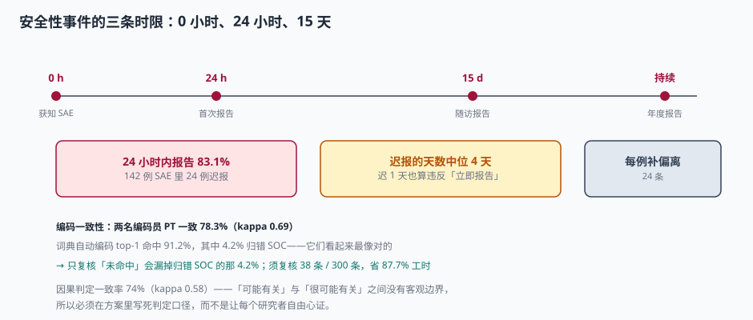

# 安全性事件与编码：SAE 报得晚，往往是因为没有「0 小时」

一个受试者在周四下午说「这两天有点胸闷」，研究者记了一笔，周五门诊忙完忘了，下周一想起来，补录进系统——**这条记录在数据上完全正常**：事件有起止日期、有严重程度、有处理措施、有转归。它唯一的问题是，如果这真是一起严重不良事件（Serious Adverse Event，SAE），从「获知」到「上报」已经过了 4 天。

临床试验的安全性报告有一条以小时计的时限。它不是行政要求，而是**保护其他正在用药的受试者**：一个未被及时上报的严重不良反应，可能正在另外二十个中心重复发生。

::: tip 一句话理解
安全性数据的核心不是「记全了没有」，而是**「从谁开始计时」**。没有明确的「0 小时」，后面所有的时限都无法判定合规。
:::

## 一、AE 与 SAE：严重（serious）不等于严重（severe）

这两个词在中文里长得一样，在规范里是两件事，混用会导致漏报：

| 概念 | 英文 | 判定依据 | 例子 |
| --- | --- | --- | --- |
| 严重程度 | severity（Grade 1~5） | CTCAE 分级，看**强度** | 3 级高血压（收缩压 ≥160） |
| 严重性 | seriousness | 看**结局**，六条标准任一命中 | 因高血压住院（命中「住院治疗」） |

六条严重性标准（任一命中即为 SAE）：导致死亡、危及生命、需要住院或延长住院、持续或显著的功能丧失、先天畸形/出生缺陷、其他重要医学事件。

本机口径：1,860 例次 AE（480 例受试者，人均 3.88 例次），其中 **142 例次（7.6%）** 判为 SAE。

::: danger 三个最常见的漏报
1. **「住院」被理解成「住了 ICU」**：为观察而住院 1 天也是住院，命中即 SAE。
2. **「危及生命」被理解成「差点死」**：只要事件发生时研究者认为有立即的生命危险，即命中，事后转归良好不改变判定。
3. **筛查期与随访后的 AE 不记**：签署知情后发生的所有 AE 都要记，包括筛败者在筛查期用药期间发生的事件。
:::

## 二、三条时限：0 小时、24 小时、15 天



| 时点 | 要求 | 依据 | 本机读数 |
| --- | --- | --- | --- |
| 0 h | 获知即记录，**记录时间 ≤ 获知时间 + 当日** | ALCOA+ 的「同时性」 | 无法事后验证，只能靠源文件时间 |
| 24 h | 致死或危及生命的 SAE，24 小时内报申办方 | 中国 GCP 2020 年第 57 号公告 | 118 / 142 = **83.1%** |
| 15 d | 其他 SAE，15 天内报申办方；随访报告同步 | ICH E2A + 中国 GCP | 24 例迟报，中位迟 4 天 |

142 例 SAE 里有 24 例（16.9%）超过 24 小时，中位迟 4 天、最长 10 天。迟报的代价不是罚款，是：

1. 每一例迟报都要开一条方案偏离记录（24 条）；
2. 申办方的 SUSAR 评估窗口被压缩——7 天/15 天的监管时限是从申办方获知起算，上游晚了，下游必然晚；
3. 稽查时「报告时限合规率 83.1%」会成为一个独立的发现项。

::: warning 「0 小时」必须写进系统
如果 eCRF 的 SAE 表单只有 `event_start_date`（事件开始日），没有 `awareness_datetime`（研究者获知时间），那 24 小时时限**在数据上无法判定**。

正确做法是 SAE 表单强制两个字段：`awareness_datetime`（获知）、`report_datetime`（上报），系统自动算差值并在超 24 小时时要求填写原因。缺 `awareness_datetime` 的记录，一律视为「无法证明合规」。
:::

## 三、编码：两个人编同一条 AE，只有 78.3% 一致

不良事件进入分析前必须编码到 MedDRA（Medical Dictionary for Regulatory Activities）的 PT（Preferred Term）和 SOC（System Organ Class）。编码是人工判断，所以有不一致性。

本机让两名编码员独立编码 300 条 AE：

| 指标 | 读数 | 含义 |
| --- | --- | --- |
| PT 完全一致 | 235 / 300 = 78.3% | 五条里有一条编到不同的词 |
| Cohen's κ | **0.69** | 中等偏好的—致性（>0.8 才算好） |
| 词典自动编码 top-1 命中 | 91.2% | 自动编码已相当可用 |
| 其中归错 SOC | 4.2% | 命中但归错系统，**看起来最像对的** |

关键在最后一行：自动编码的 91.2% 里，有 4.2% 是「词对了但系统归错」。如果复核策略是「只复核未命中的 8.8%」，这 4.2% 会全部漏掉。

| 复核策略 | 复核条数 | 漏掉的错 |
| --- | --- | --- |
| 全量复核 | 300 | 0（但工时最贵） |
| 只复核未命中 | 26 | 11 条归错 SOC |
| 未命中 + 归错 SOC 抽检 | **38** | 0（省 87.7% 工时） |

::: tip 自动编码的正确用法
把自动编码当成「起草」，不是「定稿」。复核范围 = 未命中 + 高风险词（SOC 边界模糊的词、多义词、含否定表述的词）。这样 300 条只需看 38 条，省 87.7% 工时，且不漏归错。

反过来，如果先按「历史高频词」抽样复核，会系统性漏掉**新出现的**不良事件——而那恰恰是最需要关注的。
:::

## 四、因果判定：κ = 0.58 的必然性

研究者要判断 AE 与试验药物的关系，通常五档：无关、可能无关、可能有关、很可能有关、肯定有关。

本机让研究者与申办方各自判定 300 条，一致率 74%，κ = **0.58**。这个数字不是「谁不专业」，而是**「可能有关」与「很可能有关」之间本来就没有客观边界**。

工程上的解法不是「加强培训」，而是**把判定规则写死成可操作的条件**：

| 档位 | 可操作判据（示例） |
| --- | --- |
| 肯定有关 | 有明确的药理机制 + 停药后消失 + 再用后重现 |
| 很可能有关 | 时间关系合理 + 停药后改善 + 无其他合理解释 |
| 可能有关 | 时间关系合理 + 有其他可能原因（如基础疾病） |
| 可能无关 | 时间关系不合理 + 有其他更可能的原因 |
| 无关 | 有明确证据表明由其他原因导致 |

判据写进方案后，κ 会上升，但更重要的是**判定结果可以复核**——稽查员能按同样的判据重判一遍。

## 五、数据模型：事件、报告、编码三张表

```sql
CREATE TABLE ae (
  ae_id             TEXT PRIMARY KEY,
  subject_no        TEXT NOT NULL,
  ae_term_verbatim  TEXT NOT NULL,          -- 研究者原话，永不覆盖
  start_date        TEXT NOT NULL,
  end_date          TEXT,
  severity_grade    INTEGER CHECK (severity_grade BETWEEN 1 AND 5),
  is_serious        INTEGER NOT NULL DEFAULT 0,
  seriousness_criteria TEXT,                 -- 六条标准，逗号分隔
  causality         TEXT NOT NULL CHECK (causality IN
                      ('UNRELATED','UNLIKELY','POSSIBLE','PROBABLE','DEFINITE')),
  action_taken      TEXT,
  outcome           TEXT,
  -- SAE 必填获知与上报时间
  awareness_datetime TEXT,
  report_datetime    TEXT,
  CHECK (is_serious = 0 OR (awareness_datetime IS NOT NULL AND report_datetime IS NOT NULL))
);

CREATE TABLE ae_coding (
  ae_id        TEXT NOT NULL REFERENCES ae(ae_id),
  meddra_ver   TEXT NOT NULL,               -- 词典版本，一试验一版本
  pt_code      TEXT NOT NULL,
  soc_code     TEXT NOT NULL,
  coded_by     TEXT NOT NULL,
  coded_at     TEXT NOT NULL,
  auto_coded   INTEGER NOT NULL DEFAULT 0,  -- 是否由词典自动起草
  reviewed     INTEGER NOT NULL DEFAULT 0,  -- 是否人工复核
  PRIMARY KEY (ae_id, meddra_ver)
);
```

两个设计点值得单独说：

1. **`ae_term_verbatim` 永不覆盖**：编码后的 PT 会变（词典升级），研究者原话不会变。原话是唯一可回溯的依据。
2. **`(ae_id, meddra_ver)` 复合主键**：允许同一事件在不同词典版本下有不同编码，升级时可对比、可回滚。

## 六、判据

本页判据族 `CTS-A` ~ `CTS-H`，共 8 条。八条都能被单独判定，任何一条不成立就不算这篇文档写完。

| 判据 | 验收点 | 不合格的表现 |
| --- | --- | --- |
| `CTS-A` | 严重性与严重程度分列存储 | 一个 `severity` 字段兼任两者 |
| `CTS-B` | SAE 强制 `awareness_datetime` 与 `report_datetime` | 只有事件日期，时限无法判定 |
| `CTS-C` | SAE 记录六条严重性标准的具体命中项 | 只有 `is_serious=1` |
| `CTS-D` | 编码保留 `ae_term_verbatim` 原话 | 覆盖为 PT，原话丢失 |
| `CTS-E` | 词典版本在试验内固定并留痕 | 中途升级导致同一事件两个 PT |
| `CTS-F` | 自动编码结果标记 `auto_coded` 与 `reviewed` | 自动结果直接当定稿 |
| `CTS-G` | 因果判定有可操作的判据文档 | 五档只有名称没有定义 |
| `CTS-H` | 筛败者与随访后 AE 有录入入口 | 筛败后系统无 AE 表单 |

## 七、验证方式

```shell
# 1) SAE 上报时限合规率
python3 -c "
sae=142; within=118
print('合规率 %.1f%%' % (within/sae*100), '迟报', sae-within, '例')
"
# 预期：合规率 83.1% 迟报 24 例

# 2) 编码一致性 kappa
python3 -c "
po=235/300; pe=0.31
print('一致率 %.1f%%' % (po*100), 'kappa', round((po-pe)/(1-pe),2))
"
# 预期：一致率 78.3% kappa 0.69

# 3) 自动编码复核范围
python3 -c "
n=300; top1=.912; wrong=.042
miss=int(n*(1-top1)); bad=int(n*top1*wrong)
print('未命中',miss,'归错',bad,'需复核',miss+bad,'省 %.1f%%' % ((1-(miss+bad)/n)*100))
"
# 预期：未命中 26 归错 11 需复核 38 省 87.7%

# 4) SAE 缺获知时间应被数据库拒绝
sqlite3 :memory: <<'SQL'
CREATE TABLE ae (ae_id TEXT PRIMARY KEY, is_serious INT,
  awareness_datetime TEXT, report_datetime TEXT,
  CHECK (is_serious = 0 OR (awareness_datetime IS NOT NULL AND report_datetime IS NOT NULL)));
INSERT INTO ae VALUES ('AE1', 1, NULL, '2026-11-05T10:00');
SQL
# 预期：Error: CHECK constraint failed —— 缺获知时间的 SAE 被拒
```

## 参考资料

- ICH E2A《Clinical Safety Data Management: Definitions and Standards for Expedited Reporting》（1994-10-27）：SAE 定义、7 天/15 天报告时限。
- ICH E2B(R3)《Electronic Transmission of Individual Case Safety Reports》（2014）：个案安全报告的数据元素（含 `awareness` 相关字段）。
- NMPA《药物临床试验质量管理规范》（2020 年第 57 号公告）第二十六条：致死或危及生命的 SAE 24 小时内报告，其他 SAE 15 天内报告。
- MedDRA 版本说明（MSSO）：PT/SOC 层级与每次版本升级的变更类型。
- CTCAE v5.0（2017-11-27）：1~5 级严重程度判定标准。
- 与本页相邻：[逻辑核查与单位](../EditCheck/index.md)、[盲态与揭盲](../BlindMaintenance/index.md)、[字段标准与主数据](../../../DB/DataGovernance/StandardsMasterData/index.md)。
